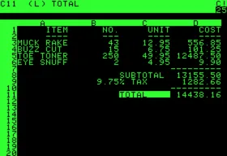
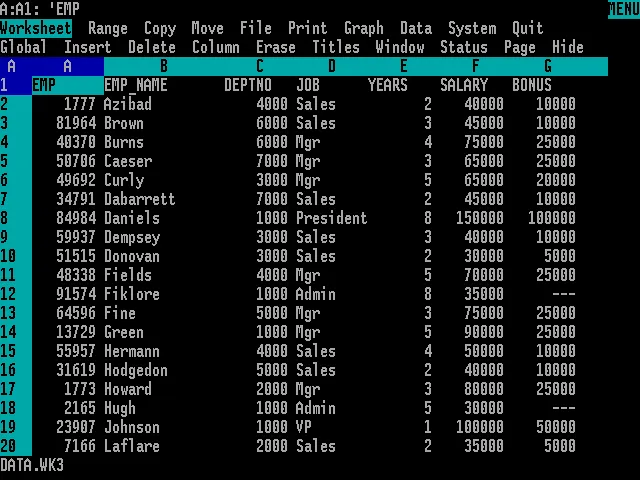
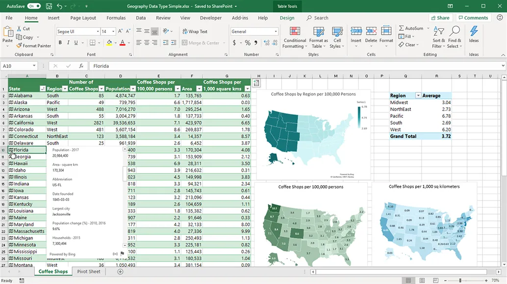

# Herramientas para el análisis. La reproducibilidad {#sec-herramientas}

::: callout-note
#### Objetivos de aprendizaje

Al terminar este capítulo, el alumno debe ser capaz de:

-   Identificar las principales herramientas disponibles para el análisis de datos industriales y explicar las razones por las que se eligen Python y R como herramientas principales en este libro.
-   Describir los usos habituales de la hoja de cálculo en el entorno industrial y reconocer sus limitaciones para el análisis reproducible.
-   Explicar el concepto de reproducibilidad y distinguirlo del de replicabilidad, y argumentar por qué es relevante en el análisis de datos industriales.
-   Comparar el uso de scripts frente al uso de hojas de cálculo desde el punto de vista de la transparencia, la trazabilidad y la reproducibilidad del análisis.

Los conceptos clave introducidos en este capítulo son: **hoja de cálculo**, **lenguaje de programación**, **script**, **reproducibilidad**, **replicabilidad**, **flujo de trabajo reproducible**, **datos rectangulares**.
:::

## Introducción

En el capítulo anterior vimos que el análisis de datos industriales requiere rigor metodológico y datos de calidad. En este capítulo abordamos las herramientas con las que vamos a trabajar a lo largo del libro: la hoja de cálculo Microsoft Excel y los lenguajes de programación **Python** y **R**. Veremos también por qué la elección de la herramienta no es indiferente cuando se trata de garantizar que un análisis sea verificable y reproducible, un requisito cada vez más exigido tanto en el ámbito industrial como en el académico.

## La hoja de cálculo

La hoja de cálculo es una herramienta presente hoy en todos los ámbitos de trabajo y educativos. Desde la aparición de [VisiCalc](https://es.wikipedia.org/wiki/VisiCalc) en 1979, ha contribuido a la gestión de miles de empresas y se ha utilizado de manera general en el análisis de datos. En la década de los años 80, [Lotus 1-2-3](https://es.wikipedia.org/wiki/Lotus_1-2-3) fue la aplicación más utilizada en los ordenadores IBM-PC y compatibles; con la llegada de Microsoft Windows, Microsoft Excel desplazó a Lotus 1-2-3 y se convirtió en la hoja de cálculo dominante, posición que mantiene hasta hoy.

### Usos de la hoja de cálculo en el análisis industrial

La hoja de cálculo es especialmente útil para:

-   La introducción, edición y almacenamiento de datos.
-   El filtrado y la corrección de errores básicos.
-   La manipulación de datos mediante tablas dinámicas.
-   La preparación de gráficos para la presentación de resultados.

En este libro trabajaremos exclusivamente con lo que llamaremos **datos rectangulares**: grupos de valores asociados a una o más variables y a varias observaciones, organizados en tablas. Es la forma más habitual de almacenar datos industriales, y la base del principio de los **datos arreglados** (*tidy data*) que se desarrolla en el capítulo siguiente.

La tendencia actual en la industria es recoger los datos de forma automática o mediante sistemas informatizados, lo que elimina el papel y reduce los errores de transcripción. En todos los casos, es imprescindible que los sistemas de información puedan exportar sus datos a ficheros de texto plano o CSV, de modo que puedan importarse tanto en Excel como en Python o R.

### Limitaciones de la hoja de cálculo

A pesar de su utilidad y su enorme difusión, la hoja de cálculo presenta limitaciones importantes cuando se usa como herramienta principal de análisis:

-   Los cálculos se realizan mediante fórmulas embebidas en las celdas, que son difíciles de rastrear y verificar por terceros, lo que compromete la transparencia del análisis.
-   Los gráficos disponibles son relativamente limitados en comparación con los que ofrecen los lenguajes de programación.
-   No está diseñada específicamente para el análisis estadístico.
-   La falta de transparencia dificulta la auditoría de los análisis, un requisito cada vez más frecuente en entornos de calidad certificada.

Estas limitaciones no son exclusivamente de orden práctico. Broman y Woo [-@broman2018] documentaron que las hojas de cálculo, pese a ser herramientas adecuadas para la entrada y el almacenamiento de datos, lo son menos para el análisis cuando se exige reproducibilidad. Recuerdan además que el propio software puede introducir errores silenciosos, como la conversión automática de identificadores a fechas, que el analista no detecta. A ello se suma que las operaciones realizadas mediante clics y fórmulas embebidas no dejan un registro verificable de los pasos seguidos. Un caso muy citado es el error de fórmula en la hoja de cálculo de un influyente estudio económico de Reinhart y Rogoff [@ryssdal2013;@krugman2013;@garicano2013;@ferrero2018].

Por ello, Broman y Woo recomiendan reservar la hoja de cálculo para la entrada y el almacenamiento de datos, y realizar el análisis y la visualización por separado mediante herramientas basadas en scripts.

Siguiendo esta recomendación, en este libro usaremos Excel principalmente para el almacenamiento de datos y el análisis básico, y Python o R para el análisis gráfico y estadístico más detallado.

## Python y R: las herramientas principales

**Python** es uno de los lenguajes de programación más utilizados y el de referencia en inteligencia artificial y ciencia de datos. Para el análisis de datos industriales ofrece una combinación de simplicidad, potencia y un ecosistema de bibliotecas muy completo:

-   `pandas` para la manipulación de datos tabulares: registros de producción, análisis de lotes, control de calidad.
-   `matplotlib` y `seaborn` para la generación de gráficos de alta calidad: tendencias, distribuciones, correlaciones.
-   `numpy` para cálculos numéricos precisos sobre arrays de datos.

**R** está muy extendido en la investigación estadística y en el análisis de datos, y algunos lo consideran la herramienta de referencia en campos como las ciencias de la salud o la biología. Dispone de algunas de las bibliotecas gráficas más potentes disponibles (en particular `ggplot2`) y cubre toda la gama de métodos estadísticos, desde la estadística descriptiva básica hasta los modelos más avanzados.

Ambos lenguajes son **gratuitos y de código abierto**, cuentan con comunidades de usuarios enormes y están respaldados por una documentación extensa. A lo largo del libro, los ejemplos de código se presentan en pestañas alternativas Python/R, de modo que el lector puede seguir el lenguaje de su elección.

## Otras herramientas del ecosistema

Más allá de Python, R y Excel, existen otras herramientas relevantes en el análisis de datos y la estadística industrial que conviene conocer, aunque no se desarrollen en este libro.

**Matlab** es un entorno de cálculo numérico muy potente, ampliamente utilizado en ingeniería y en aplicaciones científicas que requieren alto rendimiento computacional. Su sintaxis está orientada al álgebra matricial y es especialmente adecuado para simulación, procesamiento de señales y control de sistemas. Su principal limitación para nuestros objetivos es su coste elevado: se trata de software propietario con licencias de precio significativo.

**Minitab** es un software estadístico diseñado específicamente para la calidad industrial y la mejora de procesos. Es muy utilizado en entornos *Six Sigma* y en certificaciones de calidad por su facilidad de uso y sus herramientas específicas para el control estadístico de procesos. Como Matlab, es software propietario y su coste puede ser un obstáculo para su uso en formación.

**Julia** es un lenguaje de programación más reciente, diseñado para el cálculo numérico de alto rendimiento. Ofrece velocidades comparables a lenguajes compilados como C, con una sintaxis cercana a Python y R. Está ganando popularidad en la comunidad científica, especialmente en aplicaciones donde el rendimiento computacional es crítico. Sin embargo, su ecosistema para el análisis de datos es todavía menos maduro que el de Python y R, y su uso en formación es aún limitado.

**Google Sheets** y **LibreOffice Calc** son alternativas gratuitas a Microsoft Excel, casi totalmente compatibles, que pueden usarse cuando no se dispone de licencia de Office.

La elección de Python y R como herramientas principales de este libro responde, por tanto, a tres criterios combinados: son gratuitas y de código abierto, tienen el ecosistema más rico y maduro para el análisis de datos y la estadística, y son las que mejor responden al requisito de reproducibilidad que se desarrolla en la sección siguiente.

## El concepto de reproducibilidad

La **reproducibilidad** de un análisis o experimento es la capacidad de obtener los mismos resultados al repetirlo utilizando los mismos datos, la misma metodología y, en su caso, el mismo código informático. En otras palabras, un análisis es reproducible cuando otra persona, o el propio autor en un momento posterior, puede verificar los resultados y llegar a las mismas conclusiones partiendo de los datos originales.

Conviene distinguir la **reproducibilidad** de un concepto relacionado pero diferente: la **replicabilidad**, que se refiere a la capacidad de obtener resultados consistentes al replicar un estudio con un conjunto *distinto* de datos, pero obtenidos siguiendo el mismo diseño. La replicabilidad responde a la pregunta "¿se confirman estos resultados con nuevos datos?"; la reproducibilidad responde a "¿puede otra persona verificar este análisis con los mismos datos?".

El uso de estos dos términos no es uniforme en todas las disciplinas; en este libro seguimos las definiciones del informe de las Academias Nacionales de Ciencias de EE. UU. [@nasem2019].

El químico irlandés **Robert Boyle**, en el siglo XVII, fue uno de los primeros en subrayar la importancia de la replicabilidad en la ciencia, es decir, de que los mismos experimentos pudieran ser replicados por otros. Sostenía que el conocimiento científico debía basarse en hechos experimentales que pudieran volverse creíbles para la comunidad científica precisamente por ser replicables. La bomba de aire de Boyle dio lugar a una de las primeras disputas documentadas sobre la replicación de un fenómeno científico.

### La crisis de reproducibilidad

En las últimas décadas ha crecido la preocupación por la falta de reproducibilidad en resultados científicos publicados. Muchos estudios no pueden reproducirse porque los datos originales no están disponibles, el código de análisis no se ha conservado o documentado, o los procedimientos no se describen con suficiente detalle. Esta situación, conocida como **crisis de reproducibilidad**, afecta a disciplinas tan diversas como la psicología, la biomedicina o la economía, y ha llevado a un cambio en las exigencias de publicación y auditoría en muchos campos.

La magnitud del problema ha quedado cuantificada recientemente de forma sistemática. En 2026, la revista Nature publicó cuatro artículos que evalúan la reproducibilidad, la replicabilidad y la robustez de la investigación en ciencias sociales y del comportamiento, a partir de la base de datos del programa SCORE [@nature2026editorial]: aproximadamente la mitad de los efectos estudiados no se confirmaron al replicar los estudios, y los que sí lo hicieron mostraron efectos considerablemente más débiles que los originales. Aunque estos estudios se centran en la investigación académica, el principio que ilustran es directamente transferible al entorno industrial: un análisis que no puede verificarse ni auditarse introduce un riesgo oculto en cualquier decisión que se base en él.

### Reproducibilidad en metrología

En metrología, el término tiene un significado más específico: la **reproducibilidad** es la precisión de las medidas obtenidas en condiciones que cambian (distintos lugares, operadores o sistemas de medida) sobre el mismo objeto o sobre objetos similares [@jcgm2012vim, 2.24–2.25]. Se distingue de la **repetibilidad**, que es la precisión obtenida en las mismas condiciones. Ambas acepciones se desarrollan en el capítulo dedicado al análisis del sistema de medición.

## Scripts frente a hoja de cálculo: ventajas para la reproducibilidad

La diferencia fundamental entre trabajar con scripts y trabajar con hojas de cálculo, desde el punto de vista de la reproducibilidad, es la **transparencia**. En un script, cada operación realizada sobre los datos está escrita de forma explícita y secuencial: cualquier persona que lea el código puede seguir exactamente qué se ha hecho, en qué orden y con qué parámetros. En una hoja de cálculo, las operaciones están embebidas en fórmulas dispersas por las celdas, a menudo sin documentación, y el flujo del análisis no es visible de forma directa.

Las ventajas concretas de los scripts para la reproducibilidad son:

-   **Trazabilidad completa**: el código documenta cada paso del análisis, desde la carga de los datos hasta la generación de los gráficos y los resultados finales.
-   **Verificabilidad**: cualquier persona con acceso al código y a los datos originales puede reproducir el análisis y comprobar los resultados.
-   **Reutilización**: un script bien documentado puede adaptarse fácilmente a nuevos conjuntos de datos o a variaciones del análisis.
-   **Control de versiones**: el código puede gestionarse con herramientas como Git, que registran el historial completo de cambios realizados sobre los archivos, permiten recuperar versiones anteriores y facilitan la colaboración entre varios analistas sin riesgo de sobrescribir el trabajo ajeno. Git es una herramienta cada vez más presente en entornos industriales y técnicos, y su conocimiento es un valor añadido en cualquier perfil profesional orientado a los datos.

Conviene distinguir dos formas de trabajar con scripts. El **análisis interactivo**, en entornos como Google Colab o RStudio, es exploratorio y provisional: el analista prueba, ajusta y descarta opciones hasta encontrar el enfoque adecuado. El **informe automatizado** es el resultado final documentado: combina en un único documento el código, los comentarios del autor y los resultados del análisis, generado de forma reproducible cada vez que se ejecuta. Herramientas como [Quarto](https://quarto.org/) o [Google Colab](https://colab.research.google.com/) permiten producir este tipo de documentos en Python o R, lo que facilita tanto la auditoría del análisis como su presentación y comunicación. La combinación de scripts bien documentados y datos correctamente organizados constituye la base de un **flujo de trabajo reproducible**, concepto que se desarrolla en detalle en el capítulo siguiente.

::: callout-important
Utilizar código en lugar de clics de ratón no es solo una cuestión de eficiencia: es la forma más fiable de garantizar que un análisis sea transparente, verificable y reproducible.
:::

## Resumen del capítulo

Este capítulo ha presentado las herramientas de análisis que se utilizarán a lo largo del libro y ha introducido el concepto de reproducibilidad como criterio fundamental para elegir entre ellas.

La **hoja de cálculo** (principalmente Microsoft Excel) es la herramienta dominante en la empresa y resulta muy útil para el almacenamiento, la edición y el análisis básico de datos. Sin embargo, sus limitaciones en transparencia y trazabilidad la hacen insuficiente como herramienta única de análisis cuando se requiere rigor y verificabilidad.

**Python** y **R** son los lenguajes de programación elegidos como herramientas principales: gratuitos, de código abierto, con ecosistemas maduros para el análisis de datos y la estadística, y con una comunidad de usuarios amplia y activa. Otras herramientas, como Matlab, Minitab o Julia, tienen sus nichos de aplicación, pero su coste o su menor madurez las hacen menos adecuadas para los objetivos de este libro.

La **reproducibilidad** es la capacidad de verificar y repetir un análisis utilizando los mismos datos y el mismo código. Es un requisito cada vez más exigido en la industria y en la investigación, y ha cobrado relevancia ante la llamada crisis de reproducibilidad que afecta a múltiples disciplinas. La **replicabilidad**, concepto relacionado, se refiere en cambio a la consistencia de los resultados al usar nuevos datos con el mismo diseño.

Los **scripts** ofrecen ventajas decisivas frente a la hoja de cálculo en reproducibilidad: documentan cada paso del análisis, son verificables por terceros y pueden reutilizarse y gestionarse con herramientas de control de versiones. Los **informes automatizados** con Quarto o Colab llevan este principio un paso más allá, integrando código, comentarios y resultados en un único documento auditable. La combinación de ambos, sobre datos bien organizados, constituye la base de un flujo de trabajo reproducible, concepto que se desarrolla en el capítulo siguiente.