```{r}
#| include: false
library(reticulate)
use_python("C:/ProgramData/miniconda3/python.exe", required = TRUE)
```

# Medidas centrales y medidas de dispersión: la media y la varianza.

::: callout-note
## Objetivos de aprendizaje

Al finalizar este capítulo, el alumno será capaz de:

-   Calcular la media aritmética de un conjunto de datos e interpretar su significado como valor central de la distribución.
-   Explicar por qué la media por sí sola es insuficiente para describir un conjunto de datos, mediante ejemplos con la misma media y distribuciones distintas.
-   Deducir el concepto de varianza a partir del problema de las diferencias que se anulan, y relacionarlo con la fórmula de la distancia entre dos puntos.
-   Calcular la varianza y la desviación típica de un conjunto de datos en Excel, e interpretar su significado como medida de dispersión.
-   Distinguir entre estadísticos paramétricos (media, desviación típica) y no paramétricos (mediana, rango intercuartil), e identificar en qué condiciones es más adecuado el uso de cada uno.
-   Reconocer la influencia de los valores atípicos sobre la media y la desviación típica, y relacionar este comportamiento con la elección del estadístico más apropiado.
-   Relacionar los estadísticos paramétricos con la distribución normal y los no paramétricos con el diagrama de caja estudiado en el capítulo anterior.

Conceptos clave: **media aritmética, valor central, dispersión, varianza, desviación típica, estadístico paramétrico, estadístico no paramétrico, mediana, rango intercuartil, valor atípico (outlier), distribución normal, campana de Gauss, robustez**
:::

## Introducción

Al estudiar el diagrama de caja (*boxplot*) hemos visto que este gráfico se describe mediante los **cinco números**, que son:

-   mínimo y máximo,
-   primer y tercer cuartil (25% y 75%), y
-   segundo cuartil (50%).

De estos valores, el segundo cuartil, que se corresponde con la mitad de los valores, representa una estimación del centro de la distribución, y por eso lo llamamos **mediana**. La distancia entre el primer y tercer cuartil es lo que se conoce como **rango intercuartil** (se suele representar por sus siglas en inglés, **IQR**), y nos da una indicación de la **dispersión**: cuanto mayor es la dispersión de nuestros valores, más alejados estarán del centro, y por lo tanto habrá mayor distancia entre el primer y el tercer cuartil.

Una de las mayores ventajas de la mediana y del rango intercuartil es que son estadísticos robustos, es decir, tienen una alta robustez a los valores atípicos. Como en el cálculo del rango intercuartil no se tienen en cuenta los valores extremos, su valor variará muy poco si aparecen nuevas observaciones atípicas (outliers). Como no presuponen ninguna forma conreta de distribución de los datos, a estos estadísticos se los conoce como **no paramétricos**.

Existen otros estadísticos, llamados **paramétricos**, que, en determinadas condiciones, tienen ventajas frente a los no paramétricos. Los principales son la **media aritmética**, o simplemente, **media**, y la **varianza**.

## Recursos utilizados

En este ejercicio usaremos diversos datos y gráficas realizados en Excel. Para facilitar el análisis, puede descargarse esta hoja Excel, con muchas tablas y gráficos, en el enlace a continuación.

[Descargar hoja Excel](https://raw.githubusercontent.com/juanriera/master-queseria/master/datos/dibujos_varianza.xlsx)

## La media aritmética: un ejemplo de cálculo.

### Definición

La media aritmética de un conjunto de valores es el valor central que se obtiene al dividir la suma de todos los valores por la cantidad de valores. Es una medida de tendencia central que proporciona un punto de referencia para el conjunto de datos.

### Deducción de la fórmula:

Supongamos que tenemos un conjunto de $n$ valores numéricos: $x_1, x_2, x_3, \ldots, x_n$.

1.  **Suma de todos los valores**: Primero, sumamos todos los valores del conjunto. Matemáticamente, esto se expresa como:

    $$
    S = x_1 + x_2 + x_3 + \cdots + x_n
    $$

2.  **Cantidad de valores**: Luego, contamos cuántos valores hay en el conjunto. Este número es $n$.

3.  **División de la suma por la cantidad de valores**: Finalmente, dividimos la suma total $S$ por la cantidad de valores $n$ para obtener la media aritmética:

    $$
    \text{Media Aritmética} = \frac{S}{n}
    $$

4.  **Expresión general**: Sustituyendo la suma $S$ en la fórmula, tenemos:

    $$
    \text{Media Aritmética} = \frac{x_1 + x_2 + x_3 + \cdots + x_n}{n}
    $$

### Ejemplo:

Supongamos que tenemos los siguientes valores: $5, 7, 9$.

1.  **Suma de los Valores**: 
$$
    S = 5 + 7 + 9 = 21
$$

2.  **Cantidad de Valores**: 
$$
    n = 3
$$

3.  **Cálculo de la Media Aritmética**: 
$$
    \text{Media Aritmética} = \frac{21}{3} = 7
$$

Entonces, la media aritmética de los valores $5, 7, 9$ es $7$.

La media de una muestra se representa habitualmente mediante el símbolo

$$
\bar{x}
$$ 

y, de una manera más formal, su valor se obtiene mediante la fórmula siguiente:

$$
{\bar{x}={\frac {1}{n}}\sum _{i=1}^{n}x_{i}}
$$

El signo $\sum$ se conoce como *sumatorio*, e indica que ese término consiste en la suma de los $x$ valores desde el primero hasta el valor $n$. Expresado mediante una formulación matemática,

$$
{\bar{x}={\frac {1}{n}}\sum _{i=1}^{n}x_{i}={\frac {x_{1}+x_{2}+\cdots +x_{n}}{n}}}
$$ 

lo que quiere decir: *"la suma de todos los valores observados dividido entre el número de estos valores"*.

La **media** es lo que conocemos como un *valor central*, ya que representa el centro de nuestro conjunto de números. Como es el centro de nuestro conjunto de datos, la suma de las diferencias de todos los valores respecto este valor central (que podemos considerar "distancias con signo") es $cero$. Más adelante veremos la importancia de este hecho, al hablar de la dispersión y las formas de cálculo de la misma. Como hemos visto, la media de una **muestra** se representa como $\bar{x}$, mientras que la media de una **población** se representa con la letra griega *mu*: $\mu$. En ambos casos, el cálculo se realiza de forma idéntica.

Volvamos a nuestro ejemplo de la altura de un grupo de alumnos, para realizar los cálculos según el modelo que hemos descrito. En nuestro caso, la *altura media* de nuestros alumnos (la *media* de nuestro conjunto de números) se calcula como:

$$
\bar{x} = \frac{153+135+140+140+175+138+145+154+152+159+154}{11} = 149,545 \approx 149,55
$$

 Utilicemos una hoja de cálculo para guardar nuestros valores.

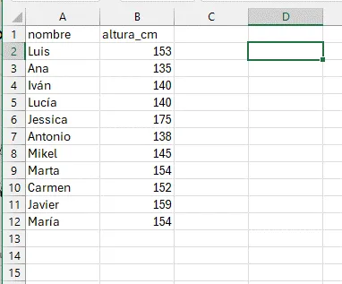

La fórmula para obtener la media en la hoja de cálculo, por ejemplo en la versión en español de *Microsoft Excel*, es `=PROMEDIO(...)`, donde los puntos suspensivos deben sustituirse por el rango a calcular. En nuestro ejemplo, introduciríamos la fórmula en la celda `B13`como `=PROMEDIO(B2:B12)` (Para más detalles, verificar la hoja Excel adjunta).

Para representar más cómodamente nuestros valores, dibujamos un punto a la altura de cada alumno,

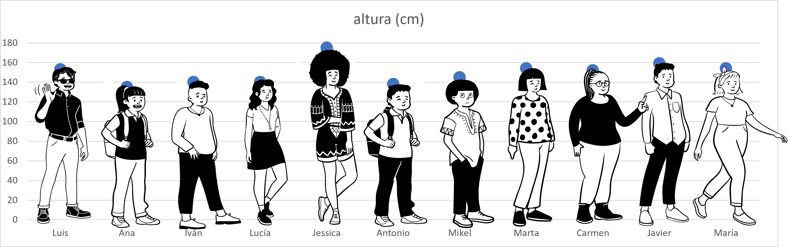

y eliminamos del gráfico los dibujos de nuestros alumnos; así hemos convertido nuestro dibujo en un *diagrama de puntos*:

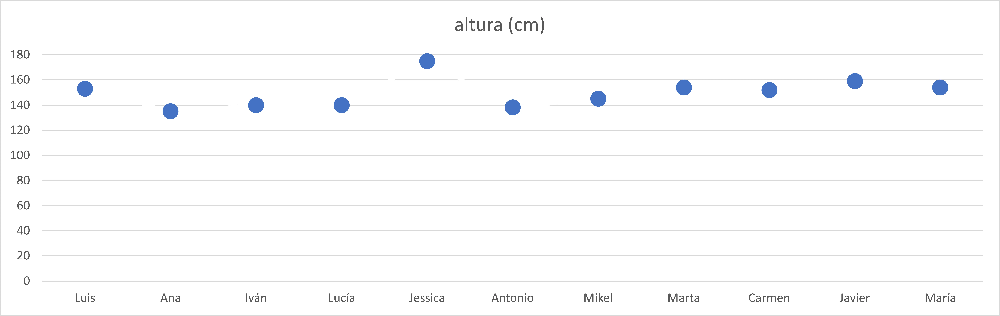

Para representar la media, aunque la media es un valor único, necesitamos añadir una columna a la derecha de nuestros datos, que rotulamos en la fila 1, celda C como `altura media`, e introducimos en cada una de las celdas desde `C2`hasta `C12`la fórmula del promedio, con el valor de nuestro rango de datos (Verificar hoja de cálculo). A continuación, designamos nuestro rango de datos para hacer un gráfico de puntos, y hacemos un *zoom* en los valores de manera que el eje Y se escale mejor entre los valores mínimo y máximo. Por último, hacemos unos ajustes en el formato para dibujar las líneas verticales que nos representan la distancia de cada valor a la media.

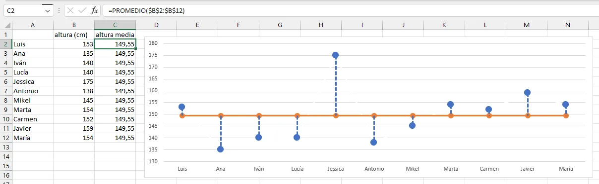

Si verificamos el eje $Y$ , veremos que en este gráfico hemos ajustado la escala respecto al gráfico anterior, situando el mínimo en $130$. Esto permite visualizar las diferencias con mucha más claridad. Hemos representado la media $\bar{x}$ como una línea, y hemos dibujado unas líneas que unen cada valor individual con la media, que se sitúa en el valor $149,55$, tal como calculamos más arriba.

Hemos representado la media como una serie de puntos unidos por una línea amarilla. Representamos en azul nuestros valores, uniendo cada valor con la línea media mediante una línea de puntos vertical. A partir de ahora, por conveniencia, eliminaremos los puntos en la linea media, dejando solo la línea.

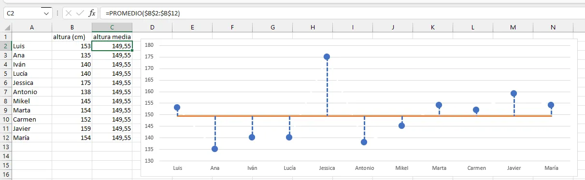

Esta línea azul de puntos representa la *distancia* de cada valor a la media. Usaremos esta distancia para calcular una **distancia media**, que será una medida de la dispersión de nuestros valores.

Hemos visto que para describir un conjunto de números, en nuestro ejemplo, las medidas de la altura de un grupo de estudiantes, existe un valor, la *media* de este conjunto, que nos describe el centro de los valores. En nuestro ejemplo, si todos los alumnos tuviesen la misma altura, esta sería de $149,55{\ }cm$.

¿Es suficiente con este valor para describir el conjunto de valores? Vamos a ver que no: diferentes conjuntos de valores pueden proporcionar el mismo *valor medio*, y sin embargo los grupos pueden ser muy diferentes.

Veamos un caso extremo. Comparemos dos grupos, uno formado por individuos iguales y otro formado por diez individuos iguales y uno distinto. Para ello usaremos nuestra hoja de cálculo:

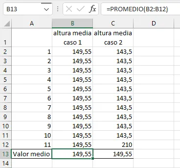{.column-margin}

¿Podemos describir adecuadamente los valores de la altura de cada uno de los grupos utilizando el valor medio? Parece evidente que no, ya que a partir de diferentes valores de altura estamos obteniendo el mismo valor medio. Sin embargo, uno de los grupos *es más alto* que el otro, si no fuera por un solo individuo que aparentemente distorsiona el cálculo. Podríamos incluir nuestro grupo original, y veremos que los tres grupos son diferentes, aunque su valor medio es idéntico.

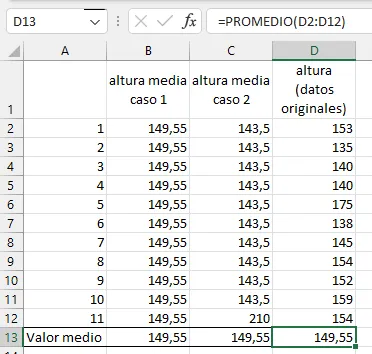{.column-margin}

Si nos ayudamos de un gráfico equivalente al que hemos utilizado antes, vemos estas diferencias con claridad:

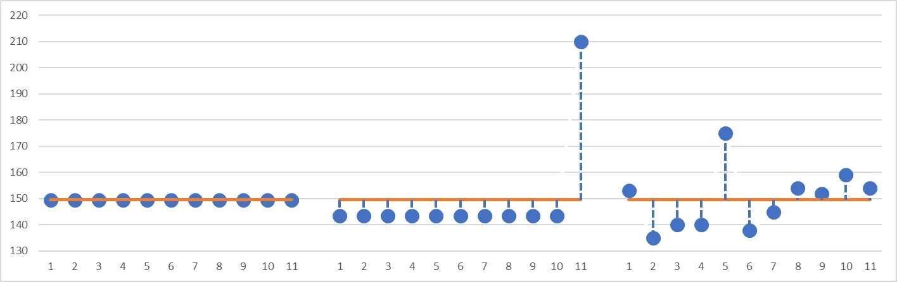

Aunque el valor medio de estos tres grupos de datos es idéntico, parece claro que los tres grupos son muy distintos en su composición, y por lo tanto la *media* no es suficiente para describir con suficiente precisión cada uno de los grupos. Necesitamos un valor adicional, que nos indique de qué forma los valores se alejan del valor medio. Para ello, vamos a introducir un concepto nuevo: la *medida de la dispersión*.

## Las medidas de dispersión: la varianza y la desviación típica

Como hemos visto en el apartado anterior, diferentes conjuntos de datos pueden tener el mismo valor medio y sin embargo ser muy diferentes. En la última gráfica que hemos visto, el primer grupo se caracteriza por tener todos sus valores idénticos; el segundo tiene todos sus valores idénticos menos uno, que está muy apartado del resto, y el tercero tiene todos sus valores diferentes.

Ahora que conocemos cómo calcular un valor resumen de un conjunto de datos, podríamos utilizar una medida semejante para describir de qué forma en cada caso los valores se separan de la media. Podríamos utilizar una *distancia media*: calculamos las diferencias entre cada valor y la media, y hacemos su promedio: esto debería darnos una indicación de la magnitud de la separación de los valores en cada uno de los tres grupos.

Usemos la hoja de cálculo para ello:

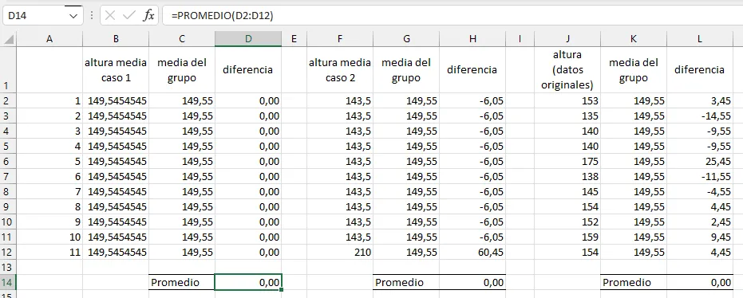

Algo parece que no está funcionando aquí: el promedio de las diferencias es cero en los tres casos; no podemos usar este cálculo para calcular la dispersión. Pero esto es esperable: ya que la media es un valor central, como hemos visto antes, la suma de las diferencias de todos los valores respecto de su media debe ser forzosamente cero, y esto es lo que estamos obteniendo.

Para encontrar una solución, vamos a recurrir al viejo teorema de Pitágoras, que si recuerdas, nos dice que, en un triángulo rectángulo, el cuadrado de la hipotenusa es igual a la suma de los cuadrados de los catetos: 

$$
h^2= a^2+b^2
$$

Esta fórmula es la base del cálculo de la distancia entre dos puntos:

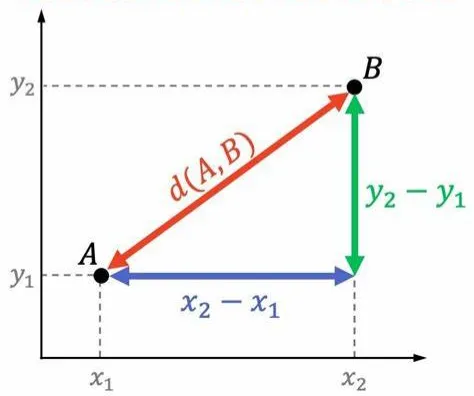{.column-margin}

$$
d(A,B)=\sqrt{(x_2-x_1)^2+(y_2-y_1)^2}
$$

Podemos adaptar esta fórmula al cálculo de nuestra distancia media. Como estamos calculando la distancia en una dimensión, solo necesitamos la coordenada $X$. Si tenemos en cuenta un solo punto, esta distancia $d$ sería:

$$
(d{\ }del{\ }valor{\ }1{\ }a{\ }la{\ }media)^2=(x_1-\bar{x})^2
$$

¡El hecho de elevar al cuadrado las diferencias nos da la solución! Las diferencias negativas ya no son un problema porque sabemos que al elevar un numero negativo al cuadrado, el resultado es positivo; de esta manera conseguimos que las diferencias no se anulen.

::: callout-note
Esta analogía con la distancia geométrica nos ayuda a entender por qué se eleva al cuadrado, aunque la justificación formal de la varianza tiene un desarrollo matemático más preciso que va más allá del alcance de este libro.
:::

Ahora sí podemos calcular una distancia cuadrática media $\bar{d}$ entre el conjunto de puntos y su media, calculando el promedio de las diferencias elevadas al cuadrado: 
$$
(\bar{d}{\ }de{\ }los{\ }n{\ }valores{\ }a{\ }la{\ }media)^2=\frac{(x_1-\bar{x})^2 + (x_2-\bar{x})^2+\cdots+(x_n-\bar{x})^2}{n}
$$

y utilizando la notación que hemos aprendido antes,

$$
(\bar{d}{\ }de{\ }los{\ }n{\ }valores{\ }a{\ }la{\ }media)^2={\frac {1}{n}}\sum _{i=1}^{n}(x_{i}-\bar{x})^2
$$

Al igual que en el cálculo de la distancia entre dos puntos, para volver alas uniddaes originales solo tenemos que extraer la raíz cuadrada de este valor para obtener la distancia cuadrática media, que es el parámetro que estábamos buscando.

Este promedio de las distancias al cuadrado $$(\bar{d}{\ }de{\ }los{\ }n{\ }valores{\ }a{\ }la{\ }media)^2$$ se conoce en estadística como **varianza**, y su raíz cuadrada es lo que se conoce como **desviación típica**. La varianza de una población se representa en estadística con el signo de la letra griega *sigma* minúscula elevada al cuadrado, $\sigma^2$, y la desviación típica, mediante la letra $\sigma$. En el caso de una muestra, la varianza se representa como $s_x^2$, y la desviación típica, como $s_x$.

Es importante resaltar que la desviación típica *es una medida de la distancia de los valores de una población a su media*. No es exactamente una distancia media, ya que al elevar al cuadrado damos más peso a las distancias grandes; podemos llamarla *distancia típica*. Tiene dimensión, con las mismas unidades que las medidas originales. La varianza, al estar elevada al cuadrado, tiene como unidades el cuadrado de las unidades originales (en el ejemplo, $cm^2$).

Con estos nuevos hallazgos, recalculamos nuestra hoja de cálculo:

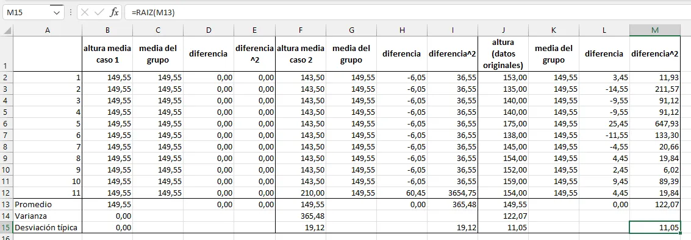

Vamos a analizar con detalle esta tabla.

En la columna `J` tenemos nuestra población original de 11 alumnos, con las alturas que hemos medido. En la columna `B` hemos supuesto que todos los alumnos fuesen iguales, con la misma altura del valor medio de los datos originales. En la columna `F` hemos simulado otro grupo, con todos los valores iguales excepto uno, y con la misma media que los otros dos grupos.

A la derecha de cada columna de medias, tenemos la columna de diferencias (columnas `D`, `H` y `L`), y en la fila `13`, nuestro primer intento de calcular una dispersión media; intento fallido, puesto que obteníamos el valor $0$ para los tres grupos.

En la siguiente columna a la derecha, para los tres grupos (columnas `E`, `I`y `M`), hemos elevado al cuadrado la distancia de cada valor a la media, siguiendo los hallazgos que nos ha proporcionado el teorema de Pitágoras y la fórmula de la distancia entre dos puntos. En la fila `13` de estas columnas, calculamos el promedio de la distancia a la media al cuadrado: esta vez el resultado ya no es cero, sino que obtenemos el valor de la **varianza**, de acuerdo con la fórmula que hemos deducido más arriba. En la fila `14` (columnas B, `F` y `J`)utilizamos la fórmula de la hoja de cálculo para la **varianza poblacional** (más detalles posteriormente), y vemos que coincide exactamente con el promedio de las diferencias al cuadrado, tal como debe ser, ya que en eso consiste la fórmula que hemos deducido.

Por último, en la fila `15`calculamos la desviación típica de ambas formas, con la fórmula de la hoja de cálculo para la **desviación típica poblacional** (columnas `B`, `F`y `J`), que Excel llama **desviación estándar**, y como la raíz cuadrada del promedio calculado antes (columnas `E`, `I`y `M`). De nuevo, ambos valores coinciden exactamente, como esperamos.

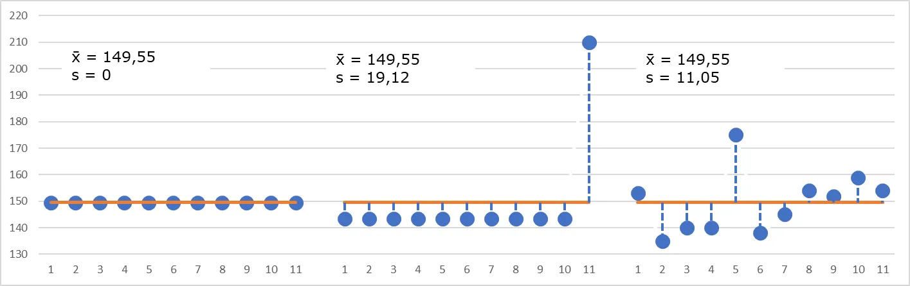

Ahora sí tenemos una forma más completa de describir nuestro conjunto de valores. Aunque el valor medio es el mismo en los tres casos, la *dispersión* de los valores es muy distinta.

¿Son suficientes estos dos parámetros que hemos calculado para describir un conjunto de datos? La respuesta a esta pregunta es sí y no. La explicación es que, más allá de los valores numéricos que hemos obtenido, la visualización gráfica de los valores nos debe hacer reflexionar.

En el primer grupo, todos los valores son iguales a la media. La variación es cero. Son valores que hemos simulado en nuestra hoja de cálculo, pero difícilmente en el mundo real encontraremos una población en la que todos sus valores, en este caso, la altura de un grupo de alumnos, sean idénticos.

En el segundo grupo, todos los valores son idénticos, salvo uno, que se distancia mucho. ¿Debemos aceptar esto como bueno? En realidad, ¿es cierto que el valor medio de este grupo sea el mismo que el del primero? Para responder a esta pregunta debemos recurrir a nuestra experiencia, la estadística no nos da *fórmulas mágicas*. Pero, con un poco de sentido común, parece que el caso extremo que aparece en este grupo no es coherente con el resto de valores. Es lo que se llama un *valor atípico* o *extraño* (en inglés, *outlier*), y debe hacernos reflexionar sobre si el valor es correcto y realmente pertenece a esta población, o es un error de medida. O, simplemente, un valor que corresponde a otro grupo y que por error hemos situado en este. La decisión de eliminar o no un valor atípico es una de las decisiones más complejas en estadística, que pueden tener una influencia enorme en la interpretación de los datos, y por lo tanto, hay que hacer con sumo cuidado. En este caso, extremo y artificial, el valor atípico debería ser eliminado, ya que, en realidad, todos los valores restantes son idénticos y más bajos que los del grupo 1. No tiene sentido lógico decir que sus medias son idénticas.

En el tercer grupo todos los valores son diferentes, y no podemos decir nada especial sobre sus valores individuales. Hay un valor que se destaca del resto, pero ¿podemos afirmar que es atípico? Seguramente, no con seguridad. De nuevo la experiencia debe indicarnos cómo proceder, aunque en este caso no tendría sentido eliminar este valor. En la situación real, todos conocemos a niños que han *pegado el estirón* antes que sus compañeros, y en algunos casos, pueden llegar a ser mucho más altos (o más bajos, si han tenido un retraso en este *estirón*) La experiencia nos dice que no es seguro que este valor sea realmente atípico, y por lo tanto, deberíamos conservarlo.

## Las limitaciones de la media y la desviación típica

En ocasiones nos enfrentamos a conjuntos de datos con valores de media y desviación típica idénticos o muy parecidos, pero que en realidad son muy diferentes. Veamos un ejemplo, semejante a los que hemos visto hasta ahora.

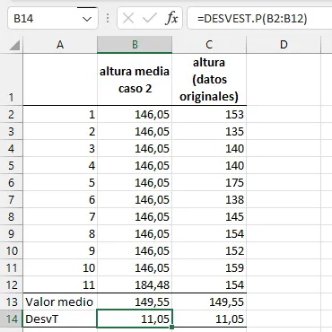


En este caso, vemos que tanto la media como la desviación típica son idénticos, y sin embargo los datos son muy diferentes, tal como nos muestra el gráfico de dispersión que hemos estado utilizando:

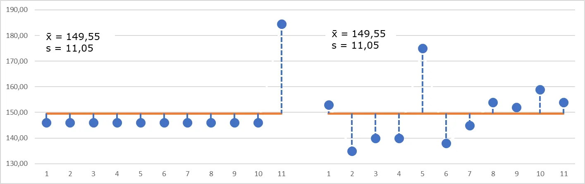

La existencia de valores atípicos o extremos muestra una de las debilidades de la media y la desviación típica como descriptores de un conjunto de datos: **ambos son muy sensibles a los casos extremos**.

Una forma intuitiva de entender por qué ocurre esto es imaginar una **barra rígida apoyada sobre un fulcro**, como una balanza o un balancín. Cada valor del conjunto es un peso colocado sobre la barra a una distancia proporcional a su magnitud. La media es exactamente el punto de apoyo en el que la barra quedaría en equilibrio perfecto: la suma de los momentos a la izquierda iguala la suma de los momentos a la derecha.

::: {#fig-media-fulcro layout-ncol="2" layout-valign="bottom"}
{#fig-media}

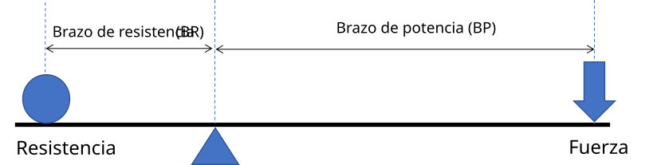{#fig-palanca}

Comparación gráfica del significado de la media en un diagrama de puntos (*dotplot*) con una palanca de primer grado, con el fulcro como punto de equilibrio.
:::

Un valor muy alejado del centro actúa como un **peso situado lejos del fulcro**: su efecto sobre el equilibrio es proporcional a la distancia de la media: un único valor extremo puede desplazar el punto de equilibrio (la media) tanto como varios valores moderados juntos. En la varianza el efecto es aún mayor, porque las diferencias se elevan al cuadrado:un valor situado al doble de distancia aporta cuatro veces más.

Por eso, **deberíamos usar la media y la desviación típica preferiblemente cuando estamos razonablemente seguros de que los datos tienen una forma aproximadamente simétrica y equilibrada**, como la famosa **campana de Gauss** (distribución normal), que podemos relacionar con el boxplot, tal como vemos en el gráfico a continuación,

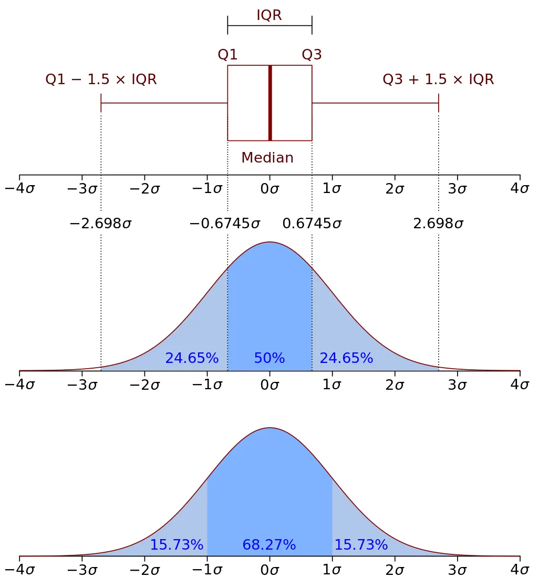

En otros casos, especialmente cuando hay valores muy altos o muy bajos, **la mediana y el rango intercuartil** (que ya vimos en el boxplot) son **estadísticos más robustos**, es decir, **más resistentes a los extremos y más seguros para describir el conjunto de datos**.

Esta diferencia entre estadísticos sensibles y robustos es clave para elegir bien qué medidas usar según el tipo de datos.

## Cálculo manual de la media y la desviación típica

Los cálculos que hemos realizado en este capítulo con la hoja de cálculo pueden reproducirse con pocas líneas de código en Python y R. Antes de ver el código, repasemos el cálculo paso a paso con nuestros datos de altura de los alumnos.

**Paso 1 — Media aritmética:**

$$\bar{x} = \frac{153+135+140+140+175+138+145+154+152+159+154}{11} = 149{,}55$$

**Paso 2 — Diferencias a la media:**

$$
\begin{aligned}
x_i - \bar{x}: \quad & (153-149{,}55),\ (135-149{,}55),\ (140-149{,}55),\ \ldots \\
& = 3{,}45,\ {-14{,}55},\ {-9{,}55},\ {-9{,}55},\ 25{,}45,\ {-11{,}55},\ {-4{,}55},\ 4{,}45,\ 2{,}45,\ 9{,}45,\ 4{,}45
\end{aligned}
$$

**Paso 3 — Diferencias al cuadrado:**

$$(x_i - \bar{x})^2: \quad 11{,}93,\ 211{,}57,\ 91{,}12,\ 91{,}12,\ 647{,}93,\ 133{,}30,\ 20{,}66,\ 19{,}84,\ 6{,}02,\ 89{,}39,\ 19{,}84$$

**Paso 4 — Suma de cuadrados (SC):**

$$
\begin{aligned}
SC & = \sum_{i=1}^{n}(x_i - \bar{x})^2  \\
& = 11{,}93+211{,}57+91{,}12+91{,}12+647{,}93+133{,}30+20{,}66+19{,}84+6{,}02+89{,}39+19{,}84 \\
& = 1342{,}73
\end{aligned}
$$

::: callout-note
La **suma de cuadrados** (SC) es una cantidad que aparecerá de forma recurrente en el análisis estadístico. Mide la variación total de un conjunto de datos respecto a su media. En el análisis de la varianza (**ANOVA**), que permite comparar si las medias de varios grupos son significativamente distintas, la SC total se descompone en partes atribuibles a diferentes causas: la variación entre grupos y la variación dentro de cada grupo. Entender qué es la SC en este capítulo facilita enormemente la comprensión del ANOVA, una técnica estadística que se menciona en el capítulo sobre el diseño de experimentos, pero que no se aborda en este libro.
:::

**Paso 5 — Varianza y desviación típica poblacional:**

$$\sigma^2 = \frac{SC}{n} = \frac{1342{,}73}{11} = 122{,}07 \qquad \sigma = \sqrt{122{,}07} = 11{,}05$$

**Paso 6 — Desviación típica muestral:**
$$s = \sqrt{\frac{SC}{n-1}} = \sqrt{\frac{1342{,}73}{10}} = \sqrt{134{,}27} = 11{,}59$$

::: callout-note
## Corrección de Bessel
Cuando trabajamos con una **muestra** en lugar de con la población completa, dividir entre $n$ tiende a subestimar la dispersión real de la población. Para corregir este sesgo, se divide entre $n-1$ en lugar de $n$. Esta corrección se conoce como **corrección de Bessel**, que corrige el sesgo de la varianza, y permite calcular la **desviación típica muestral**. En la práctica industrial, donde casi siempre trabajamos con muestras, es el valor que se usa por defecto, y es también el que calculan Excel (`DESVEST.M()`), `std()`de `pandas` en Python y `sd()` en R. En cambio, la función `numpy.std()`de Python divide por `n`por defecto.
:::

## Cálculo de estadísticos básicos en Python y R

::: panel-tabset

## R

```{r}
altura_cm <- c(153, 135, 140, 140, 175, 138, 145, 154, 152, 159, 154)

mean(altura_cm)     # media: 149.55
median(altura_cm)   # mediana
sd(altura_cm)       # desviación típica muestral (n-1): 11.59
var(altura_cm)      # varianza muestral (n-1)
summary(altura_cm)  # resumen completo
```

## Python

```{python}
import pandas as pd

altura_cm = [153, 135, 140, 140, 175, 138, 145, 154, 152, 159, 154]
serie = pd.Series(altura_cm)

print(serie.mean())     # media: 149.55
print(serie.median())   # mediana
print(serie.std())      # desviación típica muestral (n-1): 11.59
print(serie.var())      # varianza muestral (n-1)
print(serie.describe()) # resumen completo
```

:::

Una nota importante: tanto `pandas` como R calculan por defecto la desviación típica muestral, dividiendo entre n−1 en lugar de n. La diferencia es pequeña cuando el número de datos es grande, pero conviene tenerlo en cuenta (Atención: la función std() de NumPy divide por n salvo que se indique ddof=1). 

## Resumen del capítulo

La media aritmética es el estadístico central más utilizado: representa el valor en torno al cual se distribuye el conjunto de datos y se calcula como la suma de todos los valores dividida entre su número. Sin embargo, la media por sí sola no es suficiente para describir un conjunto de datos, ya que grupos muy distintos pueden compartir el mismo valor medio. 

Para completar la descripción es necesario medir la dispersión, es decir, cuánto se alejan los valores individuales de ese centro. La varianza mide esa distancia elevando al cuadrado las diferencias entre cada valor y la media, lo que evita que las diferencias positivas y negativas se anulen; la desviación típica es su raíz cuadrada y recupera las unidades originales de la medida. 

Estos estadísticos paramétricos son muy potentes cuando los datos tienen una distribución aproximadamente simétrica, pero son sensibles a los valores extremos. En esos casos, la mediana y el rango intercuartil, ya vistos en el boxplot del capítulo 5, resultan más robustos y seguros. En la práctica, ambos tipos de estadísticos se usan de forma complementaria. 

En el capítulo 12 aplicaremos todos estos conceptos al análisis de una fabricación real de queso camembert.