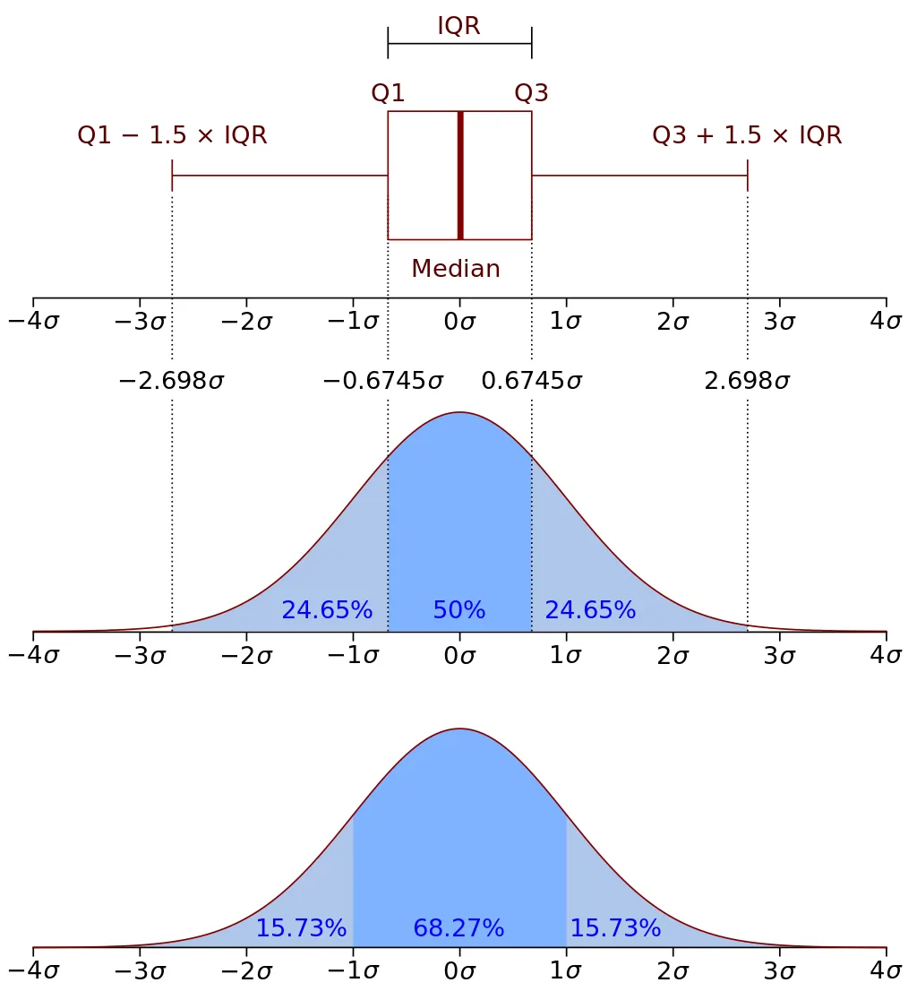

```{r setup-092}
#| include: false
Sys.setenv(RETICULATE_PYTHON = "C:/ProgramData/miniconda3/python.exe")
library(reticulate)
use_python("C:/ProgramData/miniconda3/python.exe", required = TRUE)
```

::: callout-note
## Objetivos de aprendizaje

Al finalizar este capítulo, el alumno será capaz de:

- Interpretar un histograma como representación de una distribución de probabilidad empírica.
- Reconocer las formas características de las distribuciones más frecuentes en datos industriales y relacionarlas con el proceso que las genera.
- Describir la distribución normal mediante sus parámetros ($\mu$ y $\sigma$) y aplicar la regla 68-95-99,7.
- Calcular probabilidades a partir de la distribución normal usando Python y R.
- Interpretar un gráfico QQ-plot para evaluar visualmente si un conjunto de datos sigue una distribución normal.

Conceptos clave: **distribución de probabilidad, frecuencia relativa, distribución normal, parámetros, media, desviación típica, tipificación, puntuación Z, QQ-plot, asimetría, distribución discreta, distribución continua**.
:::

::: {.callout-tip}
## Sugerencia sobre el código de este capítulo
A lo largo del capítulo encontrarás bloques de código Python y R que generan los gráficos. Cuando el código es largo o utiliza funciones avanzadas de formato y visualización, aparece **oculto por defecto**: puedes mostrarlo haciendo clic en "Mostrar código".

No es necesario entender cada línea para seguir el razonamiento del capítulo. Si tienes curiosidad sobre qué hace un bloque de código concreto, cópialo y pégalo en un asistente de inteligencia artificial como Gemini, ChatGPT o Claude y pregúntale: *"Explícame este código línea a línea, en lenguaje sencillo"*.
:::

## De la frecuencia relativa a la probabilidad

En los capítulos anteriores hemos usado el histograma para describir la distribución de los valores de una variable. Cada barra del histograma representa cuántos valores caen en un intervalo determinado. Si en lugar de contar valores contamos su proporción respecto al total, obtenemos las **frecuencias relativas**, que ya conocemos del capítulo 5.

Hay un paso conceptual sencillo desde las frecuencias relativas hasta la probabilidad: la frecuencia relativa de un intervalo es la **probabilidad** de que un valor tomado al azar de ese conjunto caiga en ese intervalo.

Por ejemplo, si en los datos de La Liga el 23,7% de los partidos terminan con 2 goles en total, podemos decir que la probabilidad de que un partido elegido al azar acabe con 2 goles es del 23,7%, o 0,237.

::: {.callout-note}
## Probabilidad y frecuencia relativa
La probabilidad de un evento es la proporción de veces que ese evento ocurre en un gran número de repeticiones. Cuando disponemos de datos reales, la frecuencia relativa observada es nuestra mejor estimación de esa probabilidad. Cuantos más datos tengamos, más fiable es esa estimación.
:::

Para precisar la distinción entre los dos conceptos, la tabla siguiente resume sus diferencias:

| | Frecuencia relativa | Probabilidad |
|---|---|---|
| **Qué es** | Proporción observada en un conjunto de datos reales | Medida teórica basada en un modelo o supuesto |
| **Cómo se obtiene** | Contando: $\frac{\text{veces que ocurre el evento}}{\text{total de observaciones}}$ | Razonando, si todos los casos son igualmente probables: $\frac{\text{casos favorables}}{\text{casos posibles}}$ |
| **Ejemplo** | En 380 partidos de La Liga, 90 acabaron con 2 goles: frecuencia relativa = 0,237 | En una moneda perfectamente equilibrada, P(cara) = 0,5 |
| **Carácter** | Empírico: depende de los datos disponibles | Teórico: no requiere datos observados |
| **Relación** | Con muchos datos, la frecuencia relativa se acerca a la probabilidad teórica |  |

En el análisis de datos industriales trabajamos casi siempre con frecuencias relativas: no conocemos la probabilidad teórica de que un queso salga fuera de especificación, pero podemos estimarla a partir de los datos históricos del proceso.

Esta conexión tiene una consecuencia práctica importante. En un histograma de frecuencias relativas, la proporción de valores comprendidos entre dos límites es la **suma de las frecuencias relativas** de los intervalos que abarcan, o la diferencia entre las frecuencias relativas acumuladas en esos dos límites, que vimos en el capítulo 5. En una distribución teórica, esa probabilidad es el **área bajo la curva** entre los dos valores.

## Distribuciones discretas y continuas

Antes de describir las formas más habituales, conviene distinguir dos tipos de variables:

Las **variables discretas** solo pueden tomar valores aislados, separados entre sí, sin posibilidad de valores intermedios: número de goles en un partido, número de colonias bacterianas en una placa, número de envases defectuosos en un lote. No tiene sentido hablar de 2,7 goles. Las distribuciones de variables discretas tienen barras separadas porque los valores posibles están separados.

Las **variables continuas** pueden tomar cualquier valor dentro de un rango: la materia grasa de un queso, el pH, el peso de un envase. Entre 23,5% y 23,6% de grasa hay infinitos valores posibles. Su distribución teórica se representa con una curva continua; con datos reales, la aproximamos mediante un histograma.

En la práctica industrial, la mayoría de las variables de proceso y calidad son continuas, y la distribución normal, que veremos en detalle, es una distribución continua.

## Las formas más frecuentes en datos industriales

Los datos que encontramos en la industria alimentaria no siempre tienen la misma forma. Reconocer la forma de una distribución es el primer paso para interpretarla correctamente y elegir las herramientas estadísticas adecuadas.

Veamos las cuatro formas más frecuentes usando datos que ya conocemos del libro y un nuevo conjunto de datos que estudiaremos en el capítulo 12:

::: panel-tabset

## R

```{r panel-distribuciones-r}
#| code-fold: true
#| code-summary: "Mostrar código"
#| message: false
#| warning: false
#| fig-width: 10
#| fig-height: 8

library(tidyverse)
library(palmerpenguins)
library(patchwork)

df_lla <- read_csv2("datos/laliga_resultados2425.csv",
                    locale = locale(decimal_mark = ",")) |>
    mutate(goles_totales = goles_local + goles_visitante)

df_cam <- read_csv2("datos/camembert.csv",
                    locale = locale(encoding = "ISO-8859-1"))
gentoo <- penguins |> filter(species == "Gentoo")
p1 <- ggplot(gentoo, aes(x = flipper_length_mm)) +
    geom_histogram(bins = 15, fill = "steelblue",
                   color = "white", alpha = 0.8) +
    labs(title = "Simétrica (normal)",
         subtitle = "Longitud aleta — pingüinos Gentoo",
         x = "Longitud aleta (mm)", y = "Frecuencia") +
    theme_bw()

p2 <- ggplot(df_lla, aes(x = goles_totales)) +
    geom_histogram(binwidth = 1, fill = "darkorange",
                   color = "white", alpha = 0.8) +
    labs(title = "Asimétrica positiva",
         subtitle = "Goles por partido — La Liga 2024-25",
         x = "Goles totales", y = "Frecuencia") +
    theme_bw()

p3 <- df_cam |>
    drop_na(coliformes) |>
    ggplot(aes(x = coliformes)) +
    geom_histogram(bins = 20, fill = "tomato",
                   color = "white", alpha = 0.8) +
    labs(title = "Asimétrica positiva extrema",
         subtitle = "Coliformes — queso camembert",
         x = "Coliformes (ufc/g)", y = "Frecuencia") +
    theme_bw()

p4 <- penguins |>
    drop_na(flipper_length_mm) |>
    ggplot(aes(x = flipper_length_mm, fill = species)) +
    geom_histogram(bins = 20, alpha = 0.8, position = "stack") +
    labs(title = "Bimodal (mezcla de grupos)",
         subtitle = "Longitud aleta — pingüinos",
         x = "Longitud aleta (mm)", y = "Frecuencia",
         fill = "Especie") +
    theme_bw() +
    theme(legend.position = "bottom",
          legend.text = element_text(size = 7))

(p1 + p2) / (p3 + p4)
```

## Python

```{python panel-distribuciones-python}
#| code-fold: true
#| code-summary: "Mostrar código"

import pandas as pd
import numpy as np
import matplotlib.pyplot as plt
from palmerpenguins import load_penguins

# Cargar datasets
url_lla = "datos/laliga_resultados2425.csv"
df_lla = pd.read_csv(url_lla, sep=';', decimal=',', encoding='ISO-8859-1')
df_lla['goles_totales'] = df_lla['goles_local'] + df_lla['goles_visitante']

penguins = load_penguins().dropna(subset=['flipper_length_mm', 'species'])
df_cam = pd.read_csv("datos/camembert.csv", sep=';', decimal=',', encoding='ISO-8859-1')

fig, axes = plt.subplots(2, 2, figsize=(11, 8))
_ = fig.suptitle("Cuatro formas de distribución en datos reales", fontsize=13)

# 1. Normal: flipper_length Gentoo
gentoo = penguins[penguins['species'] == 'Gentoo']['flipper_length_mm'].dropna()
_ = axes[0,0].hist(gentoo, bins=15,
               color='steelblue', edgecolor='white', alpha=0.8)
_ = axes[0,0].set_title("Simétrica (normal)\nLongitud aleta — pingüinos Gentoo")
_ = axes[0,0].set_xlabel("Longitud aleta (mm)")
_ = axes[0,0].set_ylabel("Frecuencia")

# 2. Asimétrica positiva moderada: goles La Liga
_ = axes[0,1].hist(df_lla['goles_totales'], bins=range(0, 12),
               color='darkorange', edgecolor='white', alpha=0.8)
_ = axes[0,1].set_title("Asimétrica positiva\nGoles por partido — La Liga 2024-25")
_ = axes[0,1].set_xlabel("Goles totales")
_ = axes[0,1].set_ylabel("Frecuencia")

# 3. Asimétrica positiva extrema: coliformes del camembert
_ = axes[1,0].hist(df_cam['coliformes'].dropna(), bins=20,
               color='tomato', edgecolor='white', alpha=0.8)
_ = axes[1,0].set_title("Asimétrica positiva extrema\nColiformes — queso camembert")
_ = axes[1,0].set_xlabel("Coliformes (ufc/g)")
_ = axes[1,0].set_ylabel("Frecuencia")

# 4. Bimodal: flipper length penguins por especie
especies = ['Adelie', 'Chinstrap', 'Gentoo']
datos = [penguins[penguins['species'] == sp]['flipper_length_mm'] for sp in especies]
_ = axes[1,1].hist(datos, bins=20, stacked=True, label=especies,
               color=['#1f77b4', '#ff7f0e', '#2ca02c'], alpha=0.8)
_ = axes[1,1].set_title("Bimodal (mezcla de grupos)\nLongitud aleta — pingüinos")
_ = axes[1,1].set_xlabel("Longitud aleta (mm)")
_ = axes[1,1].set_ylabel("Frecuencia")
_ = axes[1,1].legend(fontsize=8)

plt.tight_layout()
plt.show()
del _  # reticulate usa _ internamente; sin esto, los print() posteriores no se muestran

```


:::

Cada una de estas formas tiene una explicación en el proceso que genera los datos:

- **Simétrica:** los valores se distribuyen de forma equilibrada alrededor de un valor central. Es la forma habitual cuando la variación se debe a muchas pequeñas variaciones aleatorias que se compensan entre sí. La longitud de aleta de los pingüinos Gentoo es un buen ejemplo de esta forma.

- **Asimétrica positiva:** la mayoría de los valores son bajos pero hay una cola hacia valores altos. Es típica de recuentos de eventos poco frecuentes, como los goles por partido: la mayoría de los partidos tienen pocos goles, pero alguno tiene muchos.

- **Asimétrica positiva extrema:** versión extrema de la anterior. Los coliformes son el ejemplo perfecto: la mayoría de las muestras tienen recuentos bajos o nulos, pero episodios de contaminación producen valores muy altos. En el capítulo 12 veremos que la escala logarítmica permite examinar esta distribución con más detalle.

- **Bimodal:** dos grupos superpuestos con características distintas. En los pingüinos, la mezcla de especies con diferente tamaño produce dos modas. En datos de proceso, una distribución bimodal suele indicar que hay dos máquinas, dos operarios o dos materias primas mezcladas en el mismo dataset.

## La distribución normal

La distribución normal, también llamada **campana de Gauss**, es la más importante en estadística aplicada. No porque sea la única, sino porque muchas variables de proceso industrial se aproximan a ella cuando el proceso está bajo control, y porque es la base del cálculo de probabilidades en el control de calidad.

Su forma es característica: simétrica, con un único máximo en el centro, y colas que se extienden hacia ambos lados sin llegar nunca a cero. Está completamente definida por dos parámetros:

- **La media $\mu$:** determina dónde está centrada la distribución. Desplazar $\mu$ mueve toda la curva hacia la derecha o la izquierda sin cambiar su forma.
- **La desviación típica $\sigma$:** determina cuán ancha o estrecha es la curva. Una $\sigma$ pequeña produce una curva alta y estrecha (proceso preciso); una $\sigma$ grande produce una curva baja y ancha (proceso con mucha variabilidad).

### La regla 68-95-99,7

Una propiedad fundamental de la distribución normal es que la proporción de valores dentro de cada rango alrededor de la media es siempre la misma, independientemente de los valores concretos de $\mu$ y $\sigma$:

- Aproximadamente, el **68%** de los valores cae dentro de $\mu \pm 1\sigma$
- Aproximadamente, el **95%** de los valores cae dentro de $\mu \pm 2\sigma$
- Aproximadamente, el **99,7%** de los valores cae dentro de $\mu \pm 3\sigma$

Esta regla tiene consecuencias prácticas inmediatas: si sabemos que un proceso sigue una distribución normal con media $\mu$ y desviación típica $\sigma$, podemos calcular qué proporción de unidades estará fuera de cualquier límite especificado.

Visualicemos la regla sobre la curva teórica, con los parámetros de la longitud de aleta de los pingüinos Gentoo:

::: panel-tabset

## R

```{r regla-normal-r}
#| code-fold: true
#| code-summary: "Mostrar código"
mu <- 217.2; sigma <- 6.5
x <- seq(mu - 4*sigma, mu + 4*sigma, length.out = 300)
y <- dnorm(x, mu, sigma)
df_n <- tibble(x = x, y = y)

ggplot(df_n, aes(x, y)) +
    geom_area(data = df_n |> filter(x >= mu - 3*sigma, x <= mu + 3*sigma),
              fill = "#5dade2", alpha = 0.4) +
    geom_area(data = df_n |> filter(x >= mu - 2*sigma, x <= mu + 2*sigma),
              fill = "#a9cce3", alpha = 0.5) +
    geom_area(data = df_n |> filter(x >= mu - sigma,   x <= mu + sigma),
              fill = "#d4e6f1", alpha = 0.7) +
    geom_line(color = "navy", linewidth = 1.5) +
    geom_vline(xintercept = mu, linetype = "dashed") +
    annotate("text", x = mu + 0.2*sigma, y = max(y)*0.95,
             label = "μ", size = 4) +
    annotate("text", x = mu, y = max(y)*0.5,
             label = "68%", size = 3.5, hjust = -0.3) +
    annotate("text", x = mu + 1.5*sigma, y = max(y)*0.2,
             label = "95%", size = 3.5) +
    annotate("text", x = mu + 2.5*sigma, y = max(y)*0.05,
             label = "99,7%", size = 3.5) +
    labs(title = paste0("Distribución normal: longitud aleta Gentoo (μ=", mu,
                        ", σ=", sigma, ")"),
         x = "Longitud aleta (mm)", y = "Densidad de probabilidad") +
    theme_bw()
```

## Python

```{python regla-normal-python}
#| code-fold: true
#| code-summary: "Mostrar código"
import scipy.stats as st

mu, sigma = 217.2, 6.5   # parámetros flipper_length Gentoo

x = np.linspace(mu - 4*sigma, mu + 4*sigma, 300)
y = st.norm.pdf(x, mu, sigma)

fig, ax = plt.subplots(figsize=(10, 5))
ax.plot(x, y, color='navy', linewidth=2)

# Dibujar de mayor a menor para que las zonas internas queden encima
colores = ['#5dade2', '#a9cce3', '#d4e6f1']
rangos  = [3, 2, 1]
labels  = ['±3σ  (99,7%)', '±2σ  (95%)', '±1σ  (68%)']

for r, color, label in zip(rangos, colores, labels):
    ax.fill_between(x, y,
                    where=(x >= mu - r*sigma) & (x <= mu + r*sigma),
                    color=color, label=label)

ax.axvline(mu, color='black', linestyle='--', linewidth=1)
ax.set_title(f"Distribución normal: longitud aleta Gentoo (μ={mu}, σ={sigma})")
ax.set_xlabel("Longitud aleta (mm)")
ax.set_ylabel("Densidad de probabilidad")
ax.legend()
plt.tight_layout()
plt.show()
```

:::

::: {.callout-note}
## La regla 68-95-99,7 y el boxplot
¿Recuerdas el boxplot del capítulo 5? En una distribución normal, los bigotes del boxplot (que alcanzan, como máximo, 1,5 veces el rango intercuartil más allá de los bordes de la caja) capturan aproximadamente el 99,3% de los valores. Los puntos fuera de los bigotes corresponden aproximadamente al 0,7% de las observaciones, que es la región de las colas más allá de ±2,7$\sigma$.


:::

### Tipificación y puntuación Z

Una propiedad muy útil de la distribución normal es que cualquier distribución normal, independientemente de sus valores de $\mu$ y $\sigma$, puede transformarse en una distribución normal estándar con media 0 y desviación típica 1. Esta transformación se llama **tipificación** y el valor resultante se llama **puntuación Z** o **valor Z**:

$$Z = \frac{x - \mu}{\sigma}$$

La puntuación Z indica cuántas desviaciones típicas separan un valor concreto de la media. Un valor con $Z = 2$ está 2 desviaciones típicas por encima de la media; un valor con $Z = -1,5$ está 1,5 desviaciones típicas por debajo.

La utilidad práctica de la tipificación es que permite calcular probabilidades para cualquier distribución normal usando una única tabla o función, sin importar las unidades ni los valores concretos de $\mu$ y $\sigma$. Las funciones de Python y R que veremos a continuación hacen este cálculo directamente, sin necesidad de tipificar; en el capítulo 14 las usaremos para calcular la proporción de envases que incumple el contenido efectivo reglamentario.

## Cálculo de probabilidades con Python y R

Python y R calculan directamente la probabilidad de que un valor sea menor que un valor dado en cualquier distribución normal. No es necesario usar tablas.

La función que necesitamos es la **función de distribución acumulada** (*cumulative distribution function*, CDF): dado un valor $x$, nos devuelve la probabilidad de que una observación sea menor o igual que $x$, es decir, el área bajo la curva a la izquierda de ese punto.

Como ejemplo, calculamos algunas probabilidades para la longitud de aleta de los pingüinos Gentoo (aproximadamente normal con media 217,2 mm y desviación típica 6,5 mm):

::: panel-tabset

## R

```{r prob-normal-r}
mu <- 217.2; sigma <- 6.5

# P(longitud aleta < 210 mm)
prob <- pnorm(210, mean = mu, sd = sigma)
cat(sprintf("P(longitud aleta < 210 mm) = %.4f = %.2f%%\n", prob, prob*100))

# P(longitud aleta > 225 mm)
prob_sup <- 1 - pnorm(225, mean = mu, sd = sigma)
cat(sprintf("P(longitud aleta > 225 mm) = %.4f = %.2f%%\n", prob_sup, prob_sup*100))

# P(210 mm < longitud aleta < 225 mm)
prob_rango <- pnorm(225, mean = mu, sd = sigma) - pnorm(210, mean = mu, sd = sigma)
cat(sprintf("P(210 mm < longitud aleta < 225 mm) = %.4f = %.2f%%\n",
            prob_rango, prob_rango*100))
```

## Python

```{python prob-normal-python}
import scipy.stats as st

mu, sigma = 217.2, 6.5

# P(flipper < 210 mm)
prob = st.norm.cdf(210, loc=mu, scale=sigma)
print(f"P(longitud aleta < 210 mm) = {prob:.4f} = {prob*100:.2f}%")

# P(flipper > 225 mm)
prob_sup = 1 - st.norm.cdf(225, loc=mu, scale=sigma)
print(f"P(longitud aleta > 225 mm) = {prob_sup:.4f} = {prob_sup*100:.2f}%")

# P(210 < flipper < 225 mm)
prob_rango = st.norm.cdf(225, loc=mu, scale=sigma) - st.norm.cdf(210, loc=mu, scale=sigma)
print(f"P(210 mm < longitud aleta < 225 mm) = {prob_rango:.4f} = {prob_rango*100:.2f}%")
```

:::

La función `norm.cdf` en Python y `pnorm` en R calculan el área bajo la curva a la izquierda del valor indicado. Para probabilidades hacia la derecha (valores superiores a $x$) basta con restar a 1. Para probabilidades en un intervalo, se restan las dos CDF de los extremos.

## Comprobación de normalidad: el QQ-plot

Antes de aplicar cualquier cálculo basado en la distribución normal, es conveniente comprobar si los datos se ajustan razonablemente bien a esa distribución. El gráfico más sencillo y más informativo para esta comprobación es el **QQ-plot** (*quantile-quantile plot*).

La idea es simple: si los datos siguen una distribución normal, sus cuantiles empíricos (los valores observados ordenados de menor a mayor) deberían coincidir con los cuantiles teóricos de una distribución normal. El QQ-plot representa estos dos conjuntos de cuantiles uno frente al otro: si los puntos siguen una línea recta, los datos son aproximadamente normales; si se desvían de la línea, hay indicios de no normalidad.

Aplicamos el QQ-plot a la longitud de aleta de los pingüinos Gentoo, que acabamos de ver que sigue una distribución aproximadamente normal:

::: panel-tabset
## R

```{r qqplot-r}
#| code-fold: true
#| code-summary: "Mostrar código"
#| message: false
gentoo <- penguins |> filter(species == "Gentoo") |> drop_na(flipper_length_mm)

ggplot(gentoo, aes(sample = flipper_length_mm)) +
    stat_qq(color = "steelblue", size = 1.5, alpha = 0.7) +
    stat_qq_line(color = "red", linewidth = 1) +
    labs(title = "QQ-plot: Longitud aleta — pingüinos Gentoo",
         x = "Cuantiles teóricos (distribución normal)",
         y = "Cuantiles observados (longitud aleta, mm)") +
    theme_bw()
```

## Python

```{python qqplot-python}
#| code-fold: true
#| code-summary: "Mostrar código"
import scipy.stats as st

gentoo_flip = penguins[penguins['species'] == 'Gentoo']['flipper_length_mm'].dropna()

fig, ax = plt.subplots(figsize=(6, 6))
_ = st.probplot(gentoo_flip, dist="norm", plot=ax)  # _ evita que se imprima la salida numérica
_ = ax.set_title("QQ-plot: Longitud aleta — pingüinos Gentoo")
_ = ax.get_lines()[0].set(color='steelblue', markersize=4, alpha=0.7)
_ = ax.get_lines()[1].set(color='red', linewidth=1.5)
plt.tight_layout()
plt.show()
del _
```

:::

La mayoría de los puntos siguen la línea roja, lo que indica que la longitud de aleta de los pingüinos Gentoo se aproxima a una distribución normal. El escalonado de los puntos se debe a que las longitudes están registradas en milímetros enteros. En los extremos hay desviaciones moderadas: los valores más bajos quedan por encima de la línea y hay una acumulación de valores en 230 mm. Los extremos se separan de la línea hacia dentro, lo que, según el cuadro siguiente, indica colas algo más ligeras que las de la normal. La aproximación es razonable para los cálculos de este capítulo, pero no es perfecta.

::: {.callout-note}
## Cómo interpretar un QQ-plot
- **Puntos sobre la línea recta:** los datos se ajustan bien a la distribución normal.
- **Cola superior por encima de la línea:** hay valores altos más extremos de lo esperado (cola derecha más pesada, asimetría positiva).
- **Cola inferior por debajo de la línea:** hay valores bajos más extremos de lo esperado (cola izquierda más pesada, asimetría negativa).
- **Puntos en forma de S:** las colas no se ajustan a la normal. Si los extremos se separan de la línea hacia fuera (el inferior por debajo y el superior por encima), las colas son más pesadas que las de la normal; si se separan hacia dentro (el inferior por encima y el superior por debajo), son más ligeras y la distribución está más concentrada en el centro.
- **Punto aislado en un extremo:** un valor atípico.
:::

## Resumen del capítulo

Este capítulo ha establecido el puente entre las frecuencias relativas del histograma y el concepto de probabilidad: la proporción de valores en un intervalo es la probabilidad de que una observación caiga en ese intervalo. A partir de esta idea, la distribución normal aparece como el modelo teórico que describe el comportamiento de muchas variables industriales bajo control.

Los cuatro tipos de distribución ilustrados con datos del libro (simétrica, asimétrica positiva, asimétrica positiva extrema y bimodal) permiten al alumno reconocer en sus propios datos la forma que subyace al proceso que los genera. La distribución normal se ha descrito en profundidad mediante sus parámetros $\mu$ y $\sigma$, la regla 68-95-99,7 y el cálculo de probabilidades con Python y R. El QQ-plot proporciona una herramienta visual sencilla para verificar si la hipótesis de normalidad es razonable antes de aplicar estos cálculos. 

En el capítulo 14 aplicaremos estos conceptos a un problema real de control de calidad: el análisis del llenado de yogures según el RD 1801/2008.
