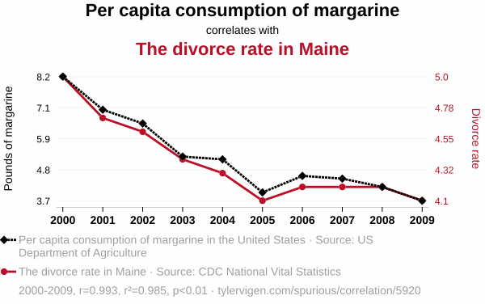
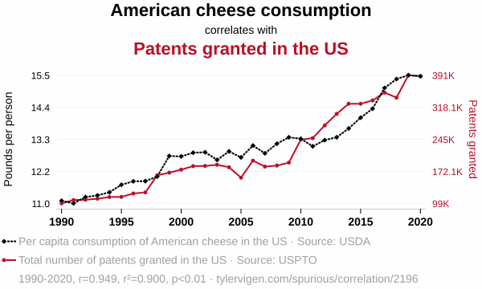

```{r setup-095}
#| include: false
Sys.setenv(RETICULATE_PYTHON = "C:/ProgramData/miniconda3/python.exe")
library(reticulate)
use_python("C:/ProgramData/miniconda3/python.exe", required = TRUE)
```

::: callout-note
## Objetivos de aprendizaje

Al finalizar este capítulo, el alumno será capaz de:

- Interpretar un gráfico de dispersión para identificar visualmente si existe relación entre dos variables y describir su dirección e intensidad.
- Explicar el concepto de correlación y usar el coeficiente de Pearson como medida numérica de la intensidad de la relación lineal.
- Distinguir entre correlación y causalidad, y reconocer ejemplos de correlación espuria.
- Interpretar una línea de regresión como resumen de la tendencia en un gráfico de dispersión.
- Aplicar estos conceptos a datos reales de fabricación de queso.

Conceptos clave: **correlación, coeficiente de Pearson, causalidad, correlación espuria, regresión lineal, línea de tendencia**.
:::

::: {.callout-tip}
## Sugerencia sobre el código de este capítulo
Los bloques de código que generan gráficos complejos aparecen **ocultos por defecto**. Puedes mostrarlos haciendo clic en "Mostrar código". Si quieres entender qué hace un bloque, cópialo y pégalo en un asistente de IA como Gemini, ChatGPT o Claude y pregúntale: *"Explícame este código línea a línea, en lenguaje sencillo"*.
:::

## Más allá de una variable: la relación entre dos variables

En los capítulos anteriores hemos descrito las variables una a una: su distribución, su media, su dispersión. Pero en la práctica industrial, muchas de las preguntas más importantes son sobre la relación entre variables: ¿influye la composición de la leche en el rendimiento quesero? ¿Tiene relación el pH con el extracto seco? ¿Están correlacionadas la materia grasa y la humedad del queso?

El gráfico de dispersión, que ya usamos en el capítulo de análisis del camembert, es la herramienta visual fundamental para explorar estas relaciones. Cada punto representa una observación con sus dos valores, y la forma de la nube de puntos nos dice si hay relación y de qué tipo.

## El coeficiente de correlación de Pearson

La inspección visual del gráfico de dispersión nos da una idea cualitativa de la relación entre dos variables, pero necesitamos también una medida numérica que nos permita compararla y comunicarla con precisión. El **coeficiente de correlación de Pearson** ($r$) es esa medida.

$r$ toma valores entre $-1$ y $+1$:

- $r = +1$: correlación positiva perfecta. Cuando una variable sube, la otra sube proporcionalmente siempre.
- $r = -1$: correlación negativa perfecta. Cuando una variable sube, la otra baja proporcionalmente siempre.
- $r = 0$: no hay relación lineal entre las variables.
- Valores intermedios indican correlaciones parciales: cuanto más cerca de $\pm 1$, más intensa la relación.

Como referencia práctica, en datos industriales:

| Valor de $|r|$ | Interpretación habitual |
|----------------|------------------------|
| 0,00 — 0,20 | Correlación muy débil o nula |
| 0,20 — 0,40 | Correlación débil |
| 0,40 — 0,60 | Correlación moderada |
| 0,60 — 0,80 | Correlación fuerte |
| 0,80 — 1,00 | Correlación muy fuerte |

Veamos un ejemplo concreto con los pingüinos. La longitud de la aleta y la masa corporal deberían estar relacionadas: los pingüinos más grandes tienen aletas más largas. Calculamos $r$ y visualizamos la relación con la línea de regresión:

::: panel-tabset

## R

```{r corr-pinguinos-intro-r}
#| code-fold: true
#| code-summary: "Mostrar código"
#| message: false
#| warning: false
library(tidyverse)
library(palmerpenguins)

pengs_completos <- penguins |>
    drop_na(flipper_length_mm, body_mass_g)

r_ping  <- cor(pengs_completos$flipper_length_mm,
               pengs_completos$body_mass_g)
r2_ping <- r_ping^2

ggplot(pengs_completos,
       aes(x = flipper_length_mm, y = body_mass_g, color = species)) +
    geom_point(alpha = 0.6, size = 2) +
    geom_smooth(aes(group = 1), method = "lm", color = "black",
                linetype = "dashed", linewidth = 1, se = FALSE) +
    scale_color_manual(values = c("Adelie"    = "#1f77b4",
                                   "Chinstrap" = "#ff7f0e",
                                   "Gentoo"    = "#2ca02c")) +
    labs(title = "Longitud de aleta vs masa corporal — pingüinos",
         subtitle = paste0("r = ", round(r_ping, 2),
                           "   R² = ", round(r2_ping, 2)),
         x = "Longitud de aleta (mm)",
         y = "Masa corporal (g)",
         color = "Especie") +
    theme_bw()
```

## Python

```{python corr-pinguinos-intro-python}
#| code-fold: true
#| code-summary: "Mostrar código"
import numpy as np
import matplotlib.pyplot as plt
from palmerpenguins import load_penguins

penguins = load_penguins().dropna(subset=['flipper_length_mm', 'body_mass_g'])
r_ping = penguins['flipper_length_mm'].corr(penguins['body_mass_g'])
r2_ping = r_ping ** 2

m_p, b_p = np.polyfit(penguins['flipper_length_mm'],
                       penguins['body_mass_g'], 1)
x_p = np.linspace(penguins['flipper_length_mm'].min(),
                   penguins['flipper_length_mm'].max(), 100)

fig, ax = plt.subplots(figsize=(7, 5))
colores_sp = {'Adelie': '#1f77b4', 'Chinstrap': '#ff7f0e', 'Gentoo': '#2ca02c'}
for sp, grp in penguins.groupby('species'):
    ax.scatter(grp['flipper_length_mm'], grp['body_mass_g'],
               alpha=0.6, s=25, color=colores_sp[sp], label=sp)
ax.plot(x_p, m_p * x_p + b_p, color='black', linewidth=1.5,
        linestyle='--')
ax.set_xlabel("Longitud de aleta (mm)")
ax.set_ylabel("Masa corporal (g)")
ax.set_title(f"Longitud de aleta vs masa corporal — pingüinos\n"
             f"r = {r_ping:.2f}   R² = {r2_ping:.2f}")
ax.legend(title='Especie', fontsize=8)
plt.tight_layout()
plt.show()
```

:::

El gráfico muestra una relación positiva clara: los pingüinos con aletas más largas son más pesados. Ahora que tenemos el gráfico delante, podemos entender mejor qué significan $r$ y $R^2$:

::: {.callout-note}
## ¿Qué mide exactamente $r$? El coeficiente de correlación y el coeficiente de determinación

El **coeficiente de correlación de Pearson** ($r$) mide la **intensidad y la dirección de la relación lineal** entre dos variables. Va de −1 a +1: valores cercanos a ±1 indican una relación fuerte; valores cercanos a 0 indican ausencia de relación lineal.

El **coeficiente de determinación** ($R^2$) es simplemente el cuadrado de $r$. Va de 0 a 1 y se interpreta como la **proporción de la variación de una variable que queda explicada por la otra**.

En el gráfico anterior, $r \approx 0{,}87$ y $R^2 \approx 0{,}76$. Esto significa que si tuviéramos que adivinar la masa corporal de un pingüino sin saber nada más, nuestra mejor apuesta sería la media de todos los pingüinos. Pero si además sabemos la longitud de su aleta, podemos hacer una predicción mucho mejor usando la línea de regresión. El $R^2 = 0{,}76$ nos dice que conocer la longitud de la aleta reduce en un 76% el error que cometeríamos si adivinásemos solo con la media. Ese 76% es la "variación explicada" por la longitud de la aleta; el 24% restante se debe a otros factores como la especie, el sexo o la condición corporal individual.

Excel muestra $R^2$ cuando se añade una línea de tendencia a un gráfico de dispersión. Es habitual ver ambos valores en informes técnicos: $r$ para describir la relación y $R^2$ para cuantificar su poder explicativo.

Una advertencia: una correlación baja no significa necesariamente que no hay relación entre las variables. Puede haber una relación curvilínea perfecta con $r = 0$. Por eso siempre hay que mirar el gráfico de dispersión junto con el valor de $r$.
:::

## La línea de regresión

La línea discontinua en el gráfico anterior es la **línea de regresión** o **línea de tendencia**. Representa la mejor aproximación lineal a la relación entre las dos variables: para cualquier longitud de aleta, la línea nos da el valor medio esperado de la masa corporal.

La ecuación de la línea tiene la forma:

$$\hat{y} = a + b \cdot x$$

donde $\hat{y}$ es el valor predicho de la variable dependiente (masa corporal), $x$ es el valor de la variable independiente (longitud de aleta), $b$ es la pendiente (cuánto sube la masa corporal por cada milímetro adicional de aleta) y $a$ es la intersección con el eje Y.

La línea se calcula por el método de los **mínimos cuadrados**: se busca la línea que minimiza la suma de los cuadrados de las distancias verticales entre cada punto y la línea. Este criterio garantiza que la línea pase lo más cerca posible de todos los puntos simultáneamente.

::: {.callout-note}
## La regresión en Excel
Excel permite añadir una línea de tendencia a cualquier gráfico de dispersión con clic derecho → "Agregar línea de tendencia". En las opciones se puede mostrar la ecuación de la línea y el coeficiente $R^2$ (que es el cuadrado del coeficiente de Pearson y mide la proporción de variación de $y$ explicada por $x$). Es una forma rápida de obtener la regresión sin código.
:::

## Correlación no implica causalidad

El coeficiente de correlación mide la intensidad de la asociación estadística entre dos variables, pero no dice nada sobre si una variable *causa* a la otra. Dos variables pueden estar correlacionadas por tres razones distintas:

1. **Causalidad directa:** $x$ causa $y$. Por ejemplo, una mayor concentración de cuajo produce una coagulación más rápida.
2. **Causa común:** una tercera variable $z$ influye en ambas. Por ejemplo, la temperatura ambiente afecta tanto al extracto seco como a la velocidad de acidificación, creando una correlación entre estas dos aunque no se causen entre sí.
3. **Coincidencia:** es una correlación espuria, sin ninguna relación causal real.

El tercer caso es más frecuente de lo que parece, especialmente cuando se analizan series temporales largas donde muchas variables crecen o decrecen juntas simplemente porque el tiempo avanza.

### Ejemplos de correlación espuria

Tyler Vigen ha recopilado en su página web [tylervigen.com/spurious-correlations](https://tylervigen.com/spurious-correlations) miles de correlaciones estadísticamente fuertes entre variables que no tienen ninguna relación causal posible. Dos ejemplos especialmente ilustrativos:

El primero tiene una conexión temática directa con este libro: el consumo de margarina per cápita correlaciona muy fuertemente con el número de divorcios en el estado de Maine (Estados Unidos). Ambas variables han crecido en paralelo durante décadas, pero nadie diría que comer más margarina lleva a divorciarse más.



*Fuente: Tyler Vigen, Spurious Correlations (tylervigen.com). Licencia Creative Commons Attribution.*

El gráfico de dispersión de los mismos datos muestra la nube de puntos, la línea de regresión y el valor de r:

::: panel-tabset

## R

```{r espuria-margarina-r}
#| code-fold: true
#| code-summary: "Mostrar código"
#| message: false
# Datos: USDA / CDC vía Tyler Vigen, Spurious Correlations (tylervigen.com)
df_m <- tibble(
    año       = 2000:2009,
    margarina = c(8.2, 7.0, 6.5, 5.3, 5.2, 4.0, 4.6, 4.5, 4.2, 3.7),
    divorcios = c(5.0, 4.7, 4.6, 4.4, 4.3, 4.1, 4.2, 4.2, 4.2, 4.1)
)
r_m <- cor(df_m$margarina, df_m$divorcios)

ggplot(df_m, aes(x = margarina, y = divorcios)) +
    geom_point(color = "steelblue", size = 3) +
    geom_text(aes(label = año), vjust = -0.7, size = 2.8) +
    geom_smooth(method = "lm", color = "red", linetype = "dashed",
                linewidth = 1, se = FALSE) +
    annotate("text", x = min(df_m$margarina) + 0.3,
             y = max(df_m$divorcios) - 0.05,
             label = paste0("r = ", round(r_m, 2)), size = 4) +
    labs(title = "Correlación espuria: margarina y divorcios en Maine",
         x = "Consumo de margarina (lb per cápita)",
         y = "Tasa de divorcios en Maine (por 1.000 hab.)") +
    theme_bw()
```

## Python

```{python espuria-margarina-python}
#| code-fold: true
#| code-summary: "Mostrar código"
# Datos: USDA / CDC vía Tyler Vigen, Spurious Correlations (tylervigen.com)
años_m    = [2000, 2001, 2002, 2003, 2004, 2005, 2006, 2007, 2008, 2009]
margarina = [8.2,  7.0,  6.5,  5.3,  5.2,  4.0,  4.6,  4.5,  4.2,  3.7]
divorcios = [5.0,  4.7,  4.6,  4.4,  4.3,  4.1,  4.2,  4.2,  4.2,  4.1]

r_m = np.corrcoef(margarina, divorcios)[0, 1]
m_m, b_m = np.polyfit(margarina, divorcios, 1)
x_m = np.linspace(min(margarina), max(margarina), 100)

fig, ax = plt.subplots(figsize=(7, 5))
ax.scatter(margarina, divorcios, color='steelblue', s=60, zorder=3)
for i, año in enumerate(años_m):
    ax.annotate(str(año), (margarina[i], divorcios[i]),
                textcoords="offset points", xytext=(5, 3), fontsize=7)
ax.plot(x_m, m_m * x_m + b_m, color='red', linewidth=1.5,
        linestyle='--', label=f'Regresión (r = {r_m:.2f})')
ax.set_xlabel("Consumo de margarina (lb per cápita)")
ax.set_ylabel("Tasa de divorcios en Maine (por 1.000 hab.)")
ax.set_title("Correlación espuria: margarina y divorcios en Maine")
ax.legend()
plt.tight_layout()
plt.show()
```

:::

El segundo es el consumo de queso en E.E.U.U., que correlaciona con el número de patentes concedidas en el país. La causa es simplemente que ambas series tienen tendencias temporales similares en el período analizado.



*Fuente: Tyler Vigen, Spurious Correlations (tylervigen.com). Licencia Creative Commons Attribution.*

::: panel-tabset
## R

```{r espuria-queso-r}
#| code-fold: true
#| code-summary: "Mostrar código"
#| message: false
# Datos: USDA / USPTO vía Tyler Vigen, Spurious Correlations (tylervigen.com)
df_q <- tibble(
    año      = c(2009,2010,2011,2012,2013,2014,2015,2016,2017,2018,2019,2020,2021),
    queso    = c(13.36,13.30,13.04,13.26,13.36,13.67,14.04,14.36,15.09,15.40,15.54,15.50,16.10),
    patentes = c(46999,48358,50066,51784,53291,55124,56763,57867,59908,62823,65120,63531,70249)
)
r_q <- cor(df_q$queso, df_q$patentes)

ggplot(df_q, aes(x = queso, y = patentes)) +
    geom_point(color = "steelblue", size = 3) +
    geom_text(aes(label = año), vjust = -0.7, size = 2.8) +
    geom_smooth(method = "lm", color = "red", linetype = "dashed",
                linewidth = 1, se = FALSE) +
    annotate("text", x = min(df_q$queso) + 0.3,
             y = max(df_q$patentes) - 1500,
             label = paste0("r = ", round(r_q, 2)), size = 4) +
    labs(title = "Correlación espuria: queso y patentes",
         x = "Consumo de queso americano (lb per cápita)",
         y = "Patentes concedidas en EE.UU.") +
    theme_bw()
```

## Python

```{python espuria-queso-python}
#| code-fold: true
#| code-summary: "Mostrar código"
# Datos: USDA / USPTO vía Tyler Vigen, Spurious Correlations (tylervigen.com)
años_q   = [2009,2010,2011,2012,2013,2014,2015,2016,2017,2018,2019,2020,2021]
queso    = [13.36,13.30,13.04,13.26,13.36,13.67,14.04,14.36,15.09,15.40,15.54,15.50,16.10]
patentes = [46999,48358,50066,51784,53291,55124,56763,57867,59908,62823,65120,63531,70249]

r_q = np.corrcoef(queso, patentes)[0, 1]
m_q, b_q = np.polyfit(queso, patentes, 1)
x_q = np.linspace(min(queso), max(queso), 100)

fig, ax = plt.subplots(figsize=(7, 5))
ax.scatter(queso, patentes, color='steelblue', s=60, zorder=3)
for i, año in enumerate(años_q):
    ax.annotate(str(año), (queso[i], patentes[i]),
                textcoords="offset points", xytext=(5, 3), fontsize=7)
ax.plot(x_q, m_q * x_q + b_q, color='red', linewidth=1.5,
        linestyle='--', label=f'Regresión (r = {r_q:.2f})')
ax.set_xlabel("Consumo de queso americano (lb per cápita)")
ax.set_ylabel("Patentes concedidas en EE.UU.")
ax.set_title("Correlación espuria: queso y patentes")
ax.legend()
plt.tight_layout()
plt.show()
```

:::

Estos ejemplos ilustran una regla fundamental del análisis de datos: **una correlación, por fuerte que sea, no prueba causalidad**. Para establecer una relación causal se necesita un diseño experimental controlado, no solo datos observacionales.

## Correlaciones en los datos de pingüinos

Para consolidar los conceptos, exploramos las correlaciones en el dataset de pingüinos, que tiene varias variables numéricas con relaciones interesantes:

::: panel-tabset

## R

```{r corr-penguins-r}
#| code-fold: true
#| code-summary: "Mostrar código"
#| message: false
#| warning: false
library(palmerpenguins)
library(patchwork)

pengs <- penguins |> drop_na()

hacer_scatter <- function(x, y, titulo) {
    r_val <- cor(pengs[[x]], pengs[[y]])
    ggplot(pengs, aes(x = .data[[x]], y = .data[[y]],
                       color = species)) +
        geom_point(alpha = 0.6, size = 1.5) +
        scale_color_manual(values = c("Adelie" = "#1f77b4",
                                       "Chinstrap" = "#ff7f0e",
                                       "Gentoo" = "#2ca02c")) +
        labs(title = titulo,
             subtitle = paste0("r = ", round(r_val, 2)),
             x = x, y = y, color = NULL) +
        theme_bw() +
        theme(legend.position = "bottom",
              text = element_text(size = 8))
}

p1 <- hacer_scatter("bill_length_mm", "bill_depth_mm",
                     "Longitud vs Profundidad pico")
p2 <- hacer_scatter("flipper_length_mm", "body_mass_g",
                     "Longitud aleta vs Masa corporal")
p3 <- hacer_scatter("bill_length_mm", "flipper_length_mm",
                     "Longitud pico vs Longitud aleta")

p1 + p2 + p3
```

## Python

```{python corr-penguins-python}
#| code-fold: true
#| code-summary: "Mostrar código"
from palmerpenguins import load_penguins

penguins = load_penguins().dropna()

fig, axes = plt.subplots(1, 3, figsize=(13, 5))
pares = [
    ('bill_length_mm', 'bill_depth_mm', 'Longitud pico vs Profundidad pico'),
    ('flipper_length_mm', 'body_mass_g', 'Longitud aleta vs Masa corporal'),
    ('bill_length_mm', 'flipper_length_mm', 'Longitud pico vs Longitud aleta'),
]
colores_sp = {'Adelie': '#1f77b4', 'Chinstrap': '#ff7f0e', 'Gentoo': '#2ca02c'}

for ax, (x, y, titulo) in zip(axes, pares):
    for sp, grp in penguins.groupby('species'):
        ax.scatter(grp[x], grp[y], alpha=0.6, s=20,
                   color=colores_sp[sp], label=sp)
    r_val = penguins[[x, y]].corr().iloc[0, 1]
    ax.set_title(f"{titulo}\nr = {r_val:.2f}", fontsize=9)
    ax.set_xlabel(x.replace('_', ' '), fontsize=8)
    ax.set_ylabel(y.replace('_', ' '), fontsize=8)

axes[0].legend(fontsize=7)
plt.tight_layout()
plt.show()
```

:::

El panel de tres gráficos muestra situaciones muy distintas. La relación entre longitud de aleta y masa corporal es la más fuerte y clara: los pingüinos más grandes tienen aletas más largas. La relación entre dimensiones del pico es más compleja: el coeficiente global puede ser bajo o incluso negativo porque las tres especies tienen patrones diferentes que se mezclan en la nube de puntos. Este es un ejemplo de cómo el coloreado por grupos puede revelar estructura que el coeficiente global oculta.

## Resumen del capítulo

Este capítulo ha extendido el análisis exploratorio más allá de las variables individuales para explorar las relaciones entre pares de variables. El gráfico de dispersión proporciona la visión cualitativa; el coeficiente de correlación de Pearson la cuantifica en un único número entre $-1$ y $+1$. La línea de regresión resume la tendencia lineal y permite hacer predicciones dentro del rango de los datos.

El mensaje más importante del capítulo es la distinción entre correlación y causalidad: una correlación fuerte, incluso con $r > 0,95$, no prueba que una variable cause a la otra. Los ejemplos espurios de Vigen ilustran con humor que cualquier búsqueda sistemática de correlaciones en bases de datos grandes encontrará asociaciones sin ningún sentido causal. La única forma de establecer causalidad es a través del diseño experimental controlado, que introduciremos en el capítulo dedicado a la introducción al diseño experimental.
