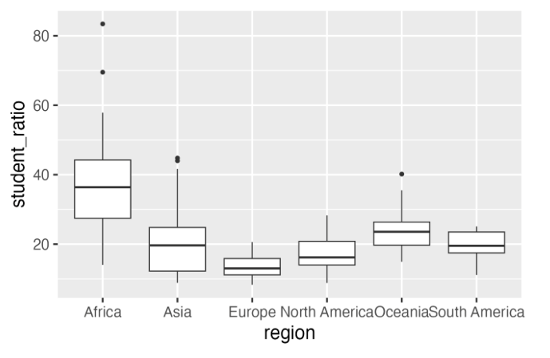
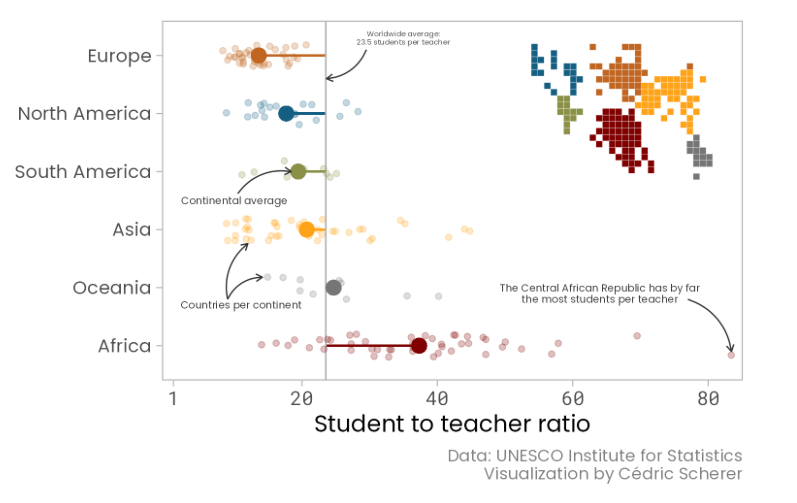

# Comunicación {#sec-comunicacion}

::: callout-note
## Objetivos de aprendizaje
Al finalizar este capítulo, el alumno será capaz de:

- Elegir el tipo de gráfico adecuado en función del mensaje que quiere comunicar.
- Aplicar los principios básicos de diseño visual para que un gráfico sea claro y honesto.
- Identificar y evitar los errores más frecuentes en la presentación de datos.
- Organizar un panel de resultados para un equipo de planta o una presentación para dirección.
- Adaptar el nivel de detalle y el lenguaje al tipo de audiencia.

Conceptos clave: **ratio datos/tinta, gráfico de barras, gráfico de líneas, gráfico de dispersión, panel de resultados, audiencia, mensaje principal**.
:::

## El análisis que nadie lee no existe

A lo largo de los capítulos anteriores hemos aprendido a calcular medias y desviaciones típicas, a construir histogramas y boxplots, a detectar correlaciones, a interpretar gráficos de control y a diseñar experimentos. Toda esa capacidad analítica tiene un solo propósito: **tomar mejores decisiones**.

Pero entre el análisis y la decisión hay un paso que con frecuencia se subestima: la comunicación. Un análisis excelente presentado de forma confusa, sobrecargada o inadecuada para la audiencia puede ser ignorado, malinterpretado o simplemente descartado. En cambio, un análisis moderado presentado con claridad y orientado a la acción puede generar cambios reales en el proceso.

Este capítulo no trata de hacer gráficos bonitos. Trata de hacer gráficos **efectivos**: que comuniquen exactamente lo que necesitan comunicar, a la audiencia correcta, en el tiempo disponible.

## La audiencia determina el mensaje

Antes de elegir un gráfico o preparar una presentación, hay que responder una pregunta fundamental: **¿quién va a ver esto y para qué?**

En el entorno industrial hay básicamente tres tipos de audiencia, cada una con necesidades diferentes:

**El equipo de planta** (operarios, técnicos de turno, jefes de línea) necesita información inmediata y accionable. La pregunta que tienen es “¿qué tengo que hacer ahora mismo?”. El gráfico de control en el panel de la línea de producción es para ellos: muestra si el proceso está bajo control o no, sin ambigüedades. No necesitan la distribución t de Student ni los índices de capacidad: necesitan saber si deben intervenir o no.

**El equipo técnico** (responsables de calidad, ingeniería de proceso, laboratorio) necesita entender el análisis en profundidad. La pregunta que tienen es “¿por qué está pasando esto y cómo lo mejoramos?”. Para ellos sí son relevantes los gráficos de correlación, los diagramas de dispersión por trimestre, los gráficos de interacción del diseño de experimentos.

**La dirección** (gerencia, responsables de área) necesita el impacto en negocio. La pregunta que tienen es “¿cuánto cuesta este problema y cuánto ganamos si lo resolvemos?”. Para ellos el análisis estadístico es secundario; lo que importa es la cifra económica y la recomendación clara.

::: callout-note
## Una presentación, un mensaje principal

Un error frecuente es intentar mostrar todo el análisis a todas las audiencias. Una presentación eficaz tiene **un mensaje principal** claramente identificado antes de empezar a preparar ningún gráfico. Todos los elementos visuales deben apoyar ese mensaje. Lo que no apoya el mensaje no debería estar en la presentación; puede ir en un anexo para quien quiera profundizar.
:::

## Los principios de Tufte: menos es más

Edward Tufte es uno de los referentes más influyentes en visualización de datos. En su obra *The Visual Display of Quantitative Information* (1983), formuló un principio que sigue siendo completamente vigente: la **ratio datos/tinta** (*data-ink ratio*).

La idea es sencilla: cada elemento visual de un gráfico (cada línea, cada color, cada símbolo) ocupa “tinta” (espacio visual). Si ese elemento transmite información real sobre los datos, justifica su presencia. Si no transmite información, porque es decoración, relleno o ruido visual, debe eliminarse.

Tufte llamó “chartjunk” (basura de gráfico) a todos esos elementos decorativos que no aportan información: fondos de cuadrícula demasiado prominentes, sombras en las barras, efectos tridimensionales, degradados de color, iconos decorativos. No solo no añaden información: dificultan activamente la lectura del gráfico.

Aplicado a los gráficos que hemos construido a lo largo del libro, esto significa:

- Usar `theme_bw()` o `theme_minimal()` en ggplot2 en lugar del tema gris por defecto
- Eliminar las líneas de cuadrícula secundarias cuando no añaden información
- No usar colores si no transmiten información adicional (un gráfico de barras de una sola variable no necesita barras de colores diferentes)
- No usar nunca efectos 3D, porque distorsionan la percepción de las magnitudes

## Los gráficos a evitar

### El gráfico de tarta (pie chart)

El gráfico de tarta es uno de los más usados y uno de los menos efectivos. El ojo humano compara mal áreas y ángulos; comparamos mucho mejor longitudes. Si tenemos cinco categorías con proporciones similares, es prácticamente imposible saber cuál es mayor en un gráfico de tarta. Un gráfico de barras ordenado comunica exactamente la misma información de forma mucho más clara.

La única excepción razonable es cuando hay exactamente dos categorías (conforme / no conforme, por ejemplo) y la proporción es muy diferente (95 % / 5 %). En ese caso, el gráfico de tarta es intuitivo. Pero incluso ahí, una sola cifra (“5 % de no conformes”) suele ser más efectiva que el gráfico.

### Los gráficos 3D

Los gráficos 3D son el ejemplo más claro de chartjunk. La tercera dimensión no añade ninguna información, solo distorsión visual. Las barras del fondo parecen más pequeñas que las del frente aunque tengan el mismo valor. La perspectiva hace imposible leer los valores con precisión. Y el efecto es peor en pantalla que en papel, y peor aún proyectado en una sala de reuniones.

La regla es simple: **nunca usar gráficos 3D para datos cuantitativos**. Si los datos son en dos dimensiones, el gráfico debe ser en dos dimensiones.

### El gráfico de doble eje Y

El gráfico con dos ejes Y distintos (uno a la izquierda y otro a la derecha, con escalas diferentes) es engañoso casi por definición. Al poder elegir las escalas libremente, se puede hacer que dos variables que no tienen ninguna relación parezcan perfectamente correlacionadas, o que dos variables muy relacionadas parezcan independientes. Es exactamente el truco visual que Tyler Vigen usa en sus correlaciones espurias que vimos en el capítulo de correlación.

Si necesitas mostrar dos variables en el mismo gráfico, usa dos gráficos separados con el mismo eje X: el lector puede compararlos visualmente sin que la escala le engañe.

## ¿Qué gráfico usar? Recursos de referencia

Elegir el tipo de gráfico correcto no siempre es obvio. El **Visual Vocabulary** del Financial Times ([ft-interactive.github.io/visual-vocabulary](https://ft-interactive.github.io/visual-vocabulary/)) es una de las mejores referencias disponibles: organiza los tipos de gráfico según el tipo de comparación que se quiere hacer (distribución, correlación, cambio temporal, desviación, parte de un todo) y, para cada categoría muestra ejemplos visuales con una breve descripción de cuándo usarlos. Es un recurso de consulta rápida especialmente útil cuando no tenemos claro qué tipo de gráfico comunicará mejor un resultado concreto.

Una versión similar pero más orientada a la implementación en R es el [R Graph Gallery](https://r-graph-gallery.com/), que muestra cientos de tipos de gráficos con el código R necesario para reproducirlos.

## Ejemplos comparativos: el gráfico incorrecto y el gráfico correcto

La mejor forma de entender los principios de visualización es verlos en acción. Los ejemplos siguientes muestran, con datos que ya conocemos del libro, la diferencia entre un gráfico que dificulta la comunicación y uno que la facilita.

### Ejemplo 1: composición por categorías — tarta vs. barras

El gráfico de tarta hace difícil comparar las proporciones de las tres especies de pingüinos. El gráfico de barras horizontales ordenado comunica exactamente lo mismo de forma mucho más clara:
```{r}
#| code-fold: true
#| message: false
#| warning: false

library(tidyverse)
library(palmerpenguins)
library(patchwork)

conteo <- penguins |>
    count(species) |>
    mutate(pct = n / sum(n) * 100)

# Gráfico incorrecto: tarta
p_malo <- ggplot(conteo, aes(x = "", y = pct, fill = species)) +
    geom_col(width = 1) +
    coord_polar("y") +
    labs(title = "❌ Gráfico de tarta",
         subtitle = "¿Cuál es la diferencia entre Chinstrap y Gentoo?",
         fill = "Especie", x = NULL, y = NULL) +
    theme_void() +
    theme(plot.title = element_text(color = "red", face = "bold"),
          plot.subtitle = element_text(size = 9))

# Gráfico correcto: barras horizontales ordenadas
p_bueno <- conteo |>
    mutate(species = fct_reorder(species, n)) |>
    ggplot(aes(x = n, y = species)) +
    geom_col(fill = "steelblue") +
    geom_text(aes(label = paste0(format(round(pct, 1), decimal.mark = ","), "%")),
              hjust = -0.2, size = 3.5) +
    xlim(0, 190) +
    labs(title = "✓ Barras horizontales",
         subtitle = "La diferencia es inmediatamente visible",
         x = "Número de individuos", y = NULL) +
    theme_bw() +
    theme(panel.grid.major.y = element_blank(),
          plot.title = element_text(color = "darkgreen", face = "bold"),
          plot.subtitle = element_text(size = 9))

p_malo + p_bueno
```

### Ejemplo 2: color innecesario vs. color con propósito

Usar colores diferentes para cada barra cuando todas representan la misma variable sugiere falsamente que las categorías son distintas. Si queremos destacar algo específico, por ejemplo el mes en que hubo una incidencia, el color tiene propósito:

```{r}
#| code-fold: true
#| message: false
#| warning: false

# Goles por partido en cada mes de La Liga 2024-25
meses <- read_csv2("datos/laliga_resultados2425.csv") |>
    mutate(mes = floor_date(dmy(fecha), "month")) |>
    group_by(mes) |>
    summarise(goles = mean(goles_local + goles_visitante)) |>
    mutate(mes_txt = factor(format(mes, "%m/%y"), levels = format(mes, "%m/%y")))

# Gráfico incorrecto: un color por barra sin motivo
p_malo2 <- ggplot(meses, aes(x = mes_txt, y = goles, fill = mes_txt)) +
    geom_col() +
    labs(title = "❌ Color decorativo",
         subtitle = "¿Qué información añaden los colores?",
         x = "Mes", y = "Goles por partido") +
    theme_bw() +
    theme(legend.position = "none",
          plot.title = element_text(color = "red", face = "bold"),
          plot.subtitle = element_text(size = 9))

# Gráfico correcto: un color, destacando el máximo
p_bueno2 <- meses |>
    mutate(destacar = goles == max(goles)) |>
    ggplot(aes(x = mes_txt, y = goles, fill = destacar)) +
    geom_col() +
    scale_fill_manual(values = c("FALSE" = "steelblue", "TRUE" = "tomato")) +
    annotate("text", x = which.max(meses$goles), y = max(meses$goles) + 0.15,
             label = "Máximo de la temporada", color = "tomato", size = 3.5) +
    labs(title = "✓ Color con propósito",
         subtitle = "El color destaca el valor relevante",
         x = "Mes", y = "Goles por partido") +
    theme_bw() +
    theme(legend.position = "none",
          plot.title = element_text(color = "darkgreen", face = "bold"),
          plot.subtitle = element_text(size = 9))

p_malo2 + p_bueno2
```

### Ejemplo 3: cuadrícula excesiva vs. gráfico limpio

El tema por defecto de ggplot2 tiene un fondo gris y una cuadrícula prominente que compite visualmente con los datos. El mismo gráfico con `theme_bw()` y sin cuadrícula secundaria es más limpio y más fácil de leer:

```{r}
#| code-fold: true
#| message: false
#| warning: false

datos_temp <- penguins |>
    filter(!is.na(flipper_length_mm), !is.na(body_mass_g))

# Gráfico incorrecto: tema por defecto con fondo gris
p_malo3 <- ggplot(datos_temp, aes(x = flipper_length_mm, y = body_mass_g,
                                   color = species)) +
    geom_point(alpha = 0.6, size = 2) +
    labs(title = "❌ Tema por defecto",
         subtitle = "El fondo gris y la cuadrícula compiten con los datos",
         x = "Longitud de aleta (mm)", y = "Masa corporal (g)",
         color = "Especie") +
    theme(plot.title = element_text(color = "red", face = "bold"),
          plot.subtitle = element_text(size = 9))

# Gráfico correcto: tema limpio sin cuadrícula secundaria
p_bueno3 <- ggplot(datos_temp, aes(x = flipper_length_mm, y = body_mass_g,
                                    color = species)) +
    geom_point(alpha = 0.6, size = 2) +
    labs(title = "✓ Tema limpio",
         subtitle = "Los datos son el protagonista",
         x = "Longitud de aleta (mm)", y = "Masa corporal (g)",
         color = "Especie") +
    theme_bw() +
    theme(panel.grid.minor = element_blank(),
          plot.title = element_text(color = "darkgreen", face = "bold"),
          plot.subtitle = element_text(size = 9))

p_malo3 + p_bueno3
```

Los tres ejemplos ilustran el mismo principio de Tufte: eliminar todo elemento visual que no transmite información sobre los datos mejora la comunicación, no la empobrece.

La elección del tipo de gráfico depende del **tipo de comparación** que quieres hacer:

| Comparación                                  | Gráfico recomendado           | Ejemplo del libro                     |
| -------------------------------------------- | ----------------------------- | ------------------------------------- |
| Distribución de una variable                 | Histograma, boxplot, densidad | Longitud de aleta de los pingüinos    |
| Evolución temporal                           | Gráfico de líneas             | Temperatura media de Oviedo           |
| Comparación entre grupos                     | Boxplot, barras con error     | Longitud de aleta por especie         |
| Relación entre dos variables                 | Dispersión                    | MG vs EST en el camembert             |
| Seguimiento de proceso                       | Gráfico de control            | Peso de yogures                       |
| Composición (pocas categorías muy distintas) | Barras horizontales           | —                                     |

Una regla práctica: si te preguntas si deberías usar un gráfico de tarta, usa un gráfico de barras. Si te preguntas si deberías usar un gráfico 3D, usa un gráfico 2D. Si tienes dudas entre histograma y boxplot, usa el boxplot para comparar grupos y el histograma para explorar la forma de una distribución.

## El color como información, no como decoración

El color es uno de los recursos visuales más potentes y más mal utilizados. En un gráfico bien diseñado, el color transmite información específica: diferentes series, diferentes grupos, una escala de intensidad. En un gráfico mal diseñado, el color es pura decoración: barras de colores diferentes aunque todas representen la misma variable, gradientes sin significado, paletas llamativas que dificultan la lectura.

Algunas reglas prácticas:

**Una variable, un color.** Si tienes un gráfico de barras con los resultados mensuales de una sola variable, todas las barras deben ser del mismo color. Usar colores diferentes para cada mes sugiere que los meses son categorías distintas, lo que confunde al lector.

**El color para destacar, no para decorar.** Si quieres llamar la atención sobre un valor específico (el mes en que el proceso falló, el período fuera de control), usa un color diferente solo para ese elemento. El contraste entre el elemento destacado y el resto en color neutro comunica inmediatamente dónde debe mirar el lector.

**Accesibilidad para daltónicos.** Aproximadamente el 8 % de los hombres tiene algún grado de daltonismo. El rojo y el verde son los colores más problemáticos. Si necesitas distinguir dos grupos, usa azul y naranja, o azul y rojo, en lugar de rojo y verde. En ggplot2, la paleta `viridis` y las paletas de `RColorBrewer` están diseñadas para ser legibles por personas con daltonismo.

**Pocas categorías, colores diferenciados.** El ojo humano distingue bien hasta 6-8 colores en un gráfico. Con más categorías, el gráfico de colores se vuelve ilegible. Si tienes más de 8 grupos, considera otras formas de organizar la información (facetas, gráficos separados).

## De los gráficos del libro a la comunicación real

A lo largo del libro hemos construido muchos gráficos con propósito analítico: para explorar los datos, detectar patrones, verificar supuestos. Esos gráficos son para nosotros, no para la audiencia. Antes de presentarlos, necesitan una revisión editorial:

### El histograma de exploración vs el histograma de comunicación

Cuando cargamos un dataset nuevo y hacemos un histograma para ver la distribución, el gráfico tiene ejes automáticos, título genérico y ninguna anotación. Es suficiente para explorar. Para comunicar, el mismo histograma necesita: un título que diga exactamente qué muestra, etiquetas de eje con unidades, y posiblemente una línea vertical indicando el objetivo o límite relevante.

Comparemos los dos enfoques con la distribución de la longitud de aleta de los pingüinos Gentoo, que usamos en el capítulo de distribuciones:

```{r}
#| code-fold: true
#| message: false
#| warning: false

library(palmerpenguins)

# Versión de exploración: rápida, sin pulir
penguins |>
    filter(species == "Gentoo") |>
    ggplot(aes(x = flipper_length_mm)) +
    geom_histogram(bins = 15, fill = "steelblue", color = "white") +
    theme_bw() +
    labs(title = "Longitud de aleta — Gentoo",
         x = "Longitud de aleta (mm)", y = "Frecuencia")
```

```{r}
#| code-fold: true
#| message: false
#| warning: false

gentoo <- penguins |> filter(species == "Gentoo", !is.na(flipper_length_mm))
media_g <- mean(gentoo$flipper_length_mm)

# Versión de comunicación: orientada al mensaje
gentoo |>
    ggplot(aes(x = flipper_length_mm)) +
    geom_histogram(bins = 15, fill = "steelblue", color = "white", alpha = 0.8) +
    geom_vline(xintercept = media_g, color = "red",
               linewidth = 1, linetype = "dashed") +
    annotate("text", x = media_g + 0.5, y = Inf, vjust = 2,
             label = paste0("Media: ", format(round(media_g, 1), decimal.mark = ","), " mm"),
             color = "red", size = 3.5, hjust = 0) +
    theme_bw() +
    theme(panel.grid.minor = element_blank()) +
    labs(title    = "Distribución de la longitud de aleta — pingüinos Gentoo",
         subtitle = paste0("n = ", nrow(gentoo), " individuos. Isla Biscoe, archipiélago Palmer (Antártida)"),
         x        = "Longitud de aleta (mm)",
         y        = "Número de individuos",
         caption  = "Fuente: Horst AM et al. (2020). palmerpenguins R package.")
```

La diferencia no está en el tipo de gráfico (es el mismo histograma), sino en los elementos que orientan al lector: el título descriptivo, el subtítulo con contexto, la línea de la media anotada, las etiquetas de eje con unidades, y la fuente de los datos.

### El gráfico de control para el panel de planta

El gráfico de control del proceso de llenado de yogures que construimos en el capítulo de SPC tenía todos los elementos necesarios para el análisis: límites de control, puntos fuera de límites marcados, título. Para un panel de planta, habría que añadir unas zonas coloreadas que indiquen de un vistazo si el proceso está en zona normal, de advertencia o fuera de control, y las etiquetas con el valor de cada línea.

La diferencia clave entre un gráfico de análisis y un gráfico de panel de planta es que el panel de planta tiene que ser **autoexplicativo para alguien que no ha visto el análisis**. Tiene que responder por sí solo las preguntas: ¿qué se está midiendo?, ¿cuál es el objetivo?, ¿estamos dentro o fuera?, ¿qué hay que hacer si estamos fuera?

```{r}
#| code-fold: true
#| message: false
#| warning: false

library(tidyverse)

# Muestreo de yogures del turno del 1 de octubre (capítulo 9)
df_m <- read_csv2("datos/llenado_yogures_muestra.csv",
                  locale = locale(decimal_mark = ",", encoding = "ISO-8859-1"))

# Medias por subgrupo, con la hora de inicio de cada subgrupo
medias_sg <- df_m |>
    group_by(muestra) |>
    summarise(hora = min(hora_envasado), media = mean(peso_g), .groups = "drop")

# Límites calculados con la Fase I (primeros 10 subgrupos, de 08:00 a 08:30).
# Como dibujamos medias de 5 envases, la desviación típica se divide por raíz de 5.
fase1     <- df_m |> filter(muestra <= 10)
media_ref <- mean(fase1$peso_g)
sigma_med <- sd(fase1$peso_g) / sqrt(5)
UCL <- media_ref + 3 * sigma_med
LCL <- media_ref - 3 * sigma_med
UWL <- media_ref + 2 * sigma_med   # límite de advertencia superior
LWL <- media_ref - 2 * sigma_med   # límite de advertencia inferior

medias_sg <- medias_sg |>
    mutate(fuera_control = media > UCL | media < LCL)
x_fin <- max(medias_sg$hora)

ggplot(medias_sg, aes(x = hora, y = media)) +
    # Zonas de advertencia (entre 2σ y 3σ)
    annotate("rect", xmin = -Inf, xmax = Inf, ymin = LCL, ymax = LWL,
             fill = "orange", alpha = 0.15) +
    annotate("rect", xmin = -Inf, xmax = Inf, ymin = UWL, ymax = UCL,
             fill = "orange", alpha = 0.15) +
    # Zonas fuera de control (más allá de 3σ)
    annotate("rect", xmin = -Inf, xmax = Inf, ymin = -Inf, ymax = LCL,
             fill = "red", alpha = 0.1) +
    annotate("rect", xmin = -Inf, xmax = Inf, ymin = UCL, ymax = Inf,
             fill = "red", alpha = 0.1) +
    # Líneas de control y de referencia
    geom_hline(yintercept = c(UCL, LCL), color = "red",
               linetype = "dashed", linewidth = 0.8) +
    geom_hline(yintercept = c(UWL, LWL), color = "orange",
               linetype = "dashed", linewidth = 0.6) +
    geom_hline(yintercept = media_ref, color = "darkgreen", linewidth = 1) +
    # Etiquetas con el valor de cada línea
    annotate("text", x = x_fin, y = UCL, vjust = -0.4, hjust = 1,
             label = paste0("LSC (", format(round(UCL, 1), decimal.mark = ","), " g)"),
             color = "red", size = 2.8) +
    annotate("text", x = x_fin, y = LCL, vjust = 1.4, hjust = 1,
             label = paste0("LIC (", format(round(LCL, 1), decimal.mark = ","), " g)"),
             color = "red", size = 2.8) +
    annotate("text", x = x_fin, y = media_ref, vjust = -0.4, hjust = 1,
             label = paste0("Referencia (", format(round(media_ref, 1), decimal.mark = ","), " g)"),
             color = "darkgreen", size = 2.8) +
    # Puntos
    geom_line(color = "steelblue", linewidth = 0.7) +
    geom_point(aes(color = fuera_control), size = 2.5) +
    scale_color_manual(values = c("FALSE" = "steelblue", "TRUE" = "red"),
                       guide = "none") +
    labs(
        title    = "Control de peso — Línea de yogures 150 g — Turno del 1 de octubre",
        subtitle = "Zona naranja: advertencia (±2σ)  |  Zona roja: fuera de control (±3σ)  |  Puntos rojos: señal de alarma",
        x        = "Hora (un subgrupo de 5 envases cada 3 min)",
        y        = "Peso medio del subgrupo (g)",
        caption  = "LSC/LIC: límites de control superior/inferior  |  Referencia: media del período estable (08:00-08:30)"
    ) +
    theme_bw() +
    theme(panel.grid.minor = element_blank(),
          plot.subtitle = element_text(size = 8))
```

El gráfico añade dos elementos respecto al gráfico de análisis del capítulo [-@sec-control-procesos]: las zonas coloreadas de advertencia (naranja) y fuera de control (rojo), que permiten leer el estado del proceso de un vistazo, y las etiquetas con el valor de cada línea, para que el operario sepa exactamente cuándo actuar.

::: {.callout-warning}
## ¿Por qué no dibujamos el límite legal T1?
T1 se aplica a cada envase, no a la media de 5 envases. Una media puede quedar muy por encima de T1 aunque uno de sus envases esté por debajo. Por eso T1 no debe dibujarse en un gráfico de medias: daría una falsa sensación de seguridad. Su lugar es un gráfico de pesos individuales o un histograma, como el del capítulo [-@sec-control-procesos].
:::

Un ejemplo brillante de la aplicación del color y el diseño es el que presentan [Yan Holtz](https://www.linkedin.com/in/yan-holtz-2477534a/) y [Cédric Scherer](https://www.linkedin.com/in/cedscherer/) en su sitio web [ggplot-uncharted](https://www.ggplot2-uncharted.com/), para explicar la relación de la ratio de estudiantes por maestro en el mundo:

::: {#fig-media-holtz layout-ncol="2" layout-valign="bottom"}




Ejemplo del uso del color y el diseño para mejorar un gráfico básico de ggplot
:::

Estos dos analistas de datos ofrecen cursos para mejorar las capacidades en el diseño gráfico y comunicación.

## Organizar una presentación de resultados

Tanto si es un panel en la pared de la planta como una presentación en PowerPoint para dirección, la estructura efectiva sigue el mismo principio: **mensaje antes que evidencia**.

El error más frecuente es organizar la presentación en el orden en que se hizo el análisis: primero los datos brutos, luego la exploración, luego el análisis, y al final la conclusión. Para el analista tiene sentido, porque así fue el proceso. Para la audiencia es agotador: tienen que esperar hasta el final para saber de qué va todo.

La estructura efectiva invierte ese orden:

1. **El mensaje principal** — una frase, en la primera diapositiva o en el encabezado del panel. “El proceso de llenado es capaz, pero dos incidentes del turno del 1 de octubre dejaron envases por debajo de T2, y el lote no es conforme con el RD 1801/2008.”
2. **La evidencia clave** — uno o dos gráficos que demuestran el mensaje. No todos los gráficos del análisis, solo los que demuestran lo que se está afirmando.
3. **La recomendación** — qué hay que hacer. Concreta, asignable, con plazo si es posible.
4. **El detalle** — en un anexo, para quien quiera verificar el análisis completo.

::: callout-note
## La regla del titular de periódico

Un buen ejercicio antes de preparar cualquier presentación de datos es escribir el titular: una frase de menos de 15 palabras que resume el hallazgo principal. Si no puedes escribirlo, probablemente no tienes claro cuál es el mensaje principal. Si el titular es obvio y poco informativo (“Análisis de los datos de peso del mes de marzo”), el análisis no ha encontrado nada relevante o no se ha formulado la pregunta correcta.

Ejemplos de titulares poco informativos: “Resultados del análisis de peso de enero”. Ejemplos de titulares efectivos: “La variabilidad del peso aumenta un 40 % en el turno de noche” o “Reducir σ de 2,6 a 1,5 g ahorra 8.000 € anuales en sobredosificación”.
:::

## Informes reproducibles: Quarto y el código abierto

En el capítulo dedicado a las herramientas de análisis vimos en detalle las limitaciones de la hoja de cálculo para el análisis reproducible: las fórmulas ocultas en las celdas dificultan la auditoría, los informes no se pueden regenerar automáticamente cuando los datos cambian, y el conocimiento queda atrapado en ficheros que nadie más entiende. Aquí retomamos ese argumento desde la perspectiva de la comunicación: no basta con hacer un buen análisis y presentarlo bien, hay que asegurarse de que ese análisis sea verificable y actualizable.

### La alternativa: el informe reproducible

Un **informe reproducible** es un documento en el que el texto, los cálculos y los gráficos están escritos en el mismo fichero, en código visible. Cuando los datos cambian, basta con regenerar el documento: todo se recalcula y se redibuja automáticamente, sin intervención manual.

El libro que estás leyendo es un ejemplo: está escrito en **Quarto**, una herramienta de código abierto que combina texto en formato Markdown con código en R o Python. Casi todos los gráficos del libro se generan a partir del código que aparece junto a ellos. Si los datos cambian, el gráfico cambia. Si hay un error en el cálculo, está visible en el código y cualquiera puede encontrarlo y corregirlo.

Quarto puede generar documentos en múltiples formatos a partir del mismo fichero fuente: HTML para publicar en web, PDF para imprimir, Word para compartir con quien no tiene acceso al sistema. Un mismo informe mensual puede entregarse en los tres formatos sin trabajo adicional.

### Código abierto vs. herramientas propietarias

Existen herramientas comerciales para crear informes y dashboards de datos, como **Power BI** (Microsoft) o **Tableau**. Son potentes, tienen interfaces visuales atractivas y están muy extendidas en grandes empresas. Pero tienen una limitación importante: **el conocimiento que adquieres es propiedad de la empresa que vende el software**.

El lenguaje visual de Power BI, sus fórmulas DAX, su forma de conectar datos: todo ese aprendizaje solo sirve dentro de Power BI. Si la empresa deja de pagar la licencia, o si cambias de trabajo a una empresa que usa otra herramienta, parte de tu inversión de aprendizaje se pierde. Es una inversión “cerrada”.

En cambio, aprender a analizar y comunicar datos con Python o R, y a generar informes con Quarto o Jupyter Notebooks, es una inversión abierta. Python y R son gratuitos, funcionan en cualquier ordenador, y el conocimiento que adquieres es completamente transferible: de una empresa a otra, de un sector a otro, de un proyecto a otro. La comunidad que los desarrolla y los mejora es global y no depende de ninguna empresa concreta.

Esto no significa que las herramientas propietarias sean malas: en algunos contextos son la opción correcta. Pero para un técnico que está construyendo su perfil profesional, aprender herramientas de código abierto es una apuesta más sólida a largo plazo.

::: callout-note
## Jupyter Notebooks: el equivalente en Python

El equivalente de Quarto en el ecosistema Python son los **Jupyter Notebooks**: documentos que combinan código Python, texto y gráficos en un formato interactivo. Son el estándar en ciencia de datos y análisis en Python, y se pueden exportar a HTML o PDF igual que Quarto. La versión en Google Colab del capítulo dedicado al camembert es un cuaderno Jupyter. Quarto, de hecho, puede incorporar notebooks de Jupyter directamente.
:::

## Recursos para seguir aprendiendo

Los principios de este capítulo se desarrollan con mucho más detalle en una serie de sitios de referencia que el alumno puede consultar libremente. Cada uno tiene un enfoque distinto y resulta útil en situaciones diferentes:

**Para elegir el tipo de gráfico correcto:**

- [**Visual Vocabulary** — Financial Times](https://ft-interactive.github.io/visual-vocabulary/): organiza los tipos de gráfico por el tipo de comparación que se quiere hacer (distribución, correlación, cambio temporal, parte de un todo…). Es la referencia más rápida para responder “¿qué gráfico uso aquí?”.
- [**From Data to Viz**](https://www.data-to-viz.com): árbol de decisión interactivo que, a partir del tipo de datos que tienes (numérico, categórico, temporal, geográfico…), te guía hasta el tipo de gráfico recomendado. Incluye código R y Python para cada tipo, y advierte de los errores más frecuentes.

**Para implementar gráficos en R y Python:**

- [**R Graph Gallery**](https://r-graph-gallery.com): catálogo exhaustivo de tipos de gráficos en R con el código ggplot2 necesario para reproducirlos. Especialmente útil cuando sabes qué quieres hacer pero no cómo hacerlo en R.
- [**Python Graph Gallery**](https://python-graph-gallery.com): equivalente al anterior para Python, con ejemplos en matplotlib, seaborn y plotly. Mismo formato: gráfico + código listo para copiar y adaptar.

**Para informes y comunicación con Quarto:**

- [**Quarto Gallery**](https://quarto.org/docs/gallery/): ejemplos de documentos, informes, dashboards y presentaciones generados con Quarto. Permite ver el resultado final y el código fuente de cada ejemplo. Es el mejor punto de partida para entender qué se puede hacer con Quarto más allá de lo que muestra este libro.

**Para desarrollar el criterio visual:**

- [**Storytelling with Data — Chart Guide**](https://www.storytellingwithdata.com/chart-guide): orientado a la comunicación más que a la implementación. Explica qué hace que un gráfico funcione o no funcione para transmitir un mensaje, con ejemplos de gráficos reales mejorados paso a paso. Complementa perfectamente los recursos técnicos anteriores.

## Resumen del capítulo

Comunicar bien los resultados de un análisis es tan importante como hacer bien el análisis. Un gráfico efectivo tiene un propósito claro, está adaptado a su audiencia, elimina todo elemento visual que no transmite información, y orienta al lector hacia el mensaje principal.

Los principios de Tufte (maximizar la ratio datos/tinta, eliminar el chartjunk) son una guía práctica para evaluar cualquier gráfico: si un elemento no transmite información sobre los datos, debe eliminarse. Los gráficos 3D, las tartas con muchas categorías y los dobles ejes Y son los errores más frecuentes y los más fáciles de evitar.

La elección del tipo de gráfico depende del tipo de comparación que se quiere hacer. Para distribuciones, el histograma y el boxplot. Para evolución temporal, el gráfico de líneas. Para relaciones entre variables, el gráfico de dispersión. Para seguimiento de proceso, el gráfico de control.

Finalmente, una presentación efectiva pone el mensaje antes que la evidencia: primero el hallazgo principal, luego los gráficos que lo demuestran, luego la recomendación. El detalle del análisis va al final, para quien quiera verificarlo.
