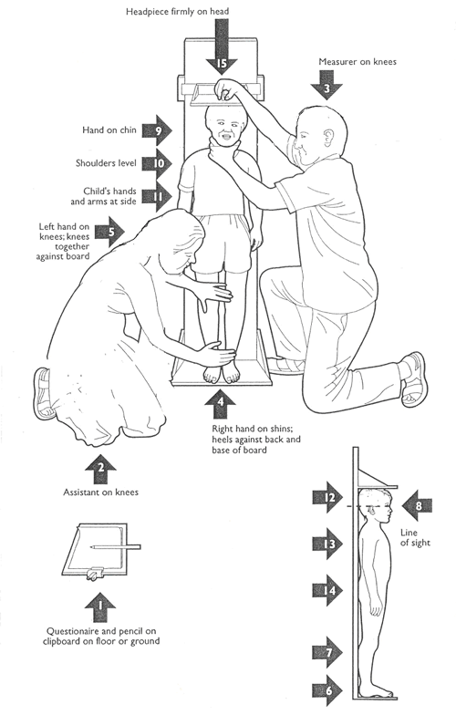
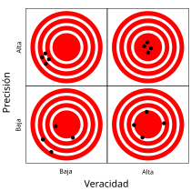
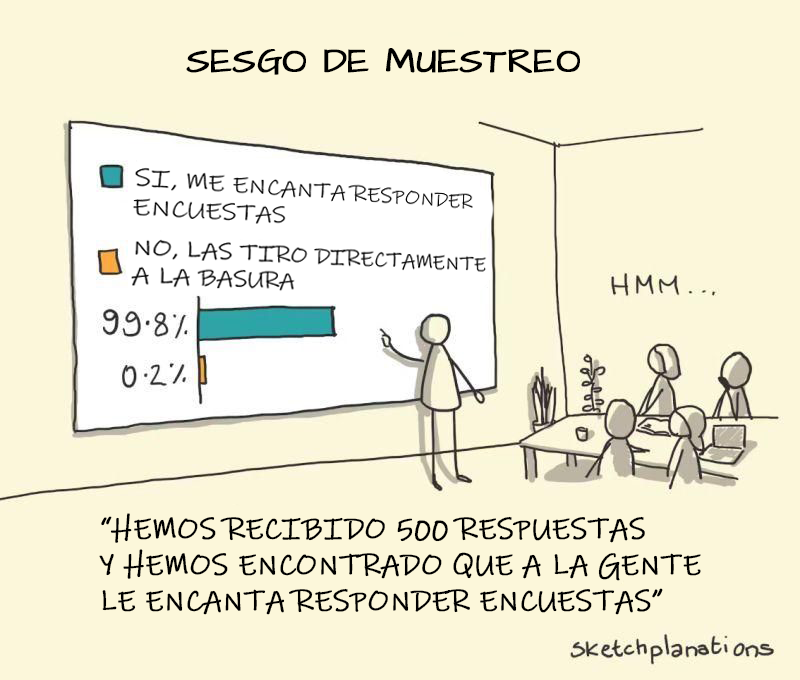

```{r}
#| include: false
library(reticulate)
use_python("C:/ProgramData/miniconda3/python.exe", required = TRUE)
```

::: callout-note
## Objetivos de aprendizaje

Al finalizar este capítulo, el alumno será capaz de:

- Identificar las principales fuentes de error en un análisis de laboratorio y clasificarlas según su origen.
- Distinguir entre veracidad y precisión según la norma ISO 5725-1:2023, y reconocer cada tipo de error en datos reales.
- Visualizar y comparar el comportamiento analítico de diferentes analistas mediante boxplot y dotplot.
- Calcular el sesgo y la desviación típica de repetibilidad para cada analista a partir de un dataset de resultados.
- Interpretar los resultados de un estudio de repetibilidad y proponer acciones correctoras adecuadas al tipo de error detectado.

Conceptos clave: **medida, fuente de variación, veracidad, precisión, exactitud, sesgo, repetibilidad, reproducibilidad, ISO 5725-1:2023**.
:::

## ¿Qué es una medida?

Una medida es el resultado de la acción de *medir*: comparar lo que queremos cuantificar con un patrón de referencia, siguiendo un procedimiento definido, con un instrumento adecuado, y por parte de uno o varios analistas.

En apariencia, el proceso parece sencillo. Sin embargo, si lo analizamos con atención, veremos que hay múltiples elementos que pueden hacer que el resultado no sea tan fiable como esperamos. Pensemos en algo tan cotidiano como medir la altura de una persona con una cinta métrica:

{.column-margin}

¿Está el niño descalzo? ¿Tiene las rodillas rectas? ¿Está apoyado en un plano vertical? ¿La posición de los ojos del analista es perpendicular a la escala? ¿La cinta métrica está homologada? Cada uno de estos elementos puede introducir un error diferente en el resultado.

La **descripción detallada del procedimiento**, junto con la especificación del instrumento y sus requisitos de calibración, constituye lo que se conoce como *método analítico*. Un buen método analítico reduce al mínimo la influencia del analista y del instrumento en el resultado, garantizando que diferentes personas obtengan resultados comparables en diferentes momentos y lugares.

{.column-margin}

La Organización Mundial de la Salud, por ejemplo, define procedimientos muy precisos para la medición de peso y talla en niños, porque pequeños errores sistemáticos en esas medidas tienen consecuencias directas en el diagnóstico nutricional a escala global.

## Las fuentes de variación en el laboratorio

En un laboratorio de quesería, las fuentes de variación más habituales son:

**El analista.** La técnica personal, la experiencia, la fatiga o simplemente un hábito incorrecto en la lectura del instrumento pueden introducir diferencias entre personas. Dos analistas que siguen el mismo método pueden obtener resultados distintos de forma sistemática.

**El instrumento.** Un butirómero descalibrado, una centrífuga con velocidad irregular, un baño maría con temperatura inestable: todos ellos introducen variación en el resultado con independencia de la habilidad del analista.

**El método.** La temperatura de la muestra en el momento del análisis, el tiempo de reposo antes de la lectura, la forma de homogeneizar la muestra: son condiciones que el procedimiento debe especificar con precisión para que no sean una fuente de variación adicional.

**La muestra.** Una muestra heterogénea o que ha sufrido degradación desde su recogida hasta el análisis introduce una variación que no es del sistema de medición sino del objeto medido.

En la práctica, lo que observamos en los resultados analíticos es la suma de todas estas fuentes. El objetivo del análisis del sistema de medición es separar y cuantificar cada una de ellas.

## Veracidad y precisión: la norma ISO 5725-1:2023

La norma internacional **ISO 5725-1:2023** (*Accuracy of measurement methods and results*) establece la terminología y los conceptos para evaluar la calidad de un método analítico. Distingue tres conceptos que en el uso cotidiano se confunden con frecuencia:

**Exactitud** (*accuracy*): término general que describe la proximidad entre un resultado de medida y el valor verdadero. Engloba dos componentes independientes.

**Veracidad** (*trueness*): proximidad entre la media de un gran número de resultados y el valor verdadero o de referencia. Cuando un método no es verídico, produce un **sesgo** sistemático: los resultados están desplazados de forma consistente hacia arriba o hacia abajo.

**Precisión** (*precision*): proximidad entre resultados independientes obtenidos en condiciones definidas. Un método preciso produce resultados muy parecidos entre sí, aunque no necesariamente cercanos al valor verdadero.

::: {.callout-tip}
## Una aclaración terminológica
En el uso coloquial, "exacto" y "preciso" se usan como sinónimos. En metrología, son conceptos distintos: un método puede ser muy preciso (resultados muy reproducibles) pero poco verídico (con sesgo), o verídico en promedio pero poco preciso (con mucha dispersión). La norma ISO 5725-1:2023 reserva el término *exactitud* para cuando ambas condiciones se cumplen simultáneamente.
:::

La imagen de las dianas ilustra las cuatro combinaciones posibles:

{width="80%"}

- **Alta veracidad, alta precisión:** los impactos están agrupados y centrados. Es el objetivo.
- **Alta veracidad, baja precisión:** los impactos están dispersos pero centrados en promedio. Hay variabilidad pero no sesgo.
- **Baja veracidad, alta precisión:** los impactos están agrupados pero desplazados del centro. Hay sesgo sistemático pero buena repetibilidad.
- **Baja veracidad, baja precisión:** los impactos están dispersos y desplazados. El peor caso.

En el laboratorio de quesería, cada uno de estos cuadros tiene una causa distinta y una solución distinta. Un analista con baja veracidad (sesgo) necesita revisar su técnica o recalibrar su instrumento. Un analista con baja precisión necesita trabajar la consistencia de su procedimiento.

## Repetibilidad y reproducibilidad

Dentro del concepto de precisión, la norma ISO 5725 distingue dos niveles:

**Repetibilidad:** variación obtenida cuando el mismo analista analiza la misma muestra varias veces en las mismas condiciones (mismo día, mismo instrumento, mismo procedimiento). Mide la consistencia interna de un analista.

**Reproducibilidad:** variación obtenida cuando diferentes analistas, en diferentes momentos o laboratorios, analizan la misma muestra. Mide la comparabilidad entre analistas o entre laboratorios.

La desviación típica de repetibilidad ($s_r$) y la desviación típica de reproducibilidad ($s_R$) son las medidas numéricas de cada uno de estos conceptos. Por definición, $s_R \geq s_r$: la variación entre analistas siempre es mayor o igual que la variación dentro de un mismo analista.

## Caso práctico: evaluación de analistas en el método Gerber

El método Gerber es uno de los métodos de referencia para la determinación de grasa en leche. Es un método volumétrico que los alumnos de tecnología láctea aprenden y practican en el laboratorio. Su resultado depende de varios factores de técnica personal: la temperatura del baño maría, el tiempo y la velocidad de centrifugación, y sobre todo la lectura correcta del menisco en el butirómetro.

Vamos a analizar los resultados de un estudio de repetibilidad en el que cinco analistas han determinado el contenido en grasa de tres muestras de leche con diferente contenido graso, realizando tres repeticiones cada uno.

Cargamos el dataset:

::: panel-tabset
## R

```{r}
#| code-fold: true
#| message: false
#| warning: false
#|

library(tidyverse)

url <- paste0(
    "https://raw.githubusercontent.com/",
    "juanriera/master-queseria/master/",
    "datos/grr_gerber.csv"
)

df <- read_csv2(url, locale = locale(decimal_mark = ","))
cat("Dimensiones:", nrow(df), "x", ncol(df), "\n")
head(df, 10)
```

## Python

```{python}
#| code-fold: true
#| message: false
#| warning: false
#|
import pandas as pd
import matplotlib.pyplot as plt
import seaborn as sns
import numpy as np

url = "datos/grr_gerber.csv"

df = pd.read_csv(url, sep=';', decimal=',', encoding='ISO-8859-1')
print(f"Dimensiones: {df.shape}")
df.head(10)
```

:::

### Visualización de los resultados por analista

El primer paso es visualizar todos los resultados. Usamos un boxplot por analista con los puntos individuales superpuestos, separando las tres muestras por color:

::: panel-tabset

## R
```{r}
#| code-fold: true
#| message: false
#| warning: false
#|

library(patchwork)

referencias <- tibble(
    muestra = c('A_baja', 'B_media', 'C_alta'),
    valor_referencia = c(3.4, 3.8, 4.5)
)

ggplot(df, aes(x = analista, y = resultado, color = muestra)) +
    geom_boxplot(aes(fill = muestra), alpha = 0.3,
                 outlier.shape = NA) +
    geom_jitter(width = 0.15, size = 2, alpha = 0.7) +
    geom_hline(data = referencias,
               aes(yintercept = valor_referencia, color = muestra),
               linetype = "dashed", linewidth = 0.7, alpha = 0.6) +
    scale_color_brewer(palette = "Set2") +
    scale_fill_brewer(palette = "Set2") +
    labs(title = "Resultados Gerber por analista y muestra",
         subtitle = "Líneas discontinuas = valor real",
         x = "Analista", y = "Grasa (%)",
         color = "Muestra", fill = "Muestra") +
    theme_bw() +
    theme(axis.text.x = element_text(angle = 15, hjust = 1))
```

## Python
```{python}
#| code-fold: true
#| message: false
#| warning: false
#|

import calendar

df_plot = df.copy()

fig, ax = plt.subplots(figsize=(12, 5))
sns.boxplot(data=df_plot, x='analista', y='resultado',
            hue='muestra', fliersize=0,
            palette='Set2', ax=ax)
sns.stripplot(data=df_plot, x='analista', y='resultado',
              hue='muestra', dodge=True,
              jitter=True, size=5, alpha=0.7,
              palette='Set2', legend=False, ax=ax)

# Añadir líneas de referencia para cada muestra
for muestra, valor, color in zip(
        ['A_baja', 'B_media', 'C_alta'],
        [3.4, 3.8, 4.5],
        ['#66c2a5', '#fc8d62', '#8da0cb']):
    ax.axhline(valor, linestyle='--', linewidth=0.8,
               color=color, alpha=0.6)

ax.set_title("Resultados Gerber por analista y muestra\n"
             "(líneas discontinuas = valor real)")
ax.set_xlabel("Analista")
ax.set_ylabel("Grasa (%)")
ax.legend(title='Muestra', bbox_to_anchor=(1.02, 1))
plt.tight_layout()
plt.show()
```

:::

El gráfico permite identificar visualmente los dos problemas distintos. ¿Puedes detectarlos antes de continuar con el análisis numérico?

### Cálculo del sesgo y la desviación típica de repetibilidad

Calculamos para cada analista y muestra la media, la desviación típica de repetibilidad y el sesgo respecto al valor real:

::: panel-tabset
## R
```{r}
#| code-fold: true
#| message: false
#| warning: false
#|

resumen <- df |>
    group_by(analista, muestra, valor_referencia) |>
    summarise(
        media = round(mean(resultado), 3),
        dt_repetibilidad = round(sd(resultado), 3),
        .groups = 'drop'
    ) |>
    mutate(sesgo = round(media - valor_referencia, 3))
resumen
```

## Python
```{python}
#| code-fold: true
#| message: false
#| warning: false
#|

resumen = (
    df.groupby(['analista', 'muestra', 'valor_referencia'])['resultado']
    .agg(
        media='mean',
        dt_repetibilidad='std'
    )
    .reset_index()
)
resumen['sesgo'] = (resumen['media'] - resumen['valor_referencia']).round(3)
resumen['media'] = resumen['media'].round(3)
resumen['dt_repetibilidad'] = resumen['dt_repetibilidad'].round(3)
resumen
```

:::

### Resumen por analista

Agregamos los resultados por analista para tener una visión global del comportamiento de cada uno:

::: panel-tabset

## R
```{r}
#| code-fold: true
#| message: false
#| warning: false
#|

resumen |>
    group_by(analista) |>
    summarise(
        sesgo_medio = round(mean(sesgo), 3),
        dt_repetibilidad_media = round(mean(dt_repetibilidad), 3)
    )
```

## Python
```{python}
#| code-fold: true
#| message: false
#| warning: false
#|

resumen_analista = (
    resumen.groupby('analista')
    .agg(
        sesgo_medio=('sesgo', 'mean'),
        dt_repetibilidad_media=('dt_repetibilidad', 'mean')
    )
    .round(3)
    .reset_index()
)
resumen_analista
```

:::

### Interpretación

La tabla y el gráfico permiten clasificar claramente a los cinco analistas:

**Analistas 1 y 2** muestran un sesgo prácticamente nulo y una desviación típica de repetibilidad baja. Son analistas con buena veracidad y buena precisión.

**Analista 3** presenta un sesgo leve pero consistente hacia valores altos, con una dispersión algo mayor que los anteriores. Probablemente redondea sistemáticamente al alza en la lectura de la columna de grasa del butirómetro. La solución pasa por revisar la técnica de lectura.

**Analista 4** destaca por tener una dispersión muy baja (alta repetibilidad) pero un sesgo negativo importante: sus resultados son sistemáticamente bajos en las tres muestras. Es el caso típico de un error de posición del ojo al leer el menisco del butirómetro: alta precisión, baja veracidad. Este analista necesita corrección en la técnica de lectura, no en la consistencia de su procedimiento.

**Analista 5** presenta la situación opuesta: sesgo nulo en promedio, pero una dispersión muy alta. Sus resultados son impredecibles: a veces acertados, a veces muy alejados del valor real. El origen más probable es una técnica irregular: temperatura del baño maría inestable, tiempo de centrifugación variable, o dificultad para homogeneizar la muestra antes del análisis.

::: {.callout-note}
## Dos tipos de error, dos soluciones distintas
El analista 4 y el analista 5 tienen errores de magnitud comparable, pero de naturaleza completamente diferente. El analista 4 necesita corregir un hábito concreto y repetible; el analista 5 necesita trabajar la consistencia de todo su procedimiento. Confundir los dos tipos de error llevaría a acciones incorrectas: no sirve de nada dar más formación teórica al analista 4 si el problema es una postura incorrecta; ni tampoco sirve corregir la postura del analista 5 si su problema es la variabilidad de las condiciones del análisis.
:::

## Seguimiento temporal del sistema de medición

El estudio GRR que hemos realizado es una fotografía del sistema de medición en un momento concreto. Pero los sistemas de medición no son estáticos: los electrodos de los pHmetros se colmatan progresivamente, los analistas desarrollan hábitos que pueden derivar con el tiempo, los instrumentos pierden calibración. Un laboratorio que solo evalúa su sistema de medición una vez al año puede estar trabajando meses con un sistema degradado sin saberlo.

La solución es el **seguimiento temporal**: repetir el estudio GRR de forma periódica — mensualmente en el caso del método Gerber — y representar la evolución de los indicadores clave a lo largo del tiempo. Esto convierte el análisis puntual en un sistema de vigilancia continua.

Usamos el dataset `grr_gerber_temporal.csv` que contiene los resultados de 12 meses de control, con 5 analistas, 3 muestras de referencia y 3 repeticiones por combinación (540 observaciones en total). El dataset incluye dos intervenciones: en el mes 4 se corrigió el hábito de lectura del menisco del analista A4, y en el mes 6 se formó al analista A5 en la técnica de agitación.

```{r temporal-carga}
#| code-fold: true
#| message: false
#| warning: false
#|

library(tidyverse)

df_t <- read_csv2("datos/grr_gerber_temporal.csv",
                  locale = locale(decimal_mark = ",")) |>
    mutate(fecha = dmy(fecha))

cat("Dimensiones:", nrow(df_t), "x", ncol(df_t), "\n")
cat("Período:", format(min(df_t$fecha), "%b %Y"), "→",
    format(max(df_t$fecha), "%b %Y"), "\n")
cat("Analistas:", paste(unique(df_t$analista), collapse = ", "), "\n")
```

Calculamos el sesgo y la desviación típica mensual por analista:

```{r temporal-calculo}
#| code-fold: true
#| message: false
#| warning: false
#|

resumen_t <- df_t |>
    mutate(error = resultado - valor_referencia) |>
    group_by(mes, fecha, analista) |>
    summarise(
        sesgo = mean(error),
        sigma = sd(error),
        .groups = "drop"
    )
```

### Evolución del sesgo por analista

```{r temporal-sesgo}
#| code-fold: true
#| code-summary: "Mostrar código"
#| fig-width: 10
#| fig-height: 5
#| message: false
#| warning: false

tol_sesgo <- 0.10

# Fecha de intervención A4: abril 2024
fecha_int_A4 <- as.Date("2024-04-15")

ggplot(resumen_t, aes(x = fecha, y = sesgo, color = analista)) +
    geom_hline(yintercept = c(-tol_sesgo, tol_sesgo),
               linetype = "dashed", color = "red", linewidth = 0.8) +
    geom_hline(yintercept = 0, color = "gray50", linewidth = 0.5) +
    geom_vline(xintercept = fecha_int_A4,
               linetype = "dotted", color = "steelblue", linewidth = 0.8) +
    geom_line(linewidth = 0.8) +
    geom_point(size = 2.5) +
    annotate("text", x = fecha_int_A4 + 5, y = -0.42,
             label = "Intervención\nAnalista_4",
             color = "steelblue", size = 3, hjust = 0) +
    scale_x_date(date_breaks = "1 month", date_labels = "%b") +
    labs(title    = "Evolución del sesgo mensual por analista — Método Gerber",
         subtitle = "Líneas rojas: tolerancia de sesgo ±0,10% (ISO 2446)",
         x = NULL, y = "Sesgo (% MG)", color = "Analista") +
    theme_bw() +
    theme(panel.grid.minor = element_blank())
```

El gráfico muestra claramente el sesgo persistente de Analista_4 durante los tres primeros meses (alrededor de −0,35%), bien fuera de la tolerancia ISO. Tras la intervención en abril, el sesgo se corrige y se mantiene dentro de los límites durante el resto del año.

### Evolución de la desviación típica de repetibilidad

```{r temporal-sigma}
#| code-fold: true
#| code-summary: "Mostrar código"
#| fig-width: 10
#| fig-height: 5
#| message: false
#| warning: false

tol_sigma <- 0.10
fecha_int_A5 <- as.Date("2024-06-15")

ggplot(resumen_t, aes(x = fecha, y = sigma, color = analista)) +
    geom_hline(yintercept = tol_sigma,
               linetype = "dashed", color = "red", linewidth = 0.8) +
    geom_vline(xintercept = fecha_int_A5,
               linetype = "dotted", color = "tomato", linewidth = 0.8) +
    geom_line(linewidth = 0.8) +
    geom_point(size = 2.5) +
    annotate("text", x = fecha_int_A5 + 5, y = 0.28,
             label = "Intervención\nAnalista_5",
             color = "tomato", size = 3, hjust = 0) +
    scale_x_date(date_breaks = "1 month", date_labels = "%b") +
    labs(title    = "Evolución de la desviación típica de repetibilidad — Método Gerber",
         subtitle = "Línea roja: tolerancia orientativa σ = 0,10%",
         x = NULL, y = "Desviación típica (% MG)", color = "Analista") +
    theme_bw() +
    theme(panel.grid.minor = element_blank())
```

La sigma elevada de A5 durante los cinco primeros meses (entre 0,20% y 0,28%) indica una técnica de análisis irregular. Tras la formación específica en el mes 6, su repetibilidad mejora notablemente y se mantiene por debajo de la tolerancia.

::: {.callout-note}
## Seguimiento temporal e intervenciones documentadas
El valor del seguimiento temporal no es solo detectar problemas, sino también **verificar que las intervenciones han sido eficaces** y que la mejora se mantiene en el tiempo. Un laboratorio que solo detecta el problema pero no verifica la corrección puede estar repitiendo el mismo ciclo de degradación y corrección indefinidamente sin saberlo. Los dos gráficos anteriores son exactamente el tipo de evidencia que se presenta en una auditoría de laboratorio para demostrar que el sistema de gestión de la calidad analítica funciona.
:::


En muchas queserías tradicionales, la evaluación de la calidad se basa en la experiencia acumulada del quesero: el tacto para reconocer el punto de la cuajada, la vista para evaluar el color del suero, el olfato para detectar una contaminación incipiente. Este conocimiento tácito tiene un valor real e indudable.

Sin embargo, tiene una limitación importante: **no se puede transferir, no se puede auditar, y se pierde cuando el experto deja la empresa.**

El análisis del sistema de medición no pretende sustituir ese conocimiento, sino complementarlo. Cuando cuantificamos el error analítico, convertimos una percepción subjetiva ("este analista es menos fiable") en un dato objetivable ("este analista tiene un sesgo de −0,35% en el método Gerber"). Eso permite actuar con precisión: formarle en la lectura correcta del butirómetro, no en todo el método.

La combinación del conocimiento experto con la cuantificación sistemática del error es lo que caracteriza a un laboratorio de producción maduro.



## Resumen del capítulo

Este capítulo ha introducido los conceptos fundamentales del análisis del sistema de medición aplicados al laboratorio de quesería. La norma ISO 5725-1:2023 distingue entre veracidad (ausencia de sesgo) y precisión (consistencia de los resultados), dos componentes independientes de la exactitud que requieren diagnóstico y solución distintos.

El caso práctico con el método Gerber ha mostrado cómo un estudio sencillo de repetibilidad —cinco analistas, tres muestras, tres repeticiones— permite identificar con claridad dos tipos de problema: el analista con sesgo sistemático pero alta repetibilidad, y el analista sin sesgo pero con alta variabilidad. La visualización con boxplot y puntos individuales superpuestos, combinada con el cálculo del sesgo y la desviación típica de repetibilidad, proporciona las herramientas suficientes para este diagnóstico en un laboratorio de producción.
