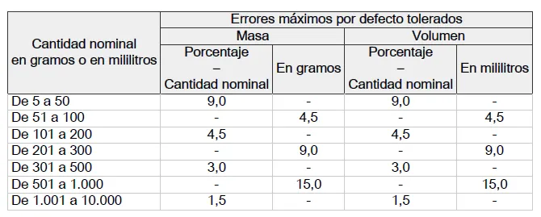
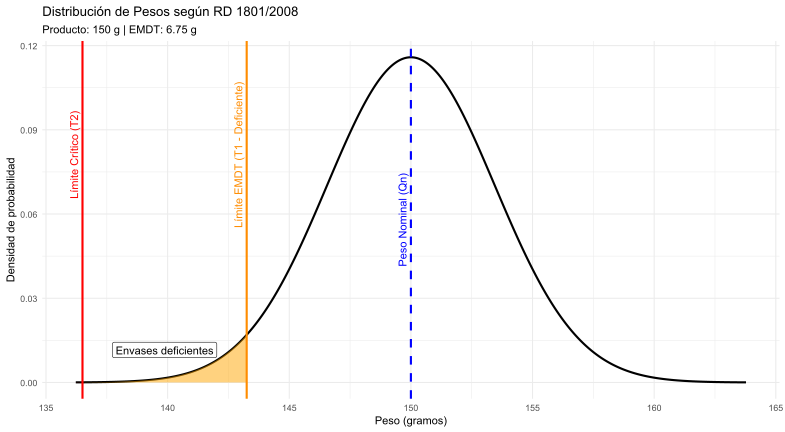

```{r setup-175}
#| include: false
Sys.setenv(RETICULATE_PYTHON = "C:/ProgramData/miniconda3/python.exe")
library(reticulate)
use_python("C:/ProgramData/miniconda3/python.exe", required = TRUE)
```

::: callout-note
## Objetivos de aprendizaje

Al finalizar este capítulo, el alumno será capaz de:

- Identificar los conceptos clave del RD 1801/2008: peso nominal, EMDT, límites T1 y T2.
- Analizar un lote de producción y determinar su conformidad con la norma.
- Explicar la función y las limitaciones del discriminador de peso como medida de control.
- Identificar las causas de variabilidad de un proceso de envasado mediante el análisis 5M.
- Simular el efecto de planes de mejora sobre la distribución de pesos y cuantificar el ahorro económico.

Conceptos clave: **contenido efectivo, peso nominal, EMDT, T1, T2, sobredosificación, discriminador de peso, capacidad de proceso, variabilidad especial, variabilidad común**.
:::

::: {.callout-warning}
## Conocimientos previos necesarios
Este capítulo aplica herramientas de los capítulos anteriores: estadísticos descriptivos (cap. 6), distribución normal (cap. 7), exploración gráfica (cap. 5) y control estadístico de procesos — gráficos de control y capacidad de proceso (cap. 9). Conviene tenerlos a mano.
:::

::: {.callout-tip}
## Sobre el código de este capítulo
Los bloques de código que generan gráficos complejos aparecen **ocultos por defecto**. Puedes mostrarlos haciendo clic en «Mostrar código». Si quieres entender qué hace un bloque, cópialo y pégalo en un asistente de IA como Claude y pregúntale: *«Explícame este código línea a línea, en lenguaje sencillo»*.

Algunos bloques de código generan los gráficos que se han estudiado, aplicados al dataset actual, con algunas modificaciones estéticas adicionales; otros bloques presentan gráficos necesarios para la explicación que se sigue en el texto, y tienen una realización más compleja que los gráficos básicos. Se incluye también el código oculto de estos bloques para revisarlo en caso de interés
:::

## Introducción

En la industria alimentaria es frecuente que el fabricante comercialice sus productos en envases individuales con un peso declarado en la etiqueta: un yogur de 125 g, un queso fresco de 500 g, una nata de 200 ml. El consumidor confía en que el contenido real coincide con lo que promete la etiqueta.

Ningún proceso de llenado industrial es perfecto. Siempre existe una dispersión natural alrededor del valor objetivo: unos envases pesarán un poco más, otros un poco menos. La pregunta no es si hay variabilidad —la hay siempre— sino cuánta variabilidad es aceptable y cómo se gestiona.

El **Real Decreto 1801/2008** responde a esa pregunta. No exige que cada envase pese exactamente lo declarado, sino que define unas tolerancias estadísticas que el fabricante debe cumplir mediante el control del proceso. Entregar menos peso del permitido es un fraude sancionable. Entregar peso por encima del nominal tiene un coste económico: se está regalando producto.

Este capítulo usa el dataset de un turno completo de envasado de yogures de 150 g para recorrer el ciclo completo: entender qué exige la norma, diagnosticar el proceso, identificar las causas de variabilidad y cuantificar el impacto económico de las mejoras.

## Dos formas de declarar el peso
Un fabricante que comercializa productos a peso fijo puede acogerse a dos modalidades diferentes:

- **Sin signo de estimación**. El fabricante declara el peso nominal en la etiqueta pero no se acoge al sistema de control estadístico de la norma. En este caso debe garantizar que todos y cada uno de sus envases contienen como mínimo el peso declarado — sin excepciones, sin tolerancias. No puede mostrar el signo ℮ en el etiquetado. Es una opción válida pero exigente en la práctica: cualquier envase por debajo del nominal es un incumplimiento.
- **Bajo la norma de contenido efectivo (signo ℮)**. El fabricante realiza controles estadísticos de peso en cada lote siguiendo el procedimiento especificado en el **Real Decreto RD 1801/2008**. A cambio, la norma le permite trabajar con tolerancias: un pequeño porcentaje de envases puede estar por debajo del nominal, dentro de los límites que se describen a continuación. Puede imprimir el signo ℮ en el etiquetado, que funciona como certificación de cumplimiento y facilita la libre circulación del producto en el mercado europeo.
La inmensa mayoría de las empresas del sector alimentario trabajan bajo la segunda modalidad. El resto de este capítulo se centra en ella.

### El signo de estimación ℮

Los envases cuyo proceso de llenado cumple las modalidades de control estadístico del RD pueden llevar impreso el **signo ℮** en el etiquetado. Este símbolo certifica, bajo responsabilidad del envasador, que el producto cumple con las disposiciones del real decreto y actúa como «pasaporte» para la libre circulación del producto en el mercado europeo.

{.column-margin}

## El RD 1801/2008: qué exige la norma

### Los conceptos clave

**Cantidad nominal ($Q_n$):** el peso o volumen declarado en el envase. Para nuestro caso, $Q_n = 150$ g.

**Error máximo por defecto tolerado (EMDT):** la diferencia máxima permitida entre el peso declarado y el contenido real del envase. No es un valor fijo: depende del rango de peso nominal según el Cuadro 1 del RD.



Para un yogur de 150 g (rango 101-200 g), el EMDT es el **4,5% del peso nominal**, redondeado por exceso a la décima de gramo:

$$\text{EMDT} = 4{,}5\% \times 150 = 6{,}75 \text{ g}$$

A partir del EMDT se calculan los dos límites de control del proceso:

**Límite T1 — envase deficiente:** un envase es deficiente cuando su peso es inferior a $Q_n - \text{EMDT}$:

$$T_1 = 150 - 6{,}75 = 143{,}25 \text{ g}$$

La norma permite un máximo del **2,5%** de envases deficientes en el lote.

**Límite T2 — envase no conforme:** ningún envase puede pesar menos de $Q_n - 2 \times \text{EMDT}$:

$$T_2 = 150 - 2 \times 6{,}75 = 136{,}5 \text{ g}$$

Un solo envase por debajo de T2 en la muestra de inspección da lugar al rechazo inmediato del lote.

::: {.callout-note}
## Resumen de límites para yogur de 150 g

| Concepto | Valor |
|---|---|
| Peso nominal ($Q_n$) | 150,00 g |
| EMDT (4,5%) | 6,75 g |
| Límite T1 — envase deficiente | 143,25 g |
| Límite T2 — envase no conforme | 136,50 g |
| Máximo de envases bajo T1 | 2,5% del lote |
| Envases bajo T2 | 0 (ninguno permitido) |
:::



::: {.callout-warning}
## Las tres reglas del envasador

Para que un lote sea conforme, deben cumplirse **simultáneamente** los tres criterios:

1. **Criterio de la media:** el peso medio del lote no puede ser inferior a $Q_n$.
2. **Criterio T1:** la proporción de envases deficientes (por debajo de T1) debe ser inferior al 2,5% del lote.
3. **Criterio T2:** ningún envase puede estar por debajo de T2. Un solo envase no conforme rechaza el lote.
:::

### El procedimiento de muestreo

La norma no evalúa el cumplimiento envase a envase, sino mediante muestreo estadístico del lote. Para un lote de más de 3.200 unidades —el caso habitual en una línea de yogures con un turno completo de producción— el procedimiento es el siguiente:

**Primera etapa:** se toman **80 envases** al azar. El lote se acepta directamente si no hay ningún envase bajo T2 y hay 3 o menos bajo T1. Se rechaza directamente si hay alguno bajo T2 o 7 o más bajo T1. Si el número de envases bajo T1 está entre 4 y 6, se pasa a la segunda etapa.

**Segunda etapa:** se toman **otros 80 envases** y se acumulan con los de la primera (160 en total). El lote se acepta si no hay ninguno bajo T2 y hay 8 o menos bajo T1. Se rechaza si hay alguno bajo T2 o 9 o más bajo T1.

| Etapa | Muestra | Aceptación | Rechazo |
|---|---|---|---|
| 1.ª | 80 uds | ≤ 3 bajo T1 y 0 bajo T2 | ≥ 7 bajo T1 o ≥ 1 bajo T2 |
| 1.ª + 2.ª | 160 uds | ≤ 8 bajo T1 y 0 bajo T2 | ≥ 9 bajo T1 o ≥ 1 bajo T2 |

::: {.callout-warning}
## Rechazo: basta una condición. Aceptación: deben cumplirse las dos
Para **rechazar** el lote basta con que se cumpla cualquiera de las dos condiciones de rechazo. Para **aceptar** deben cumplirse las dos condiciones simultáneamente. Es un criterio conservador que protege al consumidor.
:::

## Análisis del lote: el turno del 1 de octubre

Disponemos del registro de pesos de un turno completo de envasado de yogures de 150 g: **9.600 envases** producidos entre las 08:00 y las 16:00, con un envase cada 3 segundos. El fichero `simulacion_envasado_yogur.csv` contiene la hora de envasado, el número de envase, el subgrupo de control (grupos de 5 envases) y el peso en gramos.

### Carga de datos y estadísticos básicos

::: {.panel-tabset}

## R

```{r carga-datos-r}
#| code-fold: true
#| message: false
#| warning: false
library(dplyr)
library(lubridate)
library(ggplot2)

df <- read.csv("datos/simulacion_envasado_yogur.csv") |>
  mutate(hora_envasado = ymd_hms(hora_envasado))

# Límites del RD
Qn   <- 150.00
EMDT <-   6.75
T1   <- Qn - EMDT        # 143.25 g
T2   <- Qn - 2 * EMDT    # 136.50 g

summary(df$peso_g)
cat("Desviación típica :", round(sd(df$peso_g), 2), "g\n")
cat("Envases bajo T1   :", sum(df$peso_g < T1),
    "(", round(mean(df$peso_g < T1) * 100, 2), "%)\n")
cat("Envases bajo T2   :", sum(df$peso_g < T2), "\n")
```

## Python

```{python carga-datos-python}
#| code-fold: true
import pandas as pd
import numpy as np

df = pd.read_csv("datos/simulacion_envasado_yogur.csv",
                 parse_dates=["hora_envasado"])

# Límites del RD
Qn   = 150.00
EMDT =   6.75
T1   = Qn - EMDT        # 143.25 g
T2   = Qn - 2 * EMDT    # 136.50 g

print(df["peso_g"].describe().round(2))
print(f"\nDesviación típica : {df['peso_g'].std():.2f} g")
print(f"Envases bajo T1   : {(df['peso_g'] < T1).sum()} "
      f"({(df['peso_g'] < T1).mean()*100:.2f}%)")
print(f"Envases bajo T2   : {(df['peso_g'] < T2).sum()}")
```

:::

El peso medio es de 152,1 g, con una desviación típica de 3,7 g. El mínimo registrado es 129,7 g — muy por debajo de T2 — y el máximo 170,8 g. Ya en estos números se intuye un proceso con variabilidad importante.

### Histograma y diagrama de caja

::: {.panel-tabset}
## R

```{r histograma-r}
#| code-fold: true
#| message: false
#| warning: false
#| fig-width: 10
#| fig-height: 4
library(patchwork)

p1 <- ggplot(df, aes(x = peso_g)) +
  geom_histogram(binwidth = 0.5, fill = "steelblue",
                 colour = "white", alpha = 0.85) +
  geom_vline(xintercept = Qn, colour = "green4",
             linetype = "dashed", linewidth = 0.8) +
  geom_vline(xintercept = T1, colour = "orange",
             linetype = "solid", linewidth = 0.8) +
  geom_vline(xintercept = T2, colour = "red",
             linetype = "solid", linewidth = 0.8) +
  annotate("text", x = Qn + 0.3, y = Inf, label = "Qn",
           vjust = 2, colour = "green4", size = 3) +
  annotate("text", x = T1 - 0.3, y = Inf, label = "T1",
           vjust = 2, colour = "orange", size = 3, hjust = 1) +
  annotate("text", x = T2 - 0.3, y = Inf, label = "T2",
           vjust = 2, colour = "red", size = 3, hjust = 1) +
  labs(title = "Distribución de pesos — turno completo",
       x = "Peso (g)", y = "Número de envases") +
  theme_minimal()

p2 <- ggplot(df, aes(y = peso_g)) +
  geom_boxplot(fill = "steelblue", alpha = 0.6,
               outlier.colour = "red", outlier.size = 1) +
  geom_hline(yintercept = Qn, colour = "green4",
             linetype = "dashed", linewidth = 0.8) +
  geom_hline(yintercept = T1, colour = "orange",
             linetype = "solid", linewidth = 0.8) +
  geom_hline(yintercept = T2, colour = "red",
             linetype = "solid", linewidth = 0.8) +
  labs(title = "Diagrama de caja", y = "Peso (g)", x = "") +
  theme_minimal()

p1 + p2 + plot_layout(widths = c(3, 1))
```

## Python

```{python histograma-python}
#| code-fold: true
#| fig-width: 10
#| fig-height: 4
import matplotlib.pyplot as plt
import matplotlib.gridspec as gridspec

fig = plt.figure(figsize=(11, 4))
gs  = gridspec.GridSpec(1, 4)
ax1 = fig.add_subplot(gs[0, :3])
ax2 = fig.add_subplot(gs[0, 3])

ax1.hist(df["peso_g"], bins=60, color="steelblue", edgecolor="white",
         alpha=0.85)
for val, col, lbl in [(Qn, "green",  "Qn"),
                      (T1, "orange", "T1"),
                      (T2, "red",    "T2")]:
    ax1.axvline(val, color=col, linewidth=1.5)
    ax1.text(val + 0.2, ax1.get_ylim()[1] * 0.95, lbl,
             color=col, fontsize=9, va="top")
ax1.set_xlabel("Peso (g)")
ax1.set_ylabel("Número de envases")
ax1.set_title("Distribución de pesos — turno completo")

ax2.boxplot(df["peso_g"], patch_artist=True,
            boxprops=dict(facecolor="steelblue", alpha=0.6),
            flierprops=dict(marker="o", color="red", markersize=2))
for val, col in [(Qn, "green"), (T1, "orange"), (T2, "red")]:
    ax2.axhline(val, color=col, linewidth=1.2, linestyle="--")
ax2.set_ylabel("Peso (g)")
ax2.set_title("Caja")
ax2.set_xticks([])

plt.tight_layout()
plt.show()
```

:::

La distribución es aproximadamente normal pero con una cola izquierda pronunciada: hay un grupo de envases con pesos muy bajos que deforman la distribución. El diagrama de caja los señala claramente como valores atípicos por debajo de T2.

### El muestreo del RD: la herramienta de la inspección

El muestreo que define el RD es la herramienta que usa la inspección externa —el inspector de consumo, el auditor de calidad— para evaluar si un lote es conforme. No es la herramienta con la que el fabricante toma decisiones sobre su proceso: el fabricante conoce su proceso mejor que nadie y no necesita esperar a un muestreo para saber que tiene envases bajo T2. Lo ha visto en el gráfico de control.

Aun así, es importante entender qué detecta y qué no detecta el muestreo, porque condiciona el razonamiento de muchos responsables de producción. Aplicamos el procedimiento sobre nuestro lote:

::: {.panel-tabset}
## R

```{r cumplimiento-r}
#| code-fold: true
#| message: false
#| warning: false
set.seed(123)
muestra_1 <- sample(df$peso_g, 80)

cat("=== PRIMERA ETAPA (n = 80) ===\n")
cat("Envases bajo T2 :", sum(muestra_1 < T2), "\n")
cat("Envases bajo T1 :", sum(muestra_1 < T1), "\n\n")

if (sum(muestra_1 < T2) >= 1) {
  cat("→ RECHAZO DIRECTO: envase(s) bajo T2\n")
} else if (sum(muestra_1 < T1) >= 7) {
  cat("→ RECHAZO DIRECTO: demasiados envases bajo T1\n")
} else if (sum(muestra_1 < T1) <= 3) {
  cat("→ ACEPTACIÓN en primera etapa\n")
} else {
  muestra_2     <- sample(df$peso_g[!df$peso_g %in% muestra_1], 80)
  muestra_total <- c(muestra_1, muestra_2)
  cat("→ Zona de duda: segunda etapa\n\n")
  cat("=== SEGUNDA ETAPA (n acumulado = 160) ===\n")
  cat("Envases bajo T2 :", sum(muestra_total < T2), "\n")
  cat("Envases bajo T1 :", sum(muestra_total < T1), "\n")
  if (sum(muestra_total < T2) >= 1 | sum(muestra_total < T1) >= 9) {
    cat("→ RECHAZO del lote\n")
  } else {
    cat("→ ACEPTACIÓN del lote\n")
  }
}
cat("\n=== CRITERIO DE LA MEDIA ===\n")
cat("Media del lote :", round(mean(df$peso_g), 2), "g  →",
    ifelse(mean(df$peso_g) >= Qn, "CUMPLE", "NO CUMPLE"), "\n")
```

## Python

```{python cumplimiento-python}
#| code-fold: true
import numpy as np

rng = np.random.default_rng(123)
muestra_1 = rng.choice(df["peso_g"].values, size=80, replace=False)

bajo_T2_m1 = (muestra_1 < T2).sum()
bajo_T1_m1 = (muestra_1 < T1).sum()

print("=== PRIMERA ETAPA (n = 80) ===")
print(f"Envases bajo T2 : {bajo_T2_m1}")
print(f"Envases bajo T1 : {bajo_T1_m1}")

if bajo_T2_m1 >= 1:
    print("→ RECHAZO DIRECTO: envase(s) bajo T2")
elif bajo_T1_m1 >= 7:
    print("→ RECHAZO DIRECTO: demasiados envases bajo T1")
elif bajo_T1_m1 <= 3:
    print("→ ACEPTACIÓN en primera etapa")
else:
    resto     = df["peso_g"].values[~np.isin(df["peso_g"].values, muestra_1)]
    muestra_2 = rng.choice(resto, size=80, replace=False)
    total     = np.concatenate([muestra_1, muestra_2])
    print("→ Zona de duda: segunda etapa")
    print(f"\n=== SEGUNDA ETAPA (n acumulado = 160) ===")
    print(f"Envases bajo T2 : {(total < T2).sum()}")
    print(f"Envases bajo T1 : {(total < T1).sum()}")
    if (total < T2).sum() >= 1 or (total < T1).sum() >= 9:
        print("→ RECHAZO del lote")
    else:
        print("→ ACEPTACIÓN del lote")

print(f"\n=== CRITERIO DE LA MEDIA ===")
media_lote = df["peso_g"].mean()
print(f"Media del lote : {media_lote:.2f} g  →",
      "CUMPLE" if media_lote >= Qn else "NO CUMPLE")
```

:::

El resultado más probable es que el lote **pase la inspección**, a pesar de que sabemos que contiene 47 envases bajo T2 y 422 bajo T1. Esto no es un error: es una característica inherente al control estadístico por muestreo. El sistema del RD está diseñado para detectar lotes con proporciones altas de defectuosos — situaciones de fallo grave. Para proporciones pequeñas como la nuestra (0,5% bajo T2), una muestra de 80 unidades tiene menos de un 30% de probabilidad de capturar alguno.

### El razonamiento del fabricante "pragmático"

Un responsable de producción que ve este resultado puede llegar a la siguiente conclusión: *si el muestreo acepta el lote, no tengo ningún incentivo inmediato para invertir en un discriminador. Sé que tengo algunos T2, pero la probabilidad de que los detecten en una inspección es muy baja. Puedo seguir como estoy y trabajar en la mejora del proceso a largo plazo.*

Es un razonamiento que existe en la práctica, y merece una respuesta en dos niveles.

**El nivel legal.** El RD no dice "si te pillan". El artículo 14 responsabiliza al envasador de que su proceso cumpla, y le obliga a tener documentación de sus controles disponible para la inspección. Un inspector que encuentra un envase bajo T2 en el punto de venta —no en la planta, sino en el supermercado— puede iniciar un expediente sancionador independientemente de que el muestreo de producción fuera correcto. La inspección puede ocurrir en cualquier punto de la cadena de distribución, y el fabricante no controla cuándo ni dónde.

**El nivel económico.** Este argumento es más contundente para un técnico de planta, porque se traduce directamente en euros. Un proceso con σ = 4,6 g no solo produce envases de 130 g — también produce envases de 170 g. La variabilidad actúa en los dos extremos. Cada gramo que se dosifica por encima del objetivo para "cubrir" la cola izquierda es producto que se regala al consumidor sin cobrar por ello. El coste de la sobredosificación — que calcularemos en detalle más adelante — es continuo, silencioso y muy superior al coste del discriminador y de las acciones de mejora.

::: {.callout-note}
## La variabilidad tiene coste en los dos extremos

Un proceso que produce envases de 130 g también produce envases de 170 g. Para evitar los primeros, el fabricante sube la media de dosificación — y con ello regala más producto en cada envase del extremo alto. Reducir la variabilidad es la única forma de escapar de ese dilema: permite bajar la media sin arriesgar el incumplimiento, y ese ahorro es cuantificable turno a turno.
:::

## El discriminador de peso: solución inmediata, coste real

### Qué es y cómo funciona

Un **discriminador de peso** es un sistema de control en línea que pesa cada envase individualmente a la salida de la llenadora y expulsa automáticamente los que no cumplen el criterio configurado. A diferencia del muestreo del RD —que evalúa una muestra del lote al final— el discriminador actúa **envase a envase durante la producción**: es la única herramienta que garantiza que ningún T2 salga de la línea. En la práctica se configura para rechazar con seguridad los envases por debajo de T2. La detección de envases en la zona entre T2 y T1 es menos fiable: la precisión del equipo en esa banda es limitada y la tasa de detección real rara vez supera el 70-80%.

### El coste del rechazo en el lote original

::: {.panel-tabset}
## R

```{r coste-discriminador-r}
#| code-fold: true
#| message: false
#| warning: false
# Parámetros económicos
coste_kg      <- 1.20
dias_año      <- 220
tasa_det_T1T2 <- 0.75

env_bajo_T2    <- sum(df$peso_g < T2)
env_zona_T1T2  <- sum(df$peso_g >= T2 & df$peso_g < T1)
env_det_T1T2   <- round(env_zona_T1T2 * tasa_det_T1T2)
env_total      <- env_bajo_T2 + env_det_T1T2

peso_T2   <- sum(df$peso_g[df$peso_g < T2]) / 1000
peso_T1T2 <- sum(head(sort(
  df$peso_g[df$peso_g >= T2 & df$peso_g < T1]), env_det_T1T2)) / 1000
peso_rechazado_kg <- peso_T2 + peso_T1T2

cat("Envases bajo T2 (rechazo seguro)  :", env_bajo_T2, "\n")
cat("Envases zona T1-T2                :", env_zona_T1T2,
    "| Detectados (~75%):", env_det_T1T2, "\n")
cat("Total envases rechazados / turno  :", env_total, "\n")
cat("Peso rechazado / turno            :",
    round(peso_rechazado_kg, 1), "kg\n")
cat("Coste rechazo / turno             :",
    round(peso_rechazado_kg * coste_kg, 2), "€\n")
cat("Coste rechazo anual estimado      :",
    round(peso_rechazado_kg * coste_kg * dias_año, 0), "€\n")
```

## Python

```{python coste-discriminador-python}
#| code-fold: true
# Parámetros económicos
coste_kg      = 1.20   # €/kg (coste de producción estimado)
dias_año      = 220
tasa_det_T1T2 = 0.75   # tasa de detección en zona T1-T2

env_bajo_T2    = (df["peso_g"] < T2).sum()
env_zona_T1T2  = ((df["peso_g"] >= T2) & (df["peso_g"] < T1)).sum()
env_det_T1T2   = round(env_zona_T1T2 * tasa_det_T1T2)
env_total      = env_bajo_T2 + env_det_T1T2

peso_T2    = df.loc[df["peso_g"] < T2, "peso_g"].sum() / 1000
peso_T1T2  = (df.loc[(df["peso_g"] >= T2) & (df["peso_g"] < T1), "peso_g"]
              .nsmallest(env_det_T1T2).sum() / 1000)
peso_rech  = peso_T2 + peso_T1T2

print(f"Envases bajo T2 (rechazo seguro)  : {env_bajo_T2}")
print(f"Envases zona T1-T2                : {env_zona_T1T2}"
      f"  | Detectados (~75%): {env_det_T1T2}")
print(f"Total envases rechazados / turno  : {env_total}")
print(f"Peso rechazado / turno            : {peso_rech:.1f} kg")
print(f"Coste rechazo / turno             : {peso_rech * coste_kg:.2f} €")
print(f"Coste rechazo anual estimado      : "
      f"{peso_rech * coste_kg * dias_año:.0f} €")
```


:::

### La trampa de bajar la media con el discriminador instalado

Una vez instalado el discriminador, los envases bajo T2 desaparecen de la línea y el lote pasa el control. La reacción habitual en planta es inmediata: *si ya no hay rechazos T2, podemos bajar un poco el peso medio y recuperar producto*.

El razonamiento parece lógico, pero esconde una trampa. Al bajar la media con la misma σ alta, el área bajo la curva entre T2 y T1 **crece rápidamente**. El discriminador elimina los T2, pero no los T1 — y el porcentaje de envases en esa zona puede superar el 2,5% permitido antes de lo que parece.

La gráfica siguiente lo muestra: para cada valor posible de la media de dosificación, calcula el porcentaje esperado de envases bajo T1 usando la distribución normal con la σ actual del proceso (4,6 g):

::: {.panel-tabset}
## R

```{r trampa-r}
#| code-fold: true
#| message: false
#| warning: false
#| fig-width: 8
#| fig-height: 4
sigma_actual    <- sd(df$peso_g)
medias_posibles <- seq(149, 155, by = 0.1)
pct_T1          <- pnorm(T1, mean = medias_posibles,
                          sd = sigma_actual) * 100
media_limite    <- medias_posibles[which(pct_T1 >= 2.5)[1]]

df_trampa <- data.frame(media = medias_posibles, pct = pct_T1)

ggplot(df_trampa, aes(x = media, y = pct)) +
  geom_line(colour = "steelblue", linewidth = 1.2) +
  geom_hline(yintercept = 2.5, colour = "red",
             linetype = "dashed", linewidth = 0.9) +
  geom_vline(xintercept = media_limite, colour = "orange",
             linetype = "dotted", linewidth = 0.9) +
  geom_vline(xintercept = mean(df$peso_g), colour = "green4",
             linetype = "dashed", linewidth = 0.8) +
  annotate("text", x = mean(df$peso_g) + 0.1, y = 5.5,
           label = paste0("Media actual\n",
                          round(mean(df$peso_g), 1), " g"),
           colour = "green4", size = 3, hjust = 0) +
  annotate("text", x = media_limite + 0.1, y = 5.5,
           label = paste0("Límite\n", round(media_limite, 1), " g"),
           colour = "orange", size = 3, hjust = 0) +
  annotate("text", x = 155, y = 2.8,
           label = "Límite legal 2,5%",
           colour = "red", size = 3, hjust = 1) +
  labs(
    title    = "La trampa del discriminador",
    subtitle = paste0("Con σ = ", round(sigma_actual, 1),
                      " g, bajar la media más de ",
                      round(mean(df$peso_g) - media_limite, 1),
                      " g supera el límite legal del criterio T1"),
    x = "Media de dosificación (g)",
    y = "% envases bajo T1") +
  theme_minimal()
```

## Python

```{python trampa-python}
#| code-fold: true
#| fig-width: 8
#| fig-height: 4
from scipy import stats

sigma_actual    = df["peso_g"].std()
medias_posibles = np.arange(149, 155.1, 0.1)
pct_T1          = stats.norm.cdf(T1, loc=medias_posibles,
                                  scale=sigma_actual) * 100
media_actual    = df["peso_g"].mean()
media_limite    = medias_posibles[np.argmax(pct_T1 >= 2.5)]

fig, ax = plt.subplots(figsize=(8, 4))
ax.plot(medias_posibles, pct_T1, color="steelblue", linewidth=1.5)
ax.axhline(2.5, color="red", linestyle="--", linewidth=1)
ax.axvline(media_limite, color="orange", linestyle=":", linewidth=1.2)
ax.axvline(media_actual, color="green",  linestyle="--", linewidth=1)
ax.text(media_actual + 0.08, 5.2,
        f"Media actual\n{media_actual:.1f} g",
        color="green", fontsize=8)
ax.text(media_limite + 0.08, 5.2,
        f"Límite\n{media_limite:.1f} g",
        color="orange", fontsize=8)
ax.text(154.9, 2.7, "Límite legal 2,5%",
        color="red", fontsize=8, ha="right")
ax.set_xlabel("Media de dosificación (g)")
ax.set_ylabel("% envases bajo T1")
ax.set_title(
    f"La trampa del discriminador\n"
    f"Con σ = {sigma_actual:.1f} g, bajar la media más de "
    f"{media_actual - media_limite:.1f} g supera el límite legal")
plt.tight_layout()
plt.show()
```

:::

Con una σ de 3,7 g, el margen para bajar la media es de apenas `r round(mean(df$peso_g) - media_limite, 1)` g antes de incumplir el criterio T1. Y esto con el discriminador funcionando y eliminando todos los T2 — sin él, el lote ya estaría rechazado.

::: {.callout-note}
## El discriminador: solución inevitable, coste real

El discriminador es en la práctica una solución casi inevitable: mientras se trabaja en reducir la variabilidad del proceso — un trabajo que puede llevar semanas o meses — la línea tiene que seguir produciendo dentro de la norma. El coste de rechazo se trata como un coste fijo asumido, que se incorpora al coste del producto, y, por lo tanto, al precio de venta, reduciendo su competitividad. Lo que rara vez se calcula es cuánto de ese coste es evitable. Cuando se hace ese cálculo — como haremos en las secciones siguientes — el ahorro potencial se convierte en el argumento más sólido para justificar ante la dirección la inversión en las acciones de mejora.
:::

## El proceso de mejora continua para reducir la variabilidad

### Etapa 1: estabilizar el proceso

#### El gráfico de control: identificar las causas especiales

El primer paso del plan de mejora es entender *qué ocurrió* durante el turno. El gráfico de control X-barra agrupa los envases en intervalos de 3 minutos y representa la media de cada intervalo a lo largo del tiempo. Los puntos fuera de los límites de control señalan momentos en que el proceso dejó de comportarse de forma estable — las **causas especiales** de variabilidad.

```{r grafico-control-original}
#| code-fold: true
#| message: false
#| warning: false
#| results: hide
#| fig-width: 11
#| fig-height: 4
library(qicharts2)

df <- df |>
  mutate(intervalo = floor_date(hora_envasado, "3 minutes"))

qic(peso_g,
    x          = intervalo,
    data       = df,
    chart      = "xbar",
    point.size = 0.8,
    title      = "Gráfico X-barra — turno del 1 de octubre (grupos de 3 min)",
    ylab       = "Peso medio (g)",
    xlab       = "Hora de envasado")
```

```{r grafico-s-original}
#| code-fold: true
#| message: false
#| warning: false
#| results: hide
#| fig-width: 11
#| fig-height: 4
qic(peso_g,
    x          = intervalo,
    data       = df,
    chart      = "s",
    point.size = 0.8,
    title      = "Gráfico S — desviación típica por intervalo de 3 min",
    ylab       = "Desviación típica (g)",
    xlab       = "Hora de envasado")
```

El gráfico revela una historia detallada del turno. Hay siete eventos identificables:

| Hora | Evento observable | Tipo |
|---|---|---|
| 08:30 | Deriva ascendente: la media sube ~4 g en 8 min | Causa especial |
| 08:38 | Sobrecorrección violenta: la media cae a ~143 g, aparecen envases bajo T2 | Causa especial |
| 08:52 | Estabilización gradual en ~153 g | — |
| 10:00 | Alta variabilidad sostenida 45 min, sin cambio de media | Causa especial |
| 11:00 | Deriva descendente lenta: −3 g en hora y media | Causa especial |
| 13:30 | Escalón brusco ascendente: +2,5 g en 5 min | Causa especial |
| 14:00 | Oscilación rítmica periódica durante 30 min | Causa especial |

#### Diagnóstico 5M: causas y planes de acción

**Máquina — Deriva ascendente 08:30, deriva descendente 11:00 y oscilación 14:00**

La deriva lenta y progresiva de la media es la firma clásica del desgaste o pérdida de ajuste mecánico. En una llenadora de pistón, puede deberse al desgaste de juntas, variación de la carrera del pistón o cambio en la temperatura del fluido hidráulico. La oscilación rítmica de las 14:00 apunta a una vibración periódica de la bomba de producto.

*Plan de acción (Lean — TPM):* plan de mantenimiento preventivo con revisión de pistones y juntas cada N turnos; alarmas automáticas cuando la media de tres subgrupos consecutivos supere ±1,5 g respecto al objetivo.

**Mano de obra — Sobrecorrección 08:38**

El evento más grave del turno. Cuando el operario detectó la deriva ascendente de las 08:30, corrigió en exceso: bajó la dosificación tan agresivamente que la media cayó por debajo de T1, generando los 25 envases bajo T2 que rechazaron el lote. Completamente evitable.

*Plan de acción (Lean — trabajo estándar):* criterios de actuación escritos con límites de corrección: ajuste máximo de ±0,5 g por intervención, verificación del resultado antes del siguiente paso.

**Mano de obra — Escalón brusco 13:30**

El cambio brusco coincide con el cambio de turno. El operario entrante ajustó la máquina de forma diferente al saliente, sin protocolo de entrega definido.

*Plan de acción (Lean — estandarización):* protocolo escrito de cambio de turno con verificación de peso y firma de aceptación antes de liberar la línea.

**Material — Alta variabilidad sostenida 10:00-10:45**

Un período de variabilidad alta sin cambio de media apunta a material fuera de especificación: probablemente la llegada de un nuevo lote de leche con viscosidad diferente, que afecta al volumen dosificado por pistón.

*Plan de acción (Lean — poka-yoke):* control de viscosidad en recepción de cada cubeta antes de incorporarla a la línea. Si la viscosidad está fuera del rango aceptado, no se incorpora sin ajuste previo.

**Método — Deriva descendente 11:00-12:30**

Una deriva relacionada con la hora del turno puede responder a la temperatura del producto: a medida que avanza la mañana, la temperatura en el depósito de alimentación sube, la viscosidad baja y el pistón entrega ligeramente menos masa. Es una causa de método porque no existe un procedimiento de control de temperatura.

*Plan de acción:* rango de temperatura del producto en el depósito con verificación horaria. A más largo plazo: control automático de temperatura.

::: {.callout-tip}
## Variabilidad especial y variabilidad común

Los eventos identificados son **causas especiales** de variabilidad: tienen causa identificable, son esporádicas y se pueden eliminar con acciones concretas. Una vez eliminadas, el proceso queda con su **variabilidad común** — la inherente al sistema, que solo se puede reducir con mejoras estructurales más profundas.

Este enfoque de dos etapas — primero estabilizar eliminando causas especiales, después optimizar reduciendo la variabilidad común — es la base de las metodologías **Lean** y **Six Sigma**, que estudiaremos en el capítulo 20.
:::

#### El gráfico de capacidad del proceso original

```{r capacidad-original}
#| code-fold: true
#| message: false
#| warning: false
#| results: hide
#| fig-width: 8
#| fig-height: 5
library(qcc)

df_qcc <- df |>
  mutate(intervalo_5 = floor_date(hora_envasado, "5 minutes")) |>
  group_by(intervalo_5) |>
  mutate(obs_id = row_number()) |>
  ungroup()

datos_matriz <- df_qcc |>
  select(intervalo_5, obs_id, peso_g) |>
  tidyr::pivot_wider(names_from = obs_id, values_from = peso_g) |>
  select(-intervalo_5) |>
  as.matrix()

obj_xbar <- qcc(datos_matriz, type = "xbar", plot = FALSE)
process.capability(obj_xbar,
                   spec.limits = c(T1, Qn + EMDT),
                   target = Qn)
```

Los índices Cp y Cpk lo confirman: el proceso no es capaz de mantenerse dentro de los límites especificados con la variabilidad actual. La cola izquierda de la distribución se extiende claramente por debajo de T1 y, en los peores momentos del turno, por debajo de T2.

### Análisis intermedio: el proceso estabilizado

Una vez implementadas las acciones de la etapa 1, el proceso queda libre de causas especiales. Lo que queda es la **variabilidad común**: la dispersión inherente al sistema cuando todo funciona correctamente.

Simulamos este escenario manteniendo la misma media objetivo (152,5 g) pero reduciendo la desviación típica a 2,3 g, que es lo esperable de un proceso estabilizado sin mejoras tecnológicas todavía.

::: {.panel-tabset}
## R

```{r simulacion-etapa1-r}
#| code-fold: true
#| message: false
#| warning: false
set.seed(101)
n        <- nrow(df)
media_e1 <- 152.5
sigma_e1 <- 2.3

peso_etapa1 <- rnorm(n, mean = media_e1, sd = sigma_e1)

cat("=== PROCESO ESTABILIZADO (etapa 1) ===\n")
cat("Media  :", round(mean(peso_etapa1), 2), "g\n")
cat("SD     :", round(sd(peso_etapa1), 2), "g\n")
cat("Bajo T1:", sum(peso_etapa1 < T1),
    "(", round(mean(peso_etapa1 < T1) * 100, 2), "%)\n")
cat("Bajo T2:", sum(peso_etapa1 < T2), "\n\n")
cat("Criterio media :",
    ifelse(mean(peso_etapa1) >= Qn, "CUMPLE", "NO CUMPLE"), "\n")
cat("Criterio T1    :",
    ifelse(mean(peso_etapa1 < T1) * 100 < 2.5, "CUMPLE", "NO CUMPLE"), "\n")
cat("Criterio T2    :",
    ifelse(sum(peso_etapa1 < T2) == 0, "CUMPLE", "NO CUMPLE"), "\n")
```

## Python

```{python simulacion-etapa1-python}
#| code-fold: true
rng      = np.random.default_rng(101)
n        = len(df)
media_e1 = 152.5
sigma_e1 = 2.3

peso_etapa1 = rng.normal(media_e1, sigma_e1, n)

print("=== PROCESO ESTABILIZADO (etapa 1) ===")
print(f"Media  : {peso_etapa1.mean():.2f} g")
print(f"SD     : {peso_etapa1.std():.2f} g")
print(f"Bajo T1: {(peso_etapa1 < T1).sum()} "
      f"({(peso_etapa1 < T1).mean()*100:.2f}%)")
print(f"Bajo T2: {(peso_etapa1 < T2).sum()}")
print()
print("Criterio media :", "CUMPLE" if peso_etapa1.mean() >= Qn else "NO CUMPLE")
print("Criterio T1    :",
      "CUMPLE" if (peso_etapa1 < T1).mean()*100 < 2.5 else "NO CUMPLE")
print("Criterio T2    :",
      "CUMPLE" if (peso_etapa1 < T2).sum() == 0 else "NO CUMPLE")
```

:::

#### Gráfico de control del proceso estabilizado

```{r grafico-control-estabilizado}
#| code-fold: true
#| message: false
#| warning: false
#| results: hide
#| fig-width: 11
#| fig-height: 4
library(qicharts2)
library(lubridate)

# Asignamos timestamps ficticios del mismo turno
tiempos_e1 <- seq(as.POSIXct("2024-10-01 08:00:00"),
                  by = "3 sec", length.out = n)
df_e1 <- data.frame(
  hora      = tiempos_e1,
  peso_g    = peso_etapa1
) |> mutate(intervalo = floor_date(hora, "3 minutes"))

qic(peso_g,
    x          = intervalo,
    data       = df_e1,
    chart      = "xbar",
    point.size = 0.8,
    title      = "Gráfico de control del proceso estabilizado",
    ylab       = "Peso medio (g)",
    xlab       = "Hora de envasado")
```


#### Comparación visual: original vs. estabilizado

::: {.panel-tabset}

## R

```{r histograma-etapa1-r}
#| code-fold: true
#| message: false
#| warning: false
#| fig-width: 10
#| fig-height: 4
df_comp <- data.frame(
  peso  = c(df$peso_g, peso_etapa1),
  etapa = rep(c("Original (σ = 3,7 g)",
                "Etapa 1: estabilizado (σ = 2,3 g)"), each = n)
)

ggplot(df_comp, aes(x = peso, fill = etapa, colour = etapa)) +
  geom_density(alpha = 0.3, linewidth = 0.8) +
  geom_vline(xintercept = Qn, colour = "green4",
             linetype = "dashed", linewidth = 0.8) +
  geom_vline(xintercept = T1, colour = "orange",
             linetype = "solid",  linewidth = 0.8) +
  geom_vline(xintercept = T2, colour = "red",
             linetype = "solid",  linewidth = 0.8) +
  scale_fill_manual(values   = c("steelblue", "darkorange")) +
  scale_colour_manual(values = c("steelblue", "darkorange")) +
  labs(title  = "Original vs. proceso estabilizado (etapa 1)",
       x = "Peso (g)", y = "Densidad",
       fill = "Escenario", colour = "Escenario") +
  theme_minimal() +
  theme(legend.position = "bottom")
```

## Python

```{python histograma-etapa1-python}
#| code-fold: true
#| fig-width: 10
#| fig-height: 4
from scipy.stats import gaussian_kde

fig, ax = plt.subplots(figsize=(10, 4))
for datos, lbl, col in [
    (df["peso_g"].values, "Original (σ = 3,7 g)", "steelblue"),
    (peso_etapa1,         "Etapa 1: estabilizado (σ = 2,3 g)", "darkorange")
]:
    kde = gaussian_kde(datos, bw_method=0.15)
    xs  = np.linspace(135, 168, 300)
    ax.fill_between(xs, kde(xs), alpha=0.25, color=col, label=lbl)
    ax.plot(xs, kde(xs), color=col, linewidth=1.5)

for val, col, lbl in [(Qn, "green",  "Qn"),
                      (T1, "orange", "T1"),
                      (T2, "red",    "T2")]:
    ax.axvline(val, color=col, linewidth=1.3,
               linestyle="--" if val == Qn else "-")
    ax.text(val + 0.15, ax.get_ylim()[1] * 0.95, lbl,
            color=col, fontsize=9, va="top")

ax.set_xlabel("Peso (g)")
ax.set_ylabel("Densidad")
ax.set_title("Original vs. proceso estabilizado (etapa 1)")
ax.legend(loc="upper left", fontsize=9)
plt.tight_layout()
plt.show()
```

:::

La mejora es ya muy visible: la distribución se estrecha significativamente, los envases bajo T2 han desaparecido y los bajo T1 se reducen a una cifra pequeña. El lote ahora cumple los tres criterios.

#### La trampa revisada: ¿cuánto podemos bajar ahora?

::: {.panel-tabset}
## R

```{r trampa-etapa1-r}
#| code-fold: true
#| message: false
#| warning: false
#| fig-width: 8
#| fig-height: 4
df_trampa2 <- data.frame(
  media = rep(medias_posibles, 2),
  pct   = c(
    pnorm(T1, mean = medias_posibles, sd = sigma_actual) * 100,
    pnorm(T1, mean = medias_posibles, sd = sigma_e1)     * 100
  ),
  etapa = rep(c(
    paste0("Original (σ = ", round(sigma_actual, 1), " g)"),
    paste0("Etapa 1  (σ = ", sigma_e1, " g)")
  ), each = length(medias_posibles))
)

media_lim_e1 <- medias_posibles[
  which(pnorm(T1, mean = medias_posibles, sd = sigma_e1) * 100 >= 2.5)[1]]

ggplot(df_trampa2, aes(x = media, y = pct,
                        colour = etapa, linetype = etapa)) +
  geom_line(linewidth = 1.1) +
  geom_hline(yintercept = 2.5, colour = "red",
             linetype = "dashed", linewidth = 0.8) +
  geom_vline(xintercept = media_lim_e1, colour = "darkorange",
             linetype = "dotted", linewidth = 0.9) +
  annotate("text", x = media_lim_e1 + 0.1, y = 5.5,
           label = paste0("Nuevo límite\n",
                          round(media_lim_e1, 1), " g"),
           colour = "darkorange", size = 3, hjust = 0) +
  annotate("text", x = 155, y = 2.8,
           label = "Límite legal 2,5%",
           colour = "red", size = 3, hjust = 1) +
  scale_colour_manual(values = c("steelblue", "darkorange")) +
  labs(title    = "La trampa del discriminador: original vs. etapa 1",
       x = "Media de dosificación (g)", y = "% envases bajo T1",
       colour = "Escenario", linetype = "Escenario") +
  theme_minimal() +
  theme(legend.position = "bottom")
```


## Python

```{python trampa-etapa1-python}
#| code-fold: true
#| fig-width: 8
#| fig-height: 4
pct_original = stats.norm.cdf(T1, loc=medias_posibles,
                               scale=sigma_actual) * 100
pct_e1       = stats.norm.cdf(T1, loc=medias_posibles,
                               scale=sigma_e1) * 100
lim_e1       = medias_posibles[np.argmax(pct_e1 >= 2.5)]

fig, ax = plt.subplots(figsize=(8, 4))
ax.plot(medias_posibles, pct_original, color="steelblue",
        linewidth=1.3, label=f"Original (σ = {sigma_actual:.1f} g)")
ax.plot(medias_posibles, pct_e1, color="darkorange",
        linewidth=1.3, label=f"Etapa 1 (σ = {sigma_e1} g)")
ax.axhline(2.5, color="red", linestyle="--", linewidth=1)
ax.axvline(lim_e1, color="darkorange", linestyle=":", linewidth=1.1)
ax.text(lim_e1 + 0.1, 5.2,
        f"Nuevo límite\n{lim_e1:.1f} g",
        color="darkorange", fontsize=8)
ax.text(154.9, 2.7, "Límite legal 2,5%",
        color="red", fontsize=8, ha="right")
ax.set_xlabel("Media de dosificación (g)")
ax.set_ylabel("% envases bajo T1")
ax.set_title("La trampa del discriminador: original vs. etapa 1")
ax.legend(fontsize=9)
plt.tight_layout()
plt.show()
```

:::

Con σ = 2,3 g ya hay `r round(mean(df$peso_g) - media_lim_e1, 1)` g más de margen que en el proceso original. Es una mejora real, pero todavía limitada: para bajar la media de dosificación de forma significativa hay que abordar la etapa 2.

### Etapa 2: reducir la variabilidad común

Las acciones de la etapa 1 han eliminado las causas especiales. La variabilidad que queda — σ ≈ 2,3 g — es la inherente al sistema. Reducirla requiere intervenciones más profundas:

- **Revisión o sustitución de componentes de la llenadora:** si el pistón tiene holguras de fabricación, ningún ajuste operativo las elimina.
- **Control automático de temperatura** del depósito de alimentación: elimina la deriva de viscosidad.
- **Sistema de pesaje en continuo con retroalimentación automática** (*feedback control*): el equipo ajusta la dosificación de forma continua en función del peso medido, reduciendo la dependencia del ajuste manual.

Simulamos el proceso con σ = 1,5 g — un objetivo alcanzable con estas mejoras — y media ajustada a 151,0 g:

::: {.panel-tabset}

## R

```{r simulacion-etapa2-r}
#| code-fold: true
#| message: false
#| warning: false
set.seed(202)
media_e2 <- 151.0
sigma_e2 <- 1.5

peso_etapa2 <- rnorm(n, mean = media_e2, sd = sigma_e2)

cat("=== PROCESO OPTIMIZADO (etapa 2) ===\n")
cat("Media  :", round(mean(peso_etapa2), 2), "g\n")
cat("SD     :", round(sd(peso_etapa2), 2), "g\n")
cat("Bajo T1:", sum(peso_etapa2 < T1),
    "(", round(mean(peso_etapa2 < T1) * 100, 3), "%)\n")
cat("Bajo T2:", sum(peso_etapa2 < T2), "\n")
```

## Python

```{python simulacion-etapa2-python}
#| code-fold: true
rng2     = np.random.default_rng(202)
media_e2 = 151.0
sigma_e2 = 1.5

peso_etapa2 = rng2.normal(media_e2, sigma_e2, n)

print("=== PROCESO OPTIMIZADO (etapa 2) ===")
print(f"Media  : {peso_etapa2.mean():.2f} g")
print(f"SD     : {peso_etapa2.std():.2f} g")
print(f"Bajo T1: {(peso_etapa2 < T1).sum()} "
      f"({(peso_etapa2 < T1).mean()*100:.3f}%)")
print(f"Bajo T2: {(peso_etapa2 < T2).sum()}")
```

:::
#### Gráfico de control del proceso optimizado
```{r grafico-control-optimizado}
#| code-fold: true
#| message: false
#| warning: false
#| results: hide
#| fig-width: 11
#| fig-height: 4
tiempos_e2 <- seq(as.POSIXct("2024-10-01 08:00:00"),
                  by = "3 sec", length.out = n)
df_e2 <- data.frame(
  hora      = tiempos_e2,
  peso_g    = peso_etapa2
) |> mutate(intervalo = floor_date(hora, "3 minutes"))

qic(peso_g,
    x          = intervalo,
    data       = df_e2,
    chart      = "xbar",
    point.size = 0.8,
    title      = "Gráfico de control del proceso optimizado",
    ylab       = "Peso medio (g)",
    xlab       = "Hora de envasado")
```

#### Comparación de los tres escenarios

::: {.panel-tabset}
## R

```{r comparacion-tres-r}
#| code-fold: true
#| message: false
#| warning: false
#| fig-width: 11
#| fig-height: 4
df_tres <- data.frame(
  peso  = c(df$peso_g, peso_etapa1, peso_etapa2),
  etapa = rep(c(
    "Original  (σ = 3,7 g,  media = 152,1 g)",
    "Etapa 1:  estabilizado (σ = 2,3 g,  media = 152,5 g)",
    "Etapa 2:  optimizado   (σ = 1,5 g,  media = 151,0 g)"
  ), each = n)
)

ggplot(df_tres, aes(x = peso, fill = etapa, colour = etapa)) +
  geom_density(alpha = 0.22, linewidth = 0.8) +
  geom_vline(xintercept = Qn, colour = "green4",
             linetype = "dashed", linewidth = 0.8) +
  geom_vline(xintercept = T1, colour = "orange",
             linetype = "solid",  linewidth = 0.8) +
  geom_vline(xintercept = T2, colour = "red",
             linetype = "solid",  linewidth = 0.8) +
  scale_fill_manual(values   = c("steelblue", "darkorange", "forestgreen")) +
  scale_colour_manual(values = c("steelblue", "darkorange", "forestgreen")) +
  coord_cartesian(xlim = c(138, 165)) +
  labs(title  = "Evolución del proceso: original → etapa 1 → etapa 2",
       x = "Peso (g)", y = "Densidad",
       fill = "Escenario", colour = "Escenario") +
  theme_minimal() +
  theme(legend.position = "bottom")
```

## Python

```{python comparacion-tres-python}
#| code-fold: true
#| fig-width: 11
#| fig-height: 4
fig, ax = plt.subplots(figsize=(11, 4))
escenarios = [
    (df["peso_g"].values, "Original (σ=3,7 g, media=152,1 g)",       "steelblue"),
    (peso_etapa1,         "Etapa 1: estabilizado (σ=2,3 g, media=152,5 g)", "darkorange"),
    (peso_etapa2,         "Etapa 2: optimizado (σ=1,5 g, media=151,0 g)",   "forestgreen"),
]
xs = np.linspace(136, 166, 400)
for datos, lbl, col in escenarios:
    kde = gaussian_kde(datos, bw_method=0.15)
    ax.fill_between(xs, kde(xs), alpha=0.2, color=col, label=lbl)
    ax.plot(xs, kde(xs), color=col, linewidth=1.4)

for val, col, ls in [(Qn, "green",  "--"),
                     (T1, "orange", "-"),
                     (T2, "red",    "-")]:
    ax.axvline(val, color=col, linewidth=1.2, linestyle=ls)

ax.set_xlabel("Peso (g)")
ax.set_ylabel("Densidad")
ax.set_title("Evolución del proceso: original → etapa 1 → etapa 2")
ax.legend(fontsize=8, loc="upper left")
plt.tight_layout()
plt.show()
```

:::

#### La trampa con σ = 1,5 g: ahora sí hay margen real

::: {.panel-tabset}
## R

```{r trampa-final-r}
#| code-fold: true
#| message: false
#| warning: false
#| fig-width: 8
#| fig-height: 4
df_trampa3 <- data.frame(
  media = rep(medias_posibles, 3),
  pct   = c(
    pnorm(T1, mean = medias_posibles, sd = sigma_actual) * 100,
    pnorm(T1, mean = medias_posibles, sd = sigma_e1)     * 100,
    pnorm(T1, mean = medias_posibles, sd = sigma_e2)     * 100
  ),
  etapa = rep(c(
    paste0("Original (σ = ", round(sigma_actual, 1), " g)"),
    paste0("Etapa 1  (σ = ", sigma_e1, " g)"),
    paste0("Etapa 2  (σ = ", sigma_e2, " g)")
  ), each = length(medias_posibles))
)

media_lim_e2 <- medias_posibles[
  which(pnorm(T1, mean = medias_posibles,
              sd = sigma_e2) * 100 >= 2.5)[1]]

ggplot(df_trampa3, aes(x = media, y = pct,
                        colour = etapa, linetype = etapa)) +
  geom_line(linewidth = 1.1) +
  geom_hline(yintercept = 2.5, colour = "red",
             linetype = "dashed", linewidth = 0.8) +
  geom_vline(xintercept = media_lim_e2, colour = "forestgreen",
             linetype = "dotted", linewidth = 0.9) +
  annotate("text", x = media_lim_e2 + 0.1, y = 5.5,
           label = paste0("Límite etapa 2\n",
                          round(media_lim_e2, 1), " g"),
           colour = "forestgreen", size = 3, hjust = 0) +
  annotate("text", x = 155, y = 2.8,
           label = "Límite legal 2,5%",
           colour = "red", size = 3, hjust = 1) +
  scale_colour_manual(values = c("steelblue", "darkorange", "forestgreen")) +
  labs(title    = "La trampa del discriminador en los tres escenarios",
       x = "Media de dosificación (g)", y = "% envases bajo T1",
       colour = "Escenario", linetype = "Escenario") +
  theme_minimal() +
  theme(legend.position = "bottom")
```

## Python

```{python trampa-final-python}
#| code-fold: true
#| fig-width: 8
#| fig-height: 4
pct_e2  = stats.norm.cdf(T1, loc=medias_posibles, scale=sigma_e2) * 100
lim_e2  = medias_posibles[np.argmax(pct_e2 >= 2.5)]

fig, ax = plt.subplots(figsize=(8, 4))
for pct, lbl, col in [
    (pct_original, f"Original (σ = {sigma_actual:.1f} g)", "steelblue"),
    (pct_e1,       f"Etapa 1 (σ = {sigma_e1} g)",          "darkorange"),
    (pct_e2,       f"Etapa 2 (σ = {sigma_e2} g)",          "forestgreen"),
]:
    ax.plot(medias_posibles, pct, linewidth=1.3, label=lbl, color=col)

ax.axhline(2.5, color="red", linestyle="--", linewidth=1)
ax.axvline(lim_e2, color="forestgreen", linestyle=":", linewidth=1.1)
ax.text(lim_e2 + 0.1, 5.2,
        f"Límite etapa 2\n{lim_e2:.1f} g",
        color="forestgreen", fontsize=8)
ax.text(154.9, 2.7, "Límite legal 2,5%",
        color="red", fontsize=8, ha="right")
ax.set_xlabel("Media de dosificación (g)")
ax.set_ylabel("% envases bajo T1")
ax.set_title("La trampa del discriminador en los tres escenarios")
ax.legend(fontsize=9)
plt.tight_layout()
plt.show()
```

:::

Con σ = 1,5 g se puede dosificar hasta `r round(media_lim_e2, 1)` g sin superar el límite legal. Eso representa `r round(mean(df$peso_g) - media_lim_e2, 1)` g menos por envase respecto al proceso original — un margen real que justifica la inversión.

#### Estimación del ahorro anual

::: {.panel-tabset}

## R

```{r ahorro-r}
#| code-fold: true
#| message: false
#| warning: false
gramos_ahorrados <- mean(df$peso_g) - media_e2
kg_ahorrados_dia <- gramos_ahorrados * n / 1000
ahorro_bruto_dia <- kg_ahorrados_dia * coste_kg

env_T2_e2    <- sum(peso_etapa2 < T2)
env_T1T2_e2  <- round(sum(peso_etapa2 >= T2 & peso_etapa2 < T1) * 0.75)
kg_rech_e2   <- (sum(peso_etapa2[peso_etapa2 < T2]) +
  sum(head(sort(peso_etapa2[
    peso_etapa2 >= T2 & peso_etapa2 < T1]), env_T1T2_e2))) / 1000
ahorro_discrim <- (peso_rechazado_kg - kg_rech_e2) * coste_kg
ahorro_neto    <- ahorro_bruto_dia + ahorro_discrim

cat("Gramos ahorrados / envase        :", round(gramos_ahorrados, 1), "g\n")
cat("Kg ahorrados / turno             :", round(kg_ahorrados_dia, 1), "kg\n")
cat("Ahorro por dosificación / turno  :", round(ahorro_bruto_dia, 2), "€\n")
cat("Ahorro por menos rechazo / turno :", round(ahorro_discrim, 2), "€\n")
cat("Ahorro neto / turno              :", round(ahorro_neto, 2), "€\n")
cat("Ahorro neto anual (", dias_año, "días)  :",
    round(ahorro_neto * dias_año, 0), "€\n")
```


## Python

```{python ahorro-python}
#| code-fold: true
gramos_ahorrados = df["peso_g"].mean() - media_e2
kg_ahorrados_dia = gramos_ahorrados * n / 1000
ahorro_bruto_dia = kg_ahorrados_dia * coste_kg

# Rechazo discriminador en etapa 2 (mínimo)
mask_T2_e2   = peso_etapa2 < T2
mask_T1T2_e2 = (peso_etapa2 >= T2) & (peso_etapa2 < T1)
n_det_e2     = round(mask_T1T2_e2.sum() * 0.75)
kg_rech_e2   = (peso_etapa2[mask_T2_e2].sum() +
                np.sort(peso_etapa2[mask_T1T2_e2])[:n_det_e2].sum()) / 1000
coste_rech_e2 = kg_rech_e2 * coste_kg

ahorro_discrim = (peso_rech - kg_rech_e2) * coste_kg
ahorro_neto    = ahorro_bruto_dia + ahorro_discrim

print(f"Gramos ahorrados / envase        : {gramos_ahorrados:.1f} g")
print(f"Kg ahorrados / turno             : {kg_ahorrados_dia:.1f} kg")
print(f"Ahorro por dosificación / turno  : {ahorro_bruto_dia:.2f} €")
print(f"Ahorro por menos rechazo / turno : {ahorro_discrim:.2f} €")
print(f"Ahorro neto / turno              : {ahorro_neto:.2f} €")
print(f"Ahorro neto anual ({dias_año} días)  : "
      f"{ahorro_neto * dias_año:.0f} €")
```

:::

## Resumen del capítulo

El RD 1801/2008 define tres criterios simultáneos para que un lote de envases sea conforme: la media no puede ser inferior a $Q_n$, menos del 2,5% de los envases pueden estar bajo T1, y ninguno puede estar bajo T2. Un solo envase bajo T2 en la muestra de inspección rechaza el lote.

La tabla siguiente resume los tres escenarios analizados:

```{r tabla-resumen}
#| echo: false
#| message: false
#| warning: false
tabla <- data.frame(
  Escenario    = c("Original", "Etapa 1: estabilizado", "Etapa 2: optimizado"),
  Media        = c(round(mean(df$peso_g), 1),
                   round(mean(peso_etapa1), 1),
                   round(mean(peso_etapa2), 1)),
  SD           = c(round(sd(df$peso_g), 1),
                   round(sd(peso_etapa1), 1),
                   round(sd(peso_etapa2), 1)),
  Bajo_T1      = c(paste0(round(mean(df$peso_g < T1) * 100, 2), "%"),
                   paste0(round(mean(peso_etapa1 < T1) * 100, 2), "%"),
                   paste0(round(mean(peso_etapa2 < T1) * 100, 3), "%")),
  Bajo_T2      = c(sum(df$peso_g < T2),
                   sum(peso_etapa1 < T2),
                   sum(peso_etapa2 < T2)),
  Conforme     = c("NO (T2)", "SÍ", "SÍ"),
  Ahorro_anual = c("—", "Parcial",
                   paste0(round(ahorro_neto * dias_año, 0), " €"))
)

knitr::kable(tabla,
  col.names = c("Escenario", "Media (g)", "σ (g)",
                "% bajo T1", "N bajo T2", "Conforme", "Ahorro/año"),
  align = "lrrrrcr")
```

El camino de mejora tiene dos etapas bien diferenciadas. La primera — eliminar las causas especiales mediante trabajo estándar, protocolos de turno y control de materiales — es rápida y de bajo coste, y ya produce resultados visibles. La segunda — reducir la variabilidad común con mejoras tecnológicas — requiere inversión pero tiene un retorno económico cuantificable y directo.

El discriminador de peso es una herramienta necesaria durante todo el proceso, pero su coste de rechazo disminuye a medida que la variabilidad se reduce. Al final del camino, el discriminador apenas actúa — y eso es exactamente lo que se busca.

Este recorrido — medir, diagnosticar, estabilizar, optimizar — es la lógica que subyace a las metodologías **Lean** y **Six Sigma**, que formalizaremos en el capítulo 16.
