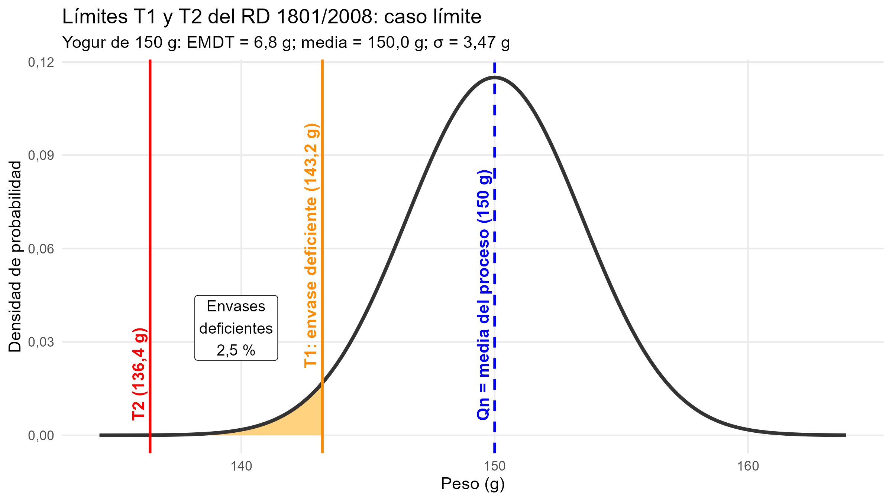
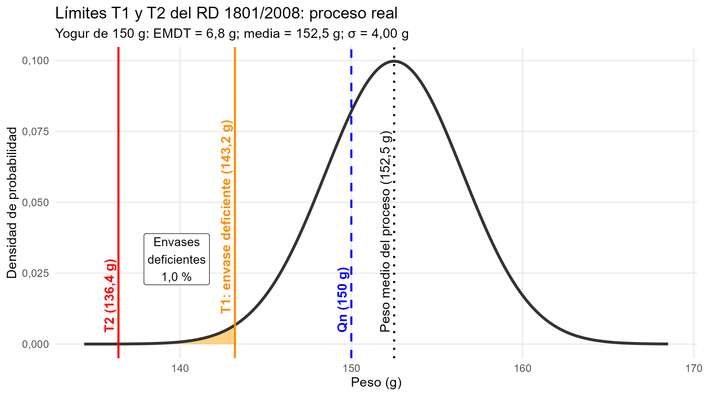

```{r setup-175}
#| include: false
Sys.setenv(RETICULATE_PYTHON = "C:/ProgramData/miniconda3/python.exe")
library(reticulate)
use_python("C:/ProgramData/miniconda3/python.exe", required = TRUE)

# Formato de números con coma decimal para el texto
fmt <- function(x, d = 1) format(round(x, d), nsmall = d,
                                 decimal.mark = ",", big.mark = ".")
```

::: callout-note
## Objetivos de aprendizaje

Al finalizar este capítulo, el alumno será capaz de:

- Identificar los conceptos clave del RD 1801/2008: cantidad nominal, EMDT, límites T1 y T2.
- Analizar un lote de producción y determinar su conformidad con la norma.
- Explicar la función y las limitaciones del discriminador de peso como medida de control.
- Identificar las causas de variabilidad de un proceso de envasado mediante el análisis 5M.
- Simular el efecto de planes de mejora sobre la distribución de pesos y cuantificar el ahorro económico.

Conceptos clave: **contenido efectivo, cantidad nominal, EMDT, T1, T2, sobredosificación, discriminador de peso, capacidad de proceso, variabilidad especial, variabilidad común**.
:::

::: {.callout-warning}
## Conocimientos previos necesarios
Este capítulo aplica herramientas de los capítulos anteriores: estadísticos descriptivos (cap. 6), distribución normal (cap. 7), exploración gráfica (cap. 5) y control estadístico de procesos, con sus gráficos de control y la capacidad de proceso (cap. 9). Conviene tenerlos a mano.
:::

::: {.callout-tip}
## Sobre el código de este capítulo
Los bloques de código que generan gráficos complejos aparecen **ocultos por defecto**. Puedes mostrarlos haciendo clic en «Mostrar código». Si quieres entender qué hace un bloque, cópialo y pégalo en un asistente de IA como Claude y pregúntale: *«Explícame este código línea a línea, en lenguaje sencillo»*.

Algunos bloques de código generan los gráficos que se han estudiado, aplicados al dataset actual, con algunas modificaciones estéticas adicionales; otros bloques presentan gráficos necesarios para la explicación que se sigue en el texto, y tienen una realización más compleja que los gráficos básicos. Se incluye también el código oculto de estos bloques para revisarlo en caso de interés.
:::

## Introducción

En la industria alimentaria es frecuente que el fabricante comercialice sus productos en envases individuales con un peso declarado en la etiqueta: un yogur de 125 g, un queso fresco de 500 g, una nata de 200 ml. El consumidor confía en que el contenido real coincide con lo que promete la etiqueta.

Ningún proceso de llenado industrial es perfecto. Siempre existe una dispersión natural alrededor del valor objetivo: unos envases pesarán un poco más, otros un poco menos. La pregunta no es si hay variabilidad (la hay siempre), sino cuánta variabilidad es aceptable y cómo se gestiona.

El **Real Decreto 1801/2008** responde a esa pregunta. No exige que cada envase pese exactamente lo declarado, sino que define unas tolerancias que el envasador debe cumplir. Entregar menos contenido del permitido es un incumplimiento. Entregar peso por encima del nominal tiene un coste económico: se está regalando producto.

Este capítulo usa los datos de un turno completo de envasado de yogures de 150 g para recorrer el ciclo completo: entender qué exige la norma, diagnosticar el proceso, identificar las causas de variabilidad y cuantificar el impacto económico de las mejoras.

## Dos formas de declarar el peso

El RD 1801/2008 se aplica a los productos envasados destinados al consumidor con cantidades nominales constantes entre 5 g y 10 kg (o entre 5 ml y 10 l). El envasador puede trabajar de dos formas:

- **Sin signo ℮.** El envasador no está obligado a aplicar el control estadístico por lotes del RD: puede, por ejemplo, controlar el contenido envase a envase. Aun así, debe cumplir los principios generales y las tolerancias del RD (artículos 7, 8 y 14.3): la media del contenido no puede ser inferior a la cantidad nominal y ningún envase puede quedar por debajo de T2 [@consumo2019].
- **Con signo ℮.** El envasador aplica el control estadístico por lotes de los artículos 10 a 12 del RD. A cambio puede imprimir el signo ℮, que certifica, bajo su responsabilidad, que el envase cumple con el real decreto y facilita la libre circulación del producto en el mercado europeo.

El resto de este capítulo se centra en la segunda modalidad.

### El signo ℮

Los envases que respondan a las modalidades de control estadístico de lotes establecidas en el RD pueden llevar impreso el **signo ℮** en el etiquetado (artículo 9). Su uso es voluntario. Este símbolo certifica, bajo responsabilidad del envasador o del importador, que el producto cumple con las disposiciones del real decreto, y actúa como «pasaporte» para la libre circulación del producto en el mercado europeo.

{.column-margin}

## El RD 1801/2008: qué exige la norma

### Los conceptos clave

**Cantidad nominal ($Q_n$):** el peso o volumen declarado en el envase. Para nuestro caso, $Q_n = 150$ g.

**Error máximo por defecto tolerado (EMDT):** la cantidad máxima que el contenido de un envase puede diferir en menos de la cantidad nominal. No es un valor fijo: depende del rango de cantidad nominal según el cuadro 1 del RD.


Para un yogur de 150 g (rango de 101 a 200 g), el EMDT es el **4,5% de la cantidad nominal**. El artículo 8 establece que los valores calculados a partir de un porcentaje se redondean por exceso a la décima de gramo:

$$\text{EMDT} = 4{,}5\% \times 150 = 6{,}75 \text{ g} \;\rightarrow\; 6{,}8 \text{ g}$$

A partir del EMDT se calculan los dos límites:

**Límite T1, envase deficiente:** un envase es deficiente cuando su contenido es inferior al contenido mínimo tolerado, $Q_n - \text{EMDT}$:

$$T_1 = 150 - 6{,}8 = 143{,}2 \text{ g}$$

**Límite T2:** ningún envase puede tener un error por defecto superior al doble del EMDT, es decir, ningún envase puede pesar menos de $Q_n - 2 \times \text{EMDT}$:

$$T_2 = 150 - 2 \times 6{,}8 = 136{,}4 \text{ g}$$

### Los tres requisitos del artículo 7

El artículo 7 del RD establece que el envasado debe realizarse de forma que se cumplan tres requisitos:

1. **La media:** la media del contenido efectivo de los envases no puede ser inferior a la cantidad nominal.
2. **Los envases deficientes:** la proporción de envases por debajo de T1 debe ser lo suficientemente pequeña para que los lotes superen los controles estadísticos del RD.
3. **T2:** ningún envase puede estar por debajo de T2.

El RD no fija un porcentaje máximo de envases deficientes: el segundo requisito se comprueba con el plan de muestreo que veremos a continuación. Como orientación, la guía WELMEC 6.5, de las autoridades europeas de metrología legal, considera adecuado no superar el **2,5%** de envases por debajo de T1. En este capítulo usaremos ese valor como referencia.

::: {.callout-note}
## Resumen de límites para yogur de 150 g

| Concepto | Valor |
|---|---|
| Cantidad nominal ($Q_n$) | 150,0 g |
| EMDT (4,5%, redondeado por exceso) | 6,8 g |
| Límite T1, envase deficiente | 143,2 g |
| Límite T2 | 136,4 g |
| Envases bajo T1 | Los suficientemente pocos para superar el muestreo (referencia orientativa: 2,5%) |
| Envases bajo T2 | Ninguno |
:::



### El procedimiento de muestreo

El cumplimiento se comprueba mediante muestreo estadístico del lote, con dos controles: uno sobre el número de envases deficientes y otro sobre la media.

**Control de los envases deficientes.** Para un lote de más de 3.200 unidades, el caso habitual en una línea de yogures con un turno completo de producción, el procedimiento es el siguiente:

- **Primera etapa:** se toman **80 envases** al azar. El lote se acepta si hay 3 o menos bajo T1 y se rechaza si hay 7 o más. Si el número de envases bajo T1 está entre 4 y 6, se pasa a la segunda etapa.
- **Segunda etapa:** se toman **otros 80 envases** y se acumulan con los de la primera (160 en total). El lote se acepta si hay 8 o menos bajo T1 y se rechaza si hay 9 o más.

| Etapa | Muestra | Aceptación | Rechazo |
|---|---|---|---|
| 1.ª | 80 uds. | ≤ 3 bajo T1 | ≥ 7 bajo T1 |
| 1.ª + 2.ª | 160 uds. | ≤ 8 bajo T1 | ≥ 9 bajo T1 |

Además, cualquier envase por debajo de T2 incumple el tercer requisito del artículo 7. En los cálculos de este capítulo, por tanto, un solo envase bajo T2 en la muestra basta para rechazar el lote.

**Control de la media.** Para un lote de más de 500 unidades se toma una muestra de 50 envases. El lote se acepta si la media de la muestra, $\bar{X}$, cumple $\bar{X} \geq Q_n - 0{,}379 \cdot s$, donde $s$ es la desviación típica de la muestra.

::: {.callout-warning}
## Rechazo: basta una condición. Aceptación: deben cumplirse todas
Para **rechazar** el lote basta con que se cumpla cualquiera de las condiciones de rechazo. Para **aceptarlo** deben cumplirse todas las condiciones de aceptación. Es un criterio conservador que protege al consumidor.
:::

## Análisis del lote: el turno del 1 de octubre

Disponemos del registro de pesos de un turno completo de envasado de yogures de 150 g: **9.600 envases** producidos entre las 08:00 y las 16:00, con un envase cada 3 segundos. Es el mismo turno que analizamos con gráficos de control en el capítulo 9, ahora con todos sus envases. El fichero `llenado_yogures.csv` contiene la hora de envasado, el número de envase, el subgrupo de control (grupos de 5 envases consecutivos), la posición del envase en el subgrupo y el peso en gramos. El turno es simulado.

### Carga de datos y estadísticos básicos

::: {.panel-tabset}

## R

```{r carga-datos-r}
#| code-fold: true
#| message: false
#| warning: false
library(tidyverse)

df <- read_csv2("datos/llenado_yogures.csv",
                locale = locale(decimal_mark = ",", encoding = "ISO-8859-1"))

# Límites del RD
Qn   <- 150
EMDT <- 6.8               # 4,5 % de 150 = 6,75, redondeado por exceso
T1   <- Qn - EMDT        # 143,2 g
T2   <- Qn - 2 * EMDT    # 136,4 g

n       <- nrow(df)
media   <- mean(df$peso_g)
sigma   <- sd(df$peso_g)
n_T1    <- sum(df$peso_g < T1)
n_T2    <- sum(df$peso_g < T2)

summary(df$peso_g)
cat("Desviación típica :", round(sigma, 2), "g\n")
cat("Envases bajo T1   :", n_T1, "(", round(100 * n_T1 / n, 2), "%)\n")
cat("Envases bajo T2   :", n_T2, "\n")
```

## Python

```{python carga-datos-python}
#| code-fold: true
import pandas as pd
import numpy as np

df = pd.read_csv("datos/llenado_yogures.csv", sep=";", decimal=",",
                 encoding="ISO-8859-1", parse_dates=["hora_envasado"])

# Límites del RD
Qn   = 150
EMDT = 6.8               # 4,5 % de 150 = 6,75, redondeado por exceso
T1   = Qn - EMDT         # 143,2 g
T2   = Qn - 2 * EMDT     # 136,4 g

print(df["peso_g"].describe().round(2))
print(f"\nDesviación típica : {df['peso_g'].std():.2f} g")
print(f"Envases bajo T1   : {(df['peso_g'] < T1).sum()} "
      f"({(df['peso_g'] < T1).mean()*100:.2f}%)")
print(f"Envases bajo T2   : {(df['peso_g'] < T2).sum()}")
```

:::

El peso medio es de `r fmt(media)` g, con una desviación típica de `r fmt(sigma)` g. El mínimo registrado es `r fmt(min(df$peso_g))` g, muy por debajo de T2, y el máximo `r fmt(max(df$peso_g))` g. Hay `r n_T1` envases por debajo de T1 (el `r fmt(100 * n_T1 / n, 2)`%) y `r n_T2` por debajo de T2. Con un solo envase bajo T2, el lote ya no cumple el artículo 7.

### Histograma y diagrama de caja

::: {.panel-tabset}
## R

```{r histograma-r}
#| code-fold: true
#| message: false
#| warning: false
#| fig-width: 10
#| fig-height: 4
library(patchwork)

p1 <- ggplot(df, aes(x = peso_g)) +
  geom_histogram(binwidth = 0.5, fill = "steelblue",
                 colour = "white", alpha = 0.85) +
  geom_vline(xintercept = Qn, colour = "green4",
             linetype = "dashed", linewidth = 0.8) +
  geom_vline(xintercept = T1, colour = "orange",
             linetype = "solid", linewidth = 0.8) +
  geom_vline(xintercept = T2, colour = "red",
             linetype = "solid", linewidth = 0.8) +
  annotate("text", x = Qn + 0.3, y = Inf, label = "Qn",
           vjust = 2, colour = "green4", size = 3) +
  annotate("text", x = T1 - 0.3, y = Inf, label = "T1",
           vjust = 2, colour = "orange", size = 3, hjust = 1) +
  annotate("text", x = T2 - 0.3, y = Inf, label = "T2",
           vjust = 2, colour = "red", size = 3, hjust = 1) +
  labs(title = "Distribución de pesos, turno completo",
       x = "Peso (g)", y = "Número de envases") +
  theme_minimal()

p2 <- ggplot(df, aes(y = peso_g)) +
  geom_boxplot(fill = "steelblue", alpha = 0.6,
               outlier.colour = "red", outlier.size = 1) +
  geom_hline(yintercept = Qn, colour = "green4",
             linetype = "dashed", linewidth = 0.8) +
  geom_hline(yintercept = T1, colour = "orange",
             linetype = "solid", linewidth = 0.8) +
  geom_hline(yintercept = T2, colour = "red",
             linetype = "solid", linewidth = 0.8) +
  labs(title = "Diagrama de caja", y = "Peso (g)", x = "") +
  theme_minimal()

p1 + p2 + plot_layout(widths = c(3, 1))
```

## Python

```{python histograma-python}
#| code-fold: true
#| fig-width: 10
#| fig-height: 4
import matplotlib.pyplot as plt
import matplotlib.gridspec as gridspec

fig = plt.figure(figsize=(11, 4))
gs  = gridspec.GridSpec(1, 4)
ax1 = fig.add_subplot(gs[0, :3])
ax2 = fig.add_subplot(gs[0, 3])

_ = ax1.hist(df["peso_g"], bins=70, color="steelblue", edgecolor="white",
             alpha=0.85)
for val, col, lbl in [(Qn, "green",  "Qn"),
                      (T1, "orange", "T1"),
                      (T2, "red",    "T2")]:
    _ = ax1.axvline(val, color=col, linewidth=1.5)
    _ = ax1.text(val + 0.2, ax1.get_ylim()[1] * 0.95, lbl,
                 color=col, fontsize=9, va="top")
_ = ax1.set_xlabel("Peso (g)")
_ = ax1.set_ylabel("Número de envases")
_ = ax1.set_title("Distribución de pesos, turno completo")

_ = ax2.boxplot(df["peso_g"], patch_artist=True,
                boxprops=dict(facecolor="steelblue", alpha=0.6),
                flierprops=dict(marker="o", color="red", markersize=2))
for val, col in [(Qn, "green"), (T1, "orange"), (T2, "red")]:
    _ = ax2.axhline(val, color=col, linewidth=1.2, linestyle="--")
_ = ax2.set_ylabel("Peso (g)")
_ = ax2.set_title("Caja")
_ = ax2.set_xticks([])

plt.tight_layout()
plt.show()
```

:::

La distribución es aproximadamente simétrica en su parte central, pero tiene una cola izquierda larga: hay un grupo de envases con pesos muy bajos. El diagrama de caja los señala como valores atípicos, algunos por debajo de T2. Fíjate también en que el centro de la distribución está unos 3 g por encima de la cantidad nominal: el proceso está ajustado para dosificar de más. Veremos por qué más adelante.

### El muestreo del RD: la herramienta de la inspección

El muestreo que define el RD es la herramienta que usa la inspección externa para evaluar si un lote es conforme. No es la herramienta con la que el fabricante toma decisiones sobre su proceso: el fabricante conoce su proceso mejor que nadie y no necesita esperar a un muestreo para saber que tiene envases bajo T2. Lo ha visto en el gráfico de control.

Aun así, es importante entender qué detecta y qué no detecta el muestreo, porque condiciona el razonamiento de muchos responsables de producción. Aplicamos el procedimiento sobre nuestro lote:

::: {.panel-tabset}
## R

```{r cumplimiento-r}
#| code-fold: true
#| message: false
#| warning: false
set.seed(123)
muestra_1 <- sample(df$peso_g, 80)

cat("=== PRIMERA ETAPA (n = 80) ===\n")
cat("Envases bajo T2 :", sum(muestra_1 < T2), "\n")
cat("Envases bajo T1 :", sum(muestra_1 < T1), "\n\n")

if (sum(muestra_1 < T2) >= 1) {
  cat("→ RECHAZO DIRECTO: envase(s) bajo T2\n")
} else if (sum(muestra_1 < T1) >= 7) {
  cat("→ RECHAZO DIRECTO: demasiados envases bajo T1\n")
} else if (sum(muestra_1 < T1) <= 3) {
  cat("→ ACEPTACIÓN en primera etapa\n")
} else {
  resto         <- df$peso_g[-match(muestra_1, df$peso_g)]
  muestra_2     <- sample(resto, 80)
  muestra_total <- c(muestra_1, muestra_2)
  cat("→ Zona de duda: segunda etapa\n\n")
  cat("=== SEGUNDA ETAPA (n acumulado = 160) ===\n")
  cat("Envases bajo T2 :", sum(muestra_total < T2), "\n")
  cat("Envases bajo T1 :", sum(muestra_total < T1), "\n")
  if (sum(muestra_total < T2) >= 1 | sum(muestra_total < T1) >= 9) {
    cat("→ RECHAZO del lote\n")
  } else {
    cat("→ ACEPTACIÓN del lote\n")
  }
}

# Control de la media: muestra de 50 envases
muestra_media <- sample(df$peso_g, 50)
limite_media  <- Qn - 0.379 * sd(muestra_media)
cat("\n=== CONTROL DE LA MEDIA (n = 50) ===\n")
cat("Media de la muestra :", round(mean(muestra_media), 2), "g  | Límite:",
    round(limite_media, 2), "g  →",
    ifelse(mean(muestra_media) >= limite_media, "CUMPLE", "NO CUMPLE"), "\n")

# Probabilidad de que una muestra de 80 envases contenga algún envase bajo T2
p_T2 <- 1 - phyper(0, n_T2, n - n_T2, 80)
cat("\nProbabilidad de encontrar algún envase bajo T2 en 80 envases:",
    round(100 * p_T2, 1), "%\n")
```

## Python

```{python cumplimiento-python}
#| code-fold: true
from scipy import stats

rng = np.random.default_rng(123)
pesos = df["peso_g"].values
indices = rng.permutation(len(pesos))
muestra_1 = pesos[indices[:80]]

bajo_T2_m1 = (muestra_1 < T2).sum()
bajo_T1_m1 = (muestra_1 < T1).sum()

print("=== PRIMERA ETAPA (n = 80) ===")
print(f"Envases bajo T2 : {bajo_T2_m1}")
print(f"Envases bajo T1 : {bajo_T1_m1}")

if bajo_T2_m1 >= 1:
    print("→ RECHAZO DIRECTO: envase(s) bajo T2")
elif bajo_T1_m1 >= 7:
    print("→ RECHAZO DIRECTO: demasiados envases bajo T1")
elif bajo_T1_m1 <= 3:
    print("→ ACEPTACIÓN en primera etapa")
else:
    total = pesos[indices[:160]]
    print("→ Zona de duda: segunda etapa")
    print("\n=== SEGUNDA ETAPA (n acumulado = 160) ===")
    print(f"Envases bajo T2 : {(total < T2).sum()}")
    print(f"Envases bajo T1 : {(total < T1).sum()}")
    if (total < T2).sum() >= 1 or (total < T1).sum() >= 9:
        print("→ RECHAZO del lote")
    else:
        print("→ ACEPTACIÓN del lote")

# Control de la media: muestra de 50 envases
muestra_media = rng.choice(pesos, size=50, replace=False)
limite_media  = Qn - 0.379 * muestra_media.std(ddof=1)
print("\n=== CONTROL DE LA MEDIA (n = 50) ===")
print(f"Media de la muestra : {muestra_media.mean():.2f} g  | Límite: "
      f"{limite_media:.2f} g  →",
      "CUMPLE" if muestra_media.mean() >= limite_media else "NO CUMPLE")

# Probabilidad de que una muestra de 80 envases contenga algún envase bajo T2
n_T2 = (pesos < T2).sum()
p_T2 = 1 - stats.hypergeom.pmf(0, len(pesos), n_T2, 80)
print(f"\nProbabilidad de encontrar algún envase bajo T2 en 80 envases: "
      f"{100 * p_T2:.1f} %")
```

:::

Sabemos que el lote contiene `r n_T2` envases bajo T2 y, por tanto, no cumple el RD. Sin embargo, la probabilidad de que una muestra de 80 envases recoja alguno de ellos es solo del `r fmt(100 * p_T2)`%. Y el porcentaje de envases bajo T1 (`r fmt(100 * n_T1 / n, 2)`%) es lo bastante bajo para que el plan de muestreo lo acepte casi siempre. Lo más probable, por tanto, es que el lote **pase la inspección**.

Esto no es un error: es una característica del control estadístico por muestreo. El sistema del RD está diseñado para detectar lotes con proporciones altas de envases deficientes, es decir, situaciones de fallo grave. Una proporción pequeña de envases bajo T2, como la de nuestro lote, rara vez aparece en una muestra de 80 unidades.

### El razonamiento del fabricante "pragmático"

Un responsable de producción que ve este resultado puede llegar a la siguiente conclusión: *si el muestreo acepta el lote, no tengo ningún incentivo inmediato para invertir en un discriminador. Sé que tengo algunos T2, pero la probabilidad de que los detecten en una inspección es muy baja. Puedo seguir como estoy y trabajar en la mejora del proceso a largo plazo.*

Es un razonamiento que existe en la práctica, y merece una respuesta en dos niveles.

**El nivel legal.** El RD no dice "si te pillan". El artículo 7 exige que ningún envase esté por debajo de T2, y el artículo 14 hace responsable al envasador de que sus envases cumplan el real decreto y le obliga a tener la documentación de sus controles a disposición de la inspección. Además, la inspección puede realizar controles en todas las fases de la comercialización (artículo 15), no solo en la planta: el fabricante no controla cuándo ni dónde se comprobarán sus envases.

**El nivel económico.** Este argumento es más contundente para un técnico de planta, porque se traduce directamente en euros. Un proceso con σ = `r fmt(sigma)` g no solo produce envases de `r fmt(min(df$peso_g), 0)` g: también produce envases de `r fmt(max(df$peso_g), 0)` g. La variabilidad actúa en los dos extremos. Cada gramo que se dosifica por encima de la cantidad nominal para "cubrir" la cola izquierda es producto que se regala al consumidor sin cobrar por ello. El coste de la sobredosificación, que calcularemos más adelante, es continuo, silencioso y muy superior al coste del discriminador y de las acciones de mejora.

::: {.callout-note}
## La variabilidad tiene coste en los dos extremos

Un proceso que produce envases muy ligeros también produce envases muy pesados. Para evitar los primeros, el fabricante sube la media de dosificación, y con ello regala más producto en cada envase. Reducir la variabilidad es la única forma de escapar de ese dilema: permite bajar la media sin arriesgar el incumplimiento, y ese ahorro es cuantificable turno a turno.
:::



## El discriminador de peso: solución inmediata, coste real

### Qué es y cómo funciona

Un **discriminador de peso** es un sistema de control en línea que pesa cada envase a la salida de la llenadora y expulsa automáticamente todos los que pesan menos que el valor al que se ha ajustado (su **consigna**). A diferencia del muestreo del RD, que evalúa una muestra del lote, el discriminador actúa **envase a envase durante la producción**.

Con el signo ℮, el discriminador se ajusta como mínimo en T2, para que ningún envase por debajo de ese límite llegue al mercado. Puede ajustarse más alto, por ejemplo en T1, a cambio de rechazar más envases. Cuando el envasador no aplica el control estadístico, el discriminador es la forma de asegurarse de que ningún envase sale por debajo del peso que se haya fijado.

### El coste del rechazo en el lote original

::: {.panel-tabset}
## R

```{r coste-discriminador-r}
#| code-fold: true
#| message: false
#| warning: false
# Parámetros económicos (valores orientativos)
coste_kg <- 1.20    # €/kg, coste de producción estimado
dias_año <- 220     # turnos de producción al año

rechazo <- tibble(consigna = c("T2", "T1"), limite = c(T2, T1)) |>
  rowwise() |>
  mutate(envases   = sum(df$peso_g < limite),
         kg        = sum(df$peso_g[df$peso_g < limite]) / 1000,
         coste_turno = kg * coste_kg,
         coste_anual = coste_turno * dias_año) |>
  ungroup()

rechazo
```

## Python

```{python coste-discriminador-python}
#| code-fold: true
# Parámetros económicos (valores orientativos)
coste_kg = 1.20    # €/kg, coste de producción estimado
dias_año = 220     # turnos de producción al año

for nombre, limite in [("T2", T2), ("T1", T1)]:
    rech = df.loc[df["peso_g"] < limite, "peso_g"]
    kg = rech.sum() / 1000
    print(f"Consigna {nombre}: {len(rech)} envases, {kg:.1f} kg, "
          f"{kg * coste_kg:.2f} €/turno, {kg * coste_kg * dias_año:.0f} €/año")
```

:::

Con la consigna en T2, el discriminador retira `r rechazo$envases[1]` envases por turno (`r fmt(rechazo$kg[1])` kg), y el lote pasa a cumplir el tercer requisito del artículo 7. Con la consigna en T1, retira `r rechazo$envases[2]` envases (`r fmt(rechazo$kg[2])` kg por turno): el rechazo se multiplica, porque la cola izquierda de la distribución es larga. En cualquier caso, el discriminador no corrige el proceso: solo retira los envases que el proceso produce mal.

### La trampa de bajar la media con el discriminador instalado

Una vez instalado el discriminador, los envases bajo T2 desaparecen de la línea y el lote pasa el control. La reacción habitual en planta es inmediata: *si ya no hay envases bajo T2, podemos bajar un poco el peso medio y recuperar producto*.

El razonamiento parece lógico, pero esconde una trampa. Al bajar la media sin reducir la variabilidad, la proporción de envases entre T2 y T1 **crece rápidamente**. Con la consigna en T2, el discriminador elimina los envases bajo T2, pero no los que quedan entre T2 y T1, y esa proporción puede superar la referencia del 2,5% antes de lo que parece.

La gráfica siguiente lo muestra: para cada valor posible de la media de dosificación, calcula el porcentaje esperado de envases bajo T1 usando la distribución normal con la σ actual del proceso (`r fmt(sigma)` g):

::: {.panel-tabset}
## R

```{r trampa-r}
#| code-fold: true
#| message: false
#| warning: false
#| fig-width: 8
#| fig-height: 4
medias_posibles <- seq(146, 158, by = 0.1)
pct_T1          <- pnorm(T1, mean = medias_posibles, sd = sigma) * 100

# Media más baja con la que el porcentaje bajo T1 no supera el 2,5 %
media_limite <- min(medias_posibles[pct_T1 <= 2.5])

ggplot(tibble(media = medias_posibles, pct = pct_T1),
       aes(x = media, y = pct)) +
  geom_line(colour = "steelblue", linewidth = 1.2) +
  geom_hline(yintercept = 2.5, colour = "red",
             linetype = "dashed", linewidth = 0.9) +
  geom_vline(xintercept = media_limite, colour = "orange",
             linetype = "dotted", linewidth = 0.9) +
  geom_vline(xintercept = media, colour = "green4",
             linetype = "dashed", linewidth = 0.8) +
  annotate("text", x = media + 0.1, y = 8,
           label = paste0("Media actual\n", fmt(media), " g"),
           colour = "green4", size = 3, hjust = 0) +
  annotate("text", x = media_limite - 0.1, y = 8,
           label = paste0("Límite\n", fmt(media_limite), " g"),
           colour = "orange", size = 3, hjust = 1) +
  annotate("text", x = 158, y = 3.3,
           label = "Referencia 2,5%", colour = "red", size = 3, hjust = 1) +
  labs(title    = "La trampa del discriminador",
       subtitle = paste0("Con σ = ", fmt(sigma), " g, bajar la media más de ",
                         fmt(media - media_limite),
                         " g supera la referencia del 2,5% bajo T1"),
       x = "Media de dosificación (g)",
       y = "% de envases bajo T1") +
  theme_minimal()
```

## Python

```{python trampa-python}
#| code-fold: true
#| fig-width: 8
#| fig-height: 4
sigma           = df["peso_g"].std()
media_actual    = df["peso_g"].mean()
medias_posibles = np.arange(146, 158.05, 0.1)
pct_T1          = stats.norm.cdf(T1, loc=medias_posibles, scale=sigma) * 100
media_limite    = medias_posibles[pct_T1 <= 2.5].min()

fig, ax = plt.subplots(figsize=(8, 4))
_ = ax.plot(medias_posibles, pct_T1, color="steelblue", linewidth=1.5)
_ = ax.axhline(2.5, color="red", linestyle="--", linewidth=1)
_ = ax.axvline(media_limite, color="orange", linestyle=":", linewidth=1.2)
_ = ax.axvline(media_actual, color="green", linestyle="--", linewidth=1)
_ = ax.text(media_actual + 0.1, 8, f"Media actual\n{media_actual:.1f} g",
            color="green", fontsize=8)
_ = ax.text(media_limite - 0.1, 8, f"Límite\n{media_limite:.1f} g",
            color="orange", fontsize=8, ha="right")
_ = ax.text(158, 3.3, "Referencia 2,5%", color="red", fontsize=8, ha="right")
_ = ax.set_xlabel("Media de dosificación (g)")
_ = ax.set_ylabel("% de envases bajo T1")
_ = ax.set_title(f"La trampa del discriminador\nCon σ = {sigma:.1f} g, bajar la "
                 f"media más de {media_actual - media_limite:.1f} g supera la "
                 f"referencia del 2,5% bajo T1")
plt.tight_layout()
plt.show()
```

:::

Con una σ de `r fmt(sigma)` g, el margen para bajar la media es de apenas `r fmt(media - media_limite)` g antes de superar la referencia del 2,5% de envases bajo T1. Y esto con el discriminador funcionando y eliminando todos los envases bajo T2: sin él, el lote ya incumple el RD.

::: {.callout-note}
## El discriminador: solución inevitable, coste real

El discriminador es en la práctica una solución casi inevitable: mientras se trabaja en reducir la variabilidad del proceso, un trabajo que puede llevar semanas o meses, la línea tiene que seguir produciendo dentro de la norma. El coste del rechazo se trata como un coste fijo asumido, que se incorpora al coste del producto y, por lo tanto, al precio de venta, reduciendo su competitividad. Lo que rara vez se calcula es cuánto de ese coste, y sobre todo cuánto de la sobredosificación, es evitable. Cuando se hace ese cálculo, como haremos en las secciones siguientes, el ahorro potencial se convierte en el argumento más sólido para justificar ante la dirección la inversión en las acciones de mejora.
:::

## El proceso de mejora continua para reducir la variabilidad

La mejora se plantea en dos etapas, cada una con sus acciones y sus conclusiones: primero se estabiliza el proceso eliminando las causas especiales, y después se reduce la variabilidad común.

### Etapa 1: estabilizar el proceso

#### Qué ocurrió durante el turno

En el capítulo 9 analizamos este turno con gráficos de control a partir de una muestra de 5 envases cada 3 minutos, y reconstruimos lo que había ocurrido:

| Hora | Qué ocurre | Tipo |
|---|---|---|
| 08:30 | Deriva ascendente: la media sube unos 6 g en 9 minutos | Causa especial |
| 08:39 | Sobrecorrección del operario: la media cae a unos 143 g durante 15 minutos | Causa especial |
| 08:54 | Recuperación gradual hasta el nivel inicial, hacia las 09:03 | |
| 10:00 | Alta variabilidad durante 45 minutos, sin cambio de la media | Causa especial |
| 11:00 | Deriva descendente lenta: la media baja 3 g en hora y media y sigue baja hasta las 13:30 | Causa especial |
| 13:30 | Escalón brusco en el cambio de turno: la media sube unos 4,5 g y queda alta hasta el final | Causa especial |
| 14:00 | Oscilación periódica durante 30 minutos | Causa especial |

Con todos los envases del turno podemos ver qué consecuencias tuvo cada incidente:

```{r consecuencias-incidentes}
#| code-fold: true
#| message: false
#| warning: false
df <- df |>
  mutate(hora = format(hora_envasado, "%H:%M"),
         periodo = case_when(
           hora >= "08:39" & hora < "09:03" ~ "Sobrecorrección (08:39-09:03)",
           hora >= "10:00" & hora < "10:45" ~ "Alta variabilidad (10:00-10:45)",
           TRUE                             ~ "Resto del turno"))

incidentes <- df |>
  group_by(periodo) |>
  summarise(envases = n(),
            bajo_T1 = sum(peso_g < T1),
            bajo_T2 = sum(peso_g < T2))
incidentes
```

La sobrecorrección y el período de alta variabilidad concentran casi todos los envases bajo T1 y todos los envases bajo T2. Son, por tanto, los dos incidentes que hacen que el lote no sea conforme.

#### Diagnóstico 5M: causas y planes de acción

**Máquina: deriva ascendente de las 08:30 y oscilación de las 14:00**

Una deriva progresiva de la media es la firma clásica del desgaste o la pérdida de ajuste mecánico. En una llenadora de pistón, puede deberse al desgaste de juntas, a una variación de la carrera del pistón o a un cambio en la temperatura del fluido hidráulico. La oscilación rítmica de las 14:00 apunta a una vibración periódica de la bomba de producto.

*Plan de acción (Lean, TPM):* plan de mantenimiento preventivo con revisión de pistones y juntas cada N turnos; alarmas automáticas cuando la media de tres subgrupos consecutivos se separe más de 1,5 g del objetivo.

**Mano de obra: sobrecorrección de las 08:39**

Es el incidente más grave del turno. Cuando el operario detectó la deriva ascendente de las 08:30, corrigió en exceso: bajó la dosificación tan bruscamente que la media cayó por debajo de T1 y aparecieron `r incidentes$bajo_T2[incidentes$periodo == "Sobrecorrección (08:39-09:03)"]` envases bajo T2, que bastan para que el lote no sea conforme. Era completamente evitable.

*Plan de acción (Lean, trabajo estándar):* criterios de actuación escritos con límites de corrección, por ejemplo un ajuste máximo de ±0,5 g por intervención y la verificación del resultado antes del siguiente paso.

**Mano de obra: escalón brusco de las 13:30**

El cambio brusco coincide con el cambio de turno. El operario entrante ajustó la máquina de forma diferente al saliente, sin un protocolo de entrega definido.

*Plan de acción (Lean, estandarización):* protocolo escrito de cambio de turno con verificación de peso y firma de aceptación antes de liberar la línea.

**Material: alta variabilidad de 10:00 a 10:45**

Un período de variabilidad alta sin cambio de la media apunta a un material diferente: probablemente la llegada de un nuevo lote de producto con una viscosidad distinta, que afecta al volumen dosificado por el pistón.

*Plan de acción (Lean, poka-yoke):* control de viscosidad en la recepción de cada cuba antes de incorporarla a la línea. Si la viscosidad está fuera del rango aceptado, no se incorpora sin un ajuste previo.

**Método: deriva descendente de 11:00 a 13:30**

Una deriva relacionada con la hora del turno puede responder a la temperatura del producto: a medida que avanza la mañana, la temperatura en el depósito de alimentación sube, la viscosidad baja y el pistón entrega ligeramente menos masa. Es una causa de método, porque no existe un procedimiento de control de temperatura.

*Plan de acción:* rango de temperatura del producto en el depósito, con verificación horaria. A más largo plazo, control automático de temperatura.

::: {.callout-tip}
## Variabilidad especial y variabilidad común

Los incidentes identificados son **causas especiales** de variabilidad: tienen una causa identificable, son esporádicos y se pueden eliminar con acciones concretas. Una vez eliminados, el proceso queda con su **variabilidad común**, la inherente al sistema, que solo se puede reducir con mejoras estructurales más profundas.

Este enfoque de dos etapas (primero estabilizar eliminando causas especiales, después optimizar reduciendo la variabilidad común) es la base de las metodologías **Lean** y **Six Sigma**, que estudiaremos en el capítulo 16.
:::

#### Por qué la media está en 153 g

Antes del primer incidente, entre las 08:00 y las 08:30, el proceso funcionaba solo con causas comunes. Esos 600 envases nos dicen cómo es el proceso cuando no ocurre nada especial:

```{r capacidad-fase1}
#| code-fold: true
fase1       <- df |> filter(hora < "08:30")
media_f1    <- mean(fase1$peso_g)
sigma_f1    <- sd(fase1$peso_g)
cpk_f1      <- (media_f1 - T1) / (3 * sigma_f1)

cat(sprintf("Media = %.2f g   Desviación típica = %.2f g   Cpk = %.2f\n",
            media_f1, sigma_f1, cpk_f1))
```

Sin incidentes, el proceso tiene una media de unos 153 g y una desviación típica de unos 2,5 g, con un $C_{pk}$ frente a T1 de `r fmt(cpk_f1, 2)`. En el capítulo 9 vimos que en la industria se suele exigir $C_{pk} \geq 1{,}33$. Como solo hay un límite inferior, eso significa que la media debe estar al menos 4 desviaciones típicas por encima de T1:

$$\mu \geq T_1 + 4\sigma = 143{,}2 + 4 \times 2{,}5 = 153{,}2 \text{ g}$$

Esta es la razón por la que la planta trabaja con una media de 153 g, 3 g por encima de la cantidad nominal: con la variabilidad actual, si baja la media aparecen envases bajo T2 o un número excesivo de envases bajo T1.

#### Simulación del proceso estabilizado

Una vez implementadas las acciones de la etapa 1, el proceso queda libre de causas especiales y se comporta como en la Fase I. Lo simulamos con la misma media (153 g) y la desviación típica de la variabilidad común (2,5 g):

::: {.panel-tabset}
## R

```{r simulacion-etapa1-r}
#| code-fold: true
#| message: false
#| warning: false
set.seed(101)
media_e1 <- 153
sigma_e1 <- 2.5

peso_etapa1 <- rnorm(n, mean = media_e1, sd = sigma_e1)

cat("=== PROCESO ESTABILIZADO (etapa 1) ===\n")
cat("Media  :", round(mean(peso_etapa1), 2), "g\n")
cat("SD     :", round(sd(peso_etapa1), 2), "g\n")
cat("Bajo T1:", sum(peso_etapa1 < T1),
    "(", round(mean(peso_etapa1 < T1) * 100, 2), "%)\n")
cat("Bajo T2:", sum(peso_etapa1 < T2), "\n")
```

## Python

```{python simulacion-etapa1-python}
#| code-fold: true
rng      = np.random.default_rng(101)
n        = len(df)
media_e1 = 153
sigma_e1 = 2.5

peso_etapa1 = rng.normal(media_e1, sigma_e1, n)

print("=== PROCESO ESTABILIZADO (etapa 1) ===")
print(f"Media  : {peso_etapa1.mean():.2f} g")
print(f"SD     : {peso_etapa1.std(ddof=1):.2f} g")
print(f"Bajo T1: {(peso_etapa1 < T1).sum()} "
      f"({(peso_etapa1 < T1).mean()*100:.2f}%)")
print(f"Bajo T2: {(peso_etapa1 < T2).sum()}")
```

:::

#### Comparación visual: original frente a estabilizado

::: {.panel-tabset}

## R

```{r histograma-etapa1-r}
#| code-fold: true
#| message: false
#| warning: false
#| fig-width: 10
#| fig-height: 4
df_comp <- tibble(
  peso  = c(df$peso_g, peso_etapa1),
  etapa = rep(c(paste0("Original (σ = ", fmt(sigma), " g)"),
                paste0("Etapa 1: estabilizado (σ = ", fmt(sigma_e1), " g)")),
              each = n)
)

ggplot(df_comp, aes(x = peso, fill = etapa, colour = etapa)) +
  geom_density(alpha = 0.3, linewidth = 0.8) +
  geom_vline(xintercept = Qn, colour = "green4",
             linetype = "dashed", linewidth = 0.8) +
  geom_vline(xintercept = T1, colour = "orange",
             linetype = "solid",  linewidth = 0.8) +
  geom_vline(xintercept = T2, colour = "red",
             linetype = "solid",  linewidth = 0.8) +
  scale_fill_manual(values   = c("steelblue", "darkorange")) +
  scale_colour_manual(values = c("steelblue", "darkorange")) +
  labs(title  = "Original frente a proceso estabilizado (etapa 1)",
       x = "Peso (g)", y = "Densidad",
       fill = "Escenario", colour = "Escenario") +
  theme_minimal() +
  theme(legend.position = "bottom")
```

## Python

```{python histograma-etapa1-python}
#| code-fold: true
#| fig-width: 10
#| fig-height: 4
from scipy.stats import gaussian_kde

fig, ax = plt.subplots(figsize=(10, 4))
xs = np.linspace(130, 170, 400)
for datos, lbl, col in [
    (df["peso_g"].values, f"Original (σ = {sigma:.1f} g)", "steelblue"),
    (peso_etapa1, f"Etapa 1: estabilizado (σ = {sigma_e1} g)", "darkorange")
]:
    kde = gaussian_kde(datos)
    _ = ax.fill_between(xs, kde(xs), alpha=0.25, color=col, label=lbl)
    _ = ax.plot(xs, kde(xs), color=col, linewidth=1.5)

for val, col, lbl in [(Qn, "green",  "Qn"),
                      (T1, "orange", "T1"),
                      (T2, "red",    "T2")]:
    _ = ax.axvline(val, color=col, linewidth=1.3,
                   linestyle="--" if val == Qn else "-")
    _ = ax.text(val + 0.15, ax.get_ylim()[1] * 0.95, lbl,
                color=col, fontsize=9, va="top")

_ = ax.set_xlabel("Peso (g)")
_ = ax.set_ylabel("Densidad")
_ = ax.set_title("Original frente a proceso estabilizado (etapa 1)")
_ = ax.legend(loc="upper left", fontsize=9)
plt.tight_layout()
plt.show()
```

:::

#### Conclusiones de la etapa 1

- **El lote pasa a ser conforme.** Sin causas especiales, la cola izquierda desaparece: no quedan envases bajo T2 y prácticamente ninguno bajo T1. El discriminador, ajustado en T2, apenas tiene que actuar.
- **Las acciones son rápidas y baratas.** Trabajo estándar, protocolo de cambio de turno, control de la viscosidad y de la temperatura y mantenimiento preventivo no requieren grandes inversiones.
- **La media no puede bajar todavía.** La variabilidad común sigue siendo de 2,5 g y, con el criterio $C_{pk} \geq 1{,}33$, la media debe mantenerse en torno a 153 g. Para dejar de regalar producto hay que pasar a la etapa 2.

### Etapa 2: reducir la variabilidad común

#### Acciones

Las acciones de la etapa 1 han eliminado las causas especiales. La variabilidad que queda, σ ≈ 2,5 g, es la inherente al sistema. Reducirla requiere intervenciones más profundas:

- **Revisión o sustitución de componentes de la llenadora:** si el pistón tiene holguras de fabricación, ningún ajuste operativo las elimina.
- **Control automático de temperatura** del depósito de alimentación, que sustituye a la verificación horaria de la etapa 1 y mantiene estable la viscosidad del producto.
- **Sistema de pesaje en continuo con retroalimentación automática** (*feedback control*): el equipo ajusta la dosificación de forma continua en función del peso medido, reduciendo la dependencia del ajuste manual.

#### Simulación del proceso optimizado

Supongamos que estas mejoras reducen la desviación típica a 1,8 g. Con el mismo criterio de $C_{pk} \geq 1{,}33$, la media de dosificación puede bajar a:

$$\mu = T_1 + 4\sigma = 143{,}2 + 4 \times 1{,}8 = 150{,}4 \text{ g}$$

que sigue estando por encima de la cantidad nominal y cumple, por tanto, el requisito de la media.

::: {.panel-tabset}

## R

```{r simulacion-etapa2-r}
#| code-fold: true
#| message: false
#| warning: false
set.seed(202)
sigma_e2 <- 1.8
media_e2 <- T1 + 4 * sigma_e2     # 150,4 g

peso_etapa2 <- rnorm(n, mean = media_e2, sd = sigma_e2)

cat("=== PROCESO OPTIMIZADO (etapa 2) ===\n")
cat("Media  :", round(mean(peso_etapa2), 2), "g\n")
cat("SD     :", round(sd(peso_etapa2), 2), "g\n")
cat("Bajo T1:", sum(peso_etapa2 < T1),
    "(", round(mean(peso_etapa2 < T1) * 100, 3), "%)\n")
cat("Bajo T2:", sum(peso_etapa2 < T2), "\n")
```

## Python

```{python simulacion-etapa2-python}
#| code-fold: true
rng2     = np.random.default_rng(202)
sigma_e2 = 1.8
media_e2 = T1 + 4 * sigma_e2      # 150,4 g

peso_etapa2 = rng2.normal(media_e2, sigma_e2, n)

print("=== PROCESO OPTIMIZADO (etapa 2) ===")
print(f"Media  : {peso_etapa2.mean():.2f} g")
print(f"SD     : {peso_etapa2.std(ddof=1):.2f} g")
print(f"Bajo T1: {(peso_etapa2 < T1).sum()} "
      f"({(peso_etapa2 < T1).mean()*100:.3f}%)")
print(f"Bajo T2: {(peso_etapa2 < T2).sum()}")
```

:::

#### Comparación de los tres escenarios

::: {.panel-tabset}
## R

```{r comparacion-tres-r}
#| code-fold: true
#| message: false
#| warning: false
#| fig-width: 11
#| fig-height: 4
df_tres <- tibble(
  peso  = c(df$peso_g, peso_etapa1, peso_etapa2),
  etapa = rep(c(
    paste0("Original (σ = ", fmt(sigma), " g, media = ", fmt(media), " g)"),
    paste0("Etapa 1: estabilizado (σ = ", fmt(sigma_e1), " g, media = ",
           fmt(media_e1), " g)"),
    paste0("Etapa 2: optimizado (σ = ", fmt(sigma_e2), " g, media = ",
           fmt(media_e2), " g)")
  ), each = n)
)

ggplot(df_tres, aes(x = peso, fill = etapa, colour = etapa)) +
  geom_density(alpha = 0.22, linewidth = 0.8) +
  geom_vline(xintercept = Qn, colour = "green4",
             linetype = "dashed", linewidth = 0.8) +
  geom_vline(xintercept = T1, colour = "orange",
             linetype = "solid",  linewidth = 0.8) +
  geom_vline(xintercept = T2, colour = "red",
             linetype = "solid",  linewidth = 0.8) +
  scale_fill_manual(values   = c("steelblue", "darkorange", "forestgreen")) +
  scale_colour_manual(values = c("steelblue", "darkorange", "forestgreen")) +
  coord_cartesian(xlim = c(135, 165)) +
  labs(title  = "Evolución del proceso: original → etapa 1 → etapa 2",
       x = "Peso (g)", y = "Densidad",
       fill = "Escenario", colour = "Escenario") +
  theme_minimal() +
  theme(legend.position = "bottom", legend.direction = "vertical")
```

## Python

```{python comparacion-tres-python}
#| code-fold: true
#| fig-width: 11
#| fig-height: 4
fig, ax = plt.subplots(figsize=(11, 4))
escenarios = [
    (df["peso_g"].values,
     f"Original (σ = {sigma:.1f} g, media = {media_actual:.1f} g)", "steelblue"),
    (peso_etapa1,
     f"Etapa 1: estabilizado (σ = {sigma_e1} g, media = {media_e1} g)", "darkorange"),
    (peso_etapa2,
     f"Etapa 2: optimizado (σ = {sigma_e2} g, media = {media_e2:.1f} g)", "forestgreen"),
]
xs = np.linspace(135, 165, 400)
for datos, lbl, col in escenarios:
    kde = gaussian_kde(datos)
    _ = ax.fill_between(xs, kde(xs), alpha=0.2, color=col, label=lbl)
    _ = ax.plot(xs, kde(xs), color=col, linewidth=1.4)

for val, col, ls in [(Qn, "green",  "--"),
                     (T1, "orange", "-"),
                     (T2, "red",    "-")]:
    _ = ax.axvline(val, color=col, linewidth=1.2, linestyle=ls)

_ = ax.set_xlabel("Peso (g)")
_ = ax.set_ylabel("Densidad")
_ = ax.set_title("Evolución del proceso: original → etapa 1 → etapa 2")
_ = ax.legend(fontsize=8, loc="upper left")
plt.tight_layout()
plt.show()
```

:::

#### La media necesaria según la variabilidad

La gráfica siguiente resume el argumento del capítulo. Para cada desviación típica, muestra el porcentaje esperado de envases bajo T1 según la media de dosificación, y marca la media mínima que exige el criterio $C_{pk} \geq 1{,}33$ ($\mu = T_1 + 4\sigma$):

::: {.panel-tabset}
## R

```{r media-necesaria-r}
#| code-fold: true
#| message: false
#| warning: false
#| fig-width: 8
#| fig-height: 4
sigmas <- c(sigma_e1, sigma_e2)
curvas <- expand_grid(media = medias_posibles, s = sigmas) |>
  mutate(pct = pnorm(T1, mean = media, sd = s) * 100,
         escenario = paste0("σ = ", fmt(s), " g"))
minimas <- tibble(s = sigmas, media_min = T1 + 4 * sigmas,
                  escenario = paste0("σ = ", fmt(s), " g"))

ggplot(curvas, aes(x = media, y = pct, colour = escenario)) +
  geom_line(linewidth = 1.1) +
  geom_vline(data = minimas, aes(xintercept = media_min, colour = escenario),
             linetype = "dotted", linewidth = 0.9) +
  geom_vline(xintercept = Qn, colour = "green4", linetype = "dashed") +
  geom_text(data = minimas,
            aes(x = media_min, y = 4, label = paste0(fmt(media_min), " g")),
            hjust = -0.1, size = 3, show.legend = FALSE) +
  annotate("text", x = Qn, y = 4.5, label = "Qn", colour = "green4",
           hjust = 1.2, size = 3) +
  scale_colour_manual(values = setNames(c("darkorange", "forestgreen"),
                                        paste0("σ = ", fmt(sigmas), " g"))) +
  coord_cartesian(ylim = c(0, 5)) +
  labs(title    = "Media mínima de dosificación según la variabilidad",
       subtitle = "Líneas punteadas: media mínima con Cpk ≥ 1,33 frente a T1",
       x = "Media de dosificación (g)", y = "% de envases bajo T1",
       colour = "Escenario") +
  theme_minimal() +
  theme(legend.position = "bottom")
```

## Python

```{python media-necesaria-python}
#| code-fold: true
#| fig-width: 8
#| fig-height: 4
fig, ax = plt.subplots(figsize=(8, 4))
for s, col in [(sigma_e1, "darkorange"), (sigma_e2, "forestgreen")]:
    pct = stats.norm.cdf(T1, loc=medias_posibles, scale=s) * 100
    media_min = T1 + 4 * s
    _ = ax.plot(medias_posibles, pct, color=col, linewidth=1.3,
                label=f"σ = {s} g")
    _ = ax.axvline(media_min, color=col, linestyle=":", linewidth=1.1)
    _ = ax.text(media_min + 0.1, 4, f"{media_min:.1f} g", color=col, fontsize=8)
_ = ax.axvline(Qn, color="green", linestyle="--", linewidth=1)
_ = ax.set_ylim(0, 5)
_ = ax.set_xlabel("Media de dosificación (g)")
_ = ax.set_ylabel("% de envases bajo T1")
_ = ax.set_title("Media mínima de dosificación según la variabilidad")
_ = ax.legend(fontsize=9)
plt.tight_layout()
plt.show()
```

:::

Con σ = 2,5 g, la media mínima es 153,2 g; con σ = 1,8 g, baja a 150,4 g. Cada décima de gramo que se reduce la desviación típica permite bajar 0,4 g la media de dosificación.

#### Estimación del ahorro anual

::: {.panel-tabset}

## R

```{r ahorro-r}
#| code-fold: true
#| message: false
#| warning: false
gramos_ahorrados <- media_e1 - media_e2
kg_ahorrados     <- gramos_ahorrados * n / 1000
ahorro_turno     <- kg_ahorrados * coste_kg
ahorro_anual     <- ahorro_turno * dias_año

cat("Gramos ahorrados / envase :", round(gramos_ahorrados, 1), "g\n")
cat("Kg ahorrados / turno      :", round(kg_ahorrados, 1), "kg\n")
cat("Ahorro / turno            :", round(ahorro_turno, 2), "€\n")
cat("Ahorro anual (", dias_año, "turnos) :", round(ahorro_anual, 0), "€\n")
```

## Python

```{python ahorro-python}
#| code-fold: true
gramos_ahorrados = media_e1 - media_e2
kg_ahorrados     = gramos_ahorrados * n / 1000
ahorro_turno     = kg_ahorrados * coste_kg
ahorro_anual     = ahorro_turno * dias_año

print(f"Gramos ahorrados / envase : {gramos_ahorrados:.1f} g")
print(f"Kg ahorrados / turno      : {kg_ahorrados:.1f} kg")
print(f"Ahorro / turno            : {ahorro_turno:.2f} €")
print(f"Ahorro anual ({dias_año} turnos) : {ahorro_anual:.0f} €")
```

:::

#### Conclusiones de la etapa 2

- **La reducción de la variabilidad común se traduce directamente en ahorro.** Bajar la media de 153 a `r fmt(media_e2)` g ahorra `r fmt(gramos_ahorrados)` g por envase, es decir, `r fmt(kg_ahorrados)` kg por turno y unos `r fmt(ahorro_anual, 0)` € al año con los parámetros de este ejemplo.
- **El proceso sigue cumpliendo con margen.** La media continúa por encima de la cantidad nominal, y prácticamente ningún envase queda por debajo de T1.
- **Requiere inversión.** A diferencia de la etapa 1, estas acciones necesitan inversión en equipos, pero su retorno es cuantificable y directo, y ese cálculo es el que hay que presentar a la dirección.

## Resumen del capítulo

El RD 1801/2008 establece tres requisitos para el envasado: la media del contenido no puede ser inferior a la cantidad nominal, la proporción de envases bajo T1 debe ser lo bastante pequeña para superar los controles estadísticos, y ningún envase puede estar por debajo de T2. Para un yogur de 150 g, con un EMDT de 6,8 g, T1 = 143,2 g y T2 = 136,4 g.

La tabla siguiente resume los tres escenarios analizados:

```{r tabla-resumen}
#| echo: false
#| message: false
#| warning: false
tabla <- tibble(
  Escenario = c("Original", "Etapa 1: estabilizado", "Etapa 2: optimizado"),
  Media     = fmt(c(media, mean(peso_etapa1), mean(peso_etapa2))),
  SD        = fmt(c(sigma, sd(peso_etapa1), sd(peso_etapa2))),
  Bajo_T1   = paste0(fmt(100 * c(n_T1 / n, mean(peso_etapa1 < T1),
                                 mean(peso_etapa2 < T1)), 2), "%"),
  Bajo_T2   = c(n_T2, sum(peso_etapa1 < T2), sum(peso_etapa2 < T2)),
  Conforme  = c(ifelse(n_T2 > 0, "NO (T2)", "SÍ"),
                ifelse(sum(peso_etapa1 < T2) > 0, "NO (T2)", "SÍ"),
                ifelse(sum(peso_etapa2 < T2) > 0, "NO (T2)", "SÍ")),
  Ahorro    = c("", "0 € (la media no baja)", paste0(fmt(ahorro_anual, 0), " €"))
)

knitr::kable(tabla,
  col.names = c("Escenario", "Media (g)", "σ (g)",
                "% bajo T1", "N bajo T2", "Conforme", "Ahorro/año"),
  align = "lrrrrcr")
```

El camino de mejora tiene dos etapas bien diferenciadas. La primera, eliminar las causas especiales mediante trabajo estándar, protocolos de turno, control de materiales y mantenimiento, es rápida y de bajo coste, y hace que el lote cumpla el RD; pero no permite bajar la media, porque esta depende de la variabilidad común. La segunda, reducir la variabilidad común con mejoras tecnológicas, requiere inversión, pero es la que permite dejar de regalar producto, con un retorno económico cuantificable y directo.

El discriminador de peso es una herramienta necesaria durante todo el proceso, pero su papel disminuye a medida que la variabilidad se reduce. Al final del camino, el discriminador apenas actúa, y eso es exactamente lo que se busca.

Este recorrido (medir, diagnosticar, estabilizar, optimizar) es la lógica que subyace a las metodologías **Lean** y **Six Sigma**, que formalizaremos en el capítulo 16.
