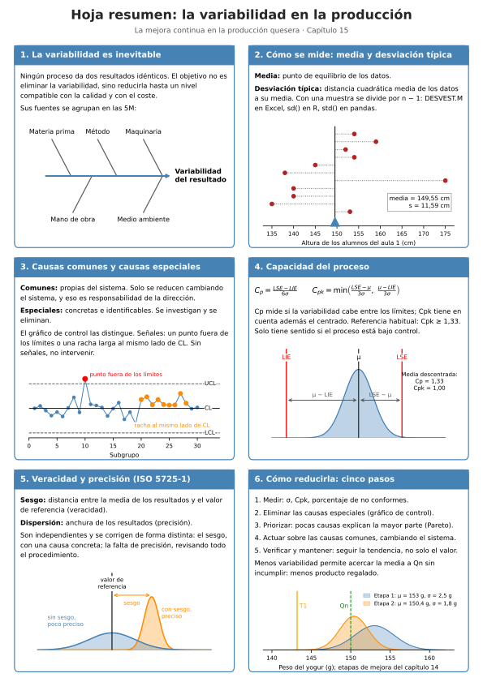

::: callout-note
## Objetivos de aprendizaje

Al finalizar este capítulo, el alumno será capaz de:

- Definir la variabilidad industrial y explicar sus fuentes principales.
- Identificar las consecuencias económicas y de calidad de no medir ni gestionar la variabilidad.
- Relacionar las herramientas del libro con los distintos aspectos de la medición y gestión de la variabilidad.
- Proponer un enfoque estructurado para reducir la variabilidad en un proceso concreto.
- Explicar por qué la variabilidad es una oportunidad de mejora, no solo un problema a evitar.

Conceptos clave: **variabilidad natural, causas comunes, causas especiales, coste de la variabilidad, capacidad de proceso, mejora continua**.
:::

## Qué es la variabilidad industrial

Ningún proceso industrial produce resultados idénticos. Dos yogures fabricados consecutivamente en la misma línea no pesan exactamente lo mismo. Dos análisis del mismo queso realizados por el mismo analista no dan exactamente el mismo valor de extracto seco. Dos fabricaciones de camembert con la misma leche y el mismo protocolo no producen quesos con exactamente la misma humedad.

Esta variación inevitable es la **variabilidad industrial**: la dispersión de los resultados de un proceso alrededor de su valor medio, causada por la suma de múltiples factores que actúan simultáneamente y que nunca se pueden controlar de forma perfecta.

La variabilidad tiene tres características fundamentales que hay que entender antes de intentar gestionarla:

**Es inevitable.** Todo proceso real tiene variabilidad. El objetivo nunca es eliminarla por completo (es imposible), sino reducirla hasta niveles que sean compatibles con los requisitos de calidad y con el coste que estamos dispuestos a asumir.

**No es aleatoria en su totalidad.** Como vimos en el capítulo 9, hay una parte de la variabilidad que es aleatoria e inherente al sistema (causas comunes) y otra parte que responde a causas concretas identificables (causas especiales). Confundir las dos lleva a tomar decisiones incorrectas: intervenir cuando no hace falta, o no intervenir cuando sí hace falta.

**Tiene estructura.** La variabilidad no aparece de forma uniforme. Hay variabilidad entre fabricaciones del mismo turno, entre turnos del mismo día, entre días de la misma semana, entre semanas del mismo mes, y entre meses del mismo año. Cada nivel tiene sus propias causas y requiere herramientas diferentes para analizarla.

### Las fuentes de variabilidad

En un proceso quesero, y en cualquier proceso industrial de transformación biológica, las fuentes de variabilidad son múltiples y se agrupan en cinco categorías clásicas, conocidas como las **5M**:

- **Materia prima** (o material): la composición de la leche varía con la raza, la alimentación, la etapa de lactación y la estación del año. Es una fuente de variabilidad que el fabricante no controla pero sí puede medir y compensar.
- **Método:** el protocolo de fabricación puede estar bien o mal documentado, bien o mal seguido. La variabilidad de método es una de las más frecuentes y de las más evitables.
- **Maquinaria** (o máquina): los equipos envejecen, se desajustan, se ensucian. Un pHmetro con el electrodo colmatado, una dosificadora con la válvula desgastada, un intercambiador de calor con depósitos: todos son fuentes de variabilidad creciente a lo largo del tiempo.
- **Mano de obra:** la formación, la experiencia y la atención del operario influyen en el resultado. La variabilidad de mano de obra se reduce con formación, procedimientos claros e instrucciones de trabajo en el puesto.
- **Medio ambiente:** la temperatura y la humedad de la sala de maduración, la carga microbiana ambiental, las variaciones estacionales. Son fuentes de variabilidad difíciles de eliminar pero posibles de monitorizar y controlar parcialmente.

::: {.callout-note}
## La variabilidad no es mala gestión
Es importante no confundir variabilidad con incompetencia. Un proceso con variabilidad alta puede estar gestionado por un equipo muy competente que, sencillamente, trabaja con una tecnología antigua, una materia prima muy variable o unos recursos insuficientes. La variabilidad de fondo, la que se debe a causas comunes, es una propiedad del sistema y no del operario (capítulo 9). Reducirla requiere actuar sobre el sistema, y eso es responsabilidad de la dirección, no solo del equipo de planta.
:::

## Consecuencias económicas y de calidad: el coste de no medir

La variabilidad tiene un coste real, aunque con frecuencia no aparezca en ninguna partida del presupuesto. Es un coste invisible que se manifiesta de formas distintas:

**Coste de la sobredosificación.** Como vimos en el capítulo 14, un proceso con alta variabilidad de peso obliga a llenar los envases con más producto del nominal para garantizar el cumplimiento legal. En la línea de yogures de ese capítulo, reducir σ de 2,5 g a 1,8 g permitía bajar la media de 153 g a 150,4 g y ahorrar 6.589 € al año. Con los mismos supuestos (1,20 €/kg, 220 jornadas de producción al año y una media mínima que garantice $C_{pk} \geq 1{,}33$ frente a T1 sin bajar de Qn), una línea de 50.000 envases diarios con σ = 3,0 g necesita una media de 155,2 g, frente a los 150 g que bastan con σ = 1,0 g: la diferencia supone unos 69.000 € anuales en producto entregado gratuitamente.

**Coste de la no conformidad.** Un proceso con alta variabilidad produce más unidades fuera de especificación: quesos con humedad incorrecta, yogures con pH fuera de rango, lotes con recuentos microbiológicos elevados. Cada unidad no conforme es producto que no se puede vender, o que se vende a precio reducido, o que genera reclamaciones y devoluciones.

**Coste del retrabajo y el desperdicio.** En muchos procesos, la variabilidad alta genera la necesidad de operaciones correctoras: reprocesar lotes, alargar la maduración, ajustar la estandarización. Estas operaciones tienen un coste directo en tiempo, energía y mano de obra.

**Coste de la pérdida de confianza.** Un proveedor que entrega producto con alta variabilidad, aunque siempre dentro de especificación, genera desconfianza en el comprador. A igualdad de precio, los compradores prefieren proveedores predecibles. La variabilidad alta es un obstáculo para acceder a clientes exigentes y a mercados de mayor valor añadido.

**El coste de no medir.** Quizás el más importante de todos: si no medimos la variabilidad, no sabemos cuánto cuesta. Un proceso puede estar perdiendo miles de euros al año en sobredosificación o en no conformidades sin que nadie lo sepa, porque nadie ha hecho el cálculo. Medir es la condición previa para mejorar.

## Cómo hemos medido la variabilidad a lo largo del libro: un recorrido

A lo largo de los capítulos anteriores hemos utilizado diferentes herramientas para medir y describir la variabilidad. Cada una captura un aspecto distinto:

**La desviación típica y la varianza** (capítulo 6) son las medidas fundamentales de dispersión. La desviación típica cuantifica en las mismas unidades que la variable cuánto se alejan los valores de la media. Es el punto de partida de cualquier análisis de variabilidad.

**El histograma y el boxplot** (capítulo 5) permiten ver la forma de la distribución: si es simétrica o asimétrica, si tiene valores atípicos, si hay varios grupos mezclados. Un proceso con distribución bimodal está diciendo que hay dos poblaciones distintas (dos turnos, dos operarios, dos proveedores) que hay que separar antes de analizar.

**El QQ-plot** (capítulo 7) permite comprobar si los datos se ajustan razonablemente a una distribución normal, algo conveniente antes de aplicar cualquier cálculo basado en ella, como la proporción esperada de valores fuera de un límite.

**El coeficiente de correlación y la regresión** (capítulo 8) permiten identificar qué variables varían conjuntamente: si el extracto seco del camembert aumenta cuando aumenta su materia grasa (capítulo 12), tenemos una pista sobre dónde buscar la causa de sus variaciones, aunque la correlación por sí sola no demuestra la causalidad.

**El análisis del sistema de medición** (capítulo 13) evalúa el error del propio sistema de análisis: el sesgo y la repetibilidad de cada analista. Es inútil intentar reducir la variabilidad del proceso si el error de la medida es comparable a ella, porque no podremos distinguir los cambios del proceso de los errores del laboratorio.

**El gráfico de control y los índices de capacidad** (capítulo 9) son las herramientas específicas para la gestión en tiempo real de la variabilidad. El gráfico distingue entre variabilidad normal (causas comunes) y señales de alarma (causas especiales). Los índices $C_p$ y $C_{pk}$ cuantifican si la variabilidad natural del proceso es compatible con las especificaciones.

**El diseño de experimentos** (capítulo 10) es la herramienta para identificar qué factores influyen en la respuesta del proceso y en qué medida. Conocerlos nos dice dónde actuar con el mayor efecto: fijar esos factores en el nivel adecuado y controlar sus oscilaciones reduce la variabilidad que provocan.

## Cómo reducir la variabilidad: herramientas, prioridades y objetivos realistas

Reducir la variabilidad es un proceso sistemático, no un conjunto de acciones aisladas. Requiere seguir una secuencia lógica:

**Primero, medir.** No se puede reducir lo que no se mide. El primer paso es siempre cuantificar la variabilidad actual: desviación típica, índice de capacidad, porcentaje de no conformidades. Sin esta línea base no hay forma de saber si las acciones de mejora están funcionando.

**Segundo, identificar las causas especiales y eliminarlas.** Antes de intentar reducir la variabilidad de fondo (causas comunes), hay que asegurarse de que no hay causas especiales activas. Un proceso con causas especiales no está bajo control estadístico, y intentar reducir su variabilidad sin eliminarlas primero es trabajar sobre un sistema inestable. El gráfico de control es la herramienta para detectarlas.

**Tercero, priorizar.** En un proceso real hay docenas de fuentes potenciales de variabilidad. No es posible actuar sobre todas a la vez. La herramienta clásica para priorizar es el **diagrama de Pareto**: un gráfico de barras que ordena las causas (por ejemplo, los motivos de no conformidad) de mayor a menor frecuencia o coste. Suele mostrar que unas pocas causas explican la mayor parte de los problemas, y actuar primero sobre ellas es mucho más eficiente que repartir el esfuerzo por igual.

**Cuarto, actuar sobre las causas comunes.** Reducir la variabilidad de fondo requiere cambiar el sistema: mejorar la precisión de los equipos, estandarizar los procedimientos, estabilizar la materia prima, mejorar la formación del equipo. Son acciones más costosas y de mayor plazo que la eliminación de causas especiales, pero son las que producen mejoras sostenibles.

**Quinto, verificar y mantener.** Una vez conseguida la mejora, hay que verificar que se ha mantenido, midiendo de nuevo la desviación típica o el índice de capacidad, y establecer un sistema de seguimiento para detectar cualquier deriva futura. Sin seguimiento, los procesos tienden a volver a su variabilidad anterior.

::: {.callout-note}
## Objetivos realistas
Un error frecuente es fijar objetivos de reducción de variabilidad sin conocer la capacidad actual del proceso. "Reducir los defectos a cero" o "eliminar toda la variabilidad" son objetivos imposibles de alcanzar o de verificar. Un objetivo realista parte de la variabilidad actual, evalúa qué es posible con los recursos disponibles, y fija un objetivo concreto y alcanzable: por ejemplo, "reducir la desviación típica del peso de 2,5 g a 1,8 g en 6 meses", como en la etapa 2 del capítulo 14. Ese objetivo es verificable, tiene un plazo, y su impacto económico se puede calcular de antemano.
:::

## Cómo hacer el seguimiento: indicadores, revisiones y tendencias

Reducir la variabilidad sin hacer seguimiento es como adelgazar sin pesarse: puede que funcione, pero no lo sabrás hasta que sea demasiado tarde para corregir.

El seguimiento de la variabilidad requiere tres elementos:

**Indicadores definidos.** Cada proceso crítico debe tener uno o dos indicadores de variabilidad bien definidos: la desviación típica del peso de llenado, el índice $C_{pk}$ del proceso de acidificación, el porcentaje de lotes no conformes del mes. Los indicadores deben ser pocos, específicos y calculados de forma consistente.

**Revisiones periódicas.** Los indicadores deben revisarse con una frecuencia adecuada al ritmo del proceso. Un gráfico de control diario es adecuado para seguir la variabilidad turno a turno. Un análisis mensual de la desviación típica por categoría de producto es adecuado para detectar derivas de largo plazo. Una revisión trimestral de los índices de capacidad es adecuada para evaluar el progreso de los planes de mejora.

**Tendencias, no solo niveles.** Un indicador que hoy está dentro del objetivo pero lleva tres meses subiendo es una alarma tan importante como uno que ya ha superado el límite. El seguimiento efectivo mira la tendencia, no solo el valor puntual. Los gráficos de control a largo plazo, construidos con datos de semanas o meses y no de horas (como el del extracto seco semanal del capítulo 9), son la herramienta para detectar estas tendencias antes de que se conviertan en problemas.

## La variabilidad como oportunidad

A lo largo del libro hemos presentado la variabilidad principalmente como un problema: algo que produce no conformidades, que obliga a sobredosificar, que genera costes ocultos. Esa perspectiva es correcta pero incompleta.

La variabilidad también es **información**. Un proceso con alta variabilidad está diciendo algo sobre sí mismo: que hay factores que no están bajo control, que hay causas que no se han identificado, que hay margen de mejora. Que un proceso sea estable, sin causas especiales, solo significa que su variabilidad es predecible: puede seguir siendo poco capaz o estar mal centrado, y entonces la mejora exige actuar sobre el sistema.

Cada episodio de variabilidad anómala (un punto fuera de los límites de control, un lote rechazado, una deriva detectada) es una oportunidad de aprendizaje. La pregunta correcta no es "¿quién ha cometido el error?" sino "¿qué nos está diciendo el proceso sobre sí mismo?". La respuesta a esa pregunta, sistemáticamente buscada y respondida, es lo que permite mejorar de forma continua.

Esta es la perspectiva con la que cerramos este capítulo y con la que abrimos el siguiente, dedicado a la mejora continua: la variabilidad no es el enemigo. Es el punto de partida. Medirla, entenderla y reducirla progresivamente es exactamente el trabajo que hacen los equipos de mejora continua en la industria, y es el hilo conductor que conecta todas las herramientas que hemos aprendido en este libro.

## Resumen del capítulo

La variabilidad industrial es inevitable: ningún proceso produce resultados idénticos. Sus fuentes son múltiples (materia prima, método, maquinaria, mano de obra y medio ambiente) y su gestión requiere distinguir entre la variabilidad de fondo inherente al sistema (causas comunes) y las señales de cambio que requieren investigación (causas especiales).

El coste de no medir la variabilidad es real aunque invisible: sobredosificación, no conformidades, retrabajo, pérdida de confianza de los clientes. Medir es la condición previa para mejorar.

A lo largo del libro hemos visto las herramientas para medir la variabilidad en sus distintos aspectos: la desviación típica para cuantificarla, el histograma y el boxplot para ver su forma, el gráfico de control para seguirla en tiempo real, los índices de capacidad para evaluar si es compatible con las especificaciones, el diseño de experimentos para identificar sus causas.

Reducir la variabilidad es un proceso sistemático: medir, eliminar causas especiales, priorizar, actuar sobre las causas comunes, verificar y mantener. El seguimiento mediante indicadores y revisiones periódicas es lo que garantiza que las mejoras se mantienen en el tiempo.

Finalmente, la variabilidad no es solo un problema: es información sobre el proceso. Cada episodio de variabilidad anómala es una oportunidad de aprendizaje. La mejora continua, que veremos en el capítulo siguiente, es precisamente la metodología para convertir esa información en acción sistemática.

## Hoja resumen

La hoja siguiente reúne en una sola página los conceptos sobre la variabilidad que hemos visto a lo largo del libro.

[Descargar la hoja resumen en PDF (A4) para imprimir](imagenes/150/hoja-resumen-variabilidad.pdf)
