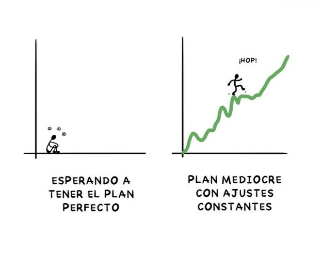

# La mejora continua y el análisis de datos {#sec-mejora-continua}

::: callout-note
## Objetivos de aprendizaje

Al finalizar este capítulo, el alumno será capaz de:

- Explicar qué es la mejora continua y por qué el análisis de datos es su herramienta fundamental.
- Formular correctamente la definición de un problema de proceso.
- Situar las herramientas del libro dentro del ciclo DMAIC.
- Relacionar los conceptos de Lean Manufacturing y Six Sigma con la reducción de la variabilidad.
- Analizar un caso de proceso quesero e identificar qué herramientas aplicaría y en qué orden.

Conceptos clave: **mejora continua, DMAIC, Lean Manufacturing, Six Sigma, definición del problema, costes de no calidad**.
:::

## Qué es la mejora continua y por qué importa en la industria quesera

La **mejora continua** es la filosofía de gestión que plantea que ningún proceso es perfecto y que siempre existe margen para mejorar: en calidad, en eficiencia, en reducción de variabilidad y en coste. No es un proyecto puntual que se hace y se acaba: es una forma sistemática y permanente de trabajar.

{width=70%}

En la industria alimentaria en general, y en la quesería en particular, la mejora continua es especialmente relevante por varias razones. Los procesos son biológicos y por tanto inherentemente variables: la composición de la leche cambia con la estación, el cultivo iniciador evoluciona, las condiciones ambientales de maduración fluctúan. Esta variabilidad es la materia prima del trabajo de mejora: cada fuente de variación identificada y reducida es una ganancia real en calidad y en rentabilidad.

La mejora continua no es una tarea exclusiva de los técnicos de calidad o de los ingenieros de proceso. Es una responsabilidad de toda la organización, desde el operario que detecta una anomalía en su turno hasta la dirección que decide invertir en un nuevo equipo de dosificación. Lo que diferencia a una organización que mejora de una que no mejora no es la ausencia de problemas (todos los procesos tienen problemas), sino la capacidad de identificarlos, cuantificarlos y resolverlos de forma sistemática.

## Definir el problema: el paso más importante

Antes de buscar soluciones hay que tener claro cuál es exactamente el problema. Este paso, que parece obvio, es con frecuencia el más descuidado. Un problema mal definido lleva a análisis incorrectos, soluciones inadecuadas y recursos malgastados.

Una buena definición de problema tiene estas características:

**Es breve.** Si no cabe en dos o tres frases, probablemente no está bien definido. La brevedad obliga a identificar lo esencial y a descartar lo accesorio.

**Usa lenguaje sencillo.** Debe ser comprensible para cualquier persona de la organización, no solo para los técnicos. Si necesitas términos técnicos para explicarlo, inclúyelos pero explícalos. Un problema que solo entienden los expertos no genera el compromiso de la organización.

**Cuantifica.** Un problema sin cifras no está definido, está descrito. "El rendimiento es bajo" no es una definición. "El rendimiento medio del turno de noche es 1,2 puntos inferior al del turno de día, lo que representa 180 kg de queso por semana" sí lo es.

**Incluye el coste.** La cuantificación económica del problema justifica el esfuerzo de resolverlo y permite priorizar entre varios problemas. Los **costes de no calidad** (el coste del retrabajo, de las no conformidades, de las devoluciones y de la sobredosificación) son a menudo mayores de lo que la dirección percibe.

**Define el ámbito.** ¿En qué línea? ¿En qué turno? ¿En qué producto? ¿Desde cuándo? Un problema bien acotado es un problema medio resuelto.

**Es SMART.** Específico, Medible, Alcanzable, Relevante y acotado en el Tiempo. Un objetivo de mejora que no cumpla estos cinco criterios es un deseo, no un objetivo.

::: {.callout-tip}
## Ejemplo de definición correcta vs incorrecta

❌ **Incorrecta:** "Tenemos problemas con el rendimiento quesero."

✓ **Correcta:** "El rendimiento (ESM/MP) del queso semicurado de vaca en la línea 2 ha disminuido de 95,8 % a 94,6 % entre enero y marzo, lo que representa una pérdida estimada de 12.000 € en el trimestre. El problema afecta principalmente al turno de noche (lunes a viernes). Objetivo: recuperar el rendimiento a 95,5 % antes del 30 de junio."
:::

## Estrategia de resolución de problemas

Ante un problema de proceso, la tentación es actuar de inmediato: cambiar algo, ajustar un parámetro, dar instrucciones al operario. Esta reacción intuitiva raramente resuelve el problema de forma duradera porque no identifica la causa raíz, es decir, la causa que, si se elimina, hace que el problema no vuelva a aparecer.

Una estrategia efectiva de resolución de problemas sigue esta secuencia:

1. **Definir el problema** con precisión y cuantificarlo (como vimos en la sección anterior).
2. **Recoger datos** sobre el proceso en el período del problema: no solo la variable afectada sino todas las variables que podrían estar relacionadas.
3. **Explorar los datos** gráficamente para identificar patrones, tendencias, correlaciones o anomalías que apunten a posibles causas.
4. **Formular hipótesis** sobre las causas más probables, basadas en el conocimiento del proceso y en los patrones observados en los datos.
5. **Verificar las hipótesis**, idealmente con un experimento diseñado, para confirmar cuál es la causa raíz.
6. **Implementar la solución** sobre la causa raíz identificada.
7. **Verificar la eficacia** de la solución midiendo de nuevo el indicador afectado.
8. **Estandarizar** el cambio en los procedimientos y formar al equipo.

Esta secuencia no es lineal en la práctica: con frecuencia los datos de la etapa 3 llevan a reformular el problema, o la verificación de hipótesis de la etapa 5 revela que la causa raíz no era la esperada. Lo importante es no saltarse pasos (especialmente el de verificación) y no implementar soluciones sin haber identificado la causa raíz.

## El ciclo DMAIC: el marco de Six Sigma

El **ciclo DMAIC** (*Define, Measure, Analyze, Improve, Control*) es el marco metodológico de los proyectos Six Sigma para la resolución de problemas y la mejora de procesos. Es esencialmente la misma secuencia que describimos en la sección anterior, organizada en cinco fases con criterios de salida bien definidos para cada una.

**Define (Definir):** se define el problema con precisión, se identifican los clientes afectados y sus requisitos, se delimita el alcance del proyecto y se estima el impacto económico. La herramienta principal es el *Project Charter* o acta de proyecto.

**Measure (Medir):** se recogen datos del proceso actual para cuantificar la magnitud del problema y establecer una línea base. En esta fase se verifica también la fiabilidad del sistema de medición, porque no tiene sentido analizar datos si el sistema que los genera no es fiable. El análisis del sistema de medición que vimos en el capítulo [-@sec-sistema-medicion] pertenece a esta fase.

**Analyze (Analizar):** se analizan los datos para identificar las causas raíz del problema. Aquí entran en juego la mayor parte de las herramientas estadísticas del libro: gráficos de control, análisis de correlación y diseño de experimentos.

**Improve (Mejorar):** se diseña e implementa la solución. Si la fase de análisis ha identificado correctamente las causas raíz, la solución es consecuencia directa del análisis. El diseño de experimentos es especialmente útil en esta fase para optimizar los parámetros del proceso.

**Control (Controlar):** se implanta un sistema de seguimiento para garantizar que la mejora se mantiene en el tiempo. Los gráficos de control, los procedimientos actualizados y la formación del equipo son los instrumentos de esta fase.

### Las herramientas del libro en el contexto DMAIC

La tabla siguiente muestra cómo las herramientas que hemos aprendido encajan en las distintas fases del ciclo DMAIC:

| Fase | Herramientas del libro |
|------|----------------------|
| **Define** | Cuantificación del problema, costes de no calidad |
| **Measure** | Estadísticos básicos, histograma, boxplot, análisis del sistema de medición |
| **Analyze** | Gráfico de control, correlación, regresión, diseño de experimentos |
| **Improve** | Diseño de experimentos, simulación con `rnorm()` |
| **Control** | Gráfico de control (seguimiento), índices de capacidad $C_p$ y $C_{pk}$ |

Ninguna de estas herramientas pertenece exclusivamente a una fase (el gráfico de control se usa en la fase Measure para entender el proceso actual y en la fase Control para verificar que la mejora se mantiene), pero la tabla ilustra cómo el ciclo DMAIC integra el conjunto de herramientas en una secuencia coherente. En el capítulo [-@sec-caja-herramientas] cada una de estas herramientas tiene su ficha práctica, con el código R para aplicarla.

## Las 7 herramientas clásicas de la calidad

Las **7 herramientas clásicas de la calidad**, que Kaoru Ishikawa presentó en 1968 en su manual para los trabajadores japoneses (publicado en inglés en 1971 como *Guide to Quality Control*), son un conjunto de herramientas gráficas sencillas para el análisis y la resolución de problemas de calidad. Son el fundamento del trabajo de los equipos de mejora en planta y no requieren conocimientos estadísticos avanzados.

| Herramienta | Propósito | Equivalente en el libro |
|------------|-----------|------------------------|
| Hoja de recogida de datos | Registrar observaciones de forma estructurada | Datos ordenados (*tidy data*), capítulo [-@sec-organizacion-datos] |
| Diagrama de Pareto | Priorizar causas por frecuencia o impacto | Ficha del capítulo [-@sec-caja-herramientas] |
| Diagrama causa-efecto (Ishikawa) | Identificar causas potenciales de un problema | Las 6M (capítulos [-@sec-contenido-efectivo] y [-@sec-variabilidad]); ficha del capítulo [-@sec-caja-herramientas] |
| Histograma | Ver la distribución de una variable | Capítulo [-@sec-exploracion] |
| Diagrama de dispersión | Ver la relación entre dos variables | Capítulo [-@sec-correlacion-regresion] |
| Gráfico de control | Seguir el proceso en el tiempo | Capítulo [-@sec-control-procesos] |
| Diagrama de flujo | Documentar el proceso | Ficha del capítulo [-@sec-caja-herramientas] |

La lista original de Ishikawa incluía la **estratificación** (separar los datos por máquina, turno, operario o proveedor) en lugar del diagrama de flujo; muchas listas actuales la sustituyen por el diagrama de flujo. Varias de estas herramientas las hemos usado ya: la hoja de recogida de datos, el histograma, el diagrama de dispersión, el gráfico de control y la estratificación (el boxplot por meses del capítulo [-@sec-camembert]). El diagrama de Pareto, el diagrama causa-efecto y el diagrama de flujo tienen su ficha en el capítulo [-@sec-caja-herramientas].

## Lean Manufacturing: eliminar el desperdicio

**Lean Manufacturing** es una filosofía de gestión originada en el Sistema de Producción de Toyota que busca eliminar todo aquello que no añade valor al producto desde la perspectiva del cliente. En Lean, el **desperdicio** (*muda* en japonés) es cualquier actividad que consume recursos sin generar valor: sobreproducción, esperas, transporte innecesario, sobreprocesado, inventario excesivo, movimientos innecesarios y defectos.

La conexión con la variabilidad es directa: la variabilidad alta es una de las principales causas de desperdicio. Un proceso de llenado con alta variabilidad produce sobredosificación (desperdicio de producto), lotes rechazados (desperdicio de trabajo y materiales) y ajustes frecuentes (desperdicio de tiempo del operario). Reducir la variabilidad es, en términos Lean, eliminar una fuente de desperdicio.

Lean pone especial énfasis en la **estandarización**: los procedimientos deben estar documentados, actualizados y seguidos de forma consistente. Un proceso sin procedimiento estándar es un proceso que cada operario realiza a su manera, lo que genera variabilidad de método, una de las fuentes más frecuentes y más evitables de variabilidad en la industria.

## Six Sigma: reducir la variabilidad con rigor estadístico

**Six Sigma** es una metodología de mejora que combina el ciclo DMAIC con herramientas estadísticas rigurosas para reducir la variabilidad de los procesos hasta niveles muy bajos. El nombre hace referencia al objetivo estadístico: un proceso Six Sigma tiene una variabilidad tan pequeña que los límites de especificación están a 6 desviaciones típicas de la media. La cifra que suele acompañarlo, 3,4 defectos por millón de oportunidades, supone además que a largo plazo la media se desplaza hasta 1,5 desviaciones típicas, de modo que el límite más cercano queda a 4,5σ; sin ese desplazamiento, un proceso centrado a 6σ produciría unos 2 defectos por cada mil millones.

Alcanzar ese nivel de perfección no es el objetivo habitual en la industria alimentaria, porque la variabilidad biológica de las materias primas lo hace prácticamente imposible en la mayor parte de los casos. Pero la metodología Six Sigma, y en particular su marco DMAIC y sus herramientas estadísticas, es completamente aplicable para reducir la variabilidad desde niveles actuales hasta niveles significativamente mejores, con un retorno económico cuantificable.

### El papel de los métodos estadísticos en Six Sigma

La característica que diferencia Six Sigma de otras metodologías de mejora es la exigencia de basar todas las decisiones en datos y en análisis estadístico riguroso. No se acepta "creemos que la causa es X"; se exige "los datos muestran que X explica el Y% de la variación de la respuesta". Esta exigencia es exactamente para lo que sirven las herramientas que hemos aprendido en este libro.

Un profesional que domina el análisis de datos con R o Python, que sabe interpretar un gráfico de control, que entiende qué es la capacidad de proceso y que puede diseñar y analizar un experimento factorial tiene las herramientas estadísticas fundamentales para participar activamente en proyectos Six Sigma, tenga o no una certificación formal en la metodología.

## El gráfico como herramienta de decisión

A lo largo del libro hemos insistido en que los gráficos no son un ejercicio estético: son herramientas de comunicación y de decisión. En el contexto de la mejora continua, esta idea adquiere su significado más pleno.

Un gráfico de control en el panel de la línea de producción no está ahí para que quede bien. Está ahí para que el operario sepa, en cada momento, si el proceso está bajo control o no, y qué debe hacer en cada caso. Un gráfico de dispersión en la reunión mensual de calidad no está ahí para impresionar. Está ahí para que el equipo vea si el rendimiento varía a la par que la grasa de la leche, y decida si investigar esa relación.

La diferencia entre un gráfico bien hecho y uno mal hecho no es estética: es la diferencia entre una decisión bien fundamentada y una decisión tomada a ciegas. En el capítulo [-@sec-comunicacion] vimos los principios para hacer gráficos efectivos. Aquí añadimos la perspectiva de la mejora continua: **el gráfico debe estar diseñado para responder una pregunta concreta de proceso, no para mostrar todos los datos disponibles**.

## Casos de discusión en equipo

Los casos siguientes presentan situaciones reales de proceso quesero para analizar en grupo. No tienen una solución única: el objetivo es discutir qué herramientas se aplicarían, en qué orden, qué datos se necesitarían y qué conclusiones preliminares se pueden extraer de la información disponible.

---

### Caso 1: El rendimiento que bajó sin razón aparente

Una quesería artesanal produce queso de oveja curado con un rendimiento histórico estable de 95,5 % (ESM/MP). En octubre, el responsable de producción nota que el rendimiento ha bajado a 94,2 % (ESM/MP) y que lleva así tres semanas. No ha habido cambios conocidos en el proceso: mismo protocolo, mismos operarios, mismo proveedor de leche.

El responsable atribuye la bajada a cambios en la leche, y decide esperar a que mejore sola. El técnico de calidad no está de acuerdo y propone hacer un análisis antes de decidir.

**Preguntas para el debate:**

1. ¿Cómo definirías el problema siguiendo los criterios de la sección anterior? ¿Qué información falta para completar la definición?
2. ¿Qué datos recogerías en las primeras 48 horas para entender qué está pasando? ¿Qué variables analizarías?
3. ¿Es suficiente la hipótesis "es la leche de otoño" para tomar una decisión? ¿Qué análisis harías para verificarla o descartarla?
4. El responsable dice "esperemos a que mejore sola". ¿Cuándo estaría justificado esperar y cuándo no? ¿Qué herramienta usarías para decidir si intervenir o no?
5. Si la causa fuera efectivamente la composición de la leche de otoño, ¿qué acciones correctoras serían posibles? ¿Y si la causa fuera otra?

---

### Caso 2: La línea de yogures que cumple... a veces

Una empresa láctea produce yogures de 125 g en dos líneas idénticas. El análisis mensual de pesos muestra que la línea 1 cumple consistentemente el RD 1801/2008 (desviación típica σ ≈ 1,2 g, media ≈ 126,5 g). La línea 2, en cambio, tiene meses en que cumple y meses en que no (σ oscila entre 1,5 g y 3,8 g, media entre 126,0 g y 128,5 g).

El responsable de mantenimiento dice que las dos líneas son idénticas y que "si una cumple, la otra también debería". El técnico de proceso sospecha que el problema está en la forma en que se hacen los cambios de formato: la línea 2 tiene más cambios de formato por semana que la línea 1.

**Preguntas para el debate:**

1. ¿Qué tipo de variabilidad describe mejor el comportamiento de la línea 2: causas comunes, causas especiales, o ambas? ¿En qué se basa tu respuesta?
2. ¿Qué gráfico construirías para investigar la hipótesis del técnico de proceso sobre los cambios de formato? ¿Qué esperarías ver si la hipótesis es correcta?
3. ¿Cómo cuantificarías el coste de la variabilidad de la línea 2 respecto a la línea 1? ¿Qué datos necesitarías?
4. El responsable de mantenimiento propone revisar ambas líneas en la próxima parada. ¿Es una buena idea? ¿Qué buscarías específicamente en la revisión de la línea 2?
5. Si después de la revisión de mantenimiento la línea 2 mejora durante dos semanas pero luego vuelve a empeorar, ¿qué conclusión extraerías y qué harías a continuación?

---

::: {.callout-tip collapse="true"}
## Respuesta sugerida — Caso 1: El rendimiento que bajó sin razón aparente

**1. Definición del problema:**
La información disponible ya permite una definición bastante completa: "El rendimiento del queso de oveja curado ha bajado de 95,5 % a 94,2 % en las últimas tres semanas, lo que representa aproximadamente 1,3 puntos porcentuales de pérdida. Con una producción de X kg de leche semanales, esto equivale a Y kg de queso no producido por semana, con un coste estimado de Z €. El problema se detectó a principios de octubre. Objetivo: identificar la causa y recuperar el rendimiento a 95,5 % o superior antes de fin de mes." Lo que falta es la producción semanal para calcular el impacto económico real.

**2. Datos a recoger:**
En las primeras 48 horas conviene recoger: composición de la leche (grasa, proteína, extracto seco) y recuento de células somáticas de los últimos lotes afectados, comparados con el período anterior; registros de temperatura y pH en cada etapa del proceso, tiempos de cuajado y desuerado, y pesos de entrada (leche) y salida (queso) de cada fabricación. Si hay registro histórico, conviene hacer un gráfico de evolución del rendimiento en el tiempo para ver exactamente cuándo empezó la bajada.

**3. La hipótesis "se debe a cambios en la leche":**
No es suficiente para tomar una decisión, pero tampoco es descartable. La composición de la leche de oveja cambia significativamente con la estación y puede afectar al rendimiento. Como el rendimiento se expresa como coeficiente ESM/MP, que ya está referido a la proteína puesta en cuba, una leche con menos proteína no basta por sí sola para explicar la bajada. Lo que sí puede bajarlo sin que cambie la fabricación es la calidad de esa proteína: en el queso queda sobre todo la caseína, y si baja su proporción en la proteína total o aumenta su degradación, como ocurre con recuentos altos de células somáticas, el ESM/MP baja aunque el proceso sea el mismo [@martideolives2020]. La leche de final de lactación puede, sin embargo, coagular peor y aumentar las pérdidas en el suero. Para verificarlo hay que comparar la recuperación y los análisis del suero con los del mismo período de años anteriores: si en otros otoños la recuperación fue normal, la hipótesis pierde fuerza; si también bajó, puede ser la causa, aunque habría que comprobar que explica toda la bajada.

**4. ¿Esperar o intervenir?**
La herramienta para decidir es el gráfico de control: si el rendimiento actual está fuera de los límites de control calculados sobre el histórico, es una señal de causa especial y hay que investigar. Si está dentro de los límites, aunque sea bajo, podría ser variabilidad normal. En este caso, si la variabilidad semanal histórica es pequeña frente a 1,3 puntos, tres semanas seguidas por debajo de la media formarán una racha, que es una señal de causa especial (capítulo [-@sec-control-procesos]); hay que comprobarlo en el gráfico antes de afirmarlo. En cualquier caso, esperar sin mirar los datos no está justificado.

**5. Acciones correctoras:**
Si la causa es la composición de la leche de otoño: estandarizar la leche (ajustar la grasa o la proteína antes de cuajar) o ajustar el protocolo de cuajado en función de la composición. Si la causa es otra (por ejemplo, un cambio en el tiempo de desuerado o en la temperatura), la acción depende de la causa identificada. En ningún caso es correcto ajustar el proceso sin haber verificado la causa.
:::

---

::: {.callout-tip collapse="true"}
## Respuesta sugerida — Caso 2: La línea de yogures que cumple... a veces

**1. Tipo de variabilidad:**
La línea 2 tiene ambos tipos. La σ que oscila entre 1,5 g y 3,8 g según el mes indica claramente causas especiales activas: algo cambia de un mes a otro que hace que la variabilidad sea a veces normal y a veces muy alta. La media que oscila entre 126,0 g y 128,5 g también apunta a causas especiales que afectan al nivel del proceso. Dentro de cada mes, probablemente hay también causas comunes que generan la variabilidad de fondo. Que la línea 1 sea consistente indica que el problema no es propio del producto ni del proceso en general, sino de la línea 2.

**2. Gráfico para investigar la hipótesis de los cambios de formato:**
Un gráfico de dispersión o boxplot con el eje X = número de cambios de formato por semana y el eje Y = desviación típica del peso en esa semana. Si la hipótesis es correcta, se verá una correlación positiva: las semanas con más cambios de formato tendrán mayor variabilidad. También sería útil un gráfico de control con los cambios de formato marcados como eventos para ver si la variabilidad aumenta justo después de cada cambio.

**3. Cuantificación del coste:**
El coste tiene dos componentes. Primero, la sobredosificación: en los meses con σ alta (3,8 g), la media debe ser más alta para cumplir el RD, lo que implica más gramos por envase. Con el número de envases diarios y el coste por kg se puede calcular el sobrecoste mensual. Segundo, el riesgo de incumplimiento: en los meses fuera de norma puede haber envases bajo T1 que impliquen lotes rechazados o sanciones. Comparando los costes de la línea 2 con los de la línea 1 se obtiene el coste real de la variabilidad adicional.

**4. Revisión de mantenimiento:**
Es una buena idea pero hay que saber qué buscar. En la línea 2, específicamente: el estado de las válvulas dosificadoras (desgaste que produce variabilidad creciente), el sistema de ajuste rápido del formato (si está desgastado o mal diseñado, cada cambio de formato introduce un error diferente), y la comparación directa entre los componentes de ambas líneas para identificar diferencias que puedan explicar el comportamiento distinto.

**5. Si mejora dos semanas y luego vuelve a empeorar:**
Esta pauta (mejora transitoria seguida de recaída) indica que el mantenimiento corrigió los síntomas pero no la causa raíz. Si el problema está en el procedimiento de cambio de formato (el operario no tiene una guía clara de ajuste, o la guía no es lo suficientemente precisa), la revisión de los componentes mecánicos lo mejorará temporalmente pero no resolverá el problema de fondo. El siguiente paso sería estudiar el proceso de cambio de formato en detalle: filmarlo, comparar cómo lo hacen los operarios de la línea 1 y de la línea 2, y estandarizarlo con un procedimiento claro y verificable.
:::

---

## Resumen del capítulo

La mejora continua no es una metodología más: es la razón de ser de todo el análisis de datos que hemos aprendido a lo largo de este libro. Medir la variabilidad, explorar los datos, construir gráficos de control, diseñar experimentos, analizar el sistema de medición: todas estas herramientas tienen un propósito final, entender los procesos lo suficientemente bien como para mejorarlos de forma sistemática y sostenible.

El ciclo DMAIC organiza ese trabajo en cinco fases coherentes. Lean Manufacturing aporta la perspectiva del desperdicio y la estandarización. Six Sigma aporta el rigor estadístico y la exigencia de basar las decisiones en datos. Las tres perspectivas son complementarias y se refuerzan mutuamente.

Las herramientas se presentan, una por una y con su código R, en el capítulo [-@sec-caja-herramientas], que cierra el libro con su aplicación a un caso completo.
