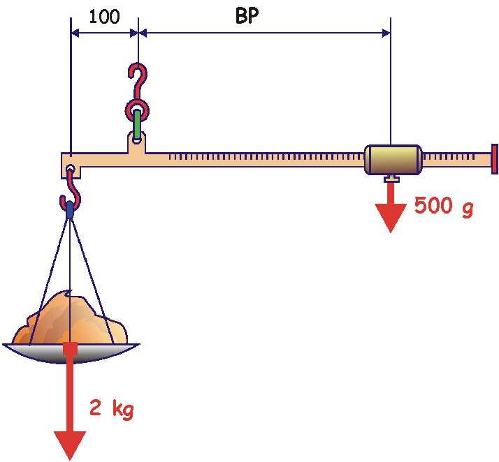
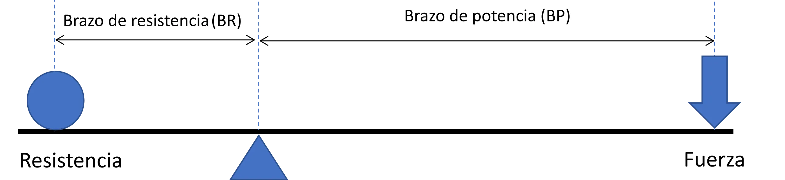

# La media aritmética como centro de gravedad de un grupo de datos {#sec-media-centro-gravedad}
{width=50%}

Para ver cómo la media aritmética equivale al punto de equilibrio o centro de gravedad de un grupo de datos, imaginaremos que tenemos un conjunto de datos cuyos valores se distribuyen en un eje X. Podemos hacer equivalentes estos valores a un conjunto de pesos que se distribuyen a lo largo de una barra, y vamos a suponer que existe un punto a una distancia $x$ del origen de la barra en el cual dicha barra está en equilibrio. Para encontrar ese valor, empezaremos considerando el principio o ley de la palanca.

El **principio** o **ley de la palanca** se conocía antes de Arquímedes, pero fue él quien dio su demostración matemática en el tratado *Sobre el equilibrio de los planos* (siglo III a. C.). Este principio dice que, en equilibrio, el producto de la fuerza aplicada (potencia) por su distancia al punto de apoyo (brazo de la potencia) es igual al producto de la resistencia por su distancia al punto de apoyo (brazo de la resistencia). Matemáticamente, se expresa como: 
$$
P \cdot d_p = R \cdot d_r
$$

Donde:

-   $P$ es la potencia o fuerza aplicada.
-   $d_p$ es la distancia desde el punto de apoyo hasta el punto donde se aplica la potencia (BP: brazo de la potencia).
-   $R$ es la resistencia o carga.
-   $d_r$ es la distancia desde el punto de apoyo hasta el punto donde se aplica la resistencia (BR: brazo de la resistencia).

## Ejemplo

Si tienes una palanca de 5 metros de longitud y de peso despreciable, y aplicas una fuerza de 10 newtons a 1 metro del punto de apoyo, para mantener el equilibrio, la fuerza de resistencia en el otro extremo a 4 metros del punto de apoyo debería ser: 

$$
P \cdot d_p = R \cdot d_r
$$

$$
10 \, \text{N} \cdot 1 \, \text{m} = R \cdot 4 \, \text{m}
$$

$$
R = \frac{10 \cdot 1}{4} = 2{,}5 \text{ N}
$$

Ahora vamos a considerar una barra, también de peso despreciable, de la que se cuelgan diferentes masas a diferentes distancias de su origen. Calcular su punto de equilibrio es un problema clásico de física que se resuelve con el principio de los momentos.

## Paso a paso

1.  **Identificar las fuerzas**: Supongamos que tienes varias masas $m_1, m_2, m_3, \ldots, m_n$ colgadas a distancias $d_1, d_2, d_3, \ldots, d_n$ del origen de la barra. Cada masa ejerce sobre la barra una fuerza, su peso, $W_i = m_i \cdot g$, donde $g$ es la aceleración de la gravedad.

2.  **Calcular los momentos**: El momento ($M$) de un peso respecto al origen es el producto de la fuerza (el peso) por su distancia al origen:

$$
    M_i = W_i \times d_i = m_i \cdot g \times d_i
$$

3.  **Sumar los momentos**: Calcula la suma de todos los momentos: 
$$
    M_{\text{total}} = W_1 \times d_1 + W_2 \times d_2 + W_3 \times d_3 + \ldots + W_n \times d_n
$$

4.  **Calcular el peso total**: Suma todos los pesos: 
$$
    W_{\text{total}} = W_1 + W_2 + W_3 + \ldots + W_n
$$

5.  **Determinar el punto de equilibrio** ($x$): La barra está en equilibrio sobre el punto de apoyo cuando los momentos de los pesos situados a cada lado se compensan, es decir, cuando $\sum W_i (d_i - x) = 0$. Despejando $x$, el punto de equilibrio es la suma de los momentos dividida por el peso total:
$$
    x = \frac{\sum (W_i \times d_i)}{\sum W_i} = \frac{\sum (m_i \cdot g \times d_i)}{\sum m_i \cdot g} = \frac{\sum (m_i \times d_i)}{\sum m_i}
$$

Como $g$ es la misma para todas las masas, se simplifica, y el punto de equilibrio puede calcularse directamente con las masas. En el ejemplo siguiente trabajamos así: los «momentos» se expresan en kg·m y la «masa total» en kg.

## Ejemplo práctico

Supongamos que tenemos tres masas de 4, 9 y 1 kg, situados, respectivamente, a 2, 1 y 3 m  del origen de la barra.

-   $m_1 = 4 \, \text{kg}$ a $d_1 = 2 \, \text{m}$
-   $m_2 = 9 \, \text{kg}$ a $d_2 = 1 \, \text{m}$
-   $m_3 = 1 \, \text{kg}$ a $d_3 = 3 \, \text{m}$

1.  **Calcular los momentos**: 
$$
    M_1 = 4 \times 2 = 8 \, \text{kg·m}
$$
$$
    M_2 = 9 \times 1 = 9 \, \text{kg·m}
$$
$$
    M_3 = 1 \times 3 = 3 \, \text{kg·m}
$$

2.  **Sumar los momentos**: 
$$
    M_{\text{total}} = 8 + 9 + 3 = 20 \, \text{kg·m}
$$

3.  **Calcular la masa total**: 
$$
    m_{\text{total}} = 4 + 9 + 1 = 14 \, \text{kg}
$$

4.  **Determinar el punto de equilibrio**:

$$
    x = \frac{20}{14} \approx 1{,}43 \, \text{m}
$$

El punto de equilibrio se encuentra a aproximadamente 1,43 metros del origen.

## Media ponderada

El centro de gravedad de un sistema de masas, cuando la gravedad es la misma en todos sus puntos (como ocurre con cualquier objeto de tamaño ordinario), es una **media ponderada** de las posiciones de las masas, y coincide con su centro de masas.

### Media aritmética

Para un conjunto de números $x_1, x_2, \ldots, x_n$, la media aritmética es: 
$$
\text{Media} = \frac{x_1 + x_2 + \cdots + x_n}{n}
$$

### Media ponderada

Para un conjunto de valores $x_1, x_2, \ldots, x_n$ con pesos asociados $w_1, w_2, \ldots, w_n$, la media ponderada es: 
$$
\text{Media ponderada} = \frac{w_1 x_1 + w_2 x_2 + \cdots + w_n x_n}{w_1 + w_2 + \cdots + w_n}
$$

## Centro de gravedad como media ponderada

Cuando calculamos el centro de gravedad ($x_{\text{cg}}$) de un sistema de masas, estamos esencialmente calculando una media ponderada de las posiciones ($x_i$) de esas masas ($m_i$):

$$
x_{\text{cg}} = \frac{\sum (m_i \cdot x_i)}{\sum m_i}
$$

Aquí, las posiciones $x_i$ son ponderadas por las masas $m_i$.

### Ejemplo numérico

En nuestro ejemplo anterior,

-   Masa 1: $m_1 = 4 \, \text{kg}$ en posición $x_1 = 2 \, \text{m}$
-   Masa 2: $m_2 = 9 \, \text{kg}$ en posición $x_2 = 1 \, \text{m}$
-   Masa 3: $m_3 = 1 \, \text{kg}$ en posición $x_3 = 3 \, \text{m}$

La media aritmética de las posiciones sería: 
$$
\text{Media} = \frac{2 + 1 + 3}{3} = 2 \, \text{m}
$$

El punto de equilibrio de la barra, o centro de gravedad, calculado como media ponderada, sería:

$$
x_{\text{cg}} = \frac{(4 \cdot 2) + (9 \cdot 1) + (1 \cdot 3)}{4 + 9 + 1} = \frac{8 + 9 + 3}{14} = \frac{20}{14} \approx 1{,}43 \, \text{m}
$$

que es el mismo resultado que obteníamos formulando el cálculo de los momentos; la fórmula resulta ser idéntica. Nótese que la media aritmética de las posiciones ($\frac{2+1+3}{3} = 2\,\text{m}$) difiere del centro de gravedad ($1{,}43\,\text{m}$) precisamente porque las masas no son iguales: el peso de 9 kg situado a solo 1 m del origen arrastra el punto de equilibrio hacia ese extremo.

## Media aritmética y centro de gravedad con masas idénticas

En los ejemplos anteriores, calculábamos el punto de equilibrio para diferentes pesos colocados a lo largo de una barra. Si en vez de eso suponemos que la distancia al origen de la barra equivale a nuestro eje $X$, que recoge los valores de los que queremos calcular nuestra media aritmética, podemos eliminar el efecto de la masa suponiendo que todas las masas son iguales.

Si las masas de los diferentes objetos son idénticas, podemos decir que la media aritmética de las posiciones coincide con el centro de gravedad. Esto se debe a que, en este caso, cada masa tiene el mismo peso o influencia en el cálculo del centro de gravedad. Esta es la explicación detallada:

**Suposición:** Cada objeto tiene la misma masa $m$.

### Media aritmética

Para un conjunto de posiciones $x_1, x_2, \ldots, x_n$, la media aritmética es: 
$$
\text{Media} = \frac{x_1 + x_2 + \cdots + x_n}{n}
$$

### Centro de gravedad

El centro de gravedad ($x_{\text{cg}}$) para un conjunto de masas idénticas en posiciones $x_1, x_2, \ldots, x_n$ es:
$$
x_{\text{cg}} = \frac{\sum (m \cdot x_i)}{\sum m}
$$

Dado que las masas $m$ son idénticas, el numerador se convierte en:
$$
\sum (m \cdot x_i) = m \cdot (x_1 + x_2 + \cdots + x_n)
$$

Y el denominador se convierte en:
$$
\sum m = n \cdot m
$$

Al sustituir estos en la fórmula del centro de gravedad, obtenemos: 
$$
x_{\text{cg}} = \frac{m \cdot (x_1 + x_2 + \cdots + x_n)}{n \cdot m}
$$

Al simplificar, los términos $m$ se cancelan, y nos queda: 
$$
x_{\text{cg}} = \frac{x_1 + x_2 + \cdots + x_n}{n}
$$

que es exactamente la fórmula de la media aritmética.

Si repetimos nuestro ejemplo anterior, suponiendo en este caso masas idénticas

-   Masa 1: $m_1 = 1 \, \text{kg}$ en posición $x_1 = 2 \, \text{m}$
-   Masa 2: $m_2 = 1 \, \text{kg}$ en posición $x_2 = 1 \, \text{m}$
-   Masa 3: $m_3 = 1 \, \text{kg}$ en posición $x_3 = 3 \, \text{m}$

La media aritmética de las posiciones sería:

$$
\text{Media} = \frac{2 + 1 + 3}{3} = 2 \, \text{m}
$$

El punto de equilibrio de la barra, o centro de gravedad, calculado como media ponderada, sería:

$$
x_{\text{cg}} = \frac{(1 \cdot 2) + (1 \cdot 1) + (1 \cdot 3)}{1 + 1 + 1} = \frac{2 + 1 + 3}{3} = \frac{6}{3} = 2 \, \text{m}
$$

que es el mismo resultado que obteníamos con la fórmula de la media aritmética de las posiciones.

## Conclusión

Cuando las masas son idénticas, la media aritmética de las posiciones coincide con el centro de gravedad. Esto nos permite afirmar que en el caso de una dimensión (por ejemplo, la altura de los alumnos) la media aritmética de un conjunto de valores coincide con el centro de gravedad o punto de equilibrio de ese conjunto de valores. Este es un resultado interesante que muestra la conexión entre conceptos estadísticos y físicos.

::: {#fig-media-fulcro2 layout-ncol="2" layout-valign="bottom"}
{#fig-media}

{#fig-palanca}

Comparación gráfica del significado de la media en un diagrama de puntos (*dotplot*) con una palanca de primer grado, con el fulcro como punto de equilibrio.
:::

## La media como punto de equilibrio y la mediana

Entender la media como punto de equilibrio tiene una consecuencia práctica directa: permite visualizar de forma intuitiva el efecto de los valores extremos o atípicos (*outliers*).

Cuando un conjunto de datos contiene un valor muy alejado del resto, ese valor actúa como un peso situado lejos del fulcro. Por la ley de la palanca, su momento (el producto de su masa, igual para todos los datos, por su distancia al punto de apoyo) es proporcional a esa distancia, de modo que un único valor muy alejado puede pesar tanto como muchos valores moderados juntos. El punto de equilibrio, es decir, la media, se desplaza hacia ese extremo, y puede dejar de representar al grupo mayoritario.

Además, el valor extremo hace aumentar mucho la varianza, que promedia los cuadrados de las distancias a la media, porque su distancia se eleva al cuadrado.

La mediana, en cambio, no se ve afectada de la misma manera: al ser el valor central de los datos ordenados, solo depende del orden. Un único dato extremo puede desplazarla, como mucho, a un valor contiguo en la ordenación, y alejarlo todavía más ya no la cambia. Por eso, ante distribuciones con valores atípicos, la mediana y el rango intercuartil son estadísticos más robustos y más fiables para describir el conjunto de datos.
