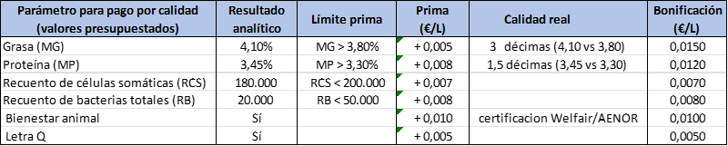
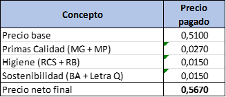
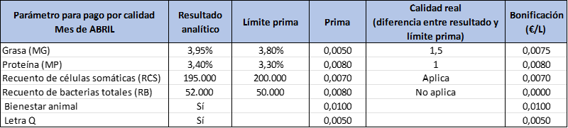
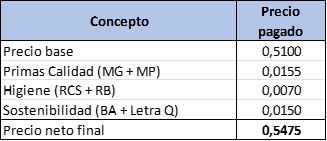
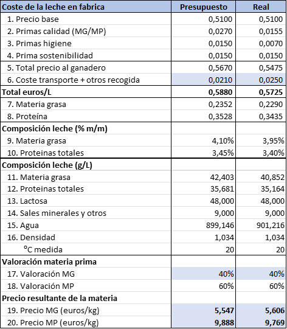

::: callout-note
## Objetivos de aprendizaje

Al finalizar este capítulo, el alumno será capaz de:

- Explicar cómo funciona el sistema de pago de la leche por calidad en España y qué componentes lo determinan.
- Calcular el precio de la leche a partir de los valores analíticos de materia grasa y proteína.
- Obtener el coste unitario de la materia grasa y la proteína de la leche en €/kg.
- Utilizar el precio de la materia prima para valorar económicamente las pérdidas de proceso y las desviaciones de rendimiento.

Conceptos clave: **pago por calidad, precio de la leche, materia grasa, proteína, coste de materia prima, precio unitario de componentes**.
:::

Antes de estudiar el balance de materia y los rendimientos queseros, vamos a ver cómo se construye el precio de la leche. Esto nos permitirá determinar no sólo el precio que pagamos al ganadero por la materia prima, sino también conocer el coste de materia a la entrada en fábrica, descompuesto en sus componentes principales, materia grasa y proteína. Conocer este coste nos permite conocer con precisión cuál es el coste real de nuestras perdidas de materia en fábrica, y también de las desviaciones de rendimientos, lo que, a su vez, nos permitirá priorizar las acciones de mejora hacia aquellos puntos con mayor repercusión en nuestros resultados económicos.

## El pago de la leche por calidad en España

El pago por calidad de la leche de vaca en España se basa en parámetros físico-químicos y sanitarios como la materia grasa (MG), materia proteica (MP), células somáticas y bacterias. Estos factores determinan el precio final que recibe el ganadero por litro entregado.

## Conceptos clave del pago por calidad

El sistema de pago por calidad busca incentivar la producción de leche con mejores características nutricionales e higiénicas. Los principales criterios son:

### 1. **Composición química**

-   **Materia Grasa (MG)**: Aporta valor energético. Cuanto mayor el porcentaje, mayor el precio.
-   **Materia Proteica (MP)**: Indicador de calidad nutricional. Muy valorada por la industria quesera.
-   **Urea**: Indicador del equilibrio nutricional de la dieta del ganado.

### 2. **Calidad higiénico-sanitaria**

-   **Recuento de células somáticas (RCS)**: Refleja la salud mamaria. Valores altos penalizan el precio.
-   **Recuento de bacterias (RB)**: Mide la higiene en el ordeño y conservación. Penaliza si supera ciertos umbrales.
-   **Inhibidores**: Presencia de antibióticos u otras sustancias. Si se detectan, la leche se rechaza.

### 3. **Otros factores**

-   **Punto crioscópico**: Detecta adulteraciones (agua añadida).
-   **Letra Q**: Etiquetado voluntario que certifica calidad superior. Está controlado por la autoridades veterinarias de cada región.
-   **Marcas de calidad**: DOP, IGP, ecológica, etc., pueden mejorar el precio.

## Aplicación práctica: ejemplo de cálculo

Supongamos que un ganadero entrega 10.000 litros de leche con la siguiente composición:

-   **MG**: 4,10%
-   **MP**: 3,45%
-   **RCS**: 180.000 células/ml
-   **RB**: 20.000 ufc/ml

La industria tiene una tabla de precios base que puede variar regionalmente y por empresa, según los acuerdos firmados con cada ganadero o cooperativa. Hay un precio base al cual se van sumando bonificaciones en función de diversos criterios, negociados entre el ganadero (o la cooperativa) y la empresa. En el caso de Asturias, podemos suponer un precio base de 0,510 €/L, y estas bonificaciones:

| Parámetro para pago por calidad | Resultado analítico | Límite prima | Prima | Calidad real | Bonificación (€/L) |
|------------|------------|------------|------------|------------|------------|
| Grasa (MG) | 4,10% | MG \> 3,80% | +0,0050 €/L | 3 décimas (4,10 vs 3,80) | 0,0150 |
| Proteína (MP) | 3,45% | MP \> 3,30% | +0,0080 €/L | 1,5 décimas (3,45 vs 3,30) | 0,0120 |
| Recuento de células somáticas (RCS) | 180.000 | RCS \< 200.000 | +0,0070 €/L |  | 0,0070 |
| Recuento de bacterias totales (RB) | 20.000 | RB \< 50.000 | +0,0080 €/L |  | 0,0080 |
| Bienestar animal | Sí |  | +0,0100 €/L | certificacion Welfair/AENOR | 0,0100 |
| Letra Q | Sí |  | +0,0050 €/L |  | 0,0050 |

Resumiendo las primas por conceptos, podemos agruparlas así:

| Concepto                      | Precio pagado |
|-------------------------------|---------------|
| Precio base                   | 0,5100        |
| Primas Calidad (MG + MP)      | 0,0270        |
| Higiene (RCS + RB)            | 0,0150        |
| Sostenibilidad (BA + Letra Q) | 0,0150        |
| Precio neto final             | 0,5670        |

La liquidación mensual daría un **total a percibir** de:

$$
10.000\ L \cdot 0,567\ euros/L = 5.670\ euros
$$

De esta manera se establece un precio por litro, que se aplica mensualmente tras el análisis de las muestras representativas. En las diferentes regiones, este proceso es gestionado por los laboratorios interprofesionales lecheros mediante protocolos de muestreo y análisis estandarizados. El Ministerio de Agricultura también ofrece ayudas específicas por calidad bajo marcas reconocidas o la Letra Q.

Es importante recordar que cada industria puede tener su propia tabla de bonificaciones y penalizaciones, pues son acordadas por negociación entre ganaderos (o centrales lecheras) y la industria, y en la mayoría de los casos, forman parte de los contratos lecheros de aprovisionamiento. Hace algunos años, la bonificación por materia grasa era siempre superior a la bonificación por proteína; este tipo de bonificación, que aplicaba la industria lechera, no es recomendable en la industria quesera, que valora sobre todo la riqueza en proteina coagulable (caseína). Por esta razón, no siempre las características de la leche recogida por la industria lechera son idóneas para la fabricación de queso. Actualmente, las empresas queseras bonifican más las mejoras en proteína, y en algunos casos también las empresas lecheras, que están encontrando más usos de valor añadido para la proteína, obtenida por técnicas de filtración tangencial, que para la grasa comercializada como mantequilla.

### La conversión del precio por litro en los costes totales de materia prima, grasa y proteína.

Una vez establecido el precio de la leche, a la industria quesera (y lechera) le interesa descomponer este precio en los ingredientes que van a ser objeto de transformación, la materia grasa y la proteína, para poder establecer con precisión los costes de materia en producción.

La transformación quesera está determinada por la eficiencia en la retención de estas materias primas en el queso, como veremos en el análisis de los rendimientos queseros. La materia prima más importante para el quesero es la proteína, que forma la matriz quesera; la materia grasa se necesita como elemento que confiere sabor y textura al queso.

Hasta hace unos años, el precio de la leche se determinaba por su riqueza en **materia seca útil (MSU)**, también llamada **extracto seco quesero (ESQ)**, que se calcula sumando el contenido de materia grasa más la proteína:

$$
MSU = MG + MP
$$

Este parámetro, vigente aún para la leche de oveja y de cabra, no es recomendable en la industria quesera. El motivo es que el productor puede aumentar la materia grasa de la leche mediante determinados tipos de alimentación animal, elevando el contenido en MG hasta un punto porcentual completo (por ejemplo, de 3,5% a 4,5%). Sin embargo, la proteína apenas puede incrementarse por la alimentación —solo 0,1–0,2 puntos porcentuales (por ejemplo, de 3,3% a 3,5%)— porque su nivel depende fundamentalmente de la genética del animal, que determina entre el 60% y el 70% de su contenido. Por esta razón, la leche de una vaca frisona nunca alcanzará el contenido proteico propio, por ejemplo, de una vaca Montbéliarde, con independencia de la alimentación que tenga disponible.

El efecto de un contenido en materia grasa demasiado elevado es una leche desequilibrada, con una cantidad de materia grasa que es posible qie no pueda ser utilizada en la producción de queso, porque se rebasaría el contenido en grasa del queso. Esto obliga al quesero a desnatar parte de la leche y vender la nata como excedente a bajo precio, lo que impacta negativamente en sus resultados.

La forma de controlar la cantidad de materia grasa necesaria en la leche de aprovisionamiento (compra) consiste en el control del factor MG/MP, que debe ser sólo ligeramente superior al del producto final (queso), para cubrir las necesidades del queso más las perdidas de producción.

Por esta razón, es muy frecuente que la industria quesera no valore de la misma manera la materia grasa y la proteína en la leche de compra, y establezca un criterio de valoración que bonifique la riqueza en proteína, por ejemplo, 40/60, como veremos a continuación.

## Cálculo del precio de la leche mediante la hoja de cálculo.

Podemos construir una hoja de calculo para el precio de la leche, en el que recojamos los diferentes elementos del pago por calidad y el transporte; de esta manera podemos comparar nuestros objetivos con lo obtenido en el caso real. En primer lugar, establecemos las hipótesis de nuestro presupuesto, es decir, lo que esperamos para el promedio de las entradas del año

Podemos resumir los principales conceptos del pago por calidad, con el precio resultante de la aplicación de estas bonificaciones al precio base:

Conociendo las hipótesis de modificación del precio, sólo tenemos que verificar cada concepto para estableer el precio de la leche en el periodo considerado, en este caso, un mes de abril, como ejemplo::

Vemos que en este mes no se han cumplido los valores de grasay proteína presupuestados, aunque son superiores a los mínimos previstos para la aplicación de las primas de calidad, y recogen una bonificación ligeramente inferior a la presupuestada. Los recuentos de células somática han sido superiores a lo previsto, pero inferiores al límite que recoge la prima por calidad, por lo que se aplica la prima por este concepto. En cambio, se ha superado el recuento de bacterias totales (52.000 vs 50.000), por lo que no se obtiene la bonificación por este concepto. Se mantienen las primas de bienestar animal y letra Q.

En total, el precio neto final del litro de leche pagado en el mes es inferior a lo previsto en el presupuesto:

## Construcción del precio de la materia grasa y la proteína a partir del precio de la leche

Una vez determinado el precio de leche pagado, y conocido el precio previsto en nuestro presupuesto, podemos comparar el coste de materia, y para ello utilizamos estos datos y los de la composición de la leche para establecer el coste real de la materia grasa y la proteína. Vamos a analizar la siguiente tabla paso a paso.

En las líneas 1 a 4 tenemos los conceptos principales del pago por calidad, que, sumados, nos permiten obtener la cantidad neta pagada al ganadero, en la línea 5. Pero ants de obtener un coste de materia en fábrica, tenemos que sumar a esta cantidad los portes, gastos de transporte y otros gastos que se deriven de la recogida y transporte de la leche a la fábrica (que pueden incluir, por ejemplo, los gastos derivados de lavar las cisternas de leche, o de pesar la leche en una báscula externa). Agrupamos todos estos costes en una línea de gastos de transporte y recogida (línea 6), y la sumamos al precio pagado al ganadero para obtener el coste real de la leche puesta en fábrica.

En las líneas 9 a 12 obtenemos al composición real de la leche comprada, mediante las analíticas de la leche; y a continuación vamos a establecer el precio al que hemos comprado el kg de grasa y de proteína, necesario para valorar nuestro producto y nuestras pérdidas.

Vamos a repartir el precio del litro de leche comprada entre la materia grasa y la proteína. Supongamos que queremos que la materia grasa soporte la mitad del precio de la leche, y que la proteína soporte la otra mitad. Podemos calcular entonces el precio del kilo de materia grasa de la sigueinte forma:

-   Dividimos el precio del litro de leche entre 2, destinando cada mitad a cada materia.
-   Para hallar el precio de la materia grasa, dividimos una mitad por los gramos de grasa que tiene el litro de leche, lo que nos permite obtener el precio del gramo de grasa.
-   Sólo tenemos que multiplicar por 1000 para obtener el precio del kilo

$$
\begin{equation}
\begin{aligned}
\text{Precio de la MG}\ \frac{\mathrm{euros}}{\mathrm{kg}}
  &= \frac{\frac{\text{Precio de la leche}}{2}\ \frac{\mathrm{euros}}{\cancel{L}}}
          {\text{Cantidad de MG}\ \frac{\cancel{g}}{\cancel{L}}}
     \cdot 1000\ \frac{\cancel{g}}{\mathrm{kg}} \\[6pt]
  &= \frac{0{,}294}{42{,}403}\cdot 1000\ \frac{\mathrm{euros}}{\mathrm{kg}}\\[6pt]
  &\approx 6{,}933\ \frac{\mathrm{euros}}{\mathrm{kg}}
\end{aligned}
\tag{1}
\end{equation}
$$

Podemos calcular el precio de la proteína de la misma manera, y de esta forma repartimos el precio de la leche entre las dos materias

$$
\begin{equation}
\begin{aligned}
\text{Precio de la MP}\ \frac{\mathrm{euros}}{\mathrm{kg}}
  &= \frac{\frac{\text{Precio de la leche}}{2}\ \frac{\mathrm{euros}}{\cancel{L}}}
          {\text{Cantidad de MP}\ \frac{\cancel{g}}{\cancel{L}}}
     \cdot 1000\ \frac{\cancel{g}}{\mathrm{kg}} \\[6pt]
  &= \frac{0{,}294}{35{,}681}\cdot 1000\ \frac{\mathrm{euros}}{\mathrm{kg}} \\[6pt]
  &\approx 8{,}240\ \frac{\mathrm{euros}}{\mathrm{kg}}
\end{aligned}
\tag{2}
\end{equation}
$$

Lo primero que llama la atención es que, a pesar de que hemos dividido el precio de la leche al 50% entre la grasa y la proteína, los precios unitarios son diferentes: la razón es que al estar siempre la proteína en una concentración inferior a la grasa, repartimos el mismo coste (50%) entre una cantidad de materia menor, por lo que el coste unitario es más alto.

Volvamos a nuestra hoja de cálculo. En realidad, las industrias queseras nunca reparten el precio de la leche al 50% entre la grasa y la proteína; como la proteína es la materia más valiosa para la fabricación de queso, siempre se pondera un poco más su valor respecto a la materia grasa. Esto es lo que hacemos en las líneas 17 y 18: asignamos a la materia grasa un valor del 40% del litro de leche, y a la proteína el 60%. Este porcentaje no se varía a lo largo del año, es una decisión estratégica de la empresa que sólo se cambia por razones muy excepcionales.

Este cálculo (incluyendo el análisis dimensional) nos da los valores definitivos:

$$
\begin{equation}
\begin{aligned}
\text{Precio de la MG}\,\left[\frac{\mathrm{euros}}{\mathrm{kg}}\right]
  &= \frac{\text{Precio de la leche}\,\left[\frac{\mathrm{euros}}{\cancel{L}}\right]}
          {\text{Cantidad de MG}\,\left[\frac{\cancel{g}}{\cancel{L}}\right]}
     \cdot 1000\,\left[\frac{\cancel{g}}{\mathrm{kg}}\right]\cdot 0{,}40 \\[6pt]
&= \frac{0{,}588}{42{,}403}\cdot 1000 \cdot 0{,}40
     \left[\frac{\mathrm{euros}}{\mathrm{kg}}\right] \\[6pt]
&\approx 5{,}547\ \left[\frac{\mathrm{euros}}{\mathrm{kg}}\right]
\end{aligned}
\tag{3}
\end{equation}
$$

y

$$
\begin{equation}
\begin{aligned}
\text{Precio de la MP}\,\left[\frac{\mathrm{euros}}{\mathrm{kg}}\right]
  &= \frac{\text{Precio de la leche}\,\left[\frac{\mathrm{euros}}{\cancel{L}}\right]}
          {\text{Cantidad de MP}\,\left[\frac{\cancel{g}}{\cancel{L}}\right]}
     \cdot 1000\,\left[\frac{\cancel{g}}{\mathrm{kg}}\right]\cdot 0{,}60 \\[6pt]
&= \frac{0{,}588}{35{,}681}\cdot 1000 \cdot 0{,}60
     \left[\frac{\mathrm{euros}}{\mathrm{kg}}\right] \\[6pt]
&\approx 9{,}888\ \left[\frac{\mathrm{euros}}{\mathrm{kg}}\right]
\end{aligned}
\tag{4}
\end{equation}
$$

Llevaremos estos datos a los siguientes ejemplos para valorar económicamente las pérdidas de materia y los rendimientos queseros.

En la hoja de cálculo adjunta se pueden verificar las tablas que se han presentado arriba, y sus fórmulas de cálculo. También se incluye una entrada en una columna adicional para ver el coste de materia resultante de los datos simulados de la recogida de leche que hemos situado en el mes de abril. Esta diferencia en el precio de la leche nos servirá para calcular las diferencias de precio al analizar las desviaciones de rendimientos.

[Descargar hoja de cálculo de precios de leche (archivo `01-precio-leche.xlsx`)](https://raw.githubusercontent.com/juanriera/master-queseria/master/datos/01-precio-leche.xlsx){target="_blank" rel="noopener noreferrer"}

## Resumen del capítulo

El precio de la leche en España se determina por un sistema de pago por calidad que pondera la composición química — fundamentalmente materia grasa y proteína — junto con la calidad higiénico-sanitaria. Conocer con precisión cómo se construye ese precio es el punto de partida para cualquier análisis económico del proceso quesero.

El paso más relevante para el análisis de rendimientos es la conversión del precio por litro en un coste unitario de la materia grasa y la proteína expresado en €/kg. Este coste unitario de los componentes es la herramienta que permite valorar económicamente las pérdidas de proceso: cada kilogramo de grasa o proteína que se pierde en el suero o en las roturas tiene un coste real que puede calcularse con precisión.

Los valores obtenidos en este capítulo — coste de la materia grasa y de la proteína en €/kg — se utilizarán directamente en los capítulos siguientes para cuantificar el impacto económico de las desviaciones de rendimiento y priorizar las acciones de mejora hacia los puntos del proceso con mayor repercusión en los resultados económicos de la empresa.
