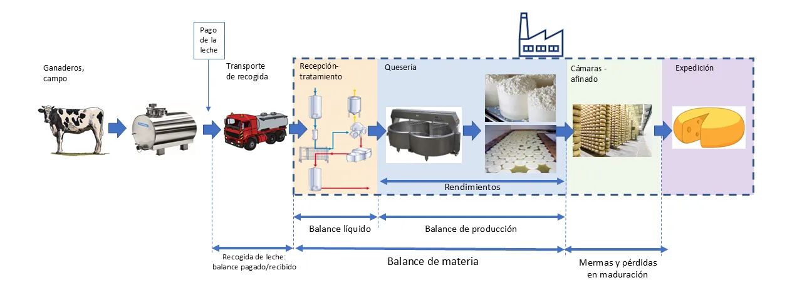
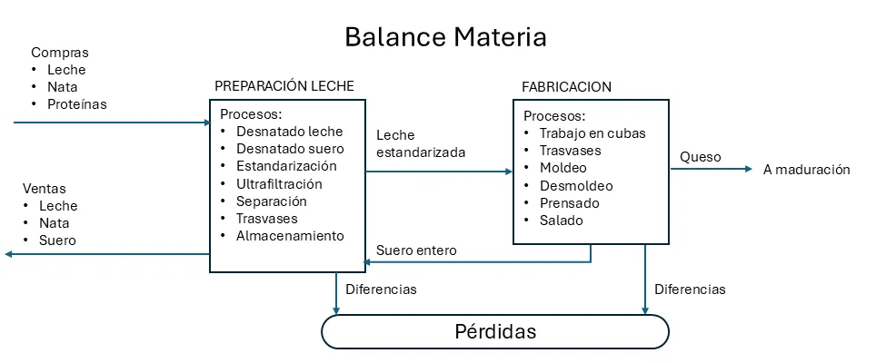
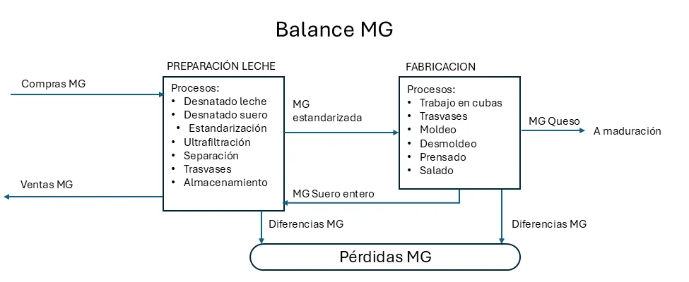
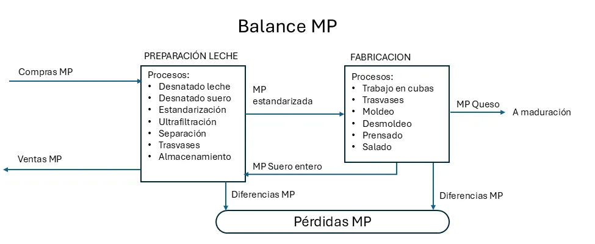
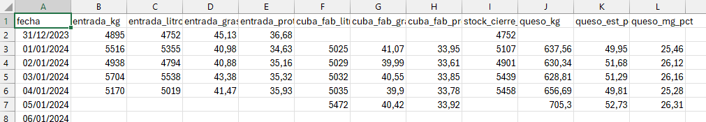
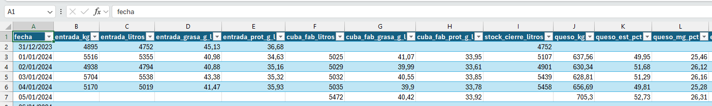
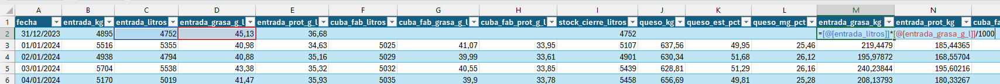
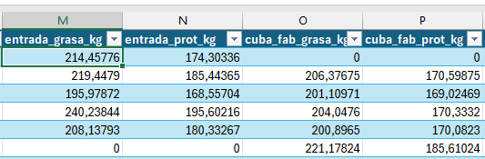
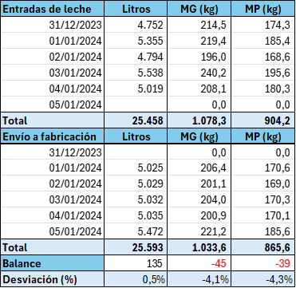
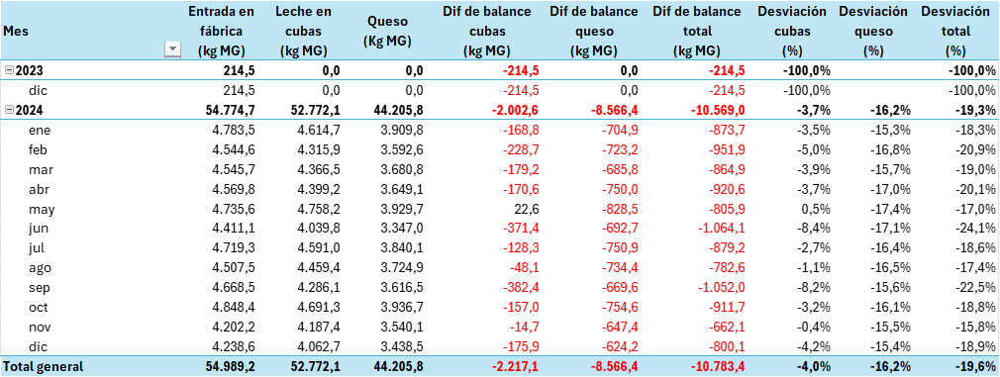

::: callout-note
## Objetivos de aprendizaje

Al finalizar este capítulo, el alumno será capaz de:

- Explicar el concepto de balance de materia en la elaboración de queso y su importancia económica.
- Calcular la recuperación de materia grasa y proteína a partir de los datos analíticos de leche y queso.
- Identificar las principales etapas del proceso quesero donde se producen pérdidas de materia.
- Construir un balance de materia en Excel e interpretar los resultados.
- Analizar la evolución temporal de las pérdidas y detectar tendencias o anomalías.
- Proponer un plan de acción para la reducción de pérdidas a partir del análisis del balance.

Conceptos clave: **balance de materia, recuperación de materia grasa, recuperación de proteína, extracto seco magro (ESM), pérdidas en proceso, finos de queso, suero, eficiencia de transformación**.
:::

## El proceso de elaboración de queso.

La elaboración de queso tiene como objetivo principal **preservar y concentrar los componentes nutritivos de la leche**, transformándolos en un producto alimentario con **elevado valor sensorial, nutricional y comercial**. Este proceso da lugar a una amplia variedad de quesos, cada uno con características únicas que responden a factores como el tipo de leche, la tecnología aplicada y las condiciones de maduración.

El propósito de la tecnología quesera es **optimizar esta transformación**, guiando el proceso de forma que se obtenga el mejor producto posible, garantizando la calidad sanitaria, tecnológica y organoléptica, y todo ello de manera **eficiente y rentable**. Para lograrlo, los objetivos técnicos se centran en **minimizar las pérdidas de materia**, especialmente de **grasa y proteína**, que son los componentes clave del coste en la elaboración del queso.

En cualquier empresa quesera, independientemente de su tamaño, una de las tareas esenciales es analizar el balance global del proceso de elaboración. Para un período determinado, que, como primera aproximación, puede ser anual, resulta fundamental conocer el balance de grasa y proteína entre la leche adquirida y el queso producido. Toda la materia de la leche que no es incorporada al queso deja de ser vendible, de modo que las pérdidas durante el proceso incrementan el coste del producto final y reducen la competitividad. Además, conviene recordar que el suero prácticmente ya no genera ingresos por venta: en la actualidad, en la mayoría de los casos, es retirado sin coste por las empresas encargadas de su secado, siendo el transporte el único elemento sujeto a negociación. 

Con el fin de conocer las pérdidas de materia (grasa y proteína) en nuestro proceso de elaboración, en este capítulo veremos en qué consiste el **balance de materia**, explicando cómo construirlo y analizarlo.

## Etapas en el proceso de fabricación de queso.

El proceso de la leche para elaborar queso empieza con el ordeño, y el almacenamiento en frío. La leche almacenada es cargada en el camión de transporte, que la lleva a la fábrica. En el momento de la carga, se toma una muestra representativa, que será analizada por el laboratorio interprofesional lechero de la zona, y que tiene como objetivo el pago por calidad, y se registran los litros cargados en la cisterna. En otras ocasiones, es el propio personal del laboratorio interprofesional el que toma la muestra, para evitar posibles conflictos con la industria, y el resultado es enviado por el laboratorio tanto al ganadero como a la industria.

A su llegada a fábrica, se toma una muestra representativa de la leche, después de agitarla adecuadamente; esta muestra será analizada en el laboratorio de fábrica, y este análisis establece las cantidades de materia que se dan de entrada en la unidad de producción.

Debido a los procesos de muestreo, y a los posibles arrastres con agua de los depósitos y tuberías, casi siempre se presentan diferencias entre las analíticas realizadas por el laboratorio interprofesional y las realizadas en fábrica a la recepción. Estas diferencias, tanto de analíticas como de cantidad medida (litros o kg), forman parte de lo que en el sector se conoce como **diferencia pagado-recibido**. Habitualmente, forman parte de la negociación en el proceso de compra y pueden partirse a medias, siempre que el promedio acumulado esté muy próximo a cero, indicando que no hay sesgos, o repartirlas entre comprador y vendendor con otros criterios, siempre de forma negociada y acordada. 

Hay que tener en cuenta que en la aparición de diferencias analíticas pueden influir incluso las diferencias en los métodos analíticos o sistemas automáticos utilizados; es fundamental realizar procesos de calibración inter-laboratorios y auditorías de proceso para asegurar que las analíticas de laboratorio interprofesional y de la fábrica proporcionan los mismos resultados para muestras de calibración idénticas, y que los sistemas de medida de fábrica proporcionan medidas correctas y son fiables y repetitivos.

El balance de materia propiamente dicho comienza con los volúmenes y analíticas que la unidad de producción ha dado de entrada en fábrica, teniendo cuidado de que no se intente llevar a diferencias pagado-recibido lo que realmente son pérdidas dentro de la fábrica. Para el control del balance de materia de la fábrica, es fundamental que las diferencias pagado-recibido no se incluyan en el balance, ya que coresponden a eventos o situaciones fuera de su control, y su resolución no puede hacerse por otros medios que no sean la negociación del reparto de diferencias.

Una vez en fábrica, el proceso de la leche puede tener varias etapas antes de llegar a la cuba:

* **Termización**
* **Estandarización** en grasa y/o proteína, que puede implicar **desnatado** y posterior **reconstitución**
* En algunos casos, como la elaboración de queso azul, una **homogeneización** de parte de la materia grasa
* El **trasvase** y movimiento de la leche y otras materias dentro de la sección de **recepción-tratamiento** entre tanques, desnatadoras, homogeneizadores y resto de sistemas.

Como resultado de todos estos movimientos y procesos, se producen pérdidas de materia por diversas razones, entre las que hay que considerar la pérdida física por valvulas averiadas, malos cierres, juntas estropeadas, etc, y las pérdidas ficticias por errores de muestreo o analíticos. La consecuencia es que, casi siempre, el total de la materia enviada a las cubas es menor que la recibida en fábrica. Estas diferencias se analizan mediante el **balance líquido**, que con mayor o menor detalle va contabilizando las diferencias entre entradas y salidas de los diferentes procesos realizados sobre la materia líquida **hasta**  su llegada a la cuba de fabricación.

Las cantidades analizadas en la cuba de fabricación constituyen el cierre (salida) del balance líquido y el inicio del **balance de producción**, que recoge la transformación quesera en sentido estricto, desde la leche en la cuba lista para fabricación, hasta el queso obtenido, antes o después de salado (opcional)

Como resultado de la manipulación de la cuajada en la cuba y los procesos de corte y agitación, se producen pequeñas pérdidas de finos de quesería, que consisten en grasa y proteína coagulada que no se ha podido retener en la cuajada enviada a moldear. En el proceso de moldeo se produce también una pérdida de materia que puede ser significativa, según el proceso y según el control que el equipo de quesería tenga sobre el proceso. Finalmente, en los intercambios osmóticos en el proceso de salado, se produce una pérdida de suero y una ganancia de extracto seco magro en forma de aporte de sal.

En el proceso de obtención del queso se produce una eliminación del suero de quesería, que recogerá la mayor cantidad de la lactosa de la leche, proteínas solubles, y algo de grasa y proteína. En la mayor parte de las ocasiones, el suero es desnatado para recuperar esta materia grasa, en forma de **nata de suero**. Si está producida y conservada en las condiciones adecuadas, la nata de suero puede adicionarse a la leche de fabricación de la siguiente fabricación de queso en la estandarización. Este reciclado de la materia grasa ayuda a reducir las pérdidas de grasa, y es realizable siempre que el producto lo admita y no haya problemas de calidad.

En resumen, todos los procesos que llevan a la elaboración de queso, constan a su vez de otros subprocesos, en los cuales se van a producir pérdidas de materia grasa y proteína en mayor o menor cantidad. Dado que en el pago por calidad de la leche, la grasa y la proteína son las materias que se valoran y son el objeto del pago, parece lógico que la optimización de la eficiencia de la elaboración de queso se enfoque en la reducción de las perdidas de materia en todas las partes del proceso.

## Las pérdidas de materia en quesería

Los procesos de preparación de leche y fabricación que tienen lugar en una fábrica de queso, pueden esquematizarse así:

Hemos organizado la información de los procesos de fábrica en dos grandes grupos, la **preparación de leche** y la **fabricación**. En la terminología del balance de materia, llamaremos a estos grupos **balance de preparación** (o **balance líquido**) y **balance de fabricación**.

 Los diferentes procesos de manipulación de la materia prima en quesería tienen como consecuencia que en cada etapa se vayan produciendo pérdidas de materia, lo que hace que la cantidad de materia real que tenemos para su transformación en queso es siempre menor que la que hemos pagado. 

La fórmula general de cualquier balance, heredada de los balances contables, es siempre:

$$
Existencia\ inicial + Entradas = Salidas + Existencia\ final \pm Pérdidas
$$

El término **Pérdidas** recoge las diferencias entre entradas y salidas, para que pueda producirse la identidad de los dos términos a cada lado del signo igual (**=**)

Aunque en este esquema indicamos de forma genérica las compras de leche, nata y otras materias primas, así como su envío a fabricación para obtener el queso, no debemos perder de vista que, en realidad, lo que pagamos al comprar la leche, y lo que transformamos en fábrica, es la **grasa** y la **proteína** de la leche. Por esta razón, resulta más conveniente representar en nuestros balances los movimientos de MG y MP:

## Análisis de un caso

 Comenzaremos con un caso simple, en el que se utiliza un solo tipo de leche, que no se estandariza en MG ni en MP, y se envía a fabricación después de pasteurización. En nuestro ejemplo, los datos que vamos a utilizar están registrados en ficheros de datos en formato `CSV`, que incluyen las entradas de leche en fábrica y el envío a fabricación, con sus las analíticas correspondientes. Analizaremos el conjunto de datos con hoja de cálculo y con Python, siguiendo nuestra línea de trabajo.

### Descripción del caso

En nuestra quesería de ejmplo se recibe leche de vaca de domingo a jueves, y se fabrica de lunes a viernes. De lunes a jueves se fabrican unos 5000 L de manera bastante regular, y los viernes se fabrica el resto de leche para que el stock quede a cero el fin de semana.

Los movimientos diarios de compra de leche y de envío a fabricación se recogen en un fichero csv organizado según los principios de *tidy data*.

La leche se recibe en una cisterna, se pesa en báscula, con lo que se dispone de los kilos de leche que se dan de entrada; se convierten a litros utilizando una densidad estándar de 1,030 g/ml. En el momento de la recepción de la leche, se hacen análisis de materia grasa y proteína, y los resultados analíticos se recogen en g/L.

La leche enviada a fabricación es analizada diariamente en grasa y proteína mediante una muestra recogida en la cuba; los resultados se expresan en g/L. 

No se hace control diario de existencias; la leche se recibe sobre un tanque de recepción en el que puede quedar algún resto de leche de un día para otro, no tiene por qué enviarse a fabricación cada día el 100% de la entrada. Pero la fabricación del viernes debe recoger el 100% de la leche existente, de forma que las existencias queden a cero y el lunes se empiece sin stock.

Entre las entradas y el envío a fabricación hay pérdidas de materia y, simultáneamente, un incremento de volumen por arrastres de agua. 

Debido a que las entradas para la fabricación semanal tienen lugar el domingo, se considera una semana de domingo a sábado (la semana ISO es lunes a domingo).

El fichero de datos que utilizaremos acumula las recepciones y fabricación de un año completo. 

[Descargar los datos de ejemplo utilizados en este cuaderno (archivo `02-fab_queso_sim.csv`)](https://raw.githubusercontent.com/juanriera/master-queseria/master/datos/02-fab_queso_sim.csv){target="_blank" rel="noopener noreferrer"}

[Descargar la hoja de cálculo Excel con el balance de materia grasa de ejemplo (archivo `03-fab_queso_sim.xlsx`)](https://raw.githubusercontent.com/juanriera/master-queseria/master/datos/03-fab_queso_sim.xlsx){target="_blank" rel="noopener noreferrer"}

## Balance de materia con la hoja de cálculo

El fichero CSV incluye el peso de báscula de la cisterna de entrada, la conversión en litros, el envío a fabricación, también en litros, y el queso fabricado, junto con las diversas analíticas. Por comodidad y para evitar errores de medida y de muestreo (desigual reparto de la MG), la fábrica utiliza la densidad estándar de 1,030 g/ml de leche para convertir los kilos de leche en litros, como hemos dicho. Tenemos una columna con el stock de leche diario, que no controlamos analíticamente, y que queda a cero semanalmente.

La existencia de un stock de leche diario sin analizar nos impide hacer un balance de materia diario, ya que tendríamos que tener en cuenta las diferencias de stock, y no tenemos los análisis correspondientes. Por otra parte, en una fase inicial, descubriremos que las variaciones analíticas y de medida pueden despistarnos introduciendo valores que no podemos explicar y que en realidad se deben a errores analíticos o de muestreo.

Por ello es más conveniente hacer el balance de materia semanalmente, asegurandonos de que los stocks de leche han quedado a cero. Al acumular los resultados, minimizamos los errores de medida.

Haremos entonces el balance de la primera semana de forma manual, para formalizar los conceptos, y luego intentaremos una mínima automatización mediante el uso de las tablas dinámicas de Excel; gracias al campo de fecha, podemos obtener mediante funciones `python` o fórmulas Excel tanto la semana del año como el día de la semana. Haremos uso de esta funcionalidad para agrupar el balance por semanas. 

En Excel vamos a desarrollar sólo el balance de la materia grasa, el balance de la proteína queda como ejercicio complementario.

### El balance de la materia grasa paso a paso

Una vez leído el fichero CSV en Excel, lo primero que haremos será convertir el formato en una tabla, lo que nos permitirá definir las fórmulas en la primera fila con facilidad.

Para ello, con el cursor dentro del área de datos, utilizamos la opción **`Menú > Insertar > Tabla`**. Aceptamos la opción por defecto y convertimos el formato del rango completo.

La tabla de datos nos muestra las entradas de datos en domingo, sin fabricación en cuba, y las fabricaciones en viernes, a partir del stock del jueves, sin que haya entradas en el día. Como hemos dicho, simplificaremos el balance haciendo un análisis semanal, para lo cual totalizamos los kilos de materia grasa y de proteína en cada etapa, mediante los análisis de los que disponemos. Añadimos estos totales como columnas nuevas a la derecha de la tabla, columna a columna. El formato **`tabla`** tiene muchas ventajas para el análisis de datos, una de ellas es la definición de las fórmulas de cálculo que afectan a la tabla en la primera fila; una vez definidas las fórmulas, la tabla replica el cálculo en el resto de la tabla, de manera semejante a cómo se calculan las columnas en un dataframe de Python.

Hemos añadido cuatro nuevas columnas:

- **`entrada_grasa_kg`**, calculada como $$entrada\_grasa\_kg=(entrada\_litros)*(entrada\_grasa\_g\_l)/1000$$
- **`entrada_prot_kg`**, calculada como $$entrada\_prot\_kg=(entrada\_litros)*(entrada\_prot\_g\_l)/1000$$
- **`cuba_fab_grasa_kg`**, calculada como $$cuba\_fab\_grasa\_kg=(cuba\_fab\_litros)*(cuba\_fab\_grasa\_g\_l)/1000$$
- **`cuba_fab_prot_kg`**, calculada como $$cuba\_fab\_prot\_kg=(cuba\_fab\_litros)*(cuba\_fab\_prot\_g\_l)/1000$$

No tenemos más que totalizar las cantidades de materia en la leche de entrada y en cuba para estimar el balance de pérdidas. Como el formato de la tabla no nos permite hacer los totales con facilidad sin insertar líneas, y sabemos que no debemos modificar nuestra tabla de datos, copiamos y pegamos en una nueva pestaña para construir la tabla de balance.

El balance de materia entre las entradas de leche y la leche en cubas nos dice que en esta semana hemos perdido en esta parte del proceso 45 kg de grasa (-4,1%) y 39 kg de proteína (-4,3%) en la semana, y que hemos ganado 135 litros de leche (+0,5%), seguramente por los arrastres de agua añadida. 

### Automatizando el análisis en Excel

En el análisis que hacabamos de hacer, hemos hecho los cálculos y diseñado la tabla de forma manual para la primera semana del año. Esto quiere decir que, si utilizamos este método para las semanas sucesivas, deberemos repetir 52 veces el mismo copia y pega, formato, etc, lo que resulta bastante engorroso y sujeto a errores. Sería más adecuado que nuestro sistema de análisis pudiese leer la tabla de datos y actualizar la información a medida que vamos añadiendo días de fabricación, sin tener que intervenir manualmente.

Afortunadamente, las **tablas dinámicas** de Excel nos permiten un cierto grado de automatización; aunque no es todo lo flexible que sería de desear, si poedmos hacer el recálculo sin necesidad de modificar la tabla, una vez que se ha diseñado.

Para construir la tabla dinámica, con el cursor dentro del rango de nuestra tabla de datos, simplemente insertamos la tabla desde el **`Menú > Insertar > Tabla dinámica`**.

Una vez creada la tabla en una nueva pestaña de Excel, vamos a colocar el nombre del campo **`fecha`** en filas, lo que creará los nuevos campos de fecha **`Años(fecha)`**. **`Trimestres (fecha)`**, **`Meses(fecha)`** y **`fecha`**, éste último será el que guarde los valores originales de la columna. Retiramos de las filas los `Trimestres` y la `fecha` para quedarnos sólo con el `Año` y los `Meses`. Podríamos hacer una agrupacion semanal incluyendo una columna en nuestra tabla que nos indique la semana; eso se puede hacer mediante la fórmula de Excel **`=NUM.DE.SEMANA()`** aplicada a la fecha.

Ahora arrastramos al área de `Valores` los campos de kg totales que hemos calculado: `entrada_grasa_kg`, `cuba_fab_grasa_kg` y `queso_mg_kg`. Vamos a construir el balance de materia grasa entre estas tres etapas.

Una vez insertados los tres campos, formateamos los valores para que sólo muestren un decimal, en la opción de **`Configuración de campo de valor`**, que aparece al hacer click con el botón derecho dentro de la tabla, con el cursor sobre el campo que queremos formatear.

A continuación, necesitamos crear cuatro campos calculados, dos para las diferencias de materia en kilos y otros dos para las diferencias en porcentaje. Las fórmulas a utilizar en los campos calculados son:

$$Dif\ de\ balance\ cubas=cuba\_fab\_grasa\_kg-entrada\_grasa\_kg$$
$$Dif\ de\ balance\ fab=queso\_mg\_kg-cuba\_fab\_grasa\_kg$$
$$Desviación\ MG\ cubas\ (\%)=\frac{(cuba\_fab\_grasa\_kg-entrada\_grasa\_kg)}{entrada\_grasa\_kg}$$

$$Desviación\ MG\ queso\ (\%)=\frac{(queso\_mg\_kg -cuba\_fab\_grasa\_kg)}{cuba\_fab\_grasa\_kg}$$
A estos campos añadimos dos más con los totales:

$$Dif\ de\ balance\ total=queso\_mg\_kg-entrada\_grasa\_kg$$
$$Desviación\ total\ (\%)=\frac{(queso\_mg\_kg -entrada\_grasa\_kg)}{entrada\_grasa\_kg}$$

Una vez creados los campos, damos formato a los valores numéricos y formateamos el encabezado para obtener la tabla:

### Análisis de la tabla de balance de materia grasa 

El balance de materia grasa nos muestra que en el año hemos perdido 10.783,4 kilos de materia grasa (19.6% de lo comprado), que se reparten entre el balance líquido (2.217,1 kg) y la elaboración propiamente dicha (8.566,4 kg). Las pérdidas del balance líquido suponen un 4% de lo comprado, mientras que las perdidas en la elaboración suponen el 15,6% de lo comprado (y el 16,2% de la MG en cuba)

Estas pérdidas suponen 59.815 euros, a nuestro precio calculado de 5,547 euros/kg de MG.

Hay que tener en cuenta que en el balance de queso deberíamos tener en cuenta el análisis del suero. Las pérdidas en fabricación se corresponden en su mayoría con las pérdidas en el suero; es necesario diferenciar las pérdidas que son inherentes a nuestro proceso, de las pérdidas extraordinarias por desviaciones en la tecnología o cualquier otro problema. Como no analizamos el suero, no podremos dar respuesta hasta el análisis detallado de los rendimientos, que veremos en el próximo capítulo.

### El balance de materia de la proteína

Para hacer el balance de materia de la proteína, no tenemos más que repetir los pasos que hemos dado en el análisis de la materia grasa, sustituyendo los campos correspondientes en la tabla dinámica. 

En el caso del ejemplo, tenemos el inconveniente de que no disponemos de análisis de la proteína del queso, porque la empresa no lo hace. Sólo podemos hacer entonces el balance de materia de la fase líquida, desde la recepción hasta la cuba. Veremos la desviación del consumo de proteína en el capítulo siguiente, mediante el análisis de los rendimientos queseros. Si dispusiéramos de análisis de proteína del queso, sólo tendríamos que incorporar el campo(columna) con sus valores a la tabla dinámica para disponer del análisis completo.

## Diseñar un plan de acción para la reducción de pérdidas

Mediante nuestro balance de materia, hemos detectado el nivel de pérdidas que tenemos en nuestro proceso. Este conocimiento no es algo que hagamos porque sí, sino con el objetivo de establecer acciones para reducirlas y mejorar los resultados de la empresa.

### El "problema" de los finos de queso en el suero y de las roturas diversas en el proceso

Hay que tener en cuenta que consideramos **pérdidas de balance** sólo aquellas que son diferencias entre entradas y salidas. Por ejemplo, pérdidas de finos (restos de queso en el proceso de moldeo, o en el suero) que han sido bien medidas en el suero pueden no ser una pérdida de balance si están bien contabilizadas como ***finos*** en las salidas de producción, es decir, la cantidad de materia en los finos está bien pesada y analizada, y no hay diferencias entre entradas y salidas. Sin embargo, son pérdidas de rendimiento porque esos finos no se recuperan en el queso, y tendremos que establecer acciones tecnológicas para reducirlos. 

Para incorporarlos al balance de materia, tendríamos que incluir en nuestra hoja de datos una columna **`finos`** en la que fuésemos anotando las cantidades producidas diariamente en la fabricación y sus análisis, y entonces podríamos incluirlos en la hoja de balance. Este control es un tanto complicado de hacer en rutina en la mayoría de los casos, debido tanto a la imprecisión en la recogida y control analítico de los restos de queso que se generan en la quesería, como a la necesidad de obtener los finos del suero mediante filtración o centrifugado, que no siempre es posible, y su análisis de forma fiable.

Por ello, a pesar de que el concepto de **pérdida de balance** es el que hemos explicado, casi siempre resulta más práctico considerar roturas, restos y finos como pérdidas, puesto que no hemos sido capaces de recuperar esa materia en el queso.

Lo importante es que las acciones que tomemos para reducir estos restos redundarán en una mejora del resultado del balance, al mejorar la retención de materia en el queso.

### Causas de pérdidas en el balance líquido

Entre las diversas causas de pérdidas en el **balance líquido**, podemos considerar:

- Mala calibración de la báscula de entrada o de los contadores de medida en la descarga
- Pérdidas en válvulas que cierran mal y no tienen un buen programa de mantenimiento preventivo de cierres y juntas
- Operaciones mal descritas y que dejan demasiado espacio a las decisiones individuales que pueden ser improvisadas
- Falta de auditorías de procesos que permitan evaluar la calidad de las operaciones y detectar los puntos críticos de mala operación
- Procedimientos de arrastres (fin de línea, depósitos) mal temporizados, lo que hace que sean demasiado cortos (pérdidas de materia) o demasiado largos (dilución excesiva)
- Mal estado de los útiles de corte en la cuba, lo que aumenta las pérdidas de finos en la cuba
- Información insuficiente (pocas muestras) para evaluar bien el balance y conocer los puntos de pérdida
- Desconocimiento del error de medida (muestreo, variabilidad de analistas, repetibilidad de los análisis), lo que lleva a correcciones que pueden no corresponder a valores de pérdida real sino a errores analíticos.
- Errores en el control de los stocks a final de día o de la semana
- Insuficiente formación en la toma de muestras, que se realiza de manera incorrecta
- Uso de bombas centrífugas para el transporte de cuajada, lo que hace que aumente la cantidade de finos que se pierden en el suero (estrictamente, puede no ser una pérdida de balance sino de rendimiento quesero)

El trabajo del tecnólogo quesero consistirá en identificar las causas específicas de las pérdidas en su caso concreto, y proponer y aplicar planes de acción para reducirlas. Los objetivos a lograr con estos planes de acción se ejecutan inmediatamente cuado es posible, o se incorporan al presupuesto del año siguiente, de tal manera que las mejoras previstas se puedan aplicar al coste presupuestado del producto, y así mejorar la competitividad del precio.

Los planes de acción de reducción de pérdidas deben actualizarse permanentemente, de forma que el proceso de mejora sea un trabajo que esté siempre en marcha.

[Descargar los datos de balance de materia semanal para análisis en hoja de cálculo (archivo `04-balance_materia_semanal.csv`)](https://raw.githubusercontent.com/juanriera/master-queseria/master/datos/04-balance_materia_semanal.csv){target="_blank" rel="noopener noreferrer"}

## Otros casos más complejos: mezclas de leche, estandarizaciones diferentes, ventas de materia y otras situaciones

El caso que hemos visto es relativamente sencillo, para entender lo que es un balance de materia. Pero en realidad, pocas fábricas son tan sencillas. En la mayoría, a la leche de fabricación se le añade nata de suero, o se preparan leches estandarizadas en materia grasa y proteína, o bien se preparan leches de fabricación utilizando varios tipos de leche (vaca, cabra, oveja) en proporciones fijas o variables.

Lo que complica el análisis del balance es el diseño del sistema de información: en la medida en que tenemos más materias primas (nata de leche, nata de suero, retentado fresco, diferentes tipos de leche, diferentes preparaciones de leche para fabricación, etc), nos vemos obligados a llevar un control analítico sobre estas materias, además de un control de stocks. El sistema de información debe diseñarse para poder llevar este control que puede llegar a ser enormemente complejo y costoso, ya que los controles analiticos se multiplican. Pero, en todo caso, la filosofía del procedimiento es que si no queremos tener pérdidas desconocidas que no sepamos cómo atacar, nos vemos obligados a mantener un control analítico detallado de nuestras materias primas y nuestros stocks.

El uso de herramientas informáticas se hace imprescindible a medida que el diseño se hace más complejo. En estos casos, no es aconsejable diseñar un sistema sobre hojas de cálculo, sino de herramientas como `python` o `R` que permiten separar la lógica del análisis del modelo de datos, que se soporta en el sistema de información de la empresa. En estos casos, el diseño del sistema de análisis ligado al sistema de información debe ser realizado por técnicos especialistas, que diseñen un sistema que responda a las necesidades del técnico quesero para el análisis de su fabricación.

## Resumen del capítulo

El balance de materia es la herramienta fundamental para controlar la eficiencia del proceso de transformación quesera. Comparando la materia grasa y la proteína que entran con la leche con las que salen en el queso producido, podemos cuantificar exactamente cuánta materia se pierde en cada período y en qué magnitud económica se traduce esa pérdida.

En este capítulo hemos visto cómo construir el balance de materia grasa y de proteína paso a paso en Excel. El uso del extracto seco magro como base de cálculo para la recuperación de proteína es una decisión técnica importante que garantiza que los resultados sean comparables entre fabricaciones con diferente humedad de queso.

El análisis del balance nos indica el nivel global de pérdidas, pero no nos explica por qué se producen. La mayor parte de las pérdidas ocurre durante la elaboración — en el suero, en los finos y en las roturas de proceso — y cada origen tiene sus propias causas y sus propias soluciones. Identificar y cuantificar esas causas es el objetivo del análisis de rendimientos queseros, que desarrollamos en el capítulo siguiente.

La reducción de pérdidas en el balance de materia es uno de los proyectos de mejora con mayor retorno económico en cualquier quesería, ya que cada punto porcentual de mejora en la recuperación de grasa o proteína se traduce directamente en producto adicional vendible sin incremento de coste de materia prima.