::: callout-note
## Objetivos de aprendizaje

Al finalizar este capítulo, el alumno será capaz de:

- Explicar el concepto de rendimiento quesero y distinguirlo del balance de materia.
- Calcular el rendimiento real de una fabricación a partir de los datos analíticos de leche y queso.
- Construir un estándar técnico de fabricación y usarlo como referencia para el análisis de desviaciones.
- Identificar y cuantificar las causas de las desviaciones de rendimiento: efecto del extracto seco, efecto de la recuperación de materia y efecto del precio de la leche.
- Calcular el coste económico de las desviaciones tecnológicas en una fabricación y extrapolar el impacto anual.
- Explicar por qué la estandarización de la leche es una herramienta clave para reducir la variabilidad del rendimiento.

Conceptos clave: **rendimiento quesero, estándar técnico de fabricación, desviación de rendimiento, recuperación de materia, extracto seco, estandarización de la leche, coste de las desviaciones, efecto precio, efecto consumo**.
:::

En el capítulo anterior hemos visto el balance de materia y cómo nos ayuda a conocer las pérdidas en las diferentes etapas del proceso de elaboración. En el balance de materia grasa que hemos hecho como ejemplo, hemos visto que las pérdidas más importantes se producen en la fase de elaboración; esto es debido sobre todo a la pérdida de materia grasa en el suero, pero también a las pérdidas extraordinarias de materia por desviaciones en la tecnología. También hemos encontrado una dificultad para hacer un balance correcto de la materia proteica cuando no se hace un análisis de proteína del queso.

En este capítulo abordaremos el análisis de la eficiencia de la transformación quesera, mediante los indicadores del rendimiento quesero, que calcularemos a partir de los valores analíticos de la leche de fabricación y del queso recién elaborado, utilizando para la proteína el coeficiente de recuperación calculado con el extracto seco magro (ESM) del queso. Extraeremos diversas conclusiones:

- Estableceremos los parámetros de referencia de nuestro propio proceso, que nos servirán de punto de comparación para las fabricaciones que vayamos realizando.
- Evaluaremos las causas posibles de las desviaciones, y veremos cómo proponer planes de acción para la reducción o eliminación de estas desviaciones.

[Descargar los datos de ejemplo utilizados en este cuaderno (archivo `02-fab_queso_sim.csv`)](https://raw.githubusercontent.com/juanriera/master-queseria/master/datos/02-fab_queso_sim.csv){target="_blank" rel="noopener noreferrer"}

## Un ejemplo de cálculo de rendimientos

Imaginemos una empresa que ha fabricado durante un año unos **5.000 L diarios**, sólo en días laborables. Esto supone la cantidad aproximada de **1.300.000 litros de leche de vaca**, algo más de 100.000 L al mes. Esta empresa ha elaborado un solo tipo de queso, y sus ventas han sido de unas **130 toneladas de queso**. El responsable de la empresa nos dice que el rendimiento quesero de esta fábrica que él está estimando es de **10 litros por kilo de queso**; para calcularlo, ha dividido los litros de leche comprados entre los kilos de queso vendido.

::: callout-warning
### ATENCION: Sobre la medida del rendimiento quesero

La relación *litros de leche por kilo de queso*, que usamos en este ejemplo, puede resultar útil como aproximación rápida, pero **no es una medida fiable del rendimiento** cuando la composición del queso varía, y puede llevar a conclusiones erróneas. Esta medida **sólo es válida si el queso tiene la composición correcta en extracto seco y materia grasa**. Si estos parámetros cambian, el valor de litros/kilo deja de reflejar el rendimiento real.

En este capítulo veremos que, para evaluar el rendimiento de forma rigurosa, debemos utilizar **el consumo de materia grasa y de proteína por kilo de queso producido**, una medida que refleja con precisión el aprovechamiento real de los componentes lácteos.
:::

A la vista de estos datos, esta empresa,

- ¿ha fabricado bien o ha fabricado mal?
- ¿Cómo puede organizar su información y analizarla para saber qué mejoras puede poner en marcha y mejorar sus resultados?
- ¿Cómo puede compararse con otras empresas competidoras y saber si está trabajando mejor o peor que la competencia?

De una forma práctica, a los efectos de la gestión contable, la información proporcionada es real y correcta, y delimita bien los límites del proceso industrial, desde la compra de leche hasta la venta del queso. Sin embargo, no nos ayuda a entender la calidad del trabajo ni dónde deberíamos actuar para plantear mejoras.

#### Pérdidas en recepción y tratamiento de leche: pérdidas de materia

Con los datos que nos han facilitado no tenemos suficiente información para profundizar más, por lo que estudiamos sus documentos de fabricación. Revisamos sus registros de quesería (en nuestro ejemplo, los datos en el CSV) y comprobamos que, con unas entradas de leche contabilizadas de 1.301.407 litros, la cantidad de leche realmente controlada como fabricada, mediante el contador en la cuba, ha sido algo superior; el quesero ha contabilizado en cuba 1.308.012 litros, sumando todas las cubas fabricadas. Es decir, entre la leche que la empresa ha comprado y la que ha enviado a quesería para fabricación, ha ganado una cantidad mínima de volumen (0,5%).

Analizando estos datos con el quesero y las personas de fábrica, descubrimos que en los depósitos de leche y línea de pasteurización, hay válvulas que no cierran bien y en ocasiones la leche se derrama por el suelo, y también que ha habido algún accidente debido a mangueras que no se habían conectado bien y han producido también algunos derrames, aparte de otras incidencias diversas. Esto nos lleva a pensar que el pequeño incremento de volumen puede deberse a arrastres de agua, pero que puede haber pérdidas reales de leche. ¿Cómo saberlo? La respuesta es: verificando la composición en nuestros registros documentales (datos en el CSV).

La leche comprada tenía un contenido de 54.989 kg de materia grasa y 46.482 kg de proteína. La leche enviada a fabricación tenía 52.772 kg de materia grasa y 44.617 kg de proteína. Las cantidades de materia en cuba son netamente inferiores a lo comprado, aunque los litros utilizados son prácticamente los mismos. Suponemos que los litros se han mantenido por los arrastres de agua, pero si la materia en cuba es inferior a lo comprado, parece claro que hemos perdido leche en los procesos de descarga y trasvases, como nos dice el conjunto de problemas que hemos constatado.

Como en el pago de la leche utilizamos la composición en grasa y proteína para el pago por calidad, está claro que hemos pagado más materia de la que ha entrado realmente en la cuba de fabricación. Si utilizamos para el cálculo de rendimiento los litros, que prácticamente se han mantenido, no tendremos en cuenta esta pérdida de materia, que es real, y que ya hemos constatado en nuestro balance de materia.

#### Pérdidas en maduración: mermas por pérdida de humedad

El responsable nos da algo más de información del proceso: después de la elaboración, el queso tiene un período de maduración en cámara de 15 días, en donde el queso se seca y afina, y en consecuencia, pierde peso (pierde humedad, aunque no materia láctea). El quesero considera que esa pérdida de peso no debería contabilizarse en sus rendimientos queseros, porque el afinado del queso no está en su responsabilidad y es un proceso posterior a la fabricación. Como parece un comentario razonable, volvemos a verificar la información de nuestro fichero de datos.

En realidad, en las cámaras se han introducido unos 163.795 kilos de queso, según las hojas de control (registradas en el CSV), que se han puesto a madurar en cámaras y se ha envasado a los 15 días. Se han vendido 130.009 kg. En el tiempo de maduración en cámara, el queso ha perdido (163.795 - 130.009) = 33.786 kilos, debido a la pérdida de humedad. Esto corresponde a una merma de maduración de un 21%, aproximadamente.

#### Integrando los datos y precisando las conclusiones

Con esta nueva información, concluimos que el verdadero rendimiento de la quesería, medido en litros/kilo ha sido de

$$
\frac{1.308.012\text{ litros de leche en cuba}}{163.795\text{ kilos de queso al final del salado}} = 7.99\text{ L/kg}
$$

Este resultado es bastante mejor que la estimación inicial de 10 litros/kg, pero es incompleto porque no diferencia las pérdidas de materia que se han producido en los procesos antes de la cuba. Hay otras pérdidas de peso por merma de humedad en maduración que no tienen que ver con el rendimiento quesero. Además, sabemos que este rendimiento está reflejando el hecho de que la composición de la leche que hemos fabricado no es la de la leche comprada, porque hemos perdido materia e incorporado agua. Podemos utilizar los litros comprados para el cálculo del rendimiento, pero debido a que, a pesar de las pérdidasd de materia, el volumen se ha mantenido por los arrastres de agua, el resultado es prácticamente idéntico.

Gracias al balance de materia hemos conseguido saber que esta quesería ha perdido un 4% de la materia grasa y de la proteína de la leche comprada en los procesos de descarga y movimientos de leche y trasvases entre depositos hasta la cuba. Ha tenido también unas mermas de maduración en cámara de un 21% en un periodo de 15 días. El detalle de estos valores permite establecer tres áreas de trabajo para la mejora bien diferenciadas:

- Las pérdidas en los trasvases de leche (actualmente, un 4% de la materia comprada)
- El rendimiento quesero y las pérdidas en la cuba (actualmente, 7,99 litros/kilo)
- Las mermas de humedad en maduración (actualmente, un 21% de pérdida de peso en 15 días)

Sin embargo, la información del rendimiento que nos proprciona el índice de litros/kilo no es suficientemente preciso, por dos razones principales:

1.  Dado que el valor que hemos asignado a la materia grasa y a la proteína es diferente, si el extracto seco de nuestro queso es correcto pero por alguna razón su composición es más alta en proteína de la esperada, el coste por kg del extracto seco será mayor de lo previsto, aunque los litros utilizados para fabricar hayan sido los correctos.
2.  Igualmente, si los litros/kilo son los previstos, pero el queso tiene más humedad de lo buscado, esto quiere decir que en el peso del queso hemos sustituido extracto seco por agua y hemos perdido materia que ha ido a pérdidas. En este caso, aunque el rendimiento en litros/kilo es correcto, nuestras pérdidas totales han sido mayores.

Puesto que el rendimiento en litros/kilo puede verse influído por el extracto seco, debemos calcular el rendimiento mediante parámetros que no se vean afectados por la humedad del queso, sino que reflejen con precisión la calidad del trabajo quesero. La mejor forma de hacerlo es calcular el porcentaje de materia quesera que hemos sido capaces de retener en el queso. Dado que los elementos de valor de la leche, que se utilizan en el pago por calidad, son la materia grasa y la proteína, calcularemos la recuperación de materia grasa, de materia proteica y de extracto seco magro.

Estos valores son propios de cada tecnología quesera, y cada uno sirve de referencia para comprender cuáles son los diferentes problemas en fabricación, por ejemplo,

- Una mala retención de materia grasa
- Una mala retención de proteína
- Una mala retención de extracto seco magro

## El estándar técnico de fabricación

Para determinar si nuestro rendimiento ha sido correcto o no, hemos hablado en el punto anterior de comparar nuestro resultado con **el resultado previsto**, que es el que esperamos obtener si todo va bien en la fabricación. Por lo tanto, necesitamos construir una referencia que nos permita comparar los valores reales con los que deberíamos haber tenido. A estos valores de referencia los conocemos como **estándar técnico de fabricación**, y deben reflejar exclusivamente **lo que somos capaces de conseguir** con nuestra tecnología, es decir, cuántos litros necesitamos para fabricar un kilo de queso, y cuántos gramos de materia grasa y de proteína necesitamos poner en juego en nuestra cuba de fabricación para obtener un queso con la composición deseada.

Es importante insistir en que **un estándar técnico de fabricación debe reflejar lo que realmente somos capaces de hacer, y no lo que nos gustaría conseguir, o lo que los libros o manuales dicen que deberíamos conseguir**. No es buena práctica establecer objetivos inalcanzables o que no sabemos cómo conseguir. En cambio, el análisis de las desviaciones respecto a lo que somos capaces de hacer (y ya hemos hecho), nos ayudará a entender dónde están las causas de estas desviaciones, de manera que podamos plantear los planes de mejora y reducción de la dispersión.

## Construcción de un estándar técnico de fabricación

### Cálculo de la cantidad de leche necesaria para fabricar 1 kg de queso

Sabemos que nuestro proceso de fabricación quesera consiste en la coagulación de la caseína y expulsión de suero, y que la materia grasa queda retenida en la red de caseína.

Este concepto es la base fundamental de la comprensión de la tecnología quesera: el rendimiento en la recuperación de la proteína es el que nos va a definir todo el proceso; la materia grasa “acompañará” de forma estática (aunque tendrá influencia en el desuerado)

Por esta razón, **el principal elemento del rendimiento es el porcentaje de recuperación de proteína en el extracto seco magro**.
Vamos a utilizar los datos reales de nuestras fabricaciones a lo largo de un año, recogidas en el archivo CSV `fab_queso_sim.CSV` que hemos estado utilizando en el análisis del balance de materia.

Para calcular nuestro **estándar técnico de fabricación** inicial, vamos a utilizar los datos de la fabricación real de un año, recogidos en nuestro CSV, que es lo que realmente hemos sido capaces de hacer en el año.

En primer lugar, calculamos el **coeficiente de recuperación ESM/MP**, que establece la relación entre la proteína puesta en cuba y el ESM del queso.

Como el ESM real del queso puede ser superior al valor de la MP en cuba, el coeficiente puede ser mayor de 100%. El valor real de los coeficientes refleja que hay pérdidas de MG y MP, bien en el suero, bien en los finos de moldeo o en cuajada que se ha caído, etc, en resumen, que no ha ido a parar al queso moldeado. Podemos argumentar, correctamente, que la parte de los finos recoge también la eficiencia de la coagulación, pero al final lo que nos interesa es recoger la conversión real en queso de nuestra materia prima, excluyendo todo lo que constituyen las **pérdidas de proceso**. Si nuestro proceso es estable, estos coeficientes deben ser siempre más o menos constantes: en un proceso estable, en el que las condiciones del proceso se han mantenido, las pérdidas deben ser muy semejantes de un día a otro. Por lo tanto, lo que nos interesa es este valor medio del coeficiente en nuestra fabricación.

Podemos hacer el cálculo mediante la tabla dinámica de balance de materia que habíamos dejado como ejercicio en el capitulo anterior, y que calculamos de manera semejante a la de la materia grasa.

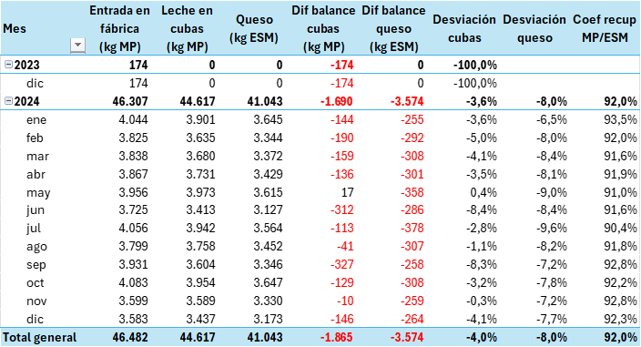

En el capítulo anterior sobre el balance de materia se proporcionó un enlace para descargar la hoja Excel con las tablas dinámicas del balance de materia, que se incluye de nuevo aquí; la tabla con el balance de proteína está en la pestaña **`BM TD MP`**

[Descargar hoja de cálculo Excel con el balance de materia y el coeficiente de recuperacion de proteína (archivo `03-fab_queso_sim.xlsx`)](https://raw.githubusercontent.com/juanriera/master-queseria/master/datos/03-fab_queso_sim.xlsx){target="_blank" rel="noopener noreferrer"}

::: {.callout-important .content-visible when-format="html"}
## ¡Atención!

Es muy recomendable dedicar un rato a analizar la construcción de la tabla y de los campos calculados utilizados.
:::

En la tabla podemos ver que las pérdidas de MP entre recepción y cubas son un -4%, mientras que las pérdidas de MP frente al ESM recuperado son un -8% (usamos signos negativos para indicar **pérdidas**). Esto nos permite calcular una recuperación en el queso de la MP en cubas de un 92%; sumando el -4% que tenemos en el balance líquido obtenemos un 88% de recuperación.

Utilizando el coeficiente de recuperación de la MP (ESM/MP), calculamos el resto de los valores necesarios para nuestro estándar técnico.

Como hemos fabricado $1.308.012\ L$ de leche (litros totales en cubas), la cantidad media de proteína en $g/L$ que tenemos en esa leche es de

$$
\frac{44.617\ \cancel{kg_{MP}\ en\ cubas}}{1.308.012\ L\ leche}\cdot 1000\frac{g}{\cancel{kg}} \approx 34,11\ g/L\ leche
$$

Teniendo en cuenta el coeficiente de recuperación de la MP (ESM/MP), podemos calcular la cantidad de ESM que obtendremos en el queso por cada litro de leche en cubas:

$$
\frac{34{,}11\ \cancel{g\ proteína}}{1\ L\ leche} \cdot \ \frac{0{,}92\ g\ ESM}{1\ \cancel{g\ proteína}} = 31{,}38\ g\ ESM\ en\ el\ queso\ por\ litro\ de\ leche
$$

Esta es la conversión clave de nuestra tecnología, y es conocida como ***coeficiente G*** en honor a su autor, Antoine M Guérault, que lo introdujo formalmente por primera vez por en su libro *La fromagerie devant les techniques nouvelles,* en 1966; desde entonces sigue utilizándose con plena validez. Originalmente, el coeficiente indica el porcentaje de ESM que hemos recuperado en el queso, dividiendo el ESM del queso entre el ESM de la leche puesta en fabricación, aunque es más habitual usar el coeficiente de recuperación de proteína en vez del de ESM, como hemos hecho arriba.

Como comentamos más atrás, para una tecnología concreta, normalmente la cantidad de sal incluida en el salado y las pérdidas de ESM en el proceso de fabricación deberían mantenerse en una horquilla más o menos estrecha, de acuerdo con la variabilidad de nuestro proceso y nuestra precisión analítica. Si el valor del coeficiente se mantiene en estos límites, nos indicará que la transformación se ha realizado dentro de los valores normales de la tecnología; en caso contrario, si hemos tenido valores anormalmente altos o bajos, será indicador de incidencias tecnológicas que intentaremos explicar para poner en marcha acciones correctivas.

Hemos definido nuestro queso con el 52% de EST y 27% de MG (porcentajes masa/masa), lo que supone un 25% de ESM.

Como sabemos la cantidad de ESM que vamos a obtener de 1 L de leche, podemos calcular los litros de leche que necesitamos para obtener 1 kg de queso con esta composición estándar, mediante una conversión simple. A este valor lo llamaremos *litraje unitario*.

$$
\text{Litraje unitario} =
\frac{25{,}00\, \cancel{g\, ESM}}{100\, \cancel{g\, queso}}
\cdot
\frac{1000\, \cancel{g\, queso}}{1\, kg\, queso}
\cdot
\frac{1\, L\, leche}{31{,}38\, \cancel{g\, ESM}}
=
7{,}967\text{ L leche para hacer 1 kg de queso}
$$

La composición media de la leche puesta en cubas, calculada antes, fue de 34,11 g/L. Podemos calcular ahora el consumo de MP por kilo de queso, que es el que resulta de calcular

$$
\frac{7{,}967\ \cancel{L\ leche}}{1\ kg\ queso} \cdot\frac{34{,}11\ g\ MP}{1\ \cancel{L\ leche}} = 271{,}75\ g\ MP\ en\ cubas\ por\ kilo\ de\ queso
$$

Es necesario insistir en que estos cálculos teóricos sólo son válidos en nuestras condiciones de trabajo precisas:

- con la composición en ESM de nuestro queso

- con la composición de proteína de nuestra leche

- con la tasa de recuperación de la proteína de la leche en el ESM del queso de nuestro específico proceso de fabricación.

Son valores teóricos que utilizamos como valor objetivo, y que pueden variar a medida que adaptemos o variemos nuestra tecnología. Para cualquier otro producto, otra composición de leche y/u otro proceso de fabricación, deberemos recalcular nuestro litraje por kilo y nuestro consumo de materia.

Sabemos que, en nuestras condiciones medias, que hemos aceptado como nuestro estándar, $7{,}967\ L$ de leche deben darnos $1\ kg$ de queso. Si obtenemos más o menos queso querrá decir que nuestras hipótesis de partida no se han cumplido, y analizando los tres elementos básicos, sabremos la razón de la desviación:

- Nuestra leche tiene una composición diferente

- Nuestro queso tiene una composición diferente

- Nuestra recuperación de proteína ha sido diferente.

Si disponemos de la analítica correspondiente, podremos tomar las decisiones correctas; no es lo mismo actuar ante un problema de composición de leche que ante un problema de composición de queso o un problema de tecnología quesera. Otros factores pueden influir directamente en el coeficiente de recuperación de proteína, por ejemplo, la cantidad de proteína coagulable (caseína) frente a la proteína total analizada puede variar a lo largo del año, y el análisis de proteína total no nos da una indicación de esta ratio. Más adelante construiremos un modelo para el análisis de estas desviaciones.

### La materia grasa

En nuestro análisis de rendimiento hemos calculado también un % de recuperación de MG. Sin embargo, no utilizaremos este % para calcular el litraje, lo haremos tal como hemos visto, con la transformación de la proteína en ESM. La razón es que *la tecnología quesera nos permite actuar sobre el ESM del queso, pero la MG depende principalmente de la estandarización*, como veremos a continuación.

Como el cálculo que hemos realizado con el coeficiente de recuperación de la MP (ESM/MP) nos da los litros de leche que necesitamos para hacer 1 kg de queso, y tenemos una composición de nuestra leche, podemos saber la cantidad de MG que vamos a tener en esos litros. Sabemos la MG que hemos obtenido realmente en nuestro queso, mediante los diferentes análisis de nuestro producto.

Hemos calculado nuestro litraje unitario: necesitamos 7,967 L leche para hacer 1 kg de queso.

Según nuestros datos, nuestra leche en cubas tiene $52.772,13 / 1.308.012 = 40,35\ g/L$ de MG, luego los $7,967\ L$ de leche teóricos tendrán

$$
7,967\cancel{\ L\ leche} \cdot \ \frac{40,35\ g\ MG}{1\cancel{\ L\ leche}} = 321,43\ g\ MG
$$

Es decir, para fabricar 1 kg de queso necesitamos 7,967 L leche, que según su composición tienen $321,43\ g\ MG$

Sin embargo, el estándar de nuestro queso nos dice que en 1 kg de queso tenemos un 27% de MG, es decir, 270 g MG por kilo de queso.

¿A qué se debe esta diferencia? La respuesta es: *a las pérdidas de MG en el proceso*, es decir, *a nuestro porcentaje de recuperación de MG.* Podemos calcular este porcentaje mediante la fracción

$$
\frac{MG\ teórica\ en\ el\ queso}{MG\ en\ la\ leche\ en\ cubas}\ =\ \frac{270{,}00\ g\ MG/kg\ en\ el\ queso}{321{,}43\ g\ MG/kg \ leche\ en \ cubas} \approx 0,8399 = 83{,}99\%
$$

Es decir, con nuestra tecnología, recuperamos un 83,99% de la materia grasa puesta en la cuba.

El mismo cálculo resulta utilizando la composición en g/L de la leche en cubas. La composición teórica en cubas debería ser la necesaria para permitirnos obtener la composición del 27% de MG con el litraje unitario que hemos calculado, es decir, los 7,967 L/kg:

$$
 \frac{27\ g\ MG}{100\ \cancel{g\ queso}} \cdot \frac{1000\ \cancel{g\ queso}}{1\ \cancel{kg\ queso}} \cdot \frac{1\ \cancel{kg\ queso}}{7,967\ L\ leche} = \frac{27 \cdot 1000}{7,967} \frac{g \ MG}{L \ leche} = 33{,}89\frac{g \ MG}{L \ leche}
$$

Nuestra leche en cubas debería tener teóricamente 33,89 g/L de MG para obtener la MG que hemos analizado en el queso. A esta MG en cuba, calculada a partir de la composición del queso, la llamaremos **materia grasa teórica en cuba**, ya que proviene de un cálculo y no de un análisis real.

Sin embargo, nuestros datos analíticos de la leche en cuba dicen que tenemos 40,35 g/L de MG, según el cálculo anterior. Comparando los dos valores, obtenemos el mismo valor de coeficiente de recuperación de MG:

$$
\frac{33,89}{40,35}=83{,}99\%
$$

Esta es la *recuperación estándar* que resulta de hacer los cálculos según nuestros datos de composición de leche, composición del queso y recuperación de proteína en el promedio de nuestra fabricación anual; cada fabricación individual real tendrá valores que podrán no coincidir con el valor estándar.

De la misma forma que en el caso de la recuperación de proteína, si nuestra recuperación de MG es diferente de la calculada teóricamente, debemos encontrar la explicación en los mismos factores:

- Composición real de la leche

- Composición real del queso

- Variaciones en la tecnología

Estas variaciones pueden implicar una mayor pérdida de MG, en el suero de quesería o en los finos de queso (o en ambos); una parte de estas pérdidas puede recuperarse mediante un desnatado del suero y la incorporación de la nata de suero obtenida a la leche en cubas.

## El estándar técnico de fabricación en la hoja de cálculo

El razonamiento y cálculos que hemos ido realizando, se suelen recoger en un documento o una hoja de cálculo, que recoge los valores estándar de nuestra tecnología dada una composición media de nuestro queso obtenido y una composición de leche de partida.

A continuación se proporciona un enlace para descargar una hoja Excel con un estándar de fabricación con los datos utilizados en el ejemplo.

[Descargar hoja de cálculo Excel con el estándar de fabricación (archivo `05-ejemplo-std-tecnico.xlsx`)](https://raw.githubusercontent.com/juanriera/master-queseria/master/datos/05-ejemplo-std-tecnico.xlsx){target="_blank" rel="noopener noreferrer"}

## La importancia de la estandarización de la leche

La tecnología quesera se diseña para optimizar el **coeficiente de recuperación de ESM/MP**, que llamaremos **rendimiento quesero**. Aunque la retención de materia grasa (MG) también depende de factores tecnológicos como el corte, el calentamiento y el pH, no está directamente controlada por la tecnología, aunque sí influenciada por ella.

En una tecnología concreta, con parámetros de trabajo fijados, cuando la cantidad de MG en la leche es superior a la definida en el proceso, se producen dos efectos:

- Una parte del exceso de MG queda retenida en la matriz proteica, lo que incrementa la cantidad de grasa en el queso y, por tanto, modifica su composición.

- Otra parte de la MG se pierde en el suero, ya que las condiciones del proceso determinan una relación fija con la cantidad total de MG de partida. Es decir, al aumentar la MG inicial, también aumentan las pérdidas relativas en el suero.

Desgraciadamente, no es posible calcular teóricamente cuánta MG se retendrá en el queso y cuánta se perderá en el suero, ya que estas cantidades no responden a una función conocida. Lo que sí sabemos es que:

- Aumentarán las pérdidas.

- Se modificará la composición del queso, lo que puede alterar su textura y el valor nutricional declarado.

- Se alterará la expulsión de suero de la matriz proteica, lo que afectará la cantidad de lactosa retenida en la cuajada y, en consecuencia, las curvas de acidificación, el extracto seco, etc.

Cuando la MG es *inferior* a la definida, estos efectos se producen en sentido inverso, afectando tanto la composición del queso como su comportamiento tecnológico.

Para minimizar estas variaciones y mantener una composición constante del producto, es necesario:

- Trabajar con leche que tenga un contenido estable de materia grasa (MG) y materia proteica (MP). Dado que la composición de la leche varía estacionalmente, esto implica estandarizarla en MG y MP, **manteniendo constante la relación MG/MP**.

- Adaptar la tecnología de forma estacional, ya que la variación estacional no solo afecta la relación MG/MP, sino también la proporción de caseína coagulable dentro del total de proteínas.

Es fundamental recordar lo señalado al definir el estándar técnico: *la tecnología permite modificar el extracto seco magro (ESM) del queso, pero la MG depende principalmente de la cantidad presente en la leche de fabricación*. **No es posible modificar la cantidad de grasa en el queso mediante la tecnología quesera en la cuba**; es necesario preparar la leche con la cantidad de grasa adecuada para cubrir tanto la retención esperada como las pérdidas previstas.

En la medida en que no se puedan realizar estas adaptaciones, se deberá aceptar una mayor variabilidad en el producto, con dos consecuencias:

- Irregularidad en el producto final, que afecta la aceptación por parte del consumidor.

- Variación en el coste del producto, que puede dar lugar a pérdidas económicas no previstas.

Por estas razones, es imprescindible realizar un seguimiento detallado de las desviaciones tecnológicas, para comprender mejor el comportamiento del proceso y actuar eficazmente sobre sus causas. Las desviaciones observadas deben analizarse siempre apoyándose en el conocimiento tecnológico, para que los planes correctivos sean eficaces.

Conociendo el coste de la MG y de la MP pagada, es posible calcular el valor económico de cada desviación, lo que permite priorizar las acciones correctivas según su impacto financiero. A continuación veremos el análisis de las desviaciones.

## El análisis de las desviaciones de rendimiento

Una vez construido nuestro estándar técnico de fabricación, vamos a usarlo de referencia para analizar las desviaciones producidas en una fabricación (haríamos le mismo razonamiento para un conjunto de ellas).

En este análisis vamos a tener en cuenta varias informaciones:

- El precio de la materia prima (coste de la MG y MP puesta en fábrica), calculada como hemos visto en el capìtulo anterior, con los valores de presupuesto y un período concreto para el que hacemos el análisis.
- EL estándar técnico que hemos preparado
- Los datos reales de las fabricaciones, que están registradas en el CSV **`fab_queso_sim.csv`**

El objetivo del análisis de las desviaciones de rendimiento es explicar esas desviaciones utilizando dos componentes principales: - La desviación del extracto seco total - La desviación de su composición (materia grasa y extracto seco magro)

Además, veremos una explicación adicional del desajuste que se produce al utilizar la proteína de la leche en cubas y el extracto seco magro del queso para explicar la recuperación de la proteína.

#### La desviación del extracto seco

El extracto seco de un queso se obtiene mediante la eliminación del suero, como sabemos. En esta eliminación intervienen diversos factores tecnológicos, como la acidificación, el corte del grano, la temperatura y el tiempo. La importancia relativa de estos factores varía según la tecnología utilizada y el producto que queramos obtener(@Mietton2014).

Las pérdidas de finos en el suero, o la degradación de la calidad de las caseínas por causas diversas (por ejemplo, proteolisis temprana en la leche producida por bacterias psicrotrofas) pueden ser también causas de la pérdida de extracto seco en el producto final. El balance de materia nos indicará si nuestras pérdidas en el suero han sido mayores de lo esperado, y el análisis de los parámetros tecnológicos, sobre todo en la cuba de fabricación, nos permitirá explicar si ha habido modificaciones que justifiquen un aumento o disminución del extracto seco final.

El efecto de aumentar el extracto seco es un mayor consumo de materia por kilo de queso, que afecta a todos los componentes del queso. La reducción del extracto seco, al contrario, implica un menor consumo de materia, ya que se sustituye por agua. En ambos casos, el producto obtenido se aparta del estándar objetivo, y este hecho suele tener un impacto negativo en el consumidor.

La evaluación de la respuesta del consumidor a la reducción del extracto seco en el producto es de suma importancia, ya que nos permitirá detectar el límite aceptable en el que nos debemos situar para maximizar la rentabilidad del producto, atendiendo también a los cambios de vida útil que se pueden derivar de una mayor actividad de agua en el producto (se puede verificar de forma indirecta mediante el valor de HQD)

Tanto los aumentos como las reducciones del extracto seco respecto al estándar tienen un impacto directo en el coste del producto, que nuestro análisis debe poner en evidencia.

#### Las variaciones en la composición del extracto seco

Dado que, como hemos visto repetidas veces, el valor de la materia grasa y el de la proteína no son iguales, cualquier variación en la proporción de materia grasa respecto al extracto seco magro del queso implica una diferencia de coste del producto.

Un aumento del extracto seco magro implica un aumento porcentual del coste por mayor consumo de proteína (suponiendo que no hay diferencias sustanciales en el porcentaje de sal), mientras que una reducción porcentual del extracto seco magro en el extracto seco total implica un aumento de la materia grasa, y por lo tanto una reducción del coste del producto.

Sin embargo estas variaciones de composición no son neutras para el producto:

- Un aumento porcentual de la materia grasa respecto al extracto seco magro implica un aumento de la HQD (humedad del queso desnatado o magro), lo que a su vez indica una mayor actividad del agua, y por lo tanto, un aumento de la proteolisis y una reducción de la vida útil del queso.

- Una disminución porcentual de la materia grasa respecto al extracto seco magro implica una reducción de la HQD, que se traduce en una percepción del producto por el consumidor como más seco, con una textura más firme.

En este caso, el interés del quesero será mantener la proporción de materia grasa más alta posible que permita tener

- una buena apreciación de la textura por el consumidor
- un comportamiento correcto del producto en el punto de venta y en el hogar del consumidor desde el punto de vista de su vida útil.

En nuestro caso, suponemos que el estándar de producto está ajustado a la optimización tanto del extracto seco total como de su composición, y por lo tanto, explicaremos las desviaciones y su coste como objetivos de mejora, que es necesario corregir tanto para ajustar el coste del producto como su calidad.

## Análisis de una fabricación

### Precio de la materia

Utilizaremos la tabla de precios que hemos construido en el capítulo dedicado al precio de la leche:

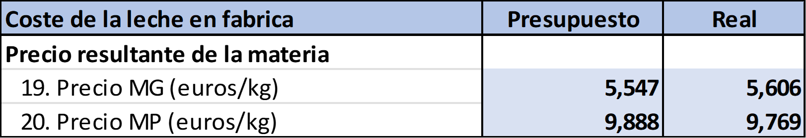

### Estándar técnico de producto

Vamos a utilizar el estándar técnico calculado en este capítulo, que tenemos disponible para descarga en el enlace que hemos proporcionado en el apartado anterior:

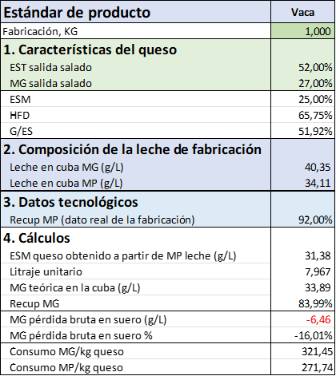

### Datos de fabricación real

Utilizaremos los datos correspondientes a la primera fabricación que tenemos en nuestro CSV, con fecha 01/01/2024. Por comodidad, reformateamos estos datos en una hoja de Excel, que después vincularemos con la hoja de cálculo de diferencias:

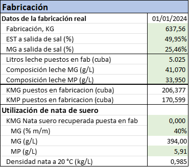

La tabla tiene un apartado para la posible inclusión de nata de suero recuperada. Dado que en nuestra fabricación no hemos reutilizado la nata de suero, ya que no desnatamos el suero, la cantidad está a cero.

### Análisis de las desviaciones

Nuestra hoja de análisis de desviaciones tiene dos columnas, una para los valores estándar y otra para los reales.

#### Análisis de los valores estándar

En los valores estándar, utilizamos los coeficientes del estándar de fabricación para estimar las cantidades de materia que deberíamos haber consumido en la fabricación de 637,56 kilos de queso si su composición se hubiese ajustado al estándar.

Las primeras líneas hacen los cálculos ordinarios de composición; a partir de los datos de extracto seco total y materia grasa, obtenemos el extracto seco magro (ESM), la humedad del queso desnatado o magro (HFD o HQD) y la grasa del extracto seco (G/ES), datos de importancia en la caracterización denuestro producto, que utilizremos para comparar conel producto real fabricado. A continuación, introducimos el valor del factor MG/MP del queso, que será de utilidad en el análisis (en el mundo anglosajón se suele utilizar la relación inversa, MP/MG).

A partir de estos datos, tenemos un bloque en el que calculamos los datos teóricos de la cuba de fabricación, si los parámetros fuesen los del estándar. Utilizamos la composición de la leche definida en el estándar, que es la composición media con la que hemos construido el coste de la materia prima que esperamos comprar, por lo tanto, el coste con el que hemos construido nuestro precio de venta. El cálculo nos proporciona el litraje unitario teórico, que hemos calculado en el capitulo anterior del estándar de fabricación. Calculamos también el factor MG/MP de la leche en cubas, que nos permite anticipar la pérdida prevista de materia grasa. Si el factor MG/MP en la leche era de 1,183 y en el queso resulta ser de 1,080, esto nos indica una pérdida relativa de grasa, que esperamos que sea la que estamos definiendo en este estándar.

Mediante los cálculos anteriores, obtenemos los coeficientes de recuperación de MG y MP (recordemos que la recuperación de la MP está medida mediante el valor del ESM del queso), y finalmente, nuestras pérdidas brutas de MG. Como no recuperamos MG del suero, el valor está a cero.

#### Análisis de los valores reales

En el caso de los valores reales, las fórmulas de cálculo son distintas, ya que hay cantidades que no son calculadas sino resultado de nuestra medida, y que hemos visto más arriba en la hoja que recoge los datos de fabricación.

Los datos que necesitamos para desglosar los detalles de la fabricación son los kilos de queso fabricados y su composición en EST y MG, y los litros de leche utilizados (leche en cubas), con su composición en EST y MG. No utilizamos los datos de leche comprada, por razones que ya hemos visto en el balance de materia, y que puede ser oportuno recordar: las pérdidas anteriores a la cuba de fabricación se deben a causas diferentes de la tecnología quesera, y nos interes separarlas para entender, buscar y explicar sus causas, aplicando planes de reducción de pérdidas adecuados. Introducir estas pérdidas en el análisis de rendimientos nos dificultaría entender estas pérdidas sólo por las modificaciones de la tecnología en cuba.

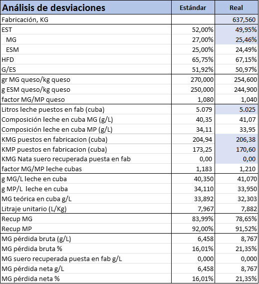

##### Primer análisis comparado de resultados

Si comparamos el factor MG/MP de la leche en cubas con el del queso, vemos que en cubas el factor MG/MP real es de 1,210 frente a 1,183 en nuestro estándar. Esto quiere decir que la leche utilizada ha sido más grasa de lo esperado. Sin embargo, el factor real en el queso es de 1,040 frente a 1,080 en el estándar, lo que nos indica ya una mayor pérdida de MG en el proceso.

La composición del queso es diferente del estándar: tenemos menos extracto seco y menos grasa; la proporción de MG en el EST menor, como vemos en el indicador G/ES (50,97% vs 51,92%), pero, debido al incremento de humedad, nuestro valor de HQD ha aumentado (67,15% vs 65,75%). Los quesos serán más blandos y su proteólisis será más rápida.

Debido a la composición de la leche, hemos puesto en cuba más MG por litro (41,070 g/L vs 40,350 g/L std) y menos proteína (33,950 g/L vs 34,110 g/L). Los litros de leche utilizados han sido menores que en el estándar, lo que es lógico teniendo en cuenta que nuestro queso tiene algo más de dos puntos porcentuales menos de extracto seco: hemos obtenido los kilos con menos litros porque hemos incorporado más agua al peso del queso. Por esta razón, el litraje unitario es más bajo (7,882 L vs 7,967 L)

Con estos datos, obtenemos los coeficientes clave del rendimiento: los porcentajes de recuperación. En ambos casos, nuestra recuperación ha sido peor que el estándar (MG: 78,65% vs 83,99%; MP: 91,52% vs 92%). La menor recuperación de la MG se comprueba por el porcentaje de pérdidas en el suero, que ha sido sensiblemente mayor (21,35% vs 16,01%)

#### Resumen del análisis inicial

En la fabricación analizada, hemos obtenido un queso con menor extracto seco que el estándar y una HFD más elevada. Aunque nuestro rendimiento en L/kg ha sido mejor que el estándar (hemos utilizado menos litros para obtener 1 kg de queso), en realidad nuestra recuperación de materia ha sido peor: hemos perdido tanto MG como MP.

A continuación vamos a analizar el coste que hemos tenido frente al coste estándar previsto en nuestro presupuesto.

### Análisis del coste de las desviaciones

#### Desviaciones por consumo y precio

Tal como hemos hecho en el cálculo del estándar, calculamos los consumos de materia puesta en cubas frente a los kilos de queso obtenidos, y lo expresamos en gramos de materia por kilo de queso. Al multiplicar este consumo por los kilos totales fabricados obtenemos las desviaciones de materia totales, que al coste de materia que hemos calculado, nos permite obtener el coste de las desviaciones.

Hacemos los cálculos en dos partes:

- Calculamos las diferencias de consumos a coste estándar, de manera que las diferencias de coste calculadas se deban sólo al consumo de materia, sin que nos influyan las diferencias de precio
- Calculamos el impacto del precio por separado, porque, de nuevo, estas diferencias están fuera de la responsabilidad de la tecnología quesera, y deben tratarse por otras vías.

No obstante, es necesario hacer ver que cuando por razones diversas, como la evolución del mercado de la leche, la meteorología o cualquier otra razón, se produce una diferencia de precio, siempre será necesario poner en marcha planes de contingencia con medidas tecnológicas que puedan compensar en lo posible estas diferencias, ya que la empresa no siempre tiene la capacidad de modificar de manera rápida y flexible ni las condiciones de compra de materia prima ni los precios de venta del queso. Aquí la tecnología puede ser de ayuda para equilibrar los resultados económicos de la empresa.

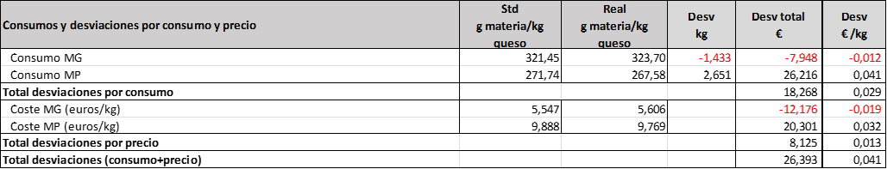

En el análisis global de desviaciones, vemos el reflejo de lo analizado antes para el total de la fabricación:

- un mayor consumo de MG frente al estándar, que se traduce en una desviación negativa de 7,948 euros
- un menor consumo de MP, que se traduce en una ganancia de 26,216 euros
- en total, una desviación positiva de 18,268 euros.

Respecto al precio,

- el incremento en la MG nos produce una desviación negativa de -12,176 euros,
- en la MP, una desviación positiva de 20,301 euros,
- en total, una desviación total positiva de 8,125 euros.

Con todos estos análisis, podemos hacer una primera valoración: el resultado económico total ha sido positivo, debido a una desviación favorable en el consumo de materia, y también en el coste de la materia. Las causas del resultado positivo han sido dos:

- la evolución favorable del precio de la proteína, y
- el extracto seco del producto que ha estado dos puntos por debajo del estándar (aunque esto tiene una lectura negativa en el aspecto de la calidad del producto)

Si descomponemos los costes de MG y MP en función de la cantidad de materia puesta en cuba, vemos estas diferencias: un mayor consumo de MG y un menor consumo de MP:

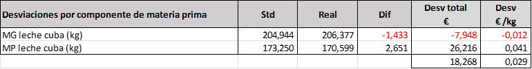

#### Detalle de las desviaciones por composición y rendimiento y cálculo de la interacción

Como hemos visto, en la fabricación de queso, las desviaciones de coste de producto debidas a la tecnología quesera (precio de materia aparte) ocurren fundamentalmente por dos causas:

- Nuestra recuperación de materia en el queso ha sido diferente de la prevista en el estándar (**efecto rendimiento**)

- El producto obtenido tiene una composición diferente del estándar en extracto seco total (**efecto EST o composición**). La composición de este EST importa, porque, dado que la MG y la MP tienen un valor diferente, un mismo EST con diferentes valores de MG y MP no tendrán el mismo impacto en el coste final.

El análisis de desviaciones se puede abordar con la pregunta clásica "qué pasaría si...". Las fórmulas utilizadas a continuación son equivalentes a las utilizadas en contabilidad de costes para calcular los efectos tasa, precio y mix.

Disponemos de dos datos básicos, nuestro estándar y nuestra situación real. En ambos casos, tenemos un valor de rendimiento (ESM/MP) y de EST. Para descomponer las causas de la variación, calcularemos dos datos adicionales:

- qué valor de rendimiento hubiésemos tenido si la composición hubiese sido la del estándar

- qué valor de composición hubiésemos tenido si el rendimiento hubiese sido el del estándar

Para calcular estos rendimientos, necesitamos calcular las cantidades de materia teóricas puestas en cuba en estos supuestos.

Para la MG, las fórmulas que utilizamos son:
$$
MGcuba_{compo\_std} = \frac{compo\_std_{MG}}{recup\_real_{MG}} * kg\_queso
$$
para la MG a composición estándar, y
$$
MGcuba_{recup\_std} =  \frac{compo\_real_{MG}}{recup\_std_{MG}} * kg\_queso 
$$
para la MG a recuperación (rendimiento) estándar. 

Aplicando las fórmulas, 

$$
MGcuba_{compo\_std} =  \frac{27,00\%}{78,65\%} * 637,560 = 218,860\ \text{kg MG en cuba a composicion std}
$$
y
$$ 
MGcuba_{recup\_std} = \frac{25,46\%}{83,99\%} * 637,560 = 193,255\text{kg MG en cuba a recup std} 
$$

Con estos cálculos, podemos construir una tabla de dos entradas,

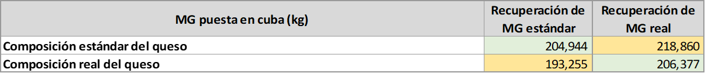

Esta tabla nos permite calcular el efecto de cada factor por separado:

- el efecto de la recuperación (rendimiento) ha sido de 204,944 - 218,860 = -13,916 kg

- el efecto de la composición ha sido de 204,944 - 193,255 = 11,689 kg

La desviación total en MG, como hemos visto arriba, es de -1,433 kg (pérdida). Ahora sabemos que este resultado está escondiendo que nuestro rendimiento ha sido bastante peor, ya que hemos perdido -13,916 kg de MG. Esta pérdida se ha visto compensada al hacer el queso más blando, ya que hemos ganado 11,689 kg por haber tenido menor EST.

Nos queda por calcular una última cantidad, que es la que se conoce como *interacción* entre la composición y el rendimiento. Para entender este concepto, tenemos que darnos cuenta de que en el análisis del rendimiento, hemos calculado la diferencia de rendimiento a composición estándar. Sin embargo esta no ha sido la realidad, ya que hemos tenido un extracto seco algo más bajo del estándar. En consecuencia, hay una pequeña parte de la pérdida de rendimiento calculada que no ha tenido lugar. Para obtener esta cantidad real, calculamos la diferencia de rendimiento a composición real, y obtenemos la interacción por diferencia:

- efecto rendimiento real a composición real: 193,255 - 206,377 = -13,122 kg

La diferencia entre esta cantidad y el efecto rendimiento a composición estándar nos da la interacción buscada:

-13,122 - (-13,916) = +0,794

Esta cantidad se corresponde, como decíamos más arriba, con la pequeña parte de pérdida de rendimiento que realmente no ha tenido lugar, ya que el extracto seco que hemos obtenido ha sido menor que el estándar. Por esta razón es una desviación positiva.

Si colocamos todos estos valores en una sola tabla, tenemos a la vista todos los factores de desviación en el componente analizado, con su valor a precio estándar.

\
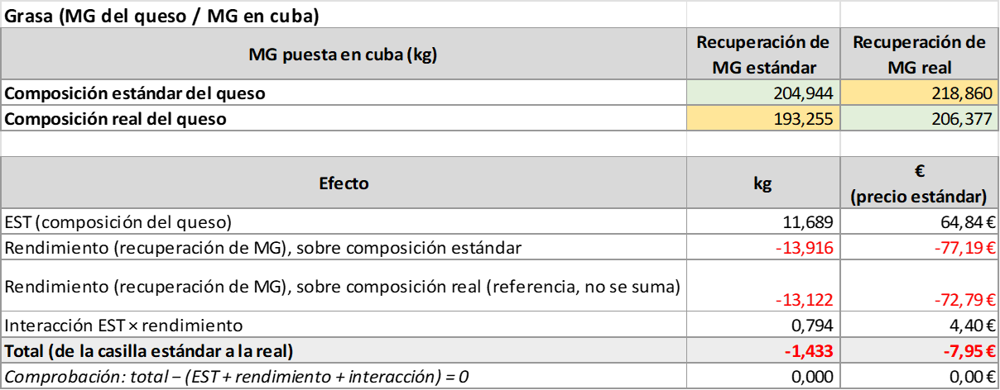

En la última línea incluimos un término de comprobación: la desviación total menos la suma de los componentes calculados debe ser cero.

Procedemos de la misma forma para el cálculo de las desviaciones e interacción de la MP:

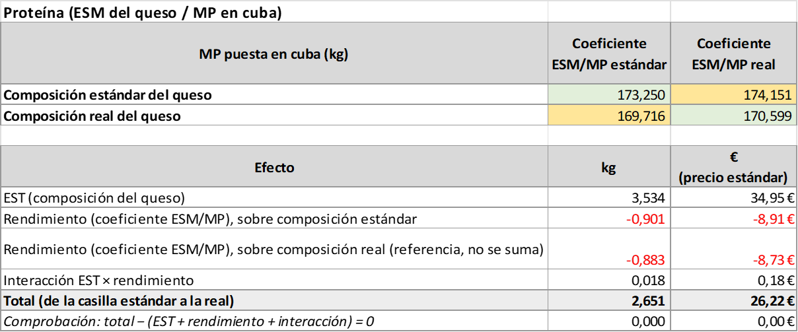

La suma de las desviaciones (MG+MP) nos permite calcular la desviación total:

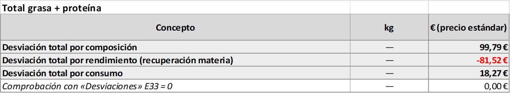

El análisis detallado nos ha permitido verificar cómo los efectos del bajo extracto seco del producto fabricado producen un resultado positivo (+99,79 euros). mientras que los efectos tecnológicos (recuperación de materia), incluyendo la interacción composición-rendimiento, han sido negativos (-81,52 euros). El resultado total, de 18,27 euros positivos podría hacernos pensar que hemos tenido un buen resultado, mejor que lo presupuestado, pero el análisis detallado de las desviaciones nos permite mayor detalle en la interpretación:

- Hemos tenido una fuerte desviación negativa en el rendimiento, que deberemos corregir. Si las pérdidas debidas a la tecnología han sido de -81,52 euros en una fabricación, y hemos previsto unas 260 fabricaciones anuales, la falta de corrección de nuestra tecnología nos puede llevar a unas pérdidas anuales de algo más de 20.000 euros.

- Hemos compensado este error en la conducción de la tecnología bajando el extracto seco. Esto no es una buena decisión, ya que la modificación de la composición puede tener un impacto desfavorable en el consumidor, y en consecuencia, un efecto negativo a largo plazo sobre la aceptación de nuestro producto.

En el enlace a continuación se puede descargar una hoja Excel con el detalle de cada tabla presentada en este documento, y repasar la construcción de la fórmulas utilizadas.

[Descargar la hoja de cálculo Excel con el análisis de desviaciones de rendimientos de ejemplo (archivo `06-analisis-desviaciones-rendimientos_2x2.xlsx`)](https://raw.githubusercontent.com/juanriera/master-queseria/master/datos/06-analisis-desviaciones-rendimientos_2x2.xlsx){target="_blank" rel="noopener noreferrer"}

## Resumen del capítulo

El análisis de rendimientos queseros es la herramienta más potente para identificar y cuantificar las ineficiencias del proceso de transformación. A diferencia del balance de materia, que nos dice cuánta materia se pierde en global, el análisis de rendimientos nos permite desglosar las causas de las desviaciones y asignarles un coste económico concreto.

El **estándar técnico de fabricación** es el punto de referencia fundamental: define qué rendimiento debería obtener el proceso con la leche disponible, calculado a partir de los valores medios anuales, o mensuales, en caso de disponer de un estándar mensual. La diferencia entre el rendimiento estándar y el rendimiento real se descompone en tres efectos independientes: el efecto del extracto seco del queso (¿hemos obtenido el grado de concentración previsto?), el efecto de la recuperación de materia prima (¿hemos retenido en el queso la proporción de grasa y proteína esperada?) y el efecto del precio de la leche (¿hemos pagado por la materia prima lo que teníamos previsto en el presupuesto, y su composición real se ajusta a lo presupuestado?).

Esta descomposición es esencial para priorizar las acciones de mejora: un problema de recuperación de materia apunta a causas tecnológicas (temperatura de cuajado, tiempo de desuerado, manejo de la cuajada, curva de acidificación), mientras que un problema de extracto seco pede apuntar además a causas de proceso adicionales (tiempo de prensado, salado, condiciones de maduración).

La estandarización de la leche antes de la fabricación reduce la variabilidad del rendimiento al eliminar el efecto de las fluctuaciones estacionales de la composición. Es una inversión con retorno directo y cuantificable: a mayor variabilidad del rendimiento, mayor dificultad para detectar problemas tecnológicos reales entre el ruido de las variaciones de materia prima.

Como hemos visto en el ejemplo de análisis, incluso una sola fabricación con desviaciones tecnológicas moderadas puede representar un coste de decenas de euros; extrapolado a cientos de fabricaciones anuales, el impacto económico justifica ampliamente el esfuerzo de análisis sistemático.
